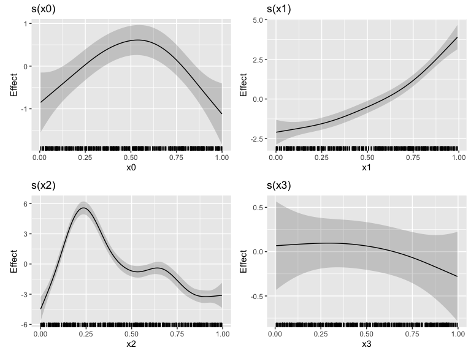
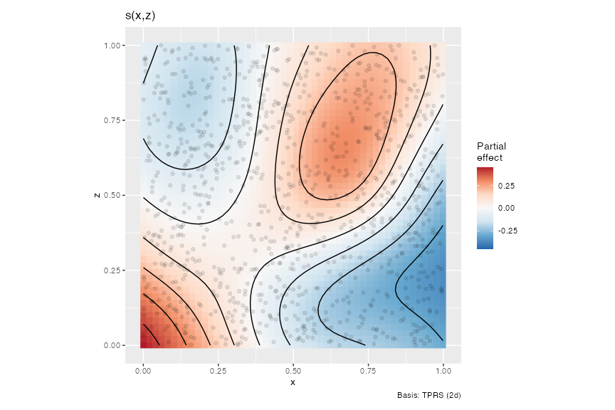
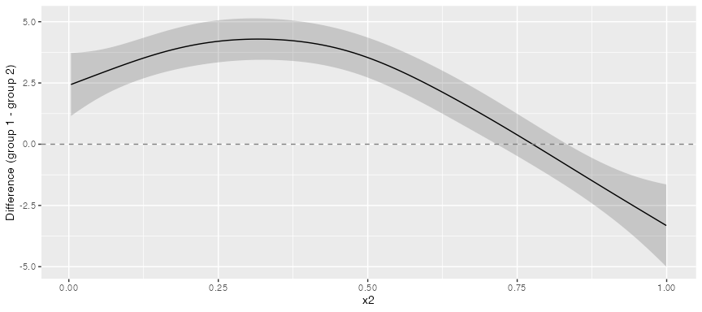
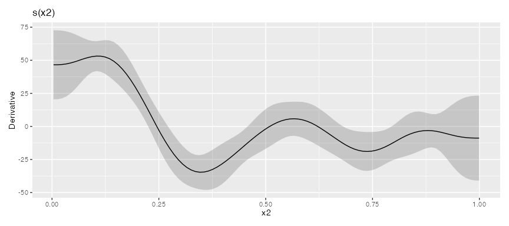
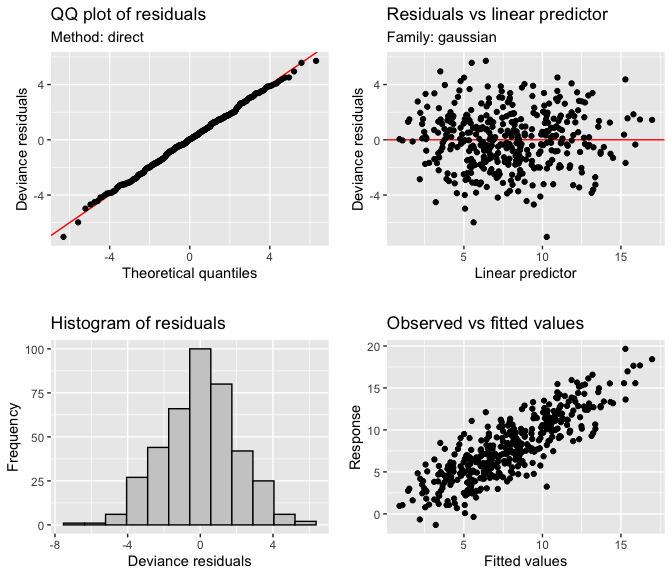
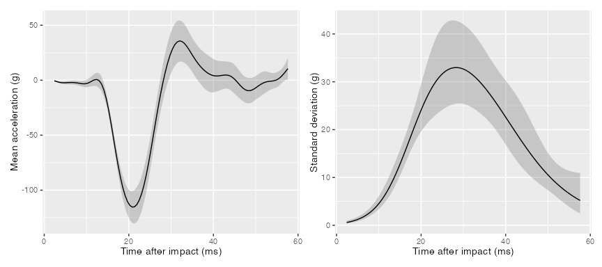
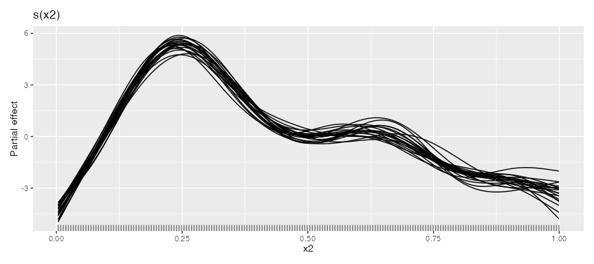

<!-- README.md is generated from README.Rmd. Please edit that file -->

# gratia 

<!-- badges: start -->

[](https://github.com/gavinsimpson/gratia/actions)
[](https://app.codecov.io/gh/gavinsimpson/gratia)
[](https://cran.r-project.org/package=gratia)
[](https://cran.r-project.org/package=gratia)
[](https://doi.org/10.21105/joss.06962)
[](https://gavinsimpson.r-universe.dev/gratia)
[](https://gavinsimpson.r-universe.dev/gratia)
<!-- badges: end -->

## Overview

Working with GAMs and models containing penalised spline terms within
the ‘tidyverse’ can be tedious and even difficult without a good
understanding of these models themselves and how the model is returned
by *mgcv* or other packages, and what the model objects contain.
*gratia* is designed to help with this.

*gratia* provides *ggplot*-based graphics and utility functions for
working with generalized additive models (GAMs) fitted using the *mgcv*
package, via a reimplementation of the `plot()` method for GAMs that
*mgcv* provides, as well as *tidyverse* compatible representations of
estimated smooths. Additionally, *gratia* supports several related
packages that allow *mgcv*’s smooths to be included in their models:

- *GJRM*,
- *glmmTMB*,
- *gamm4*,
- *scam*,
- *sdmTMB*

## Citation

If you use *gratia* in your work, please cite the package using:

Simpson, G. L., (2024). gratia: An R package for exploring generalized
additive models. *Journal of Open Source Software*, **9**(104), 6962,
<https://doi.org/10.21105/joss.06962>

## Features

- **Visualise model effects.** Plot smooths, parametric effects and
  interactions with `draw()`, including surfaces and effects that vary
  between groups. Customise individual plots or complete figures using
  native ggplot2 themes. For example, draw the smooths and partial
  residuals from a GAM:

  <figure>
  
  <figcaption aria-hidden="true">Estimated smooths and partial residuals
  from a GAM</figcaption>
  </figure>

  Or plot a smooth surface:

  <figure>
  
  <figcaption aria-hidden="true">Estimated smooth surface from a
  GAM</figcaption>
  </figure>

- **Understand how effects and predictions change.** Estimate
  derivatives, compare smooths, contrast fitted responses between
  groups, and calculate accumulated local effects. Work with transformed
  covariates while displaying effects on their original scales. Here,
  `conditional_differences()` compares fitted responses for two groups
  across a covariate:

  <figure>
  
  <figcaption aria-hidden="true">Difference in fitted responses between
  two groups</figcaption>
  </figure>

- **Quantify uncertainty across smooths.** Calculate pointwise and
  simultaneous intervals for smooths, derivatives, differences and
  predictions. For example, estimate how quickly a smooth changes with
  `derivatives()` and draw its derivative with a 95% simultaneous
  interval:

  <figure>
  
  <figcaption aria-hidden="true">Derivative of a smooth with a
  simultaneous interval</figcaption>
  </figure>

- **Check models with diagnostics suited to their response
  distributions.** Use `appraise()` for an overview of model fit, or
  draw individual diagnostic plots. Check a wide range of response
  distributions, including categorical and censored responses, using
  appropriate residuals and posterior predictive checks. Plots designed
  for large datasets keep diagnostic displays readable while using all
  observations.

  <figure>
  
  <figcaption aria-hidden="true">Residual diagnostics for a
  GAM</figcaption>
  </figure>

- **Explore the fitted response distribution.** Estimate and plot
  response means, variances and other distribution summaries, with
  uncertainty. These tools also work with models where several
  distribution parameters depend on covariates. Here,
  `conditional_moments()` shows how mean acceleration and its standard
  deviation vary with time in the motorcycle impact data:

  <figure>
  
  <figcaption aria-hidden="true">Estimated mean and standard deviation of
  acceleration over time</figcaption>
  </figure>

- **Simulate from fitted models.** Generate coefficient, smooth,
  derivative, fitted-response and predictive draws from approximate
  posterior distributions. Multiple chains, sampling diagnostics, and
  integration with
  [posterior](https://CRAN.R-project.org/package=posterior),
  [coda](https://CRAN.R-project.org/package=coda) and
  [bayesplot](https://CRAN.R-project.org/package=bayesplot) support more
  extensive posterior exploration. For example, `smooth_samples()`
  generates possible smooth curves:

  <figure>
  
  <figcaption aria-hidden="true">Twenty draws of a smooth from its
  approximate posterior distribution</figcaption>
  </figure>

- **Use familiar tools across more model classes.** Explore
  shape-constrained models from
  [scam](https://CRAN.R-project.org/package=scam) and `mgcv::scasm()`,
  as well as models from
  [GJRM](https://CRAN.R-project.org/package=GJRM),
  [gamm4](https://CRAN.R-project.org/package=gamm4),
  [glmmTMB](https://CRAN.R-project.org/package=glmmTMB) and
  [sdmTMB](https://CRAN.R-project.org/package=sdmTMB). See the articles
  on
  [SCAM](https://gavinsimpson.github.io/gratia/articles/scam-support.html),
  [glmmTMB](https://gavinsimpson.github.io/gratia/articles/glmmTMB-support.html)
  and
  [sdmTMB](https://gavinsimpson.github.io/gratia/articles/sdmTMB-support.html)
  for the operations supported by these model classes.

## Installing *gratia*

*gratia* is now available on CRAN, and can be installed with

``` r
install.packages("gratia")
```

however *gratia* is under active development and you may wish to install
the development version from github. The easiest way to do this is via
the binary packages of the development version that are provided by
rOpenSci’s R Universe service:

``` r
# Install gratia in R
install.packages(
  "gratia",
  repos = c(
    "https://gavinsimpson.r-universe.dev",
    "https://cloud.r-project.org"
  )
)
```

Alternatively, install from source using the `install_github()` function
from package *remotes*. Make sure you have *remotes* installed, then run

``` r
remotes::install_github("gavinsimpson/gratia")
```

to install the package.

## History

*gratia* grew out of an earlier package, *schoenberg*, itself a
development of the earlier package *tsgam*, which was originally
intended to be used with GAMs fitted to time series. As I was developing
*tsgam* however it became clear that the package could be used more
generally and that the name “tsgam” was no longer appropriate. To avoid
breaking blog posts I had written using *tsgam* I decided to copy the
git repo and all the history to a new repo for the package under the
name *schoenberg*. At a later date someone released another package
called *schoenberg* to CRAN, so that scuppered that idea. Now I’m
calling the package *gratia*. Hopefully I won’t have to change it again…

## Why *gratia*?

In naming his *greta* package, Nick Golding observed the recent
phenomena of naming statistical modelling software, such as Stan or
Edward, after individuals that played a prominent role in the
development of the field. This lead Nick to name his Tensor Flow-based
package *greta* after *Grete Hermann*.

In the same spirit, *gratia* is named in recognition of the
contributions of [Grace
Wahba](https://en.wikipedia.org/wiki/Grace_Wahba), who did pioneering
work on the penalised spline models that are at the foundation of the
way GAMs are estimated in *mgcv*. I wanted to name the package *grace*,
to explicitly recognise Grace’s contributions, but unfortunately there
was already a package named *Grace* on CRAN. So I looked elsewhere for
inspiration.

The English word “grace” derives from the Latin *gratia*, meaning
“favour, charm, thanks” ([according to Merriam
Webster](https://www.merriam-webster.com/dictionary/grace)).

The chair that Grace Wahba currently holds is named after [Isaac J
Schoenberg](https://en.wikipedia.org/wiki/Isaac_Jacob_Schoenberg), a
former University Madison-Wisconsin Professor of Mathematics, who in a
1946 paper provided the first mathematical reference to “splines”.
(Hence the previous name for the package.)
