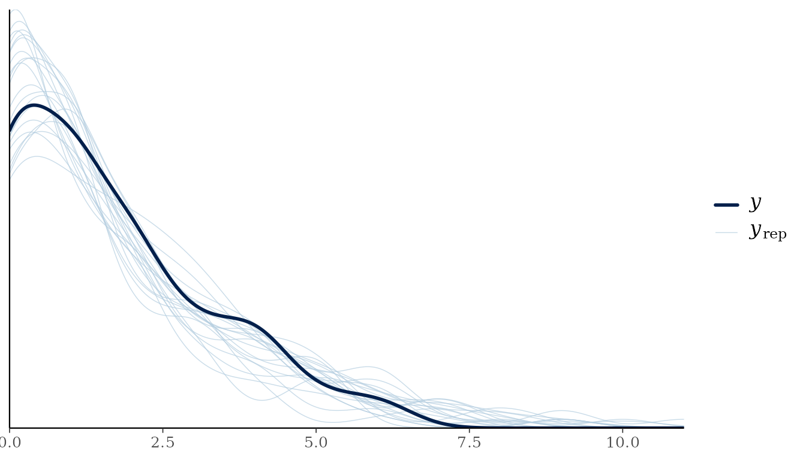
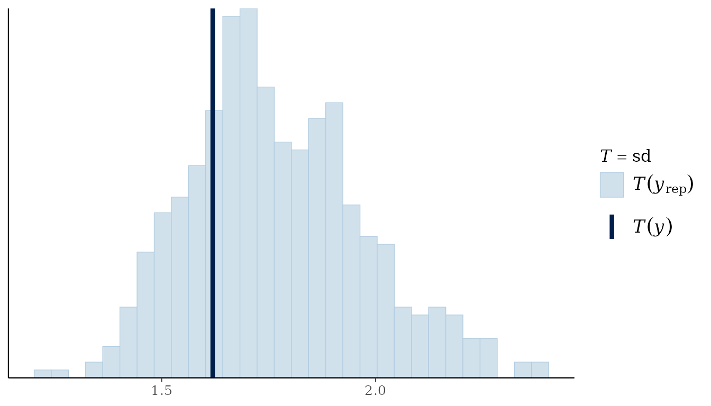
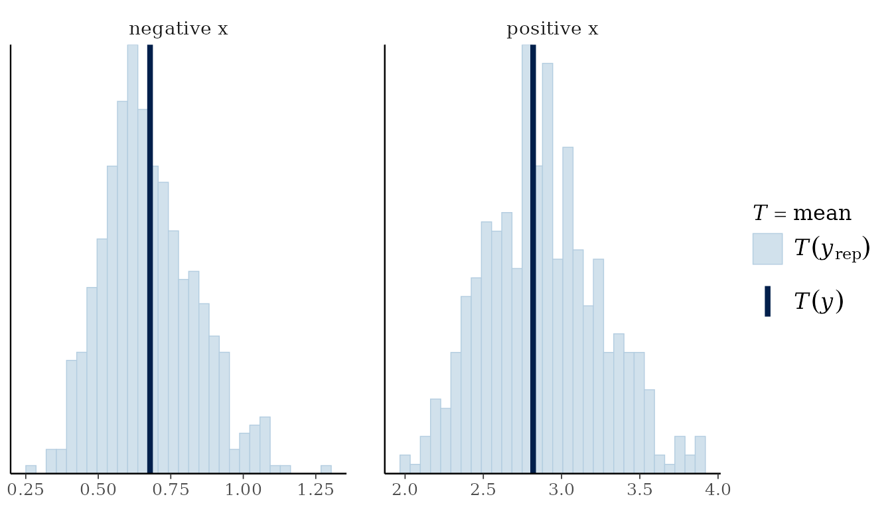
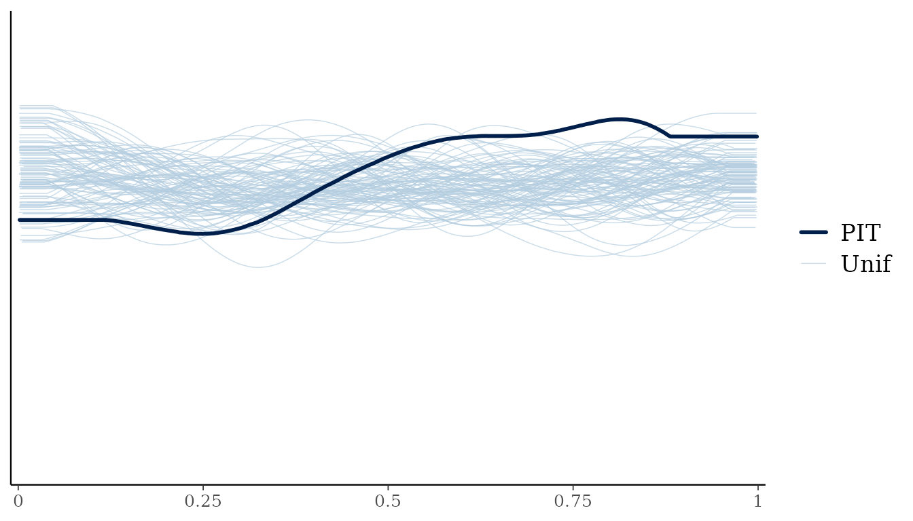

# Posterior predictive checks and approximate leave-one-out comparisons

Gratia can prepare posterior predictive checks for bayesplot and
observation log likelihoods for loo. Both packages are optional: install
them to use their methods.
[`log_lik()`](https://gavinsimpson.github.io/gratia/reference/log_lik.md)
itself needs neither package. The existing
[`appraise()`](https://gavinsimpson.github.io/gratia/reference/appraise.md)
and
[`posterior_predictive_plot()`](https://gavinsimpson.github.io/gratia/reference/posterior_predictive_plot.md)
functions also work without them.

Some bayesplot plots, including `error_binned` and the LOO-PIT plots,
also require bayesplot’s optional rstantools package; install it with
`install.packages("rstantools")` to use those plots.

``` r

library("gratia")
load_mgcv()
set.seed(278)
dat <- data.frame(x = runif(100, -1, 1))
dat$y <- rpois(nrow(dat), exp(.3 + sin(3 * dat$x)))
linear <- gam(y ~ x, data = dat, family = poisson(), method = "REML")
smooth <- gam(y ~ s(x, k = 7), data = dat, family = poisson(), method = "REML")
```

## Check replicated responses

For each coefficient draw, a posterior predictive check generates
another response at every fitting observation. The variation between
these replicated data sets includes coefficient uncertainty and response
variation.

``` r

bayesplot::pp_check(smooth, type = "dens_overlay", n_draws = 20, seed = 42)
```



``` r

bayesplot::pp_check(smooth, type = "stat", stat = "sd", n_draws = 500, seed = 42)
#> `stat_bin()` using `bins = 30`. Pick better value `binwidth`.
```



The first plot compares the observed response distribution with
replicated distributions. The second checks whether their standard
deviations cover the observed standard deviation. Other bayesplot
statistics can be supplied through `stat`, including a function such as
`function(y) mean(y == 0)` for the proportion of zeroes. To display
predictions alone, use `prefix = "ppd"`.

Grouped plots accept a fitting-frame variable name or a vector in
fitting-row order. A vector is useful when the grouping variable was not
used in the model.

``` r

bayesplot::pp_check(smooth, type = "stat_grouped", stat = "mean", n_draws = 500,
  group = factor(dat$x > 0, labels = c("negative x", "positive x")), seed = 42)
#> Note: in most cases the default test statistic 'mean' is too weak to detect anything of interest.
#> `stat_bin()` using `bins = 30`. Pick better value `binwidth`.
```



Missing fitting rows are omitted consistently from responses and
covariates. Binomial checks use success counts and fitted trial counts;
gratia’s own posterior predictive plots use proportions. Multivariate
and grouped-family models require `response`, for example `"response1"`
or `"component2"`. These selections keep distinct responses and
observation families from being pooled. For gamm/gamm4 fits,
`conditioning` retains its existing gratia meaning.

## Evaluate observed-response log likelihoods

[`log_lik()`](https://gavinsimpson.github.io/gratia/reference/log_lik.md)
holds each response at its observed value and evaluates its log density
or log probability mass at each coefficient draw. Rows are posterior
draws and columns are retained fitting observations. For example, a
Poisson entry is `dpois(y[i], lambda = mu[s, i], log = TRUE)`.

``` r

ll <- gratia::log_lik(smooth, n_draws = 2000, seed = 42)
dim(ll)
#> [1] 2000  100
head(attr(ll, "observation"))
#> [1] 1 2 3 4 5 6
attr(ll, "gratia")
#> $method
#> [1] "gaussian"
#> 
#> $n_draws
#> [1] 2000
#> 
#> $chains
#> [1] 1
#> 
#> $approximation
#> [1] "Gaussian coefficient posterior approximation"
#> 
#> $fixed_parameters
#> [1] "Smoothing parameters and family parameters outside the coefficient vector remain at fitted values."
#> 
#> $unconditional
#> [1] FALSE
#> 
#> $posterior_correction
#> [1] FALSE
```

These values include the fitting likelihood’s normalising constants and
weights, but exclude smoothing penalties. They differ from the single
fitted log likelihood returned by `stats::logLik(smooth)`, whose
existing behaviour is unchanged. A multivariate-normal observation
contributes a joint density for its complete response vector.
Grouped-family rows use their respective family.

## Compare predictive performance with loo

Loo uses importance weights to approximate the predictions obtained by
leaving one observation out. Its `elpd_loo` estimate summarises expected
log predictive density: larger values indicate better predictions on the
same response scale and the same observations.

``` r

loo_linear <- loo::loo(linear, n_draws = 2000, seed = 42)
loo_smooth <- loo::loo(smooth, n_draws = 2000, seed = 42)
loo::loo_compare(loo_linear, loo_smooth)
#>   model elpd_diff se_diff p_worse diag_diff diag_elpd
#>  model2       0.0     0.0      NA                    
#>  model1     -14.0     4.2    1.00
loo::pareto_k_table(loo_smooth)
#> 
#> All Pareto k estimates are good (k < 0.7).
```

The methods return ordinary loo objects, so loo’s plotting,
model-comparison and weighting tools are available. For an already
extracted matrix of independent Gaussian coefficient draws, the
equivalent calculation is `loo::loo(ll, r_eff = 1)`.
`loo::waic(smooth, n_draws = 2000, seed = 42)` also works. Model methods
evaluate likelihoods one observation at a time, avoiding a full
draws-by-observations matrix unless saved PSIS weights are requested.

Large Pareto-k values identify observations whose omission is difficult
to approximate by reweighting the existing draws. Inspect these
observations and loo’s warnings before relying on a comparison. Use
explicit refits or a separate cross-validation analysis when reweighting
is unreliable; these methods do not automatically refit models or
perform moment matching.

LOO predictive plots use response simulations and importance weights
from the same coefficient draws:

``` r

bayesplot::pp_check(smooth, type = "loo_pit_overlay", n_draws = 2000, seed = 42)
#> NOTE: The kernel density estimate assumes continuous observations and is not
#> optimal for discrete observations.
```



## Understand the posterior approximation

By default, gratia draws coefficients jointly from mgcv’s Gaussian
approximation. For a distributional GAM, this includes coefficients for
each distribution parameter. For multivariate-normal likelihoods, it
also includes the fitted precision-matrix coefficients. Scale, shape and
other parameters outside the coefficient vector stay at fitted values,
as do smoothing parameters.

This is a conditional approximation, rather than a procedure that
re-estimates every parameter for every omitted observation.
`unconditional = TRUE` can use mgcv’s corrected coefficient covariance
when available, but it does not draw those other parameters jointly.
PSIS calculations do not correct the Gaussian approximation, and small
Pareto-k values do not establish its accuracy.

``` r

# Extra sampler arguments are kept separate from loo and plotting arguments.
loo::loo(smooth, n_draws = 2000, seed = 42,
  sampling_args = list(unconditional = TRUE))
bayesplot::pp_check(smooth, n_draws = 50, seed = 42,
  sampling_args = list(unconditional = TRUE))

# Four chains share the total retained count, with separate burn-in.
loo::loo(smooth, n_draws = 2000, seed = 42,
  sampling_args = list(method = "mh", chains = 4, burnin = 1000))
```

For supplied coefficient draws, use `method = "user", draws = B` in
[`log_lik()`](https://gavinsimpson.github.io/gratia/reference/log_lik.md),
or place those arguments in `sampling_args` for loo and bayesplot. LOO
uses the chain and iteration mapping stored by gratia’s samplers. For an
unlabelled matrix, supply `chain_id` or an explicit `r_eff`; gratia
cannot infer chain boundaries from its dimensions. A supplied `chain_id`
must agree with stored metadata. Bootstrap coefficient samples do not
become posterior draws by passing them to this interface.

`n_draws` is the total retained count, so 2,000 draws over four chains
retains 500 draws per chain. Likelihood and LOO/WAIC wrappers default to
4,000 draws; bayesplot uses 50 for ordinary checks and 4,000 for
leave-one-out plots. Supplied matrices determine their own count and
chains. These wrappers reject the obsolete `n` argument, and inactive
sampler controls produce errors. Use `diagnostics = TRUE` directly in
[`log_lik()`](https://gavinsimpson.github.io/gratia/reference/log_lik.md),
or in `sampling_args` for LOO and bayesplot, to retain coefficient
diagnostics. The likelihood matrix also supports
[`as_mcmc_draws()`](https://gavinsimpson.github.io/gratia/reference/as_mcmc_draws.md)
for diagnostics of its observation-wise log densities.

Likelihood and LOO methods initially cover independent GAM/BAM
responses. They exclude residual-correlated BAMs, full gamm/gamm4 fits,
quasi families, Cox partial likelihoods and censored observation
processes. Supported ordinary posterior predictive checks retain their
existing model coverage. With random-effect smooths, observation-level
LOO predicts further observations in the fitted groups; it does not
leave out entire groups.

The reproducible script `inst/validation/loo-refits.R` compares
representative Gaussian, Poisson and binomial PSIS results with explicit
leave-one-out refits. It distinguishes refits that hold smoothing and
nuisance parameters fixed from refits that re-estimate them.
