# Customising gratia plots

## Apply a theme to every panel

{gratia}’s
[`draw()`](https://gavinsimpson.github.io/gratia/reference/draw.md)
combines the individual plots for model terms into one figure using
{patchwork}. The `&` operator applies a {ggplot2} theme to every panel,
so you can style them together.

Load the plotting packages and simulate 400 observations. The covariates
are independent and range from zero to one. Three have nonlinear effects
on the mean response; `x3` has no true effect. Independent Gaussian
noise adds variation with standard deviation 2.

``` r

library("gratia")
load_mgcv()
library("ggplot2")
library("dplyr")
#> 
#> Attaching package: 'dplyr'
#> The following objects are masked from 'package:stats':
#> 
#>     filter, lag
#> The following objects are masked from 'package:base':
#> 
#>     intersect, setdiff, setequal, union
library("patchwork")

# simulate data
n <- 400
eg1 <- data_sim("eg1", n = n, seed = 1)
```

Fit a Gaussian GAM with one smooth for each covariate. REML selects the
smoothness; we will reuse this fitted model throughout the plotting
examples.

``` r

# fit model
m <- gam(y ~ s(x0) + s(x1) + s(x2) + s(x3),
  data = eg1, method = "REML")
```

Save the default figure as `p` so we can apply different styles to the
same fitted smooths.

``` r

p <- draw(m)
p
```

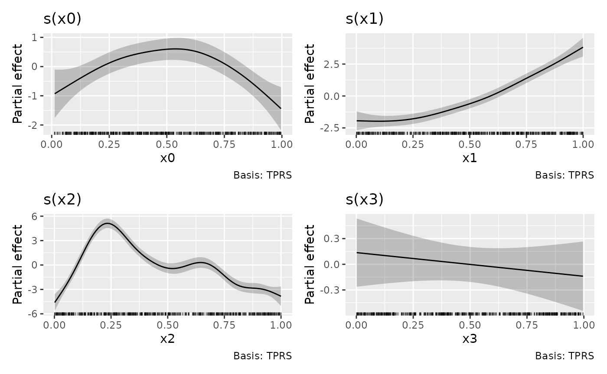

Adding a theme with `+` changes only the last panel in this combined
figure. The following example makes that behaviour visible: only the
final smooth receives the white background from
[`theme_bw()`](https://ggplot2.tidyverse.org/reference/ggtheme.html).

``` r

p + theme_bw()
```

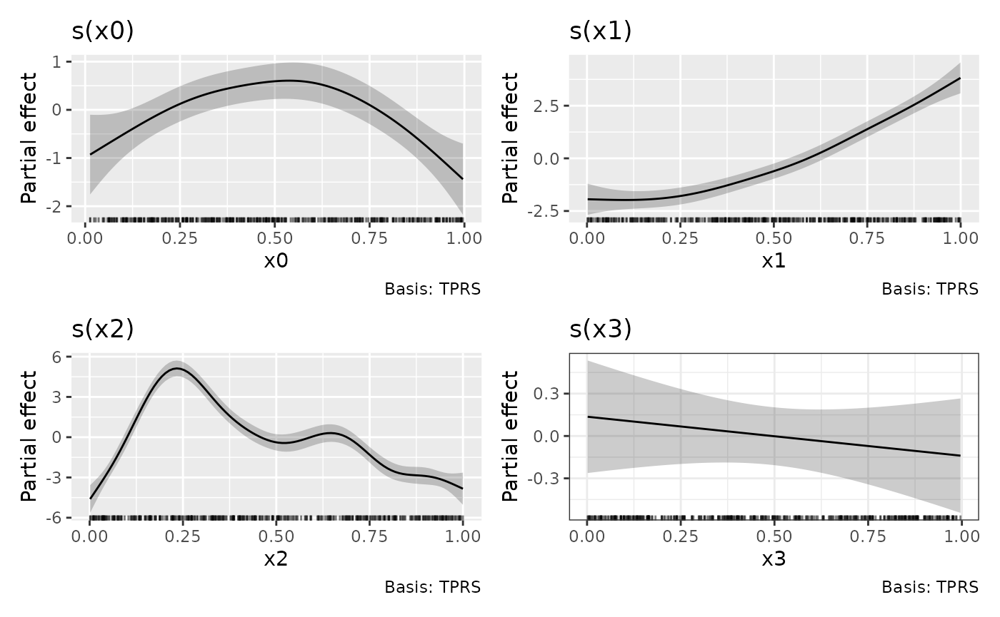

Use `&` to apply the same theme to all four panels.

``` r

p & theme_bw()
```

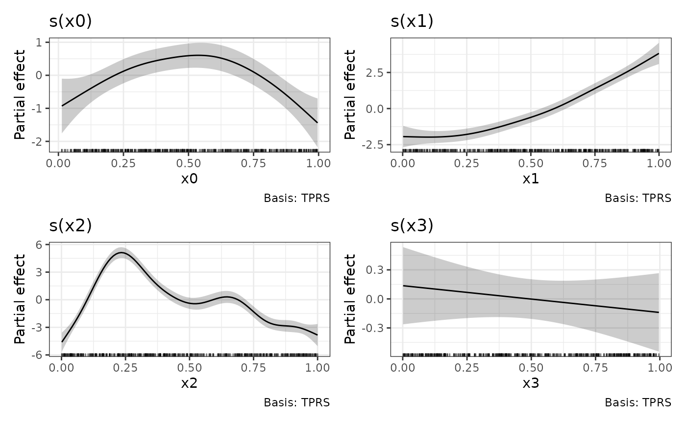

## Change curve colours, intervals and other plot components

gratia has theme settings for smooth curves, interval ribbons, residual
points and reference lines. Here we make every smooth navy, give it a
thicker line and use a pale navy interval ribbon.

``` r

p & theme(
  geom.gratia.smooth = element_geom(colour = "navy", linewidth = 0.8),
  geom.gratia.interval = element_geom(fill = "navy"),
  gratia.alpha.interval = 0.15
)
```

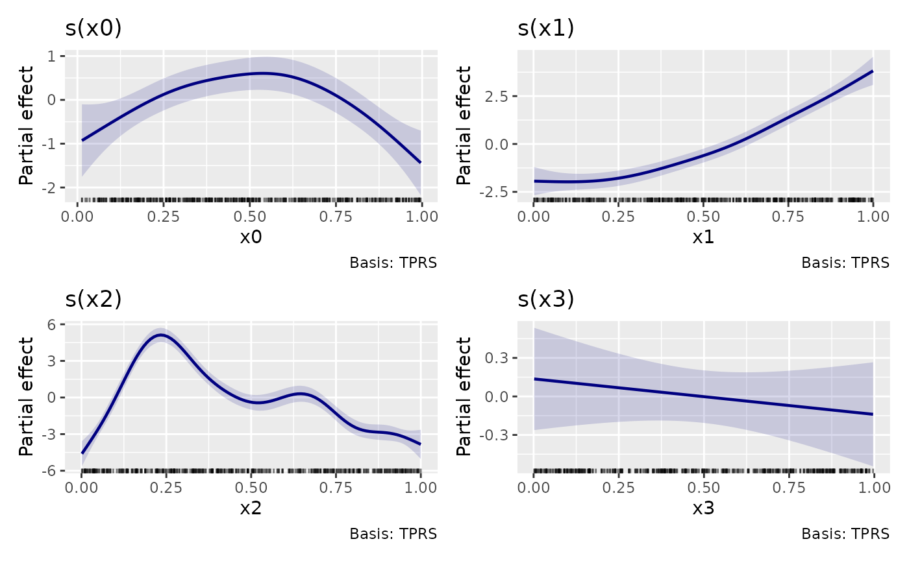

Use `geom.gratia.partial.residual` for partial residuals,
`geom.gratia.diagnostic.point` for diagnostic points, and
`geom.gratia.reference` for reference lines. Opacity uses numeric
settings such as `gratia.alpha.interval` and
`gratia.alpha.diagnostic.point`. More specific settings, such as
`geom.gratia.smooth.interval`, override the general interval setting.
See
[`?gratia_theme_get`](https://gavinsimpson.github.io/gratia/reference/gratia_theme_get.md)
for the component list.

Use
[`gratia_theme_set()`](https://gavinsimpson.github.io/gratia/reference/gratia_theme_get.md)
when you want subsequent gratia figures to share a style. Save its
return value so you can restore the previous settings after drawing the
figure.

``` r

old_theme <- gratia_theme_set(theme(gratia.alpha.interval = 0.1))
draw(m)
```

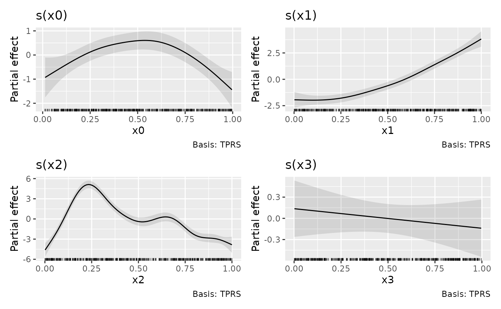

``` r

gratia_theme_set(old_theme)
```

These settings affect gratia plots created afterwards. For a temporary
change, you can instead use
[`withr::with_options()`](https://withr.r-lib.org/reference/with_options.html)
with the `gratia.plot.theme` option. If you have older code using
arguments such as `smooth_col` or `ci_alpha`, replace those arguments
with theme settings as shown above.

Common replacements for deprecated arguments are:

| Previous argument | Theme setting |
|:---|:---|
| `smooth_col` | `geom.gratia.smooth = element_geom(colour = ...)` |
| `ci_col`, `ci_alpha` | `geom.gratia.interval = element_geom(fill = ...)`, `gratia.alpha.interval` |
| `resid_col` | `geom.gratia.partial.residual = element_geom(colour = ...)` |
| `contour_col` | `geom.gratia.contour = element_geom(colour = ...)` |
| `point_col`, `point_alpha` in diagnostics | `geom.gratia.diagnostic.point = element_geom(colour = ...)`, `gratia.alpha.diagnostic.point` |
| `line_col` in diagnostics | `geom.gratia.diagnostic.reference = element_geom(colour = ...)` |
| `colour`, `alpha` in smooth samples | `geom.gratia.sample = element_geom(colour = ...)`, `gratia.alpha.sample` |
| `ci_3d_col`, `ci_3d_alpha` | `geom.gratia.surface.interval = element_geom(fill = ...)`, `gratia.alpha.surface.interval` |
| `alpha`, `linewidth` in chain diagnostics | `gratia.alpha.chain`, `geom.gratia.chain = element_geom(linewidth = ...)` |

Use `geom.gratia.effect` for parametric curves and
`geom.gratia.derivative` for derivatives. Rootograms have separate
`rootogram.bar`, `rootogram.fitted`, `rootogram.reference` and
`rootogram.warning` elements. MRF interval lines use
`geom.gratia.smooth.interval`, independently of the points controlled by
`geom.gratia.smooth`. Diagnostic boxplots use
`geom.gratia.diagnostic.boxplot`.

## Laying out labels, legends and colour bars

Long labels can overlap when several plots share a figure. Use
[`draw_label_control()`](https://gavinsimpson.github.io/gratia/reference/draw_label_control.md)
to choose wrapping widths and guide layouts, then pass the result as
`label_control` to
[`draw()`](https://gavinsimpson.github.io/gratia/reference/draw.md) or
[`assemble()`](https://gavinsimpson.github.io/gratia/reference/assemble.md).
The configuration works across drawing methods.

For a categorical axis, wrapping breaks long labels into lines and
`n_dodge` staggers labels across rows. We simulate observations in three
fishing categories so we can illustrate both options. The response
combines a curved effect of day, a difference between categories and
independent Gaussian noise of standard deviation 0.3.

``` r

set.seed(430)
fishing <- data.frame(
  day = runif(150, 0, 300),
  angler_type = factor(rep(c("Boat (guided)", "Boat (unguided)", "Shore"), 50))
)
fishing$y <- sin(fishing$day / 60) +
  c(0, -0.8, -0.3)[as.integer(fishing$angler_type)] + rnorm(150, sd = 0.3)
```

Fit a GAM with a smooth effect of day and a parametric effect of fishing
category. Wrap the fishing-category labels and stagger them over two
rows.

``` r

fishing_model <- gam(y ~ angler_type + s(day, k = 8),
  data = fishing, method = "REML")
axis_layout <- draw_label_control(axes = list(wrap = 12, n_dodge = 2))
draw(fishing_model, label_control = axis_layout, ncol = 2)
```

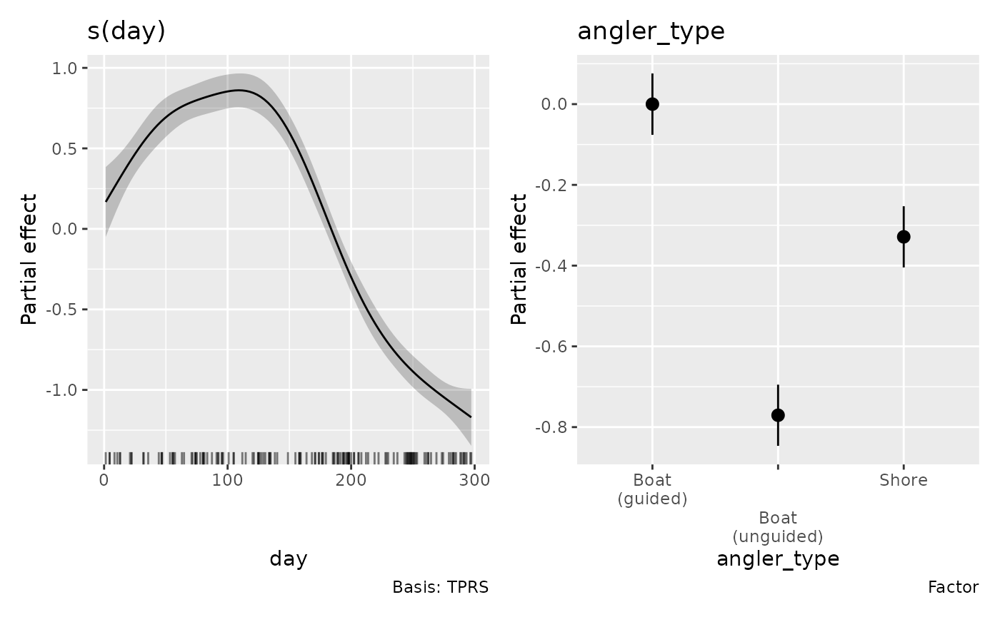

Legends have their own wrapping width and can arrange their entries into
rows or columns. Compare the fitted day smooth with one that has a
smaller basis and no smoothing penalty (`fx = TRUE`). The smaller basis
limits how much the curve can bend. Use descriptive labels for the two
fits and wrap the entries in a single legend column.

``` r

simple_fishing <- gam(y ~ angler_type + s(day, k = 3, fx = TRUE),
  data = fishing, method = "REML")
comparison <- compare_smooths(fishing_model, simple_fishing, n = 50)
comparison$.model <- factor(comparison$.model,
  levels = c("fishing_model", "simple_fishing"),
  labels = c("More flexible curve across the season", "Less flexible curve across the season"))
legend_layout <- draw_label_control(
  legend = list(wrap = 22, title_wrap = 18, ncol = 1)
)
draw(comparison, label_control = legend_layout)
```

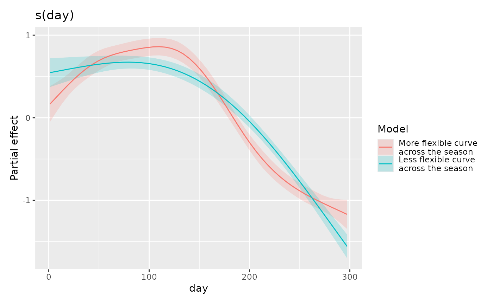

Colour bars can wrap their titles, rotate their tick labels, and change
their displayed dimensions. The following pairwise concurvity plot shows
how closely each smooth can be approximated by another smooth in the
four-smooth model. The fill scale supplies the title and the label
control wraps it and sets the bar height. Use the scale to set the
palette, breaks and numeric labels.

``` r

bar_layout <- draw_label_control(
  axes = list(wrap = 15),
  colourbar = list(title_wrap = 18, height = grid::unit(35, "mm"))
)
draw(model_concurvity(m, pairwise = TRUE),
  continuous_colour = scale_fill_viridis_c(name = "Concurvity between model terms"),
  label_control = bar_layout)
```

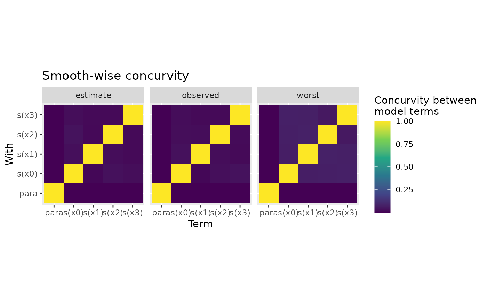

Wrapping happens after scale labels have been formatted, preserving
custom labels, mathematical expressions and explicit line breaks. Use
`axes = list(title_wrap = ...)` to wrap axis titles. Wrapping and
staggering tick labels applies only to discrete axes.

## Use a different palette for groups

Grouped curves and ribbons use the Okabe–Ito palette for up to nine
groups, and a hue palette for more than nine. Supply a palette function
to both the colour and fill theme settings to keep each model’s curve
and interval the same colour. Here we use Paul Tol’s bright palette for
the model comparison.

``` r

tol <- gratia_palette("tol_bright")
draw(comparison) &
  theme(palette.colour.discrete = tol, palette.fill.discrete = tol)
```

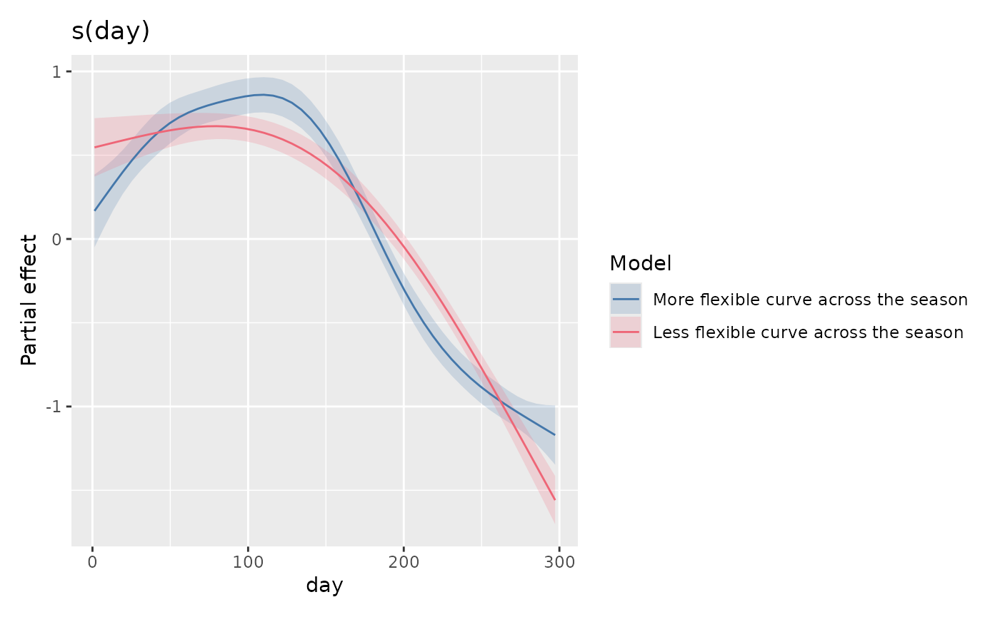

Paul Tol choices include bright and vibrant (7 colours), muted (9), dark
(11), and banded schemes (12, 16 or 20). The dark palette is designed
for a white background. Choose a palette with enough colours for all
your groups. A request for more colours than the palette provides gives
an error. See
[`?gratia_palette`](https://gavinsimpson.github.io/gratia/reference/gratia_palette.md)
for available names.

Continuous palettes can also be changed through
`palette.fill.continuous` and `palette.colour.continuous`. Existing
scale arguments still accept complete scales when custom
transformations, breaks or guides are needed.

## Combining individual plots produced by `draw()`

Each [`draw()`](https://gavinsimpson.github.io/gratia/reference/draw.md)
result is already a combined figure, even if it contains only one
smooth. When combining several results, specify their layout explicitly.
First, here is the error that can occur when those dimensions are
omitted.

``` r

p1 <- draw(m, select = "s(x0)")
p2 <- draw(m, select = "s(x1)")
p3 <- draw(m, select = "s(x2)")
p1 + p2 + p3
#> Error in `wrap_dims()`:
#> ! Need 3 panels, but together `nrow` and `ncol` only provide 1.
#> ℹ Please increase `ncol` and/or `nrow`.
```

Add `plot_layout(ncol = 3)` to place the three results in one row.

``` r

p1 + p2 + p3 + plot_layout(ncol = 3)
```


When all smooths come from the same model, select them in one
[`draw()`](https://gavinsimpson.github.io/gratia/reference/draw.md) call
and supply `ncol` directly.

``` r

draw(m, select = c("s(x0)", "s(x1)", "s(x2)"), ncol = 3)
```

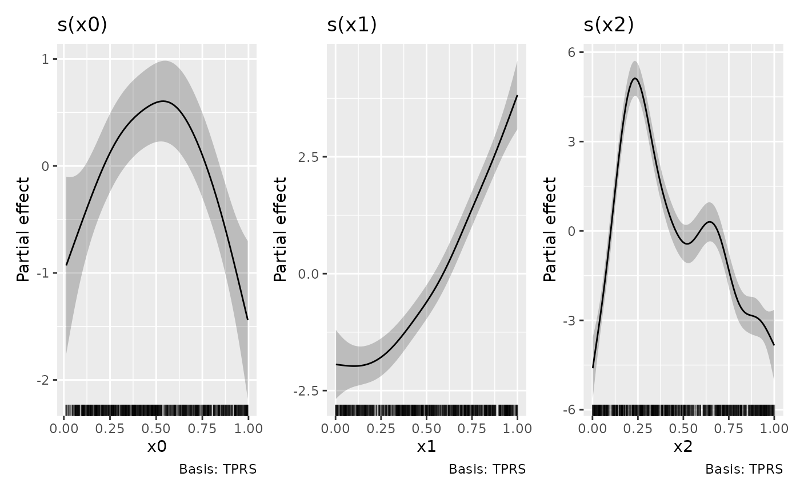

The explicit layout is useful when the plots come from different models
or need to be arranged with other ggplot2 figures.

## Grouping factor smooths and showing their intervals

`grouped` selects which factor smooth types share a plot. Choose any of
`"factor-by"`, `"sz"`, and `"fs"`. Types omitted from the vector are
drawn separately for each level, or each evaluated combination of levels
for `sz` terms with several factors. `show_ci` independently selects
which of these types show interval ribbons. These controls apply to
curves with one continuous covariate; ordinary smooths and surface plots
retain their displays.

The defaults, `grouped = c("sz", "fs")` and
`show_ci = c("factor-by", "sz")`, retain the existing grouping and
interval visibility. Use `FALSE` to select none. Separate curves use the
usual univariate styling: a black fitted line and a translucent black
interval. We simulate `x2` between zero and one and use `fac` to
identify three groups. The response combines a different curve of `x2`
in each group with independent Gaussian noise of standard deviation 2.
We then fit three ways of representing these relationships. A factor-by
smooth fits a curve for each group; an `sz` smooth represents group
deviations from a shared curve; an `fs` smooth estimates group curves
whose penalties share smoothing parameters.

``` r

factor_data <- data_sim("eg4", n = 400, seed = 244)
```

Fit the three representations to the same data so we can compare how
their group curves are displayed. Each model uses REML to select its
smoothing parameters.

``` r

m_by <- gam(y ~ fac + s(x2, by = fac), data = factor_data, method = "REML")
m_sz <- gam(y ~ s(x2) + s(x2, fac, bs = "sz"),
  data = factor_data, method = "REML")
m_fs <- gam(y ~ s(x2, fac, bs = "fs"),
  data = factor_data, method = "REML")
```

Overlay the factor-by curves with intervals:

``` r

draw(m_by, grouped = "factor-by", parametric = FALSE)
```

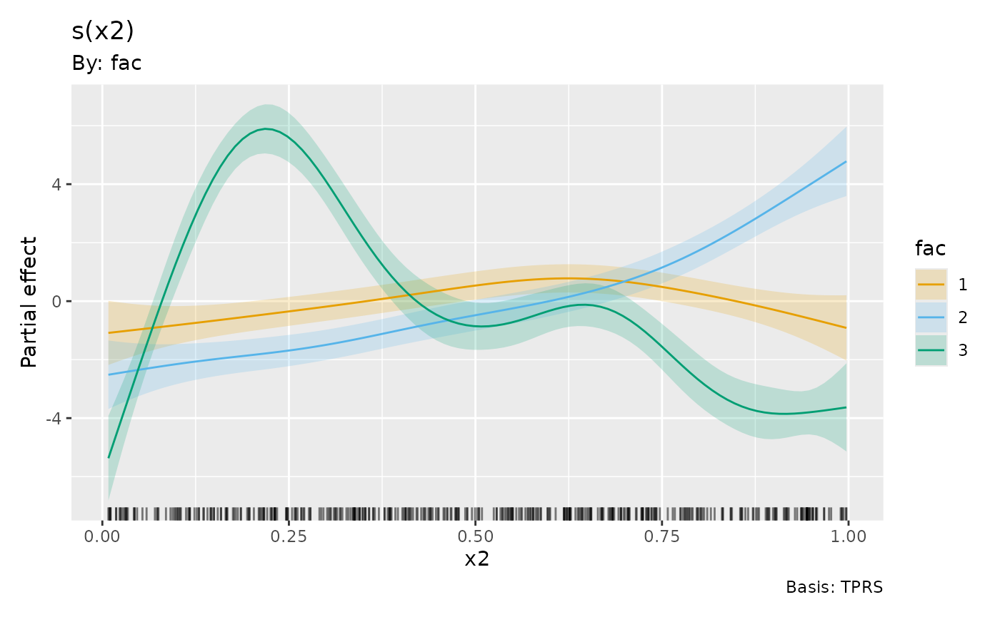

Separate the `sz` deviations and hide their intervals. The ordinary
smooth retains its interval:

``` r

draw(m_sz, grouped = FALSE, show_ci = "factor-by")
```

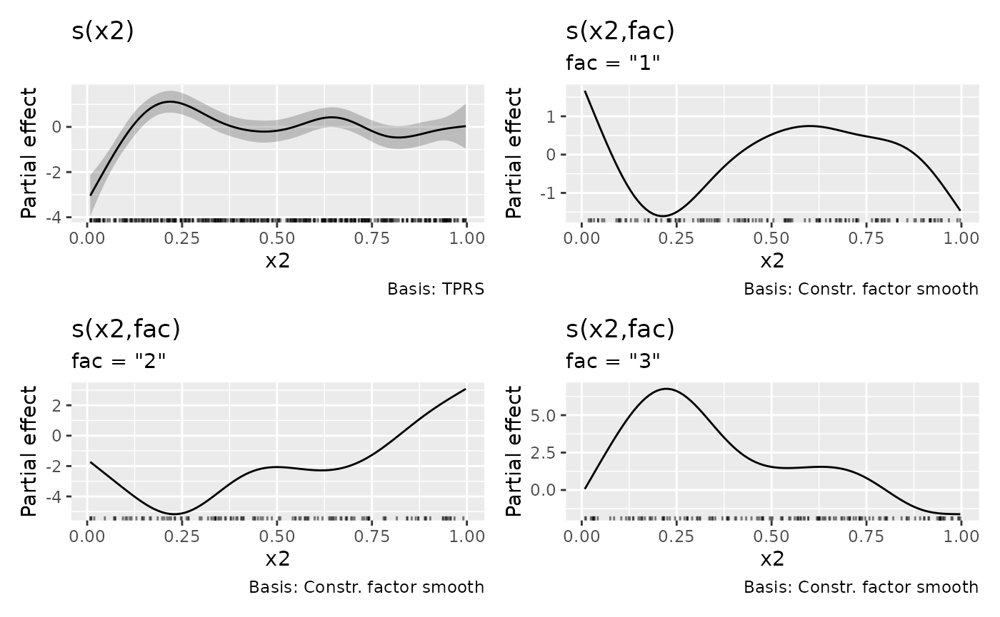

`fs` terms represent a fitted curve for each factor level. Separate
those curves and include their intervals with:

``` r

draw(m_fs, grouped = FALSE, show_ci = "fs")
```

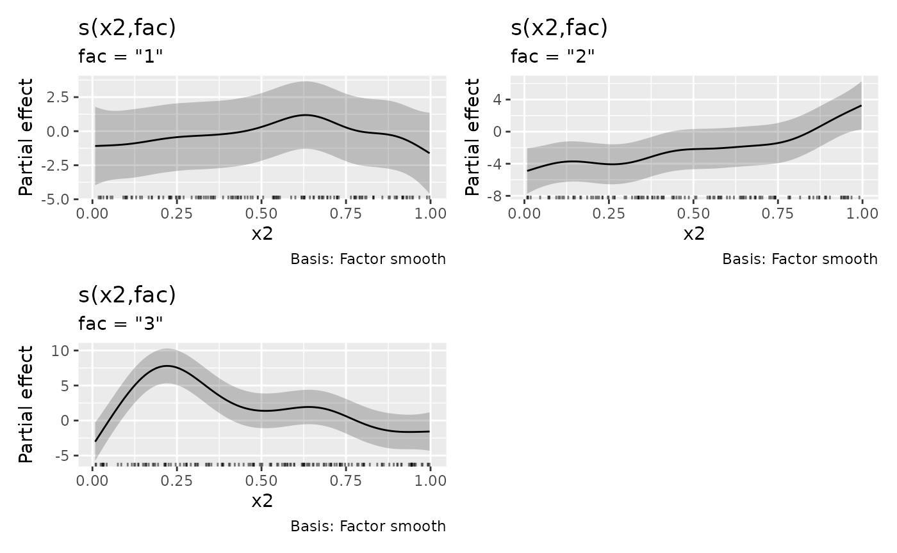

The same controls work with saved estimates. Grouping the curves or
hiding their intervals leaves the saved estimates and interval limits
intact. A saved simultaneous band still applies to the grid used to
calculate it, even if the plot shows only some of those curves. Here we
draw each group deviation separately and omit its interval ribbon.

``` r

sz_estimates <- smooth_estimates(m_sz)
draw(sz_estimates, grouped = FALSE, show_ci = FALSE)
```

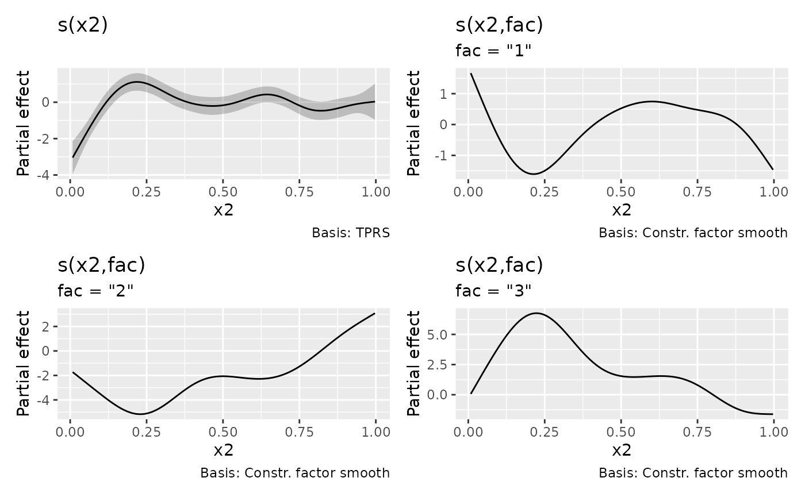

Ordered-factor `by` smooths use `"factor-by"` too. In the following
model, `s(x2)` is the reference smooth and the ordered-factor terms
describe deviations for the other levels. Grouping overlays only those
deviations; the reference smooth remains a separate plot. No smooth is
created for the ordered factor’s first level, and the displayed
deviations do not have the reference smooth added to them.

``` r

factor_data$ordered_fac <- ordered(factor_data$fac)
m_ordered <- gam(y ~ fac + s(x2) + s(x2, by = ordered_fac),
  data = factor_data, method = "REML")
draw(m_ordered, grouped = "factor-by", parametric = FALSE)
```

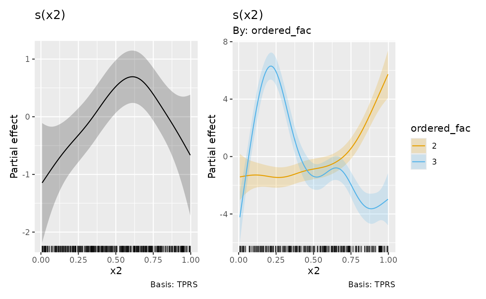

`grouped_by` is deprecated. Replace `grouped_by = TRUE` with
`grouped = c("factor-by", "sz", "fs")`; replace `grouped_by = FALSE`
with `grouped = c("sz", "fs")`. During migration, an explicit
`grouped_by` updates only `"factor-by"` membership in `grouped`.

## Drawing surfaces in 3D

With the optional {ggcube} package installed, use `surface = "3d"` to
view a two-dimensional smooth as a surface. First simulate a nonlinear
response over two covariates with independent Gaussian noise of standard
deviation 0.2, so the surface’s peaks remain visible above the noise.

``` r

eg2 <- data_sim("eg2", n = 400, scale = 0.2, seed = 2)
```

Fit a tensor product smooth with 15 basis functions per covariate to
allow enough flexibility for the nonlinear surface; REML selects its
smoothness. Then draw the smooth’s contribution to the linear predictor.
`n_2d = 50` evaluates the surface on a 50-by-50 grid, and `yaw` controls
the viewing angle.

``` r

m_surface <- gam(y ~ te(x, z, k = c(15, 15)),
  data = eg2, method = "REML")
draw(m_surface, surface = "3d", n_2d = 50,
  surface_3d = list(yaw = 45, persp = FALSE))
```

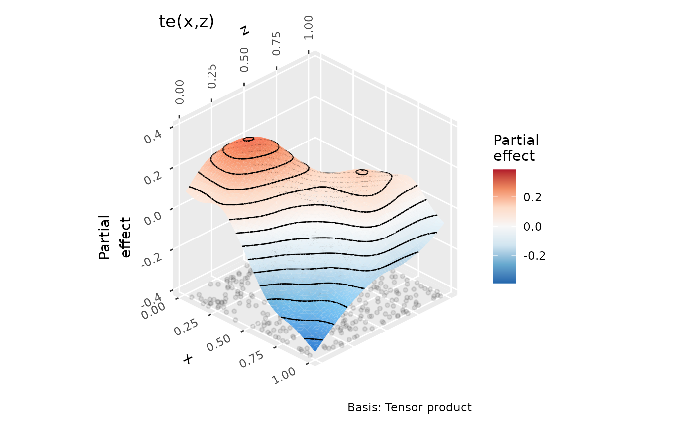

Pass camera settings through `surface_3d`, which forwards them to
[`ggcube::coord_3d()`](https://matthewkling.github.io/ggcube/reference/coord_3d.html).
For example, `persp = FALSE` uses a parallel projection so distant parts
of the surface do not appear smaller.

The covariates form the two horizontal axes and the partial effect forms
the vertical axis. Use `surface = "tile"` for a flat rectangular display
or the default `surface = "raster"` for a compact image. These choices
display the same estimated effect.

## Build a plot from smooth estimates and partial residuals

Themes control the appearance of plots returned by
[`draw()`](https://gavinsimpson.github.io/gratia/reference/draw.md). To
choose different layers or map additional variables to aesthetics, build
a plot from the estimates returned by gratia.

First evaluate the fitted smooths with
[`smooth_estimates()`](https://gavinsimpson.github.io/gratia/reference/smooth_estimates.md)
and add pointwise interval limits with
[`add_confint()`](https://gavinsimpson.github.io/gratia/reference/add_confint.md).
Each row contains a value of the covariate, the estimated smooth at that
value and its interval limits.

``` r

# evaluate the smooths
sm <- smooth_estimates(m) |>
  add_confint()
sm
#> # A tibble: 400 × 11
#>    .smooth .type .by   .estimate   .se     x0    x1    x2    x3 .lower_ci
#>    <chr>   <chr> <chr>     <dbl> <dbl>  <dbl> <dbl> <dbl> <dbl>     <dbl>
#>  1 s(x0)   TPRS  NA       -0.929 0.422 0.0131    NA    NA    NA    -1.76 
#>  2 s(x0)   TPRS  NA       -0.881 0.396 0.0230    NA    NA    NA    -1.66 
#>  3 s(x0)   TPRS  NA       -0.834 0.372 0.0329    NA    NA    NA    -1.56 
#>  4 s(x0)   TPRS  NA       -0.786 0.348 0.0429    NA    NA    NA    -1.47 
#>  5 s(x0)   TPRS  NA       -0.738 0.326 0.0528    NA    NA    NA    -1.38 
#>  6 s(x0)   TPRS  NA       -0.690 0.305 0.0627    NA    NA    NA    -1.29 
#>  7 s(x0)   TPRS  NA       -0.643 0.287 0.0727    NA    NA    NA    -1.20 
#>  8 s(x0)   TPRS  NA       -0.595 0.270 0.0826    NA    NA    NA    -1.12 
#>  9 s(x0)   TPRS  NA       -0.548 0.255 0.0925    NA    NA    NA    -1.05 
#> 10 s(x0)   TPRS  NA       -0.501 0.242 0.102     NA    NA    NA    -0.975
#> # ℹ 390 more rows
#> # ℹ 1 more variable: .upper_ci <dbl>
```

To add partial residual points, use
[`add_partial_residuals()`](https://gavinsimpson.github.io/gratia/reference/add_partial_residuals.md)
on the fitting data. In this Gaussian model with an identity link, a
partial residual for a smooth is the observation minus the fitted
intercept and the contributions of the other terms. These are the points
shown by `draw(m, residuals = TRUE)`.

``` r

# add partial residuals to data
eg1 <- eg1 |>
  add_partial_residuals(m)
```

The new columns use the smooth labels as names, such as `s(x0)` and
`s(x1)`. Inspect the names so we can select the column matching the
smooth to plot.

``` r

names(eg1)
#>  [1] "y"     "x0"    "x1"    "x2"    "x3"    "f"     "f0"    "f1"    "f2"   
#> [10] "f3"    "s(x0)" "s(x1)" "s(x2)" "s(x3)"
```

Plot the smooth for `x2` using five layers:

1.  a rug plot of the observed values of `x2`,
2.  the credible interval around the estimated smooth,
3.  the partial residuals as a point layer,
4.  the estimated smooth as a line layer,
5.  an axis label and title.

``` r

p_sx2 <- sm |>
  filter(.smooth == "s(x2)") |>
  ggplot() +
  geom_rug(aes(x = x2),
    data = eg1,
    sides = "b", length = grid::unit(0.02, "npc")
  ) +
  geom_ribbon(aes(ymin = .lower_ci, ymax = .upper_ci, x = x2),
    alpha = 0.2
  ) +
  geom_point(aes(x = x2, y = `s(x2)`),
    data = eg1, size = 1.5, colour = "steelblue3"
  ) +
  geom_line(aes(x = x2, y = .estimate), linewidth = 1.2) +
  labs(y = "Partial effect", title = "s(x2)")
p_sx2
```

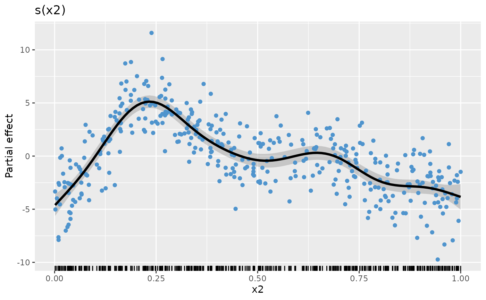

We prepare equivalent plots for the other three smooths to combine with
this one below. Their construction repeats the same steps, so the code
is hidden.

Combine the four plots and set `ncol = 2` to arrange them in two
columns.

``` r

p_sx0 + p_sx1 + p_sx2 + p_sx3 + plot_layout(ncol = 2)
```

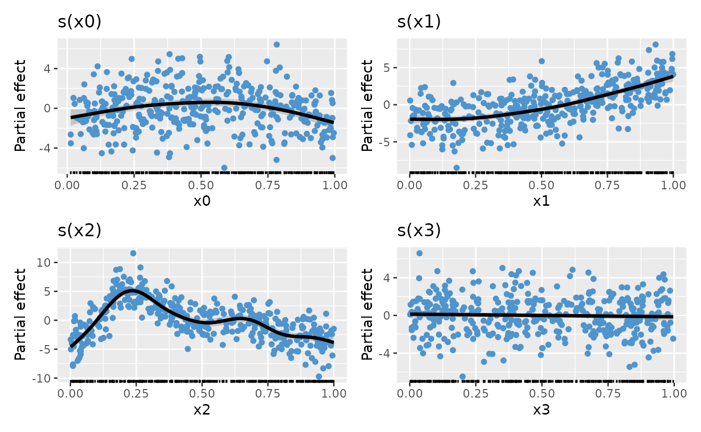

## Colour partial residuals by another variable

A custom plot can show information beyond the variables in the fitted
smooth. To demonstrate grouping, create an arbitrary four-level factor
and use it to colour the residual points. This factor is unrelated to
the simulated response and is used only to demonstrate the colour
mapping.

``` r

set.seed(12)
eg1 <- eg1 |>
  mutate(fac = sample(letters[1:4], n(), replace = TRUE))
```

Build the curve and interval first, then add the partial residuals with
`fac` mapped to colour. Adding the points last keeps them visible above
the interval ribbon.

``` r

plt <- sm |>
  filter(.smooth == "s(x2)") |>
  ggplot() +
  geom_rug(aes(x = x2),
    data = eg1,
    sides = "b", length = grid::unit(0.02, "npc")
  ) +
  geom_ribbon(aes(ymin = .lower_ci, ymax = .upper_ci, x = x2),
    alpha = 0.2
  ) +
  geom_line(aes(x = x2, y = .estimate), linewidth = 1.2) +
  labs(y = "Partial effect", title = "s(x2)")

plt +
  geom_point(
    aes(
      x = x2, y = `s(x2)`,
      colour = fac
    ),
    data = eg1, size = 1.5
  )
```

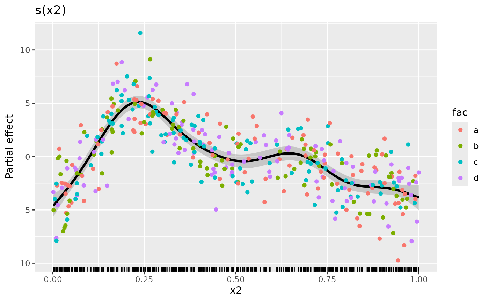

To look for patterns involving another fitted covariate, map `x1` to
point colour and size. We remove the fixed point size so it can vary
with `x1`.

``` r

plt +
  geom_point(
    aes(
      x = x2, y = `s(x2)`,
      colour = x1, size = x1
    ),
    data = eg1, alpha = 0.3
  ) +
  scale_colour_viridis_c(option = "plasma")
```

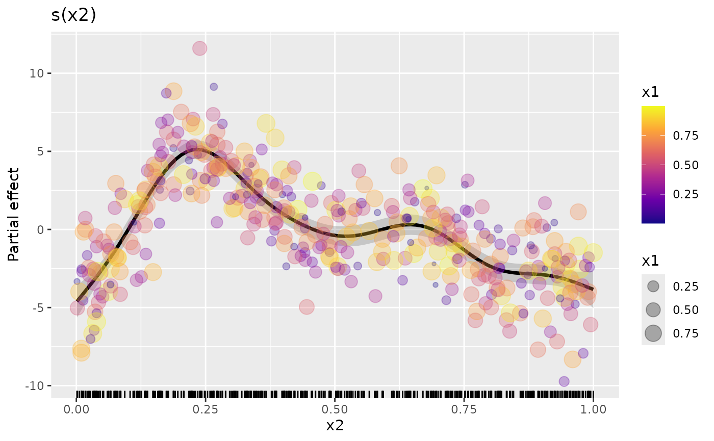

If points of the same colour consistently fall above or below the fitted
curve, residuals may still vary with `x1`. The [model diagnostics
article](https://gavinsimpson.github.io/gratia/articles/model-checking.md)
shows how to check that pattern by plotting residuals directly against a
covariate.
