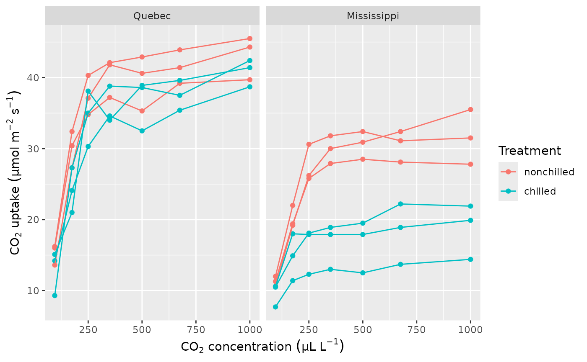
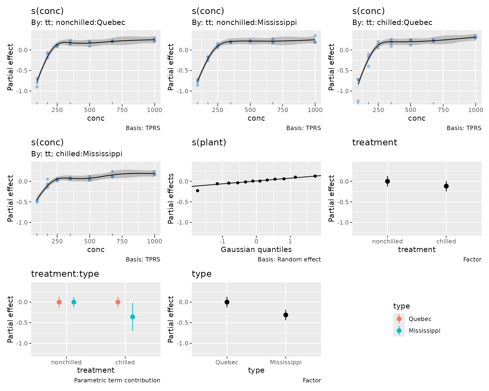
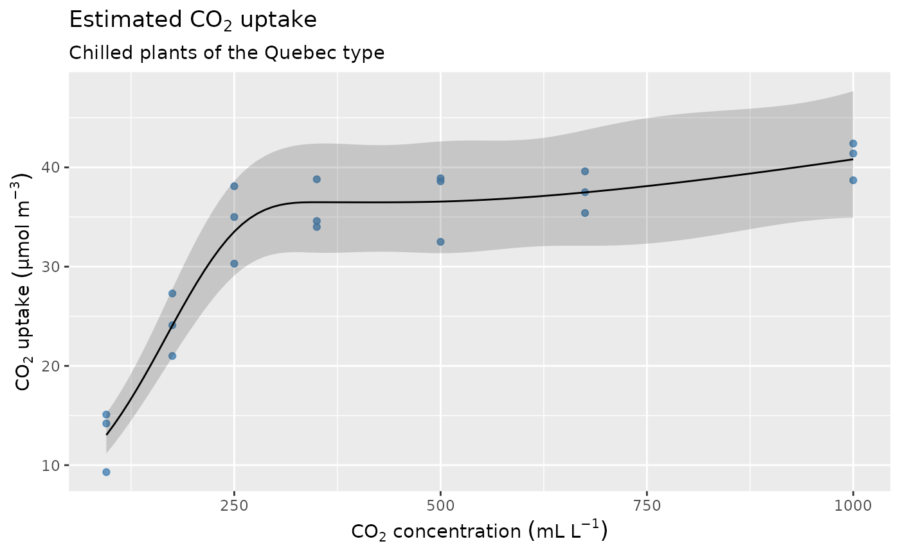
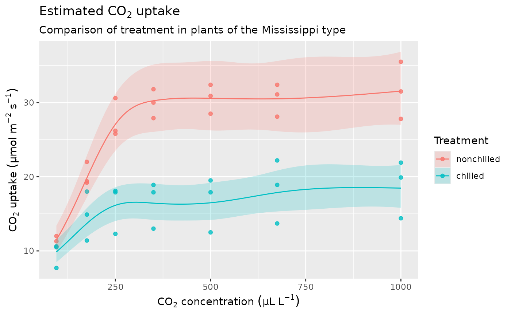
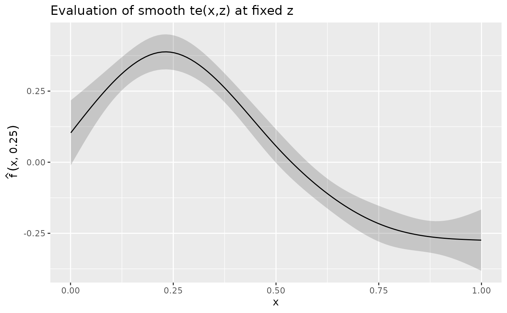
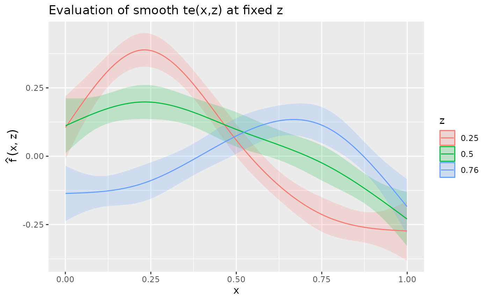
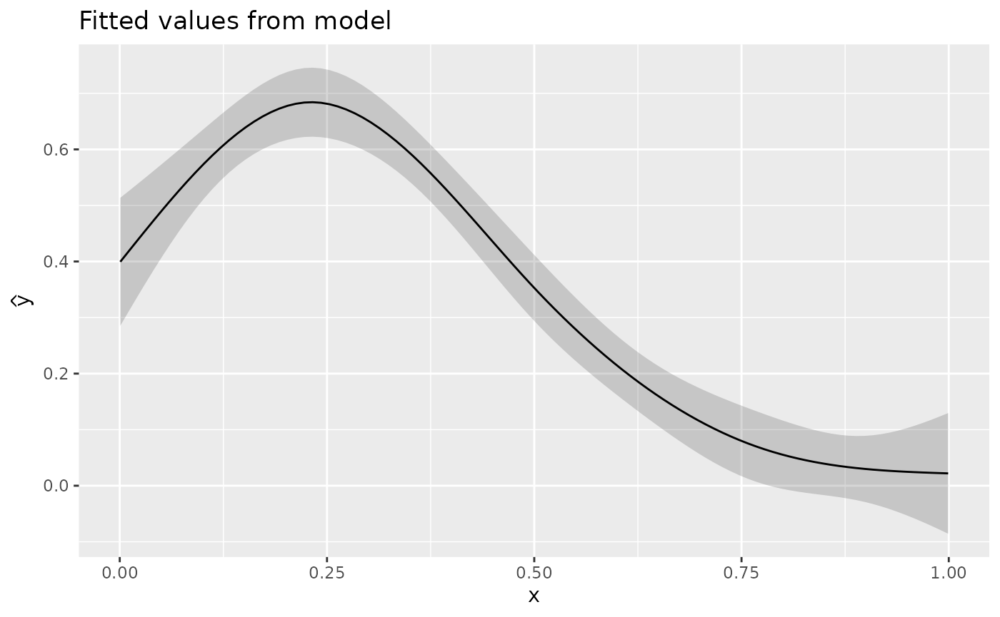
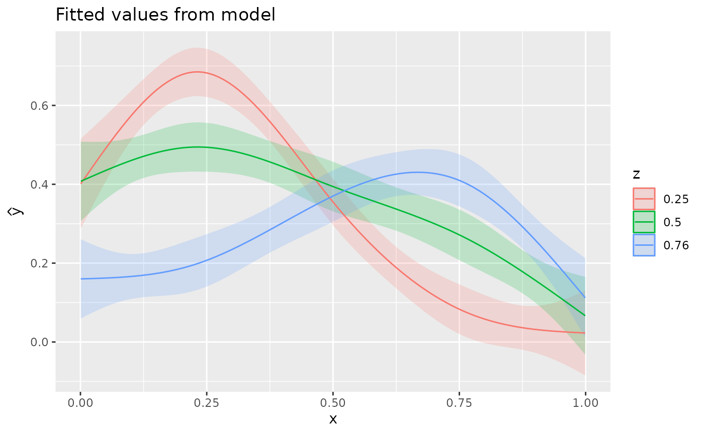

# Creating prediction grids with data_slice()

A prediction curve needs a set of covariate values at which to evaluate
the model. For example, to plot a treatment group’s response to
concentration, we vary concentration and hold the treatment and other
covariates fixed.
[`data_slice()`](https://gavinsimpson.github.io/gratia/reference/data_slice.md)
creates this prediction grid, called a *data slice*, from a fitted model
or a data frame.

This article builds grids for treatment comparisons and for curves
through a two-dimensional smooth. We load {gratia} for prediction grids,
{mgcv} for model fitting, {dplyr} and {forcats} for data preparation,
and {ggplot2} for plotting.

``` r

library("gratia")
library("mgcv")
#> Loading required package: nlme
#> This is mgcv 1.9-4. For overview type '?mgcv'.
library("dplyr")
#> 
#> Attaching package: 'dplyr'
#> The following object is masked from 'package:nlme':
#> 
#>     collapse
#> The following objects are masked from 'package:stats':
#> 
#>     filter, lag
#> The following objects are masked from 'package:base':
#> 
#>     intersect, setdiff, setequal, union
library("ggplot2")
library("forcats")
library("datasets")
```

## Predict uptake for selected plant groups

The `CO2` data from {datasets} record uptake at seven carbon dioxide
concentrations for each of twelve grass plants from Quebec and
Mississippi. The plants received either a chilled or nonchilled
treatment. We rename the grouping variables and make the plant
identifier an unordered factor for modelling.

``` r

## data load and prep
data(CO2, package = "datasets")
plant <- CO2 |>
  as_tibble() |>
  rename(plant = Plant, type = Type, treatment = Treatment) |>
  mutate(plant = factor(plant, ordered = FALSE))
```

Plot the measurements by origin and treatment to see the curves we want
to predict. Uptake is measured in micromoles per square metre per second
and concentration in microlitres per litre
(\mu\mathrm{L}\\\mathrm{L}^{-1}). See Table 1 in the [original
study](https://biology.mcgill.ca/faculty/potvin/articles/PotvinLech_90.pdf).

``` r

plant_ylab <- expression(CO[2] ~ uptake ~ (mu * mol ~ m^{-2} ~ s^{-1}))
plant_xlab <- expression(CO[2] ~ concentration ~ (mu * L ~ L^{-1}))

plant |>
  ggplot(
    aes(x = conc, y = uptake, group = plant, colour = treatment)
  ) +
  geom_point() +
  geom_line() +
  facet_wrap(~type) +
  labs(y = plant_ylab, x = plant_xlab, colour = "Treatment")
```



Fit a separate concentration smooth for each combination of treatment
and origin. `tt` identifies those combinations. The plant random
intercept allows each plant to have a different overall uptake level and
accounts for dependence between measurements on the same plant. The
Gamma family models a positive, continuous response, and the log link
keeps the fitted mean positive.

``` r

plant <- plant |>
  mutate(tt = fct_cross(treatment, type))
m_plant <- gam(
  uptake ~ treatment * type + s(conc, by = tt, k = 6) +
    s(plant, bs = "re"),
  data = plant, method = "REML", family = Gamma(link = "log")
)
overview(m_plant)
#> 
#> Generalized Additive Model with 9 terms
#> 
#>   term                             type        k   edf ref.edf statistic p.value
#>   <chr>                            <chr>   <dbl> <dbl>   <dbl>     <dbl> <chr>  
#> 1 Intercept                        parame…    NA  1       1        53.4  < 0.001
#> 2 treatmentchilled                 parame…    NA  1       1        -1.26 0.21249
#> 3 typeMississippi                  parame…    NA  1       1        -3.35 0.00148
#> 4 treatmentchilled:typeMississippi parame…    NA  1       1        -2.73 0.00855
#> 5 s(conc):ttnonchilled:Quebec      TPRS        5  4.72    4.96     69.7  < 0.001
#> 6 s(conc):ttnonchilled:Mississippi TPRS        5  4.62    4.92     74.1  < 0.001
#> 7 s(conc):ttchilled:Quebec         TPRS        5  4.71    4.95     86.5  < 0.001
#> 8 s(conc):ttchilled:Mississippi    TPRS        5  4.39    4.81     25.3  < 0.001
#> 9 s(plant)                         Random…    12  7.40    8        12.8  < 0.001
```

Plot the smooth contributions on common scales to compare their shapes.
The panels show contributions to the log of mean uptake. Partial
residuals add the model’s weighted working residuals to each smooth,
making it easier to see where the data depart from the fitted curve. We
use {patchwork} to collect the legend in the empty lower-right panel.

``` r

draw(
  m_plant, residuals = TRUE, scales = "fixed",
  ncol = 3, guides = "collect"
) +
  patchwork::guide_area()
```



To predict uptake for chilled Quebec plants, vary `conc` over 100 evenly
spaced values and fix `type` and `treatment`. Unspecified predictors
receive representative values. First inspect this grid to see what that
means for the derived factor `tt`.

``` r

ds1 <- data_slice(
  m_plant,
  conc = evenly(conc, n = 100),
  type = level(type, "Quebec"),
  treatment = level(treatment, "chilled")
)
ds1
#> # A tibble: 100 × 5
#>     conc type   treatment tt                plant
#>    <dbl> <fct>  <fct>     <fct>             <fct>
#>  1   95  Quebec chilled   nonchilled:Quebec Qn1  
#>  2  104. Quebec chilled   nonchilled:Quebec Qn1  
#>  3  113. Quebec chilled   nonchilled:Quebec Qn1  
#>  4  122. Quebec chilled   nonchilled:Quebec Qn1  
#>  5  132. Quebec chilled   nonchilled:Quebec Qn1  
#>  6  141. Quebec chilled   nonchilled:Quebec Qn1  
#>  7  150. Quebec chilled   nonchilled:Quebec Qn1  
#>  8  159. Quebec chilled   nonchilled:Quebec Qn1  
#>  9  168. Quebec chilled   nonchilled:Quebec Qn1  
#> 10  177. Quebec chilled   nonchilled:Quebec Qn1  
#> # ℹ 90 more rows
```

[`data_slice()`](https://gavinsimpson.github.io/gratia/reference/data_slice.md)
uses the most common level for an unspecified factor, with ties resolved
by choosing the first tied level. It treats `tt` as a separate factor,
so supply the level that matches `treatment` and `type` before using
this grid for prediction.

``` r

ds1 <- data_slice(
  m_plant,
  conc = evenly(conc, n = 100),
  treatment = level(treatment, "chilled"), type = level(type, "Quebec"),
  tt = level(tt, "chilled:Quebec")
)
ds1
#> # A tibble: 100 × 5
#>     conc treatment type   tt             plant
#>    <dbl> <fct>     <fct>  <fct>          <fct>
#>  1   95  chilled   Quebec chilled:Quebec Qn1  
#>  2  104. chilled   Quebec chilled:Quebec Qn1  
#>  3  113. chilled   Quebec chilled:Quebec Qn1  
#>  4  122. chilled   Quebec chilled:Quebec Qn1  
#>  5  132. chilled   Quebec chilled:Quebec Qn1  
#>  6  141. chilled   Quebec chilled:Quebec Qn1  
#>  7  150. chilled   Quebec chilled:Quebec Qn1  
#>  8  159. chilled   Quebec chilled:Quebec Qn1  
#>  9  168. chilled   Quebec chilled:Quebec Qn1  
#> 10  177. chilled   Quebec chilled:Quebec Qn1  
#> # ℹ 90 more rows
```

Pass the grid to
[`fitted_values()`](https://gavinsimpson.github.io/gratia/reference/fitted_values.md)
for predictions and credible intervals for mean uptake with the plant
random intercept set to zero.

``` r

fv1 <- fitted_values(
  m_plant,
  data = ds1,
  scale = "response",
  exclude = "s(plant)"
)
#> Prediction data contain 100 rows with combinations of categorical predictor
#> levels absent from the fitting data.
#> ℹ Factors: `treatment`, `type`, `tt`, and `plant`. Input rows: 1, 2, 3, 4, 5,
#>   6, 7, 8, 9, 10, ....
fv1
#> # A tibble: 100 × 11
#>     .row  conc treatment type   tt     plant .parameter .fitted    .se .lower_ci
#>    <int> <dbl> <fct>     <fct>  <fct>  <fct> <chr>        <dbl>  <dbl>     <dbl>
#>  1     1   95  chilled   Quebec chill… Qn1   mean          13.0 0.0783      11.2
#>  2     2  104. chilled   Quebec chill… Qn1   mean          14.1 0.0757      12.1
#>  3     3  113. chilled   Quebec chill… Qn1   mean          15.2 0.0737      13.1
#>  4     4  122. chilled   Quebec chill… Qn1   mean          16.3 0.0722      14.2
#>  5     5  132. chilled   Quebec chill… Qn1   mean          17.6 0.0714      15.3
#>  6     6  141. chilled   Quebec chill… Qn1   mean          18.9 0.0711      16.4
#>  7     7  150. chilled   Quebec chill… Qn1   mean          20.2 0.0712      17.6
#>  8     8  159. chilled   Quebec chill… Qn1   mean          21.6 0.0716      18.8
#>  9     9  168. chilled   Quebec chill… Qn1   mean          23.0 0.0721      20.0
#> 10    10  177. chilled   Quebec chill… Qn1   mean          24.4 0.0726      21.2
#> # ℹ 90 more rows
#> # ℹ 1 more variable: .upper_ci <dbl>
```

`exclude` removes the random intercept’s contribution even though the
grid contains a plant identifier. With the default `scale = "response"`,
the fitted values and intervals are in uptake units. With a log link,
setting the random intercept to zero gives a prediction for a plant at
that reference level. Averaging over the distribution of plant effects
would give a different mean.

Plot that curve and interval alongside the observed measurements for
chilled Quebec plants. The observations include variation between
individual plants, while the curve holds the plant-specific intercept at
zero.

``` r

fv1 |>
  ggplot(aes(x = conc, y = .fitted)) +
  geom_point(
    data = plant |>
      filter(type == "Quebec", treatment == "chilled"),
    mapping = aes(y = uptake),
    alpha = 0.8, colour = "steelblue"
  ) +
  geom_ribbon(
    aes(ymin = .lower_ci, ymax = .upper_ci),
    alpha = 0.2
  ) +
  geom_line() +
  labs(
    x = plant_xlab, y = plant_ylab,
    title = expression(Estimated ~ CO[2] ~ uptake),
    subtitle = "Chilled plants of the Quebec type"
  )
```



## Compare treatments on the same concentration grid

To compare treatments for Mississippi plants, request all treatment
levels and one origin. Recreate `tt` from those values so that each
prediction row selects the appropriate smooth.

``` r

ds2 <- data_slice(
  m_plant,
  conc = evenly(conc, n = 100),
  treatment = evenly(treatment),
  type = level(type, "Mississippi")
) |>
  mutate(
    tt = fct_cross(treatment, type, keep_empty = TRUE)
  )
ds2
#> # A tibble: 200 × 5
#>     conc treatment  type        tt                     plant
#>    <dbl> <fct>      <fct>       <fct>                  <fct>
#>  1   95  nonchilled Mississippi nonchilled:Mississippi Qn1  
#>  2   95  chilled    Mississippi chilled:Mississippi    Qn1  
#>  3  104. nonchilled Mississippi nonchilled:Mississippi Qn1  
#>  4  104. chilled    Mississippi chilled:Mississippi    Qn1  
#>  5  113. nonchilled Mississippi nonchilled:Mississippi Qn1  
#>  6  113. chilled    Mississippi chilled:Mississippi    Qn1  
#>  7  122. nonchilled Mississippi nonchilled:Mississippi Qn1  
#>  8  122. chilled    Mississippi chilled:Mississippi    Qn1  
#>  9  132. nonchilled Mississippi nonchilled:Mississippi Qn1  
#> 10  132. chilled    Mississippi chilled:Mississippi    Qn1  
#> # ℹ 190 more rows
```

[`fct_cross()`](https://forcats.tidyverse.org/reference/fct_cross.html)
replaces the automatically chosen `tt` value with the correct
treatment-origin combination. `keep_empty = TRUE` retains the factor
levels used when fitting, including combinations absent from this
prediction grid.

Predict both treatment curves with the plant-specific intercept set to
zero, then overlay the measurements for Mississippi plants.

``` r

fitted_values(
  m_plant,
  data = ds2, scale = "response",
  exclude = "s(plant)"
) |>
  ggplot(
    aes(x = conc, y = .fitted, group = treatment)
  ) +
  geom_point(
    data = plant |> filter(type == "Mississippi"),
    mapping = aes(y = uptake, colour = treatment),
    alpha = 0.8
  ) +
  geom_ribbon(
    aes(ymin = .lower_ci, ymax = .upper_ci, fill = treatment),
    alpha = 0.2
  ) +
  geom_line(
    aes(colour = treatment)
  ) +
  labs(
    x = plant_xlab,
    y = plant_ylab,
    title = expression(Estimated ~ CO[2] ~ uptake),
    subtitle = "Comparison of treatment in plants of the Mississippi type",
    colour = "Treatment",
    fill = "Treatment"
  )
#> Prediction data contain 200 rows with combinations of categorical predictor
#> levels absent from the fitting data.
#> ℹ Factors: `treatment`, `type`, `tt`, and `plant`. Input rows: 1, 2, 3, 4, 5,
#>   6, 7, 8, 9, 10, ....
```



## Choose values for a prediction grid

Use these helpers to select numeric values or factor levels for a grid.

- `evenly(x, n = 100)` returns 100 evenly spaced values from the minimum
  to the maximum of `x`.
- `evenly(x, by = 5)` takes steps of 5 from the minimum of `x` up to its
  maximum.
- Supply `lower`, `upper` or both to use different bounds, as in
  `evenly(x, n = 100, lower = 5, upper = 10)`.
- `evenly(fct)` and `all_levels(fct)` return each level of `fct` once.
- `ref_level(fct)` returns the first level of `fct`. For an unordered
  factor, this is the reference under R’s default contrasts.
- `level(fct, "B")` returns the requested level `"B"`.

Factor helpers preserve the levels used in the fitted model, so a
prediction grid uses the same coding as the fitting data.

[`data_slice()`](https://gavinsimpson.github.io/gratia/reference/data_slice.md)
also accepts named R expressions, evaluated using variables from the
fitted model’s data or from supplied `data`. Here we select the lower
quartile, median and upper quartile of concentration. Other covariates
retain their representative values.

``` r

data_slice(
  m_plant,
  conc = quantile(conc, probs = c(0.25, 0.5, 0.75))
)
#> # A tibble: 3 × 5
#>    conc treatment  type   tt                plant
#>   <dbl> <fct>      <fct>  <fct>             <fct>
#> 1   175 nonchilled Quebec nonchilled:Quebec Qn1  
#> 2   350 nonchilled Quebec nonchilled:Quebec Qn1  
#> 3   675 nonchilled Quebec nonchilled:Quebec Qn1
```

When several variables have multiple requested values, the grid contains
every combination of those values.

## Keep prediction ranges within each group

When a covariate has a different observed range in each group, a grid
spanning the full range can lead to extrapolation for some groups. Use
`.by` to evaluate expressions separately within each observed group.
Here the range of `x` differs between groups A and B.

``` r

group_data <- data.frame(
  x = c(0, 4, 10, 5, 12, 20),
  fac = factor(rep(c("A", "B"), each = 3)),
  z = c(1, 2, 3, 7, 8, 9)
)
data_slice(
  group_data,
  x = evenly(x, n = 5),
  .by = fac
)
#> # A tibble: 10 × 3
#>        x fac       z
#>    <dbl> <fct> <dbl>
#>  1  0    A         3
#>  2  2.5  A         3
#>  3  5    A         3
#>  4  7.5  A         3
#>  5 10    A         3
#>  6  5    B         3
#>  7  8.75 B         3
#>  8 12.5  B         3
#>  9 16.2  B         3
#> 10 20    B         3
```

This generates five values from 0 to 10 for A, and five from 5 to 20 for
B. The same syntax works for a fitted GAM containing `s(x, by = fac)`.
Grouping variables are included automatically, and only observed groups
are used. Select multiple grouping variables with
`.by = c(site, treatment)` to work within their observed combinations.

Use `fac = level(fac, "B")` to create a grid for B alone. With
`.by = fac`,
[`data_slice()`](https://gavinsimpson.github.io/gratia/reference/data_slice.md)
selects B before evaluating `evenly(x, n = 5)`, so it uses that group’s
range of 5 to 20.

``` r

data_slice(group_data,
  x = evenly(x, n = 5), fac = level(fac, "B"), .by = fac
)
#> # A tibble: 5 × 3
#>       x fac       z
#>   <dbl> <fct> <dbl>
#> 1  5    B         3
#> 2  8.75 B         3
#> 3 12.5  B         3
#> 4 16.2  B         3
#> 5 20    B         3
```

Unspecified covariates, such as `z` above, keep their overall
representative values. To use group-specific values, supply an
expression explicitly:

``` r

data_slice(group_data, x = evenly(x, n = 5), z = mean(z), .by = fac)
#> # A tibble: 10 × 3
#>        x     z fac  
#>    <dbl> <dbl> <fct>
#>  1  0        2 A    
#>  2  2.5      2 A    
#>  3  5        2 A    
#>  4  7.5      2 A    
#>  5 10        2 A    
#>  6  5        8 B    
#>  7  8.75     8 B    
#>  8 12.5      8 B    
#>  9 16.2      8 B    
#> 10 20        8 B
```

The returned tibble is ungrouped and preserves the original factor
levels and their ordered status.

With several continuous predictors, a combination can be unobserved even
when each value is within its group’s range. Set `.observed_only = TRUE`
to retain only combinations of the specified covariates that occur in
the data. This also removes interpolated points, so leave it off to draw
a continuous curve and check that the chosen grid is supported by
observations.

## Plot curves through a two-dimensional smooth

For a surface depending on `x` and `z`, we can plot how the smooth
changes with `x` at selected values of `z`. We simulate a mean surface
with two peaks and sample `x` and `z` independently and uniformly
between zero and one. The response adds independent Gaussian noise of
standard deviation 0.25.

``` r

# simulate data from the bivariate surface
df <- data_sim("eg2", n = 1000, scale = 0.25, seed = 2)
```

Fit a tensor product smooth to estimate the surface. We will then
evaluate it along `x` at selected values of `z`.

``` r

# fit the GAM
m_biv <- gam(y ~ te(x, z), data = df, method = "REML")
```

We will use the same grids to compare smooth contributions from
[`smooth_estimates()`](https://gavinsimpson.github.io/gratia/reference/smooth_estimates.md)
with full fitted means from
[`fitted_values()`](https://gavinsimpson.github.io/gratia/reference/fitted_values.md).

### Using `smooth_estimates()`

Create a grid over `x` with `z` fixed at its lower quartile. The axis
label records that fixed value so the resulting curve is easy to
identify.

``` r

ds3 <- data_slice(m_biv,
  x = evenly(x, n = 100),
  z = quantile(z, probs = 0.25)
)

z_val <- with(ds3, round(quantile(z, probs = 0.25), 2))
ylab <- bquote(hat(f)(x, .(z_val)))
```

Evaluate the smooth on the grid and add pointwise credible intervals.

``` r

sm <- smooth_estimates(m_biv, select = "te(x,z)", data = ds3) |>
  add_confint()
sm
#> # A tibble: 100 × 9
#>    .smooth .type        .by   .estimate    .se       x     z .lower_ci .upper_ci
#>    <chr>   <chr>        <chr>     <dbl>  <dbl>   <dbl> <dbl>     <dbl>     <dbl>
#>  1 te(x,z) Tensor prod… NA        0.103 0.0583 6.63e-4 0.245   -0.0107     0.218
#>  2 te(x,z) Tensor prod… NA        0.122 0.0548 1.08e-2 0.245    0.0148     0.230
#>  3 te(x,z) Tensor prod… NA        0.141 0.0514 2.08e-2 0.245    0.0400     0.242
#>  4 te(x,z) Tensor prod… NA        0.159 0.0482 3.09e-2 0.245    0.0648     0.254
#>  5 te(x,z) Tensor prod… NA        0.177 0.0451 4.10e-2 0.245    0.0890     0.266
#>  6 te(x,z) Tensor prod… NA        0.195 0.0422 5.11e-2 0.245    0.113      0.278
#>  7 te(x,z) Tensor prod… NA        0.213 0.0396 6.12e-2 0.245    0.135      0.291
#>  8 te(x,z) Tensor prod… NA        0.230 0.0372 7.13e-2 0.245    0.157      0.303
#>  9 te(x,z) Tensor prod… NA        0.247 0.0351 8.14e-2 0.245    0.178      0.316
#> 10 te(x,z) Tensor prod… NA        0.263 0.0333 9.14e-2 0.245    0.198      0.328
#> # ℹ 90 more rows
```

Use ggplot2 to plot the estimated curve and its intervals.

``` r

sm |>
  ggplot(aes(x = x, y = .estimate)) +
  geom_ribbon(aes(ymin = .lower_ci, ymax = .upper_ci), alpha = 0.2) +
  geom_line() +
  labs(
    title = "Evaluation of smooth te(x,z) at fixed z",
    y = ylab
  )
```



With `overall_uncertainty = TRUE`, the default, the interval includes
uncertainty in the intercept even though the plotted estimate is the
centred smooth contribution. Set `overall_uncertainty = FALSE` to base
the interval only on uncertainty in the smooth’s coefficients.

To compare curves at low, middle and high values of `z`, request its
lower quartile, median and upper quartile. Each value gets a separate
colour and interval ribbon.

``` r

ds4 <- data_slice(m_biv,
  x = evenly(x, n = 100),
  z = round(quantile(z, probs = c(0.25, 0.5, 0.75)), 2)
)

sm <- smooth_estimates(m_biv, select = "te(x,z)", data = ds4) |>
  add_confint() |>
  mutate(fz = factor(z))

sm |>
  ggplot(aes(x = x, y = .estimate, colour = fz, group = fz)) +
  geom_ribbon(aes(ymin = .lower_ci, ymax = .upper_ci, fill = fz, colour = NULL),
    alpha = 0.2
  ) +
  geom_line() +
  labs(
    title = "Evaluation of smooth te(x,z) at fixed z",
    y = expression(hat(f)(x, z)), colour = "z", fill = "z"
  )
```



### Using `fitted_values()`

[`fitted_values()`](https://gavinsimpson.github.io/gratia/reference/fitted_values.md)
evaluates the full model on the grid. For this Gaussian identity-link
model, the fitted mean at each row is the intercept plus the smooth
contribution. The interval quantifies uncertainty in that mean.

We first plot the fitted mean over `x` at the single fixed value of `z`.

``` r

fitted_values(m_biv, data = ds3) |>
  ggplot(aes(x = x, y = .fitted)) +
  geom_ribbon(aes(ymin = .lower_ci, ymax = .upper_ci), alpha = 0.2) +
  geom_line() +
  labs(
    title = "Fitted values from model",
    y = expression(hat(y))
  )
```



We then plot the fitted mean at each of the three fixed values of `z`.

``` r

fitted_values(m_biv, data = ds4) |>
  mutate(fz = factor(z)) |>
  ggplot(aes(x = x, y = .fitted, colour = fz, group = fz)) +
  geom_ribbon(aes(ymin = .lower_ci, ymax = .upper_ci, fill = fz, colour = NULL),
    alpha = 0.2
  ) +
  geom_line() +
  labs(
    title = "Fitted values from model",
    y = expression(hat(y)), colour = "z", fill = "z"
  )
```


