# Working with glmmTMB models in gratia

A smooth describes a relationship without requiring it to be linear.
{glmmTMB} can estimate these relationships alongside its other model
components, and {gratia} can extract and display their effects. The
examples below ask how annual river flow changes over time and how
plants respond to increasing carbon dioxide concentration. The second
example also accounts for measurements on the same plant.

This article needs the optional package glmmTMB, with support for
[`mgcv::s()`](https://rdrr.io/pkg/mgcv/man/s.html) terms; the examples
require glmmTMB 1.1.15.2 or later and {mgcv} 1.9-4. Smooth fitting
remains experimental in glmmTMB. Its [fitting
documentation](https://glmmtmb.github.io/glmmTMB/reference/glmmTMB.html)
recommends `REML = TRUE`. Attach mgcv and write
[`s()`](https://rdrr.io/pkg/mgcv/man/s.html) in the model formula so
glmmTMB can recognise the smooth and estimate its smoothing penalty. We
also load {ggplot2} to plot the data and predictions.

``` r

library("gratia")
load_mgcv()
library("glmmTMB")
library("ggplot2")
```

## Fit a smooth trend in annual river flow

The [Nile
data](https://stat.ethz.ch/R-manual/R-devel/library/datasets/html/Nile.html)
contain 100 annual flow measurements at Aswan from 1871 to 1970,
measured in units of 10^8 cubic metres. The question here is
descriptive: what broad change in mean flow is supported by these
observations? We adapt the smooth example in the glmmTMB documentation,
name the variables `year` and `flow`, and fit the same spline with mgcv
for comparison.

``` r

nile <- data.frame(
  year = as.numeric(time(Nile)),
  flow = as.numeric(Nile)
)
ggplot(nile, aes(year, flow)) +
  geom_point() +
  labs(x = "Year", y = expression(Annual ~ flow ~ (10^8 ~ m^3)))
```

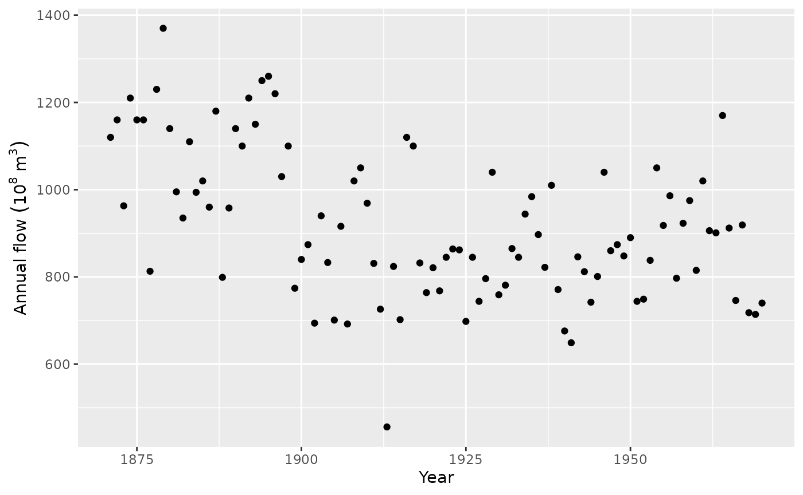

Annual flow is continuous. A Gaussian model is a reasonable starting
point for departures around a smooth mean, provided its residual spread
is reasonably stable. The observations are a time series, so
independence needs checking; year appearing in a smooth does not itself
model residual serial dependence. Fit the same Gaussian smooth with mgcv
and glmmTMB so we can compare the extracted effects and predictions.

``` r

nile_gam <- gam(flow ~ s(year, k = 10), data = nile, method = "REML")
nile_tmb <- glmmTMB(flow ~ s(year, k = 10), data = nile,
  family = gaussian(), REML = TRUE, start = list(theta = 5))
summary(nile_tmb)
#>  Family: gaussian  ( identity )
#> Formula:          flow ~ s(year, k = 10)
#> Data: nile
#> 
#>       AIC       BIC    logLik -2*log(L)  df.resid 
#>    1265.7    1276.1    -628.8    1257.7        96 
#> 
#> Random effects:
#> 
#> Conditional model:
#>  Groups   Name   Variance Std.Dev.
#>  dummy    dummy1 81075    284.7   
#>  Residual        19000    137.8   
#> Number of obs: 100, groups:  dummy, 1
#> 
#> Dispersion estimate for gaussian family (sigma^2): 1.9e+04 
#> 
#> Conditional model:
#>             Estimate Std. Error z value Pr(>|z|)    
#> (Intercept)   919.35      13.78   66.70   <2e-16 ***
#> s(year)1       99.30      86.34    1.15     0.25    
#> ---
#> Signif. codes:  0 '***' 0.001 '**' 0.01 '*' 0.05 '.' 0.1 ' ' 1
```

`k = 10` sets the size of the spline basis. The fitted penalty
determines how much the curve can bend within that basis. The `start`
argument supplies an initial log standard deviation for the spline’s
random coefficients, which glmmTMB estimates during fitting. The `dummy`
random effect in the summary represents those spline coefficients.

## Extract the smooth and its uncertainty

List the available smooths with
[`smooths()`](https://gavinsimpson.github.io/gratia/reference/smooths.md),
then extract the year effect with
[`smooth_estimates()`](https://gavinsimpson.github.io/gratia/reference/smooth_estimates.md).
Save the estimates so they can be inspected and passed to
[`draw()`](https://gavinsimpson.github.io/gratia/reference/draw.md)
without evaluating the model again.

``` r

smooths(nile_tmb)
#> [1] "s(year)"
head(smooth_coefs(nile_tmb, select = "s(year)"))
#>   s(year).1   s(year).2   s(year).3   s(year).4   s(year).5   s(year).6 
#>   18.174609 -115.231114   -2.991595  -24.387354  -15.572794   13.125102
trend <- smooth_estimates(nile_tmb, select = "s(year)",
  interval = "credible")
head(trend)
#> # A tibble: 6 × 9
#>   .smooth .type .by   .estimate   .se  year .crit .lower_ci .upper_ci
#>   <chr>   <chr> <chr>     <dbl> <dbl> <dbl> <dbl>     <dbl>     <dbl>
#> 1 s(year) TPRS  NA         226.  49.6  1871  1.96      129.      323.
#> 2 s(year) TPRS  NA         220.  46.3  1872  1.96      129.      311.
#> 3 s(year) TPRS  NA         214.  43.2  1873  1.96      129.      299.
#> 4 s(year) TPRS  NA         208.  40.4  1874  1.96      129.      287.
#> 5 s(year) TPRS  NA         202.  37.8  1875  1.96      128.      276.
#> 6 s(year) TPRS  NA         196.  35.6  1876  1.96      127.      266.
draw(trend, xlab = "Year", ylab = expression(Flow ~ contribution ~ (10^8 ~ m^3)))
```

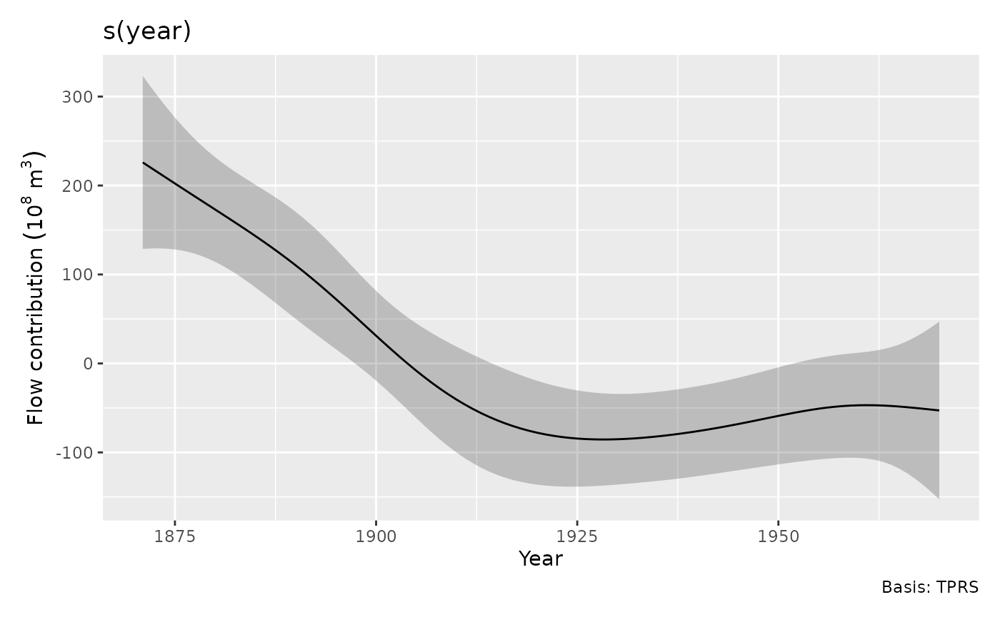

The curve shows the smooth’s contribution to expected flow. In this
model a positive value means that expected flow is above the fitted
intercept. The broad decline around the turn of the twentieth century is
clearer than the smaller changes that follow. The shaded region shows
uncertainty in the estimated trend at each year and includes uncertainty
in the intercept by default.

The interval uses glmmTMB’s covariance for the fitted coefficients,
including covariance between fixed and random coefficients. The mgcv
covariance options `frequentist = TRUE` and `unconditional = TRUE` are
unavailable for glmmTMB effects.

At any particular year a pointwise interval is useful. If the claim
concerns the entire plotted trend, ask for a simultaneous band instead:

``` r

draw(nile_tmb, select = "s(year)", interval = "simultaneous",
  n = 120, n_sim = 3000, seed = 71,
  xlab = "Year", ylab = expression(Flow ~ contribution ~ (10^8 ~ m^3)))
```

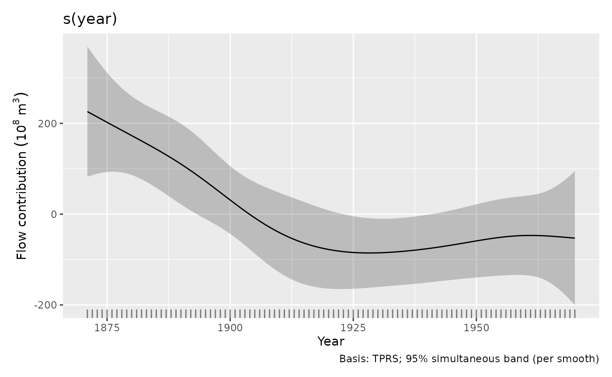

The wider band is designed to cover the trend jointly across the years
where the smooth was evaluated. The earlier `interval = "credible"` is
an alias for the pointwise option, `interval = "confidence"`. For mgcv
models, choose `frequentist = TRUE` to change the covariance used to
calculate either type of interval.

For the full expected flow, add the intercept. Here the model has just
one smooth and an identity link, so this gives a direct comparison with
both packages’ predictions:

``` r

year_grid <- data.frame(year = seq(1871, 1970, length.out = 120))
full_trend <- smooth_estimates(nile_tmb, data = year_grid,
  interval = "credible")
full_trend$mean_flow <- full_trend$.estimate + unname(fixef(nile_tmb)$cond[1])
full_trend$lower <- full_trend$.lower_ci + unname(fixef(nile_tmb)$cond[1])
full_trend$upper <- full_trend$.upper_ci + unname(fixef(nile_tmb)$cond[1])
full_trend$mgcv_mean <- as.numeric(predict(nile_gam, newdata = year_grid))
ggplot(full_trend, aes(year, mean_flow)) +
  geom_point(data = nile, aes(y = flow), alpha = 0.5) +
  geom_ribbon(aes(ymin = lower, ymax = upper), alpha = 0.2) +
  geom_line() +
  geom_line(aes(y = mgcv_mean), colour = "steelblue", linetype = 2) +
  labs(x = "Year", y = expression(Annual ~ flow ~ (10^8 ~ m^3)),
    subtitle = "glmmTMB mean and interval; dashed blue line is the mgcv mean")
```

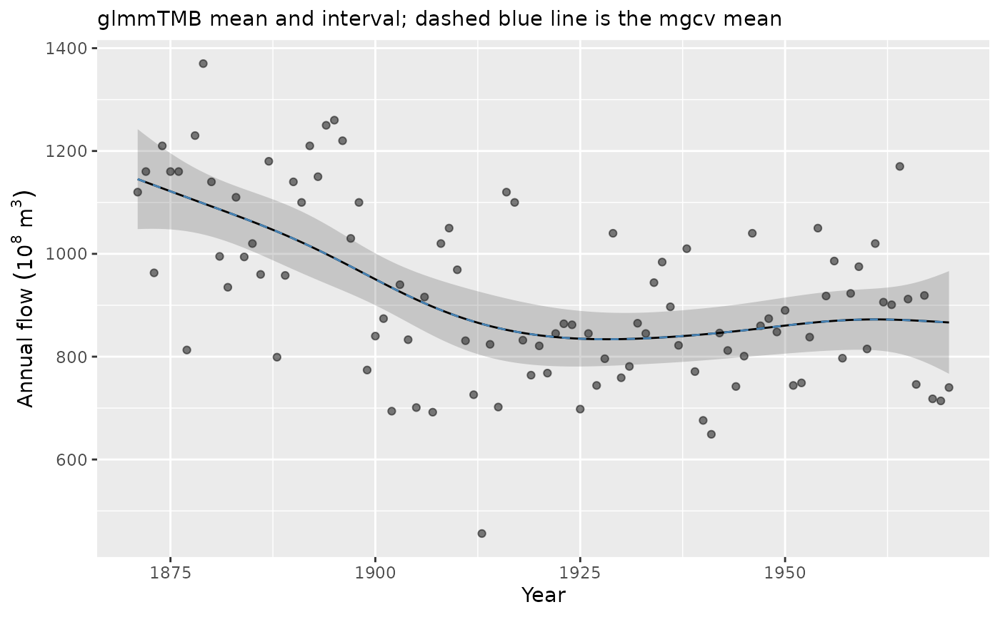

`overall_uncertainty = TRUE`, the default, includes uncertainty in the
model constant in the smooth’s standard errors. Adding the intercept to
the displayed values therefore gives appropriate mean intervals for this
one-smooth model. For a model with several terms, adding only the
intercept would leave out the other contributions; use predictions from
the full model instead. The two mean curves almost coincide here because
the models use the same Gaussian likelihood and spline penalty. Such
agreement is not expected automatically for non-Gaussian fits or more
complex random-effect structures.

For the mgcv fit, we can compare the two covariance choices at years of
interest while leaving the estimated trend unchanged:

``` r

comparison_years <- data.frame(year = c(1880, 1920))
bayesian_effect <- smooth_estimates(nile_gam, data = comparison_years)
frequentist_effect <- smooth_estimates(nile_gam, data = comparison_years,
  frequentist = TRUE, interval = "confidence")
data.frame(year = comparison_years$year,
  contribution = bayesian_effect$.estimate,
  bayesian_se = bayesian_effect$.se,
  frequentist_se = frequentist_effect$.se)
#>   year contribution bayesian_se frequentist_se
#> 1 1880    172.99113    29.51978       28.36395
#> 2 1920    -77.82668    25.22793       22.21411
gam_covariance <- get_vcov(nile_gam, frequentist = TRUE)
```

The frequentist covariance describes how the estimated coefficients
would vary across repeated samples with the smoothing parameters held
fixed. Its standard errors describe sampling variation and can be small
even when smoothing pulls the estimate away from the true curve. The
default for smooth-effect intervals is the approximate Bayesian
covariance. Use
[`get_vcov()`](https://gavinsimpson.github.io/gratia/reference/get_vcov.md)
to extract the covariance for your own calculations.

## Check residual variation and serial correlation

Use
[`appraise()`](https://gavinsimpson.github.io/gratia/reference/appraise.md)
to compare the residual distribution with simulations from the fitted
model. Then use
[`residual_correlation_plot()`](https://gavinsimpson.github.io/gratia/reference/residual_correlation.md)
to look for similar departures in successive years, which the
independent Gaussian errors do not represent.

``` r

appraise(nile_tmb, type = "pearson", method = "simulate",
  n_simulate = 100, seed = 72)
```

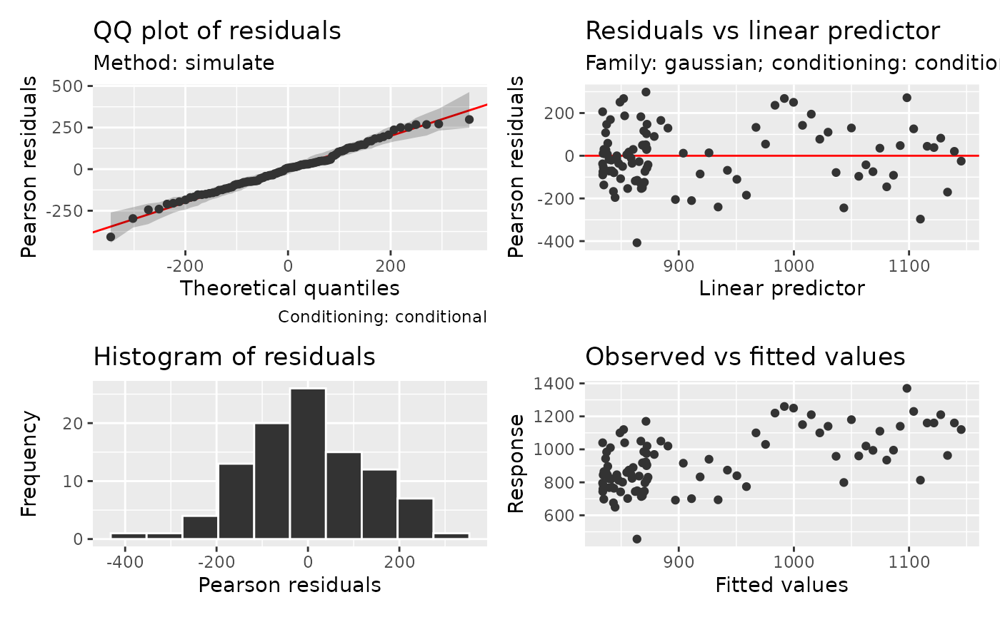

``` r

residual_correlation_plot(nile_tmb, type = "pearson", lag_max = 15)
```

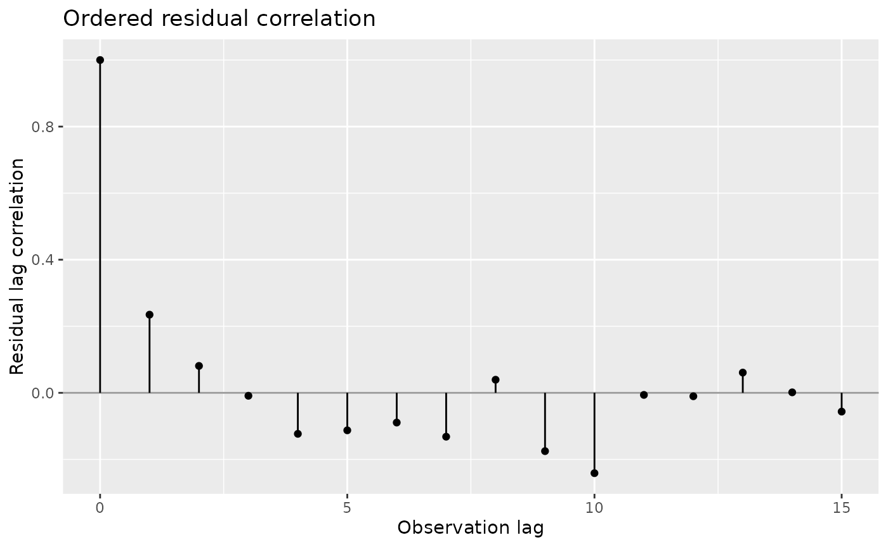

The panel uses glmmTMB’s Pearson residuals. For this Gaussian fit they
remain on the scale of the flow response, rather than standard-normal
scores. Simulated QQ references hold the fitted smooth fixed and
generate new annual responses. They check the response distribution
under this fitted model; they do not refit the trend. The separate
autocorrelation plot asks whether successive departures still resemble
one another. Its correlations describe ordered residual structure, with
no significance bands that assume independent residuals. Lags are
observation positions; here each position corresponds to one year.

Most of the QQ points follow their simulated reference, with the
lowest-flow observation standing out in the lower tail. The
serial-correlation plot checks whether neighbouring years have similar
departures from that distribution.

The residual correlation at lag one is about 0.24, with much smaller
correlation at lag two. Some adjacent-year structure remains after
removing the smooth trend. A time-series model can represent that
remaining correlation when estimating trend uncertainty. The smooth
describes a broad decline in mean flow, while the residual check
identifies variation that its independent Gaussian errors leave
unexplained. See [the model diagnostics
article](https://gavinsimpson.github.io/gratia/articles/model-checking.md)
for checks of dependence and for the distinction between holding effects
fixed, drawing their uncertainty and simulating new effects.

## Plot smooth and random effects for repeated plant measurements

The `CO2` experiment recorded carbon dioxide uptake by twelve plants of
*Echinochloa crus-galli* at seven concentrations. The researchers paired
plants within each origin (Quebec or Mississippi). One plant in each
pair received the chilling treatment and the other served as a control.
Table 1 of the [original
study](https://biology.mcgill.ca/faculty/potvin/articles/PotvinLech_90.pdf)
gives concentrations in \mu\mathrm{L}\\\mathrm{L}^{-1}. We use these
data to illustrate repeated measurements, with a Gamma model to let the
variance of positive uptake increase with its mean.

We use a shared smooth response to concentration, an origin-by-treatment
interaction and plant-specific intercepts and slopes. The shared smooth
describes the curved response, and the slopes allow plants to differ in
their response to concentration. The model accounts for repeated
measurements within each plant. The treatment terms illustrate how to
plot an interaction in this fit, which omits the pairing used in the
experiment.

``` r

plant <- as.data.frame(CO2)
plant$Plant <- factor(plant$Plant, ordered = FALSE)
plant$log_conc <- log(plant$conc) - mean(log(plant$conc))
plant_tmb <- glmmTMB(
  uptake ~ Type * Treatment + s(log_conc, k = 5) + (1 + log_conc | Plant),
  data = plant, family = Gamma(link = "log"), REML = TRUE)
summary(plant_tmb)
#>  Family: Gamma  ( log )
#> Formula:          
#> uptake ~ Type * Treatment + s(log_conc, k = 5) + (1 + log_conc |      Plant)
#> Data: plant
#> 
#>       AIC       BIC    logLik -2*log(L)  df.resid 
#>     454.1     478.4    -217.0     434.1        74 
#> 
#> Random effects:
#> 
#> Conditional model:
#>  Groups Name        Variance Std.Dev. Corr 
#>  dummy  dummy1      0.532393 0.72965       
#>  Plant  (Intercept) 0.013376 0.11565       
#>         log_conc    0.007544 0.08685  0.36 
#> Number of obs: 84, groups:  Plant, 12; dummy, 1
#> 
#> Dispersion estimate for Gamma family (sigma^2): 0.0067 
#> 
#> Conditional model:
#>                                  Estimate Std. Error z value Pr(>|z|)    
#> (Intercept)                       3.50826    0.06743   52.03  < 2e-16 ***
#> TypeMississippi                  -0.31784    0.09327   -3.41 0.000655 ***
#> Treatmentchilled                 -0.13966    0.09931   -1.41 0.159638    
#> TypeMississippi:Treatmentchilled -0.27192    0.18888   -1.44 0.149972    
#> s(log_conc)1                     -0.46392    0.04158  -11.16  < 2e-16 ***
#> ---
#> Signif. codes:  0 '***' 0.001 '**' 0.01 '*' 0.05 '.' 0.1 ' ' 1
```

For non-Gaussian responses, glmmTMB recommends simulations for the
intended design to check REML estimates and interval coverage.

Each plant’s random intercept gives its departure from the shared
predictor at the geometric mean concentration, where `log_conc` is zero.
The shared curve represents rapid change at low concentrations and
slower change at high concentrations. The interaction allows the
treatment difference in log mean uptake to vary by origin.

Plot the model effects to see the shared concentration curve, treatment
contributions, and differences between plants in one figure.

``` r

draw(plant_tmb, ncol = 2)
```

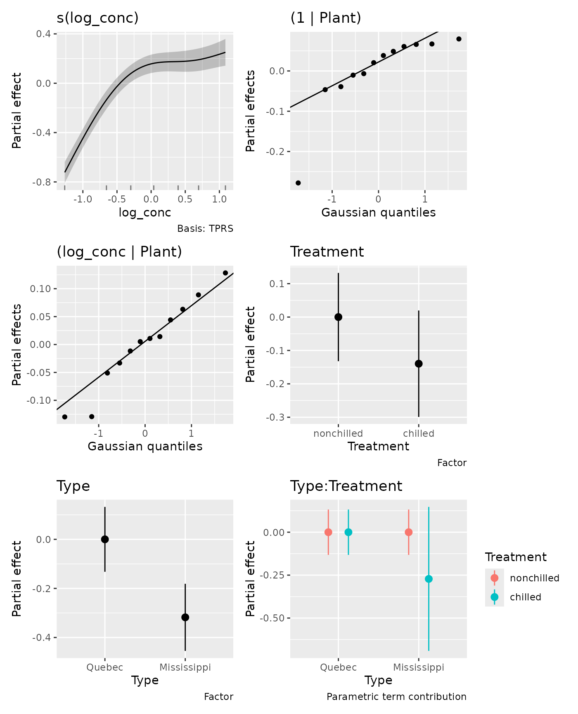

[`draw()`](https://gavinsimpson.github.io/gratia/reference/draw.md)
includes smooths, random effects and parametric effects by default. The
Gaussian QQ panels for plant intercepts and slopes show fitted plant
deviations, not response residuals. The random coefficients that encode
the spline are excluded from these panels. `parametric = FALSE` omits
parametric panels; an explicit `select` draws only selected effects
unless `parametric = TRUE` is also supplied. To see each plant’s
combined intercept and slope contribution, select both random-effect
terms and set `ranef_lines = TRUE`.

``` r

draw(plant_tmb, select = c("(1 | Plant)", "(log_conc | Plant)"),
  ranef_lines = TRUE)
```

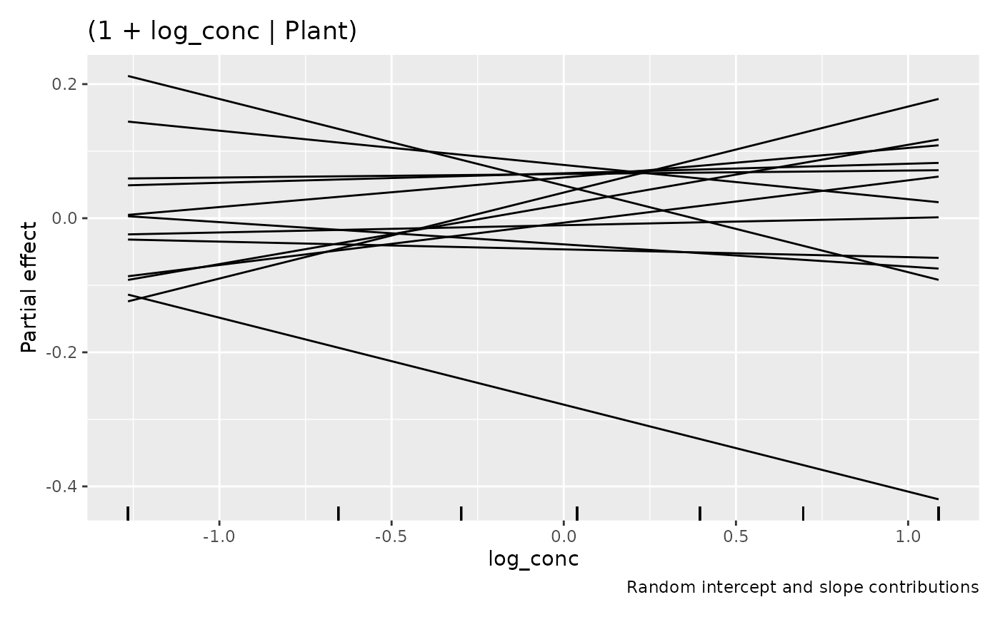

Each line shows plant j’s departure from the shared predictor, b\_{0j} +
x b\_{1j}, where x is the centred log concentration. This display
requires an intercept and a single numeric slope in the same formula
term. Terms with multiple slopes, transformed or factor slopes, or
structured covariance use separate QQ panels.

Use
[`parametric_effects()`](https://gavinsimpson.github.io/gratia/reference/parametric_effects.md)
to isolate the origin-by-treatment interaction. This shows how treatment
differences vary between the two origins.

``` r

parametric_terms(plant_tmb)
#>             Type        Treatment   Type:Treatment 
#>           "Type"      "Treatment" "Type:Treatment"
draw(parametric_effects(plant_tmb, terms = "Type:Treatment"))
```

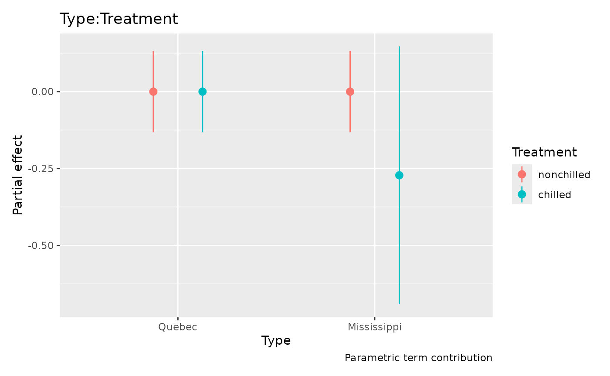

These are contrast-coded partial contributions on the log scale.
Contrast coding gives the reference category a zero contribution; full
predictions add the intercept and the other model terms. Parametric
intervals include intercept uncertainty and its covariance with the term
by default; use `overall_uncertainty = FALSE` for uncertainty in the
term alone. The estimated partial contributions do not change. Full
predictions combine all terms:

``` r

plant$expected <- as.numeric(predict(plant_tmb, type = "response"))
ggplot(plant, aes(conc, uptake, group = Plant, colour = Treatment)) +
  geom_point() +
  geom_line(aes(y = expected)) +
  facet_wrap(~ Type) +
  labs(x = expression(CO[2] ~ concentration ~ (mu * L ~ L^{-1})),
    y = expression(CO[2] ~ uptake ~ (mu * mol ~ m^{-2} ~ s^{-1})))
```

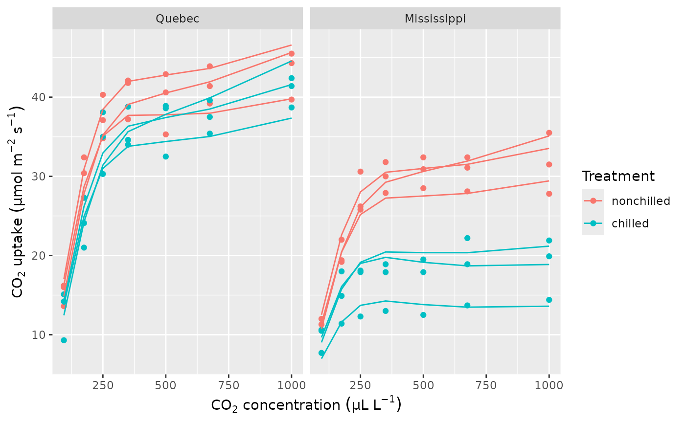

The curves describe these observed plants, including their fitted
deviations. Use
[`appraise()`](https://gavinsimpson.github.io/gratia/reference/appraise.md)
to assess whether the Gamma response distribution and shared
concentration curve describe the observations adequately.

``` r

appraise(plant_tmb, type = "quantile", seed = 73)
```

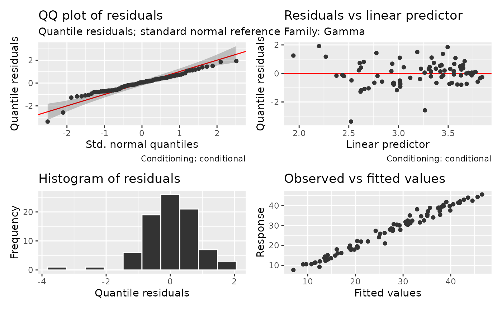

The lowest quantile score stands out below the normal reference: one
measurement is substantially lower than its fitted distribution would
typically produce. Inspect the fitted curve for that plant to see
whether other measurements show a similar departure. [Plotting
group-specific smooths and parametric
interactions](https://gavinsimpson.github.io/gratia/articles/smooth-effects.md)
explores more flexible plant-specific curves.

The check above holds the fitted plant effects and smooth fixed. With
`conditioning = "marginal"`, glmmTMB instead simulates new plant effects
**and new spline random coefficients**. That checks the distribution of
both plant variation and the shared curve. See the [diagnostics
article](https://gavinsimpson.github.io/gratia/articles/model-checking.md)
for choosing between these checks and posterior predictive checks. The
`glmmTMB-methods` help topic lists supported response families, model
components and current restrictions.
