# Smooth trends and repeated measurements with glmmTMB

A smooth describes a relationship without requiring it to be linear.
glmmTMB can estimate these relationships alongside its other model
components, and gratia can now extract and display their effects. The
examples below ask how annual river flow changes over time and how
plants respond to increasing carbon dioxide concentration. The second
example also accounts for measurements on the same plant.

This article needs the optional package glmmTMB, with support for
[`mgcv::s()`](https://rdrr.io/pkg/mgcv/man/s.html) terms; the examples
require glmmTMB 1.1.15.2 or later and mgcv 1.9-4. Smooth fitting remains
experimental in glmmTMB. Its [fitting
documentation](https://glmmtmb.github.io/glmmTMB/reference/glmmTMB.html)
recommends `REML = TRUE`. Use an unqualified
[`s()`](https://rdrr.io/pkg/mgcv/man/s.html) in the formula after
attaching mgcv, rather than replacing the smooth with an unpenalised
spline basis. The smoothing penalty is estimated during fitting.

``` r

library("mgcv")
library("glmmTMB")
library("gratia")
library("ggplot2")
```

## How did the mean annual flow of the Nile change?

The [Nile
data](https://stat.ethz.ch/R-manual/R-devel/library/datasets/html/Nile.html)
contain 100 annual flow measurements at Aswan from 1871 to 1970,
measured in units of $`10^8`$ cubic metres. The question here is
descriptive: what broad change in mean flow is supported by these
observations? We adapt the smooth example in the glmmTMB documentation,
name the variables `year` and `flow`, and fit the same spline with mgcv
for comparison.

``` r

nile <- data.frame(
  year = as.numeric(time(Nile)),
  flow = as.numeric(Nile)
)
ggplot(nile, aes(year, flow)) +
  geom_point() +
  labs(x = "Year", y = expression(Annual ~ flow ~ (10^8 ~ m^3)))
```

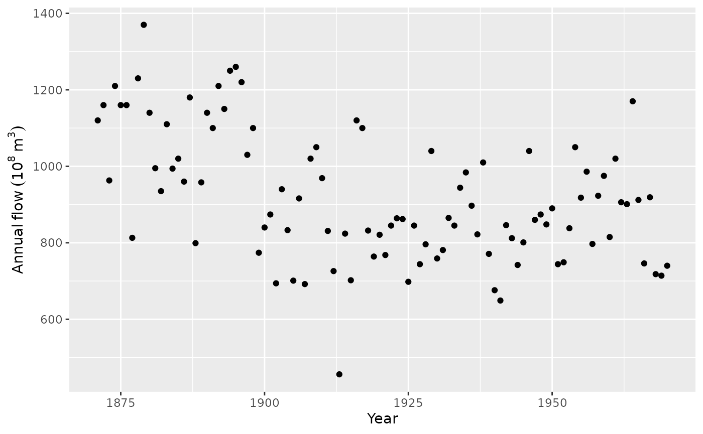

Annual flow is continuous. A Gaussian model is a reasonable starting
point for departures around a smooth mean, provided its residual spread
is reasonably stable. The observations are a time series, so
independence needs checking; year appearing in a smooth does not itself
model residual serial dependence.

``` r

nile_gam <- gam(flow ~ s(year, k = 10), data = nile, method = "REML")
nile_tmb <- glmmTMB(flow ~ s(year, k = 10), data = nile,
  family = gaussian(), REML = TRUE, start = list(theta = 5))
summary(nile_tmb)
#>  Family: gaussian  ( identity )
#> Formula:          flow ~ s(year, k = 10)
#> Data: nile
#> 
#>       AIC       BIC    logLik -2*log(L)  df.resid 
#>    1265.7    1276.1    -628.8    1257.7        96 
#> 
#> Random effects:
#> 
#> Conditional model:
#>  Groups   Name   Variance Std.Dev.
#>  dummy    dummy1 81075    284.7   
#>  Residual        19000    137.8   
#> Number of obs: 100, groups:  dummy, 1
#> 
#> Dispersion estimate for gaussian family (sigma^2): 1.9e+04 
#> 
#> Conditional model:
#>             Estimate Std. Error z value Pr(>|z|)    
#> (Intercept)   919.35      13.78   66.70   <2e-16 ***
#> s(year)1       99.30      86.34    1.15     0.25    
#> ---
#> Signif. codes:  0 '***' 0.001 '**' 0.01 '*' 0.05 '.' 0.1 ' ' 1
```

`k = 10` sets the size of the available spline basis, rather than fixing
ten effective degrees of freedom. The fitted penalty discourages
unnecessary wiggliness. `start` follows the package’s Nile example and
supplies an initial log standard deviation for the spline’s random
coefficients; it does not fix their fitted variance. The `dummy` random
effect in the printed summary is part of the spline representation, not
an additional sampled group.

## Extract the trend and read its uncertainty

``` r

smooths(nile_tmb)
#> [1] "s(year)"
head(smooth_coefs(nile_tmb, select = "s(year)"))
#>   s(year).1   s(year).2   s(year).3   s(year).4   s(year).5   s(year).6 
#>   18.174609 -115.231114   -2.991595  -24.387354  -15.572794   13.125102
trend <- smooth_estimates(nile_tmb, select = "s(year)",
  interval = "credible")
head(trend)
#> # A tibble: 6 × 9
#>   .smooth .type .by   .estimate   .se  year .crit .lower_ci .upper_ci
#>   <chr>   <chr> <chr>     <dbl> <dbl> <dbl> <dbl>     <dbl>     <dbl>
#> 1 s(year) TPRS  NA         226.  49.6  1871  1.96      129.      323.
#> 2 s(year) TPRS  NA         220.  46.3  1872  1.96      129.      311.
#> 3 s(year) TPRS  NA         214.  43.2  1873  1.96      129.      299.
#> 4 s(year) TPRS  NA         208.  40.4  1874  1.96      129.      287.
#> 5 s(year) TPRS  NA         202.  37.8  1875  1.96      128.      276.
#> 6 s(year) TPRS  NA         196.  35.6  1876  1.96      127.      266.
draw(trend, xlab = "Year", ylab = expression(Flow ~ contribution ~ (10^8 ~ m^3)))
```

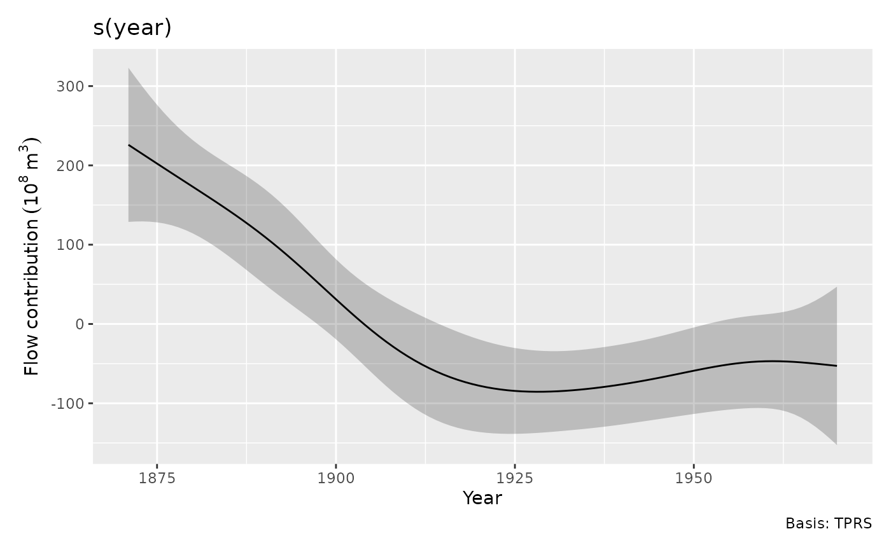

The curve is the smooth’s contribution relative to its centring
constraint, not the full expected flow. Positive values indicate flow
above the fitted intercept. The broad decline from the late nineteenth
century to the early twentieth century is much clearer than the small
subsequent undulations. The shaded region concerns uncertainty in the
fitted mean contribution; it does not describe the spread of individual
annual observations.

The default interval uses the joint TMB covariance, transformed back to
the mgcv smooth coefficients. It includes covariance between fixed and
fitted random coefficients. This is not mgcv’s frequentist covariance or
its optional correction for uncertainty in smoothing parameters:
`frequentist = TRUE` and `unconditional = TRUE` are unavailable for
glmmTMB effects.

At any particular year a pointwise interval is useful. If the claim
concerns the entire plotted trend, ask for a simultaneous band instead:

``` r

draw(nile_tmb, select = "s(year)", interval = "simultaneous",
  n = 120, n_sim = 3000, seed = 71,
  xlab = "Year", ylab = expression(Flow ~ contribution ~ (10^8 ~ m^3)))
```

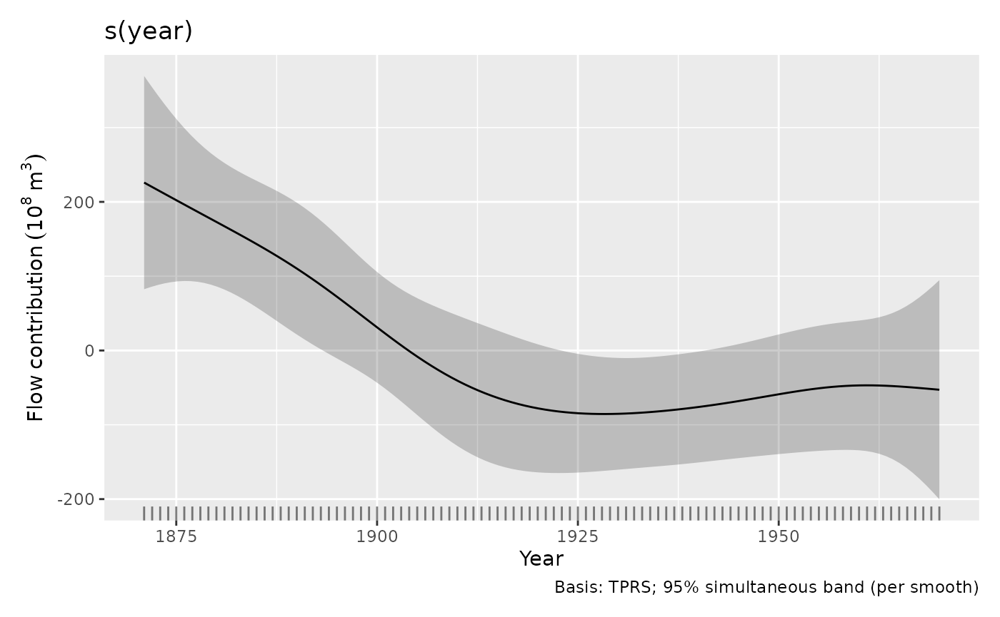

The wider band has approximate coverage over the finite evaluation grid
of this smooth. It is not a prediction interval, and it does not claim
joint coverage across all model terms. `interval = "credible"` is an
alias for the pointwise `"confidence"` option. With mgcv models,
[`smooth_estimates()`](https://gavinsimpson.github.io/gratia/reference/smooth_estimates.md)
also allows `frequentist = TRUE`; that changes the covariance used,
rather than changing a pointwise statement into a simultaneous one.
[`get_vcov()`](https://gavinsimpson.github.io/gratia/reference/get_vcov.md)
makes the chosen model covariance available for custom calculations.

For the full expected flow, add the intercept. Here the model has just
one smooth and an identity link, so this gives a direct comparison with
both packages’ predictions:

``` r

year_grid <- data.frame(year = seq(1871, 1970, length.out = 120))
full_trend <- smooth_estimates(nile_tmb, data = year_grid,
  interval = "credible")
full_trend$mean_flow <- full_trend$.estimate + unname(fixef(nile_tmb)$cond[1])
full_trend$lower <- full_trend$.lower_ci + unname(fixef(nile_tmb)$cond[1])
full_trend$upper <- full_trend$.upper_ci + unname(fixef(nile_tmb)$cond[1])
full_trend$mgcv_mean <- as.numeric(predict(nile_gam, newdata = year_grid))
ggplot(full_trend, aes(year, mean_flow)) +
  geom_point(data = nile, aes(y = flow), alpha = 0.5) +
  geom_ribbon(aes(ymin = lower, ymax = upper), alpha = 0.2) +
  geom_line() +
  geom_line(aes(y = mgcv_mean), colour = "steelblue", linetype = 2) +
  labs(x = "Year", y = expression(Annual ~ flow ~ (10^8 ~ m^3)),
    subtitle = "glmmTMB mean and interval; dashed blue line is the mgcv mean")
```

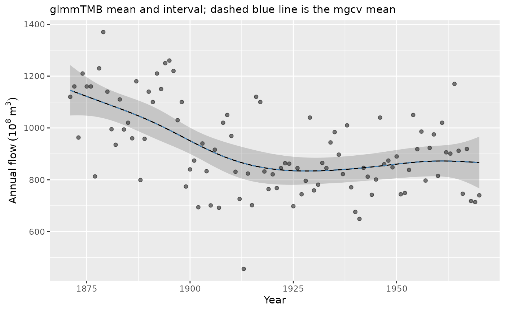

`overall_uncertainty = TRUE`, the default, includes uncertainty in the
model constant in the smooth’s standard errors. Adding the intercept to
the displayed values therefore gives appropriate mean intervals for this
one-smooth model. For a model with several terms, adding only the
intercept would leave out the other contributions; use predictions from
the full model instead. The two mean curves almost coincide here because
the models use the same Gaussian likelihood and spline penalty. Such
agreement is not expected automatically for non-Gaussian fits or more
complex random-effect structures.

For the mgcv fit, we can compare the two covariance choices at years of
interest while leaving the estimated trend unchanged:

``` r

comparison_years <- data.frame(year = c(1880, 1920))
bayesian_effect <- smooth_estimates(nile_gam, data = comparison_years)
frequentist_effect <- smooth_estimates(nile_gam, data = comparison_years,
  frequentist = TRUE, interval = "confidence")
data.frame(year = comparison_years$year,
  contribution = bayesian_effect$.estimate,
  bayesian_se = bayesian_effect$.se,
  frequentist_se = frequentist_effect$.se)
#>   year contribution bayesian_se frequentist_se
#> 1 1880    172.99113    29.51978       28.36395
#> 2 1920    -77.82668    25.22793       22.21411
gam_covariance <- get_vcov(nile_gam, frequentist = TRUE)
```

The frequentist covariance concerns sampling variability of the
penalised coefficient estimator with smoothing parameters held fixed.
Smaller standard errors do not account for the bias introduced by
penalisation. The default approximate Bayesian covariance is usually the
useful starting point for smooth-effect intervals. The final line
extracts the chosen covariance for custom calculations.

## Does the fitted distribution explain variation around the trend?

``` r

appraise(nile_tmb, type = "pearson", method = "simulate",
  n_simulate = 100, seed = 72)
```

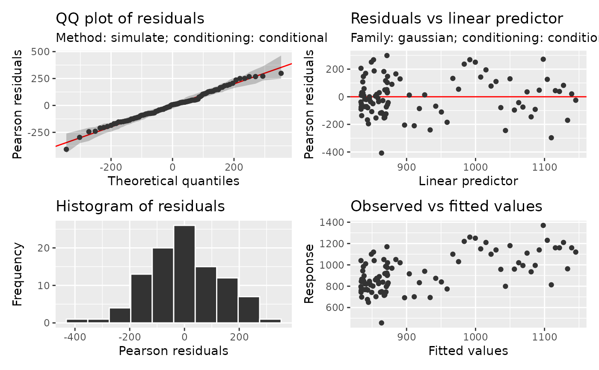

``` r

residual_correlation_plot(nile_tmb, type = "pearson", lag_max = 15)
```

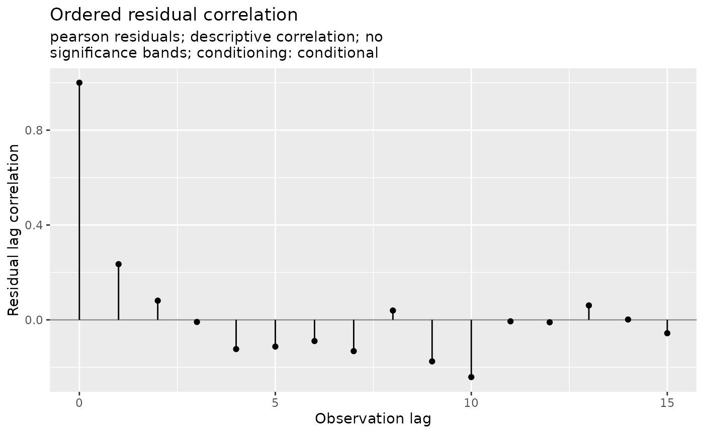

The panel uses glmmTMB’s native Pearson residuals. For this Gaussian fit
they remain on the scale of the flow response, rather than
standard-normal scores. Simulated QQ references hold the fitted smooth
fixed and generate new annual responses. They check the response
distribution under this fitted model; they do not refit the trend. The
separate autocorrelation plot asks whether successive departures still
resemble one another. Its correlations describe ordered residual
structure, with no significance bands that assume independent residuals.
Lags are observation positions; here each position corresponds to one
year.

Most of the QQ points follow their simulated reference, with the
lowest-flow observation standing out in the lower tail. The
serial-correlation plot checks whether neighbouring years have similar
departures from that distribution.

The residual correlation at lag one is about 0.24, with much smaller
correlation at lag two. Some adjacent-year structure remains after
removing the smooth trend. A time-series model can represent that
remaining correlation when estimating trend uncertainty. The smooth
describes a broad decline in mean flow, while the residual check
identifies variation that its independent Gaussian errors leave
unexplained. See [Choosing diagnostic
references](https://gavinsimpson.github.io/gratia/articles/model-checking.md)
for checks of dependence and for the distinction between holding effects
fixed, drawing their uncertainty and simulating new effects.

## Do repeated measurements change how we read plant responses?

The `CO2` experiment recorded carbon dioxide uptake by twelve plants of
*Echinochloa crus-galli* at seven concentrations. Plants came from
Quebec or Mississippi and received chilled or nonchilled treatment. See
[`?datasets::CO2`](https://rdrr.io/r/datasets/zCO2.html) for the
experiment and units. Uptake is positive, and a Gamma model with a log
link allows its residual variance to grow with the mean. Measurements
from one plant share individual characteristics. The 84 measurements
provide only twelve independently treated plants.

We use a shared smooth response to concentration, an origin-by-treatment
interaction, and plant-specific intercepts and slopes. These slopes
allow individual plants to differ in their response to concentration
without assuming that the population response itself is linear.

``` r

plant <- as.data.frame(CO2)
plant$Plant <- factor(plant$Plant, ordered = FALSE)
plant$log_conc <- log(plant$conc) - mean(log(plant$conc))
plant_tmb <- glmmTMB(
  uptake ~ Type * Treatment + s(log_conc, k = 5) + (1 + log_conc | Plant),
  data = plant, family = Gamma(link = "log"), REML = TRUE)
summary(plant_tmb)
#>  Family: Gamma  ( log )
#> Formula:          
#> uptake ~ Type * Treatment + s(log_conc, k = 5) + (1 + log_conc |      Plant)
#> Data: plant
#> 
#>       AIC       BIC    logLik -2*log(L)  df.resid 
#>     454.1     478.4    -217.0     434.1        74 
#> 
#> Random effects:
#> 
#> Conditional model:
#>  Groups Name        Variance Std.Dev. Corr 
#>  dummy  dummy1      0.532393 0.72965       
#>  Plant  (Intercept) 0.013376 0.11565       
#>         log_conc    0.007544 0.08685  0.36 
#> Number of obs: 84, groups:  Plant, 12; dummy, 1
#> 
#> Dispersion estimate for Gamma family (sigma^2): 0.0067 
#> 
#> Conditional model:
#>                                  Estimate Std. Error z value Pr(>|z|)    
#> (Intercept)                       3.50826    0.06743   52.03  < 2e-16 ***
#> TypeMississippi                  -0.31784    0.09327   -3.41 0.000655 ***
#> Treatmentchilled                 -0.13966    0.09931   -1.41 0.159638    
#> TypeMississippi:Treatmentchilled -0.27192    0.18888   -1.44 0.149972    
#> s(log_conc)1                      0.46392    0.04158   11.16  < 2e-16 ***
#> ---
#> Signif. codes:  0 '***' 0.001 '**' 0.01 '*' 0.05 '.' 0.1 ' ' 1
```

For non-Gaussian responses, glmmTMB recommends simulations for the
intended design to check REML estimates and interval coverage.

The centred log concentration improves the interpretation of plant
intercepts: they apply at the geometric mean concentration. The shared
curve represents rapid change at low concentrations and slower change at
high concentrations. The treatment interaction allows its shift in log
mean uptake to differ by origin. With only three plants in each
origin-treatment combination, the treatment estimates remain uncertain.

``` r

draw(plant_tmb, ncol = 2)
```

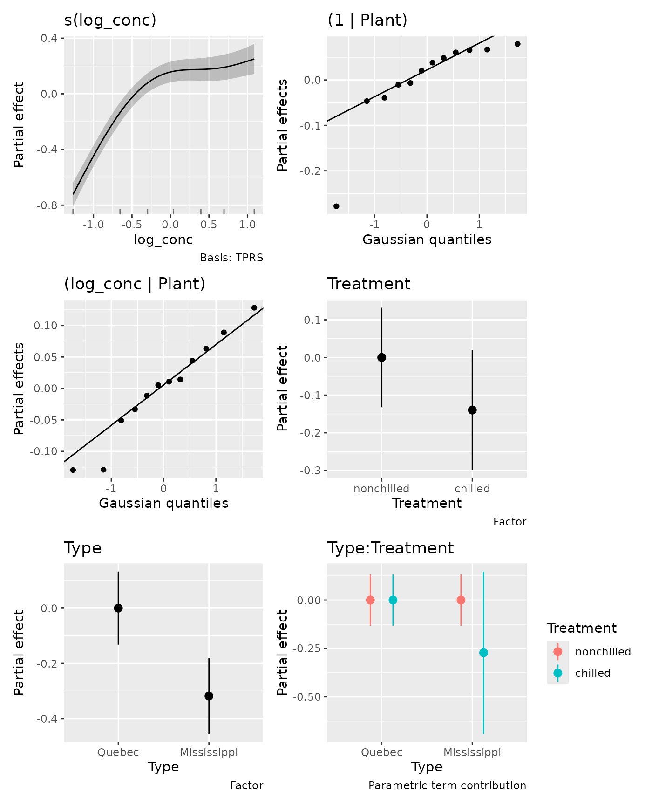

[`draw()`](https://gavinsimpson.github.io/gratia/reference/draw.md)
includes smooths, native random effects and parametric effects by
default. The Gaussian QQ panels for plant intercepts and slopes show
fitted plant deviations, not response residuals. The random coefficients
that encode the spline are excluded from these panels.
`parametric = FALSE` omits parametric panels; an explicit `select` draws
only selected effects unless `parametric = TRUE` is also supplied.

``` r

draw(plant_tmb, select = c("(1 | Plant)", "(log_conc | Plant)"),
  ranef_lines = TRUE)
```

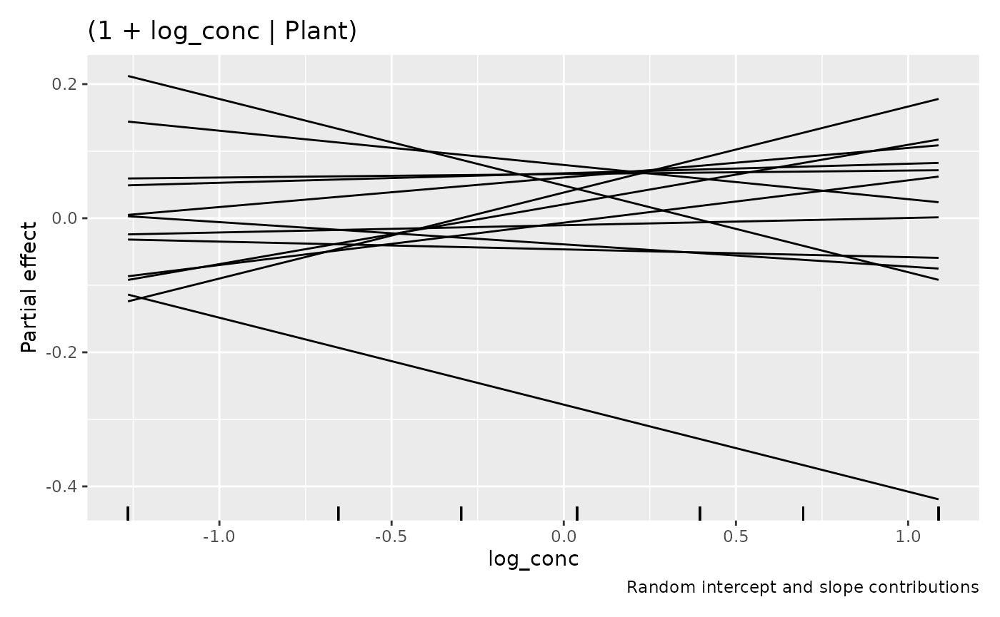

These lines are each plant’s random contribution $`b_{0j} + x b_{1j}`$
on the log scale. They do not include the shared curve or treatment
means and have no uncertainty bands. This display requires a simple
numeric intercept-slope pair from the same formula term. Multiple
slopes, transformed or factor slopes, and structured covariance terms
retain separate QQ panels.

The interaction deserves a focused view rather than interpreting two
main effects separately:

``` r

parametric_terms(plant_tmb)
#>             Type        Treatment   Type:Treatment 
#>           "Type"      "Treatment" "Type:Treatment"
draw(parametric_effects(plant_tmb, terms = "Type:Treatment"))
```

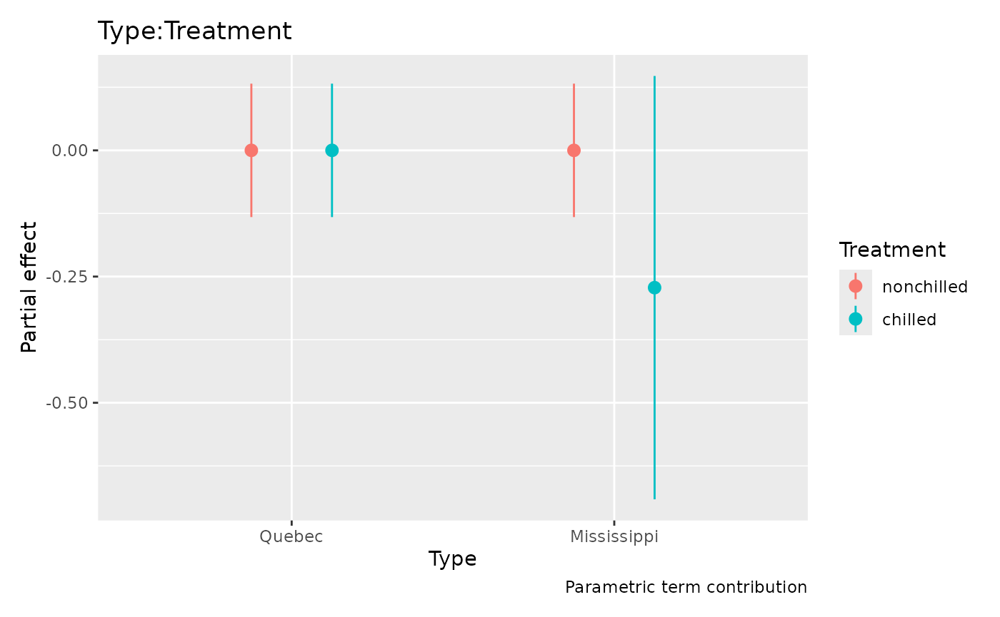

These are contrast-coded partial contributions on the log scale.
Contrast coding gives the reference category a zero contribution; full
predictions add the intercept and the other model terms. Parametric
intervals now include intercept uncertainty and its covariance with the
term by default; use `overall_uncertainty = FALSE` for uncertainty in
the term alone. The estimated partial contributions do not change. Full
predictions combine all terms:

``` r

plant$expected <- as.numeric(predict(plant_tmb, type = "response"))
ggplot(plant, aes(conc, uptake, group = Plant, colour = Treatment)) +
  geom_point() +
  geom_line(aes(y = expected)) +
  facet_wrap(~ Type) +
  labs(x = "Carbon dioxide concentration (mL/L)",
    y = expression(CO[2] ~ uptake ~ (mu * mol ~ m^{-2} ~ s^{-1})))
```

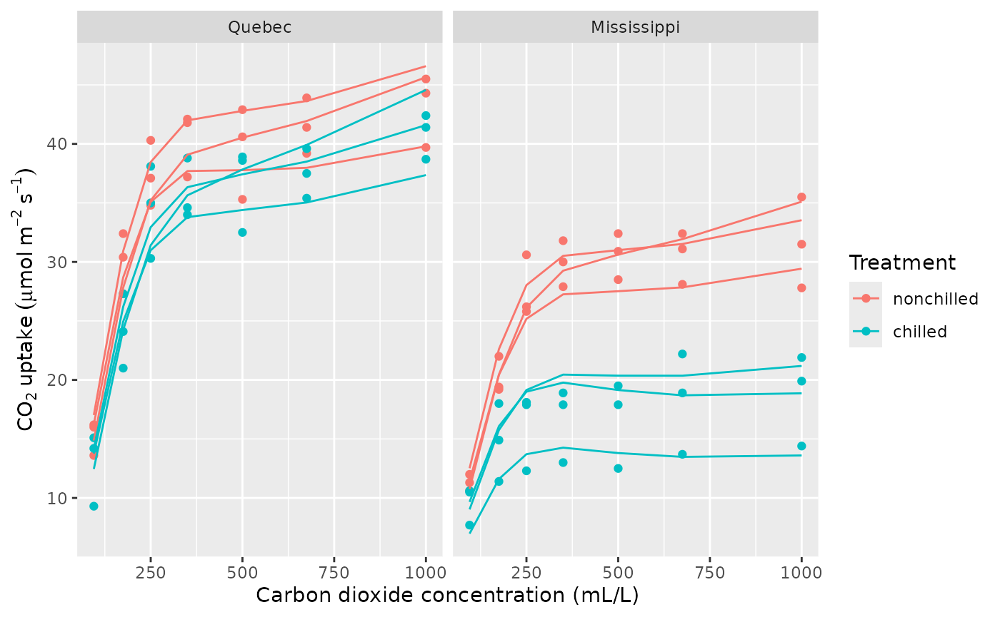

The curves describe these observed plants, including their fitted
deviations. They are not marginal mean curves for a new plant. The Gamma
model and common nonlinear shape are working assumptions that should be
checked:

``` r

appraise(plant_tmb, type = "quantile", seed = 73)
```

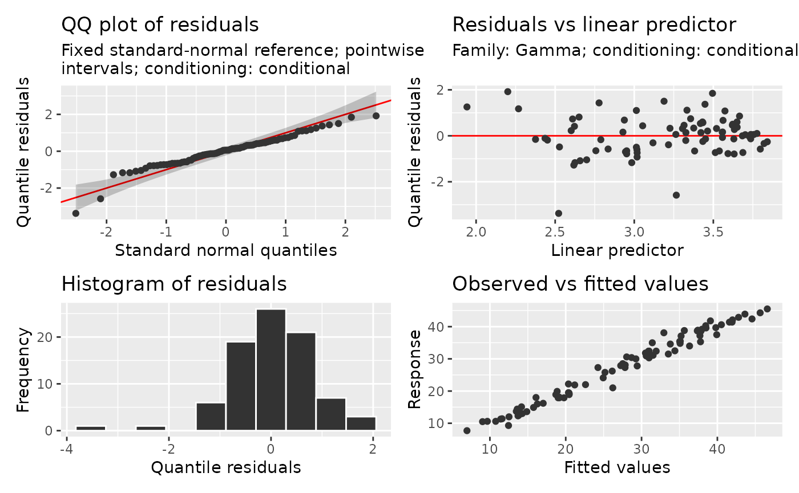

The lowest quantile score stands out below the normal reference: one
measurement is substantially lower than its fitted distribution would
typically produce. Inspect that observation and the fitted curve for its
plant to decide whether its individual concentration response needs more
flexibility. [Read smooth effects, interactions and
surfaces](https://gavinsimpson.github.io/gratia/articles/smooth-effects.md)
explores more flexible plant-specific curves.

A conditional check holds the fitted plant effects and smooth fixed.
Quantile residuals use a fixed standard-normal reference to assess the
distribution of individual scores conditional on those effects; the
reference does not preserve dependence between scores. A marginal check
instead draws new plant effects **and new spline random coefficients**
with glmmTMB’s simulator. It therefore checks a broader distribution
than that of new plants around a fixed shared concentration curve. The
same scope applies to marginal posterior predictive checks. Conditional
posterior predictive checks draw uncertainty in fitted coefficients and
effects together. These answer different questions; see [Choosing
diagnostic
references](https://gavinsimpson.github.io/gratia/articles/model-checking.md).
Partial-residual overlays are not supported for glmmTMB smooth plots.
For supported response families, model parts and current limitations,
consult
[`?"glmmTMB-methods"`](https://gavinsimpson.github.io/gratia/reference/glmmTMB-methods.md).
Multiple linear predictors retain model-wide smooth selection and
identify the conditional, zero-inflation or dispersion model in their
plot subtitles; constant dispersion alone does not add these subtitles.

gratia cannot make a smooth type available if glmmTMB cannot fit it.
Effects require the stored smooth and random-effect information;
unsupported structures with several penalties, models that fix or share
joint parameters through `map`, and rank-deficient smooth models give
explicit errors. For a GAM that does not require glmmTMB’s additional
model components, mgcv offers a broader range of spline constructions.
