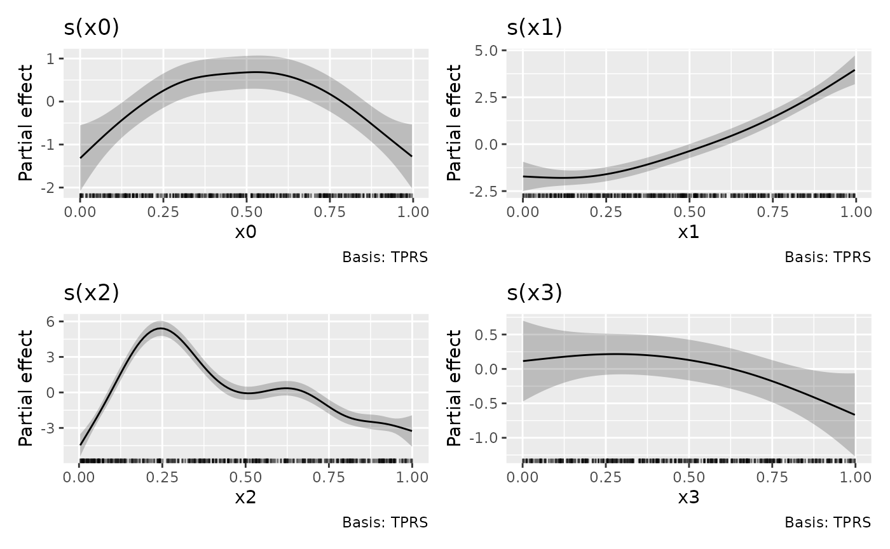
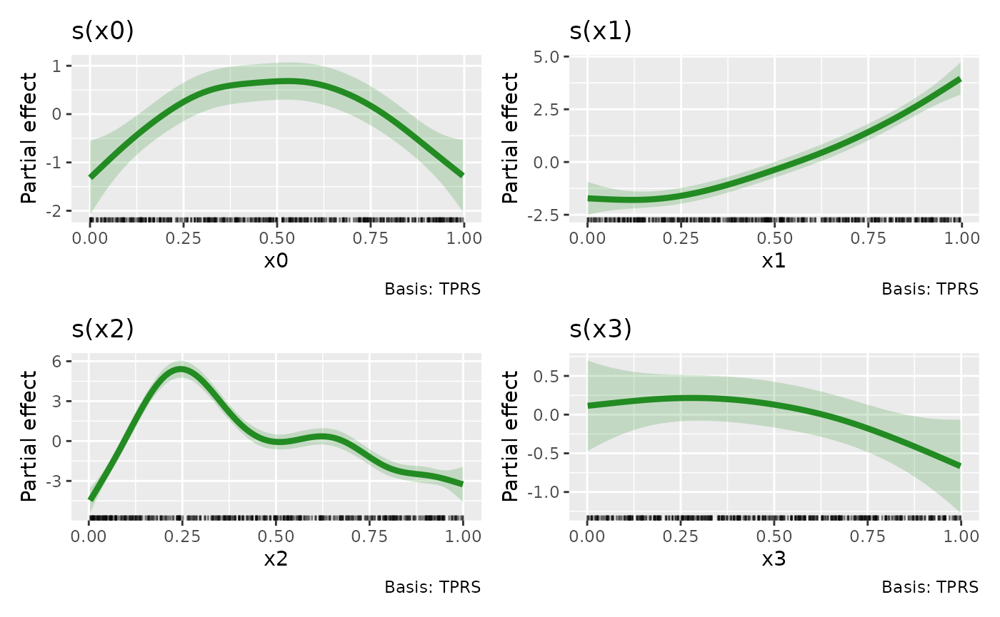
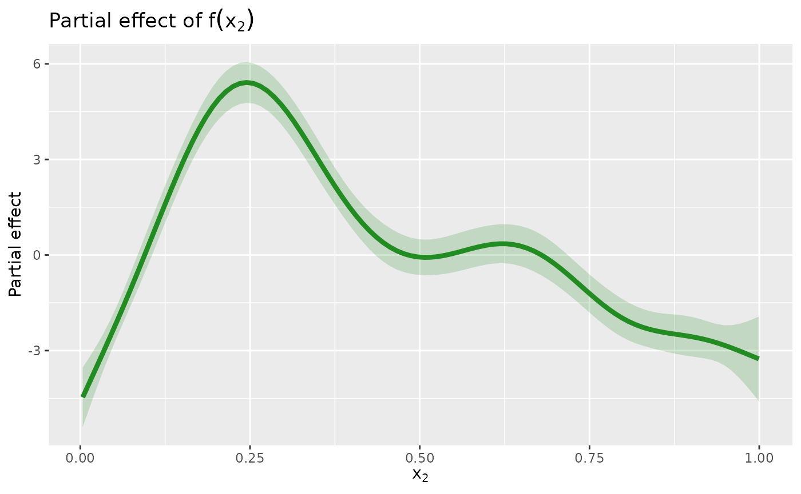
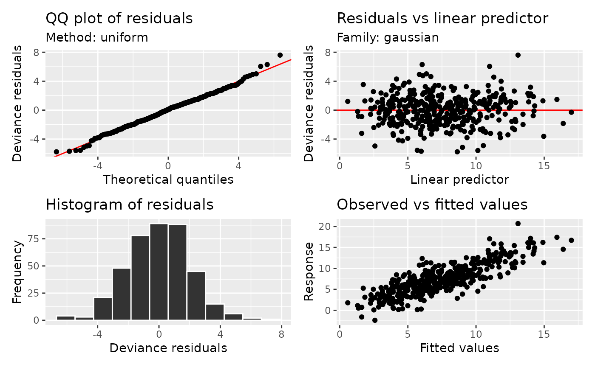
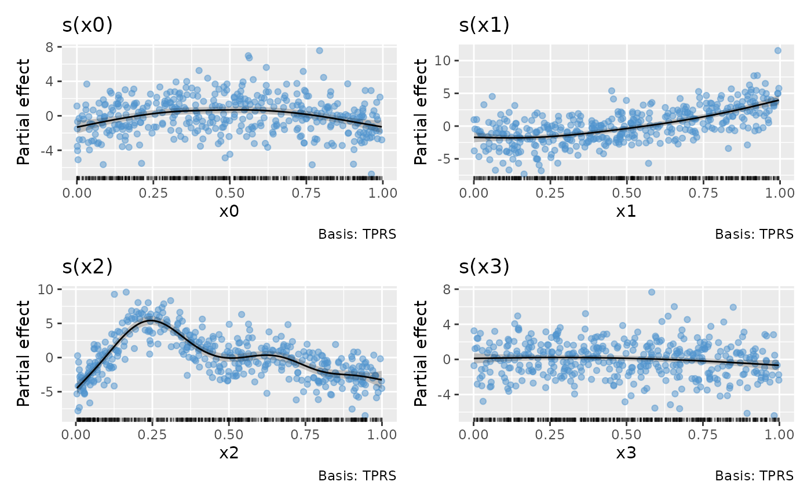

# Getting started with gratia

{gratia} provides plots, predictions and diagnostics for generalized
additive models (GAMs). This introduction fits a GAM, plots its smooth
terms, extracts the values behind those plots and checks the model’s
residuals.

First load gratia and make {mgcv}’s model-fitting functions available.

``` r

library("gratia")
load_mgcv()
```

We simulate 400 observations with four independent covariates sampled
uniformly between zero and one. The response combines nonlinear effects
of `x0`, `x1` and `x2` with independent Gaussian noise of standard
deviation 2. `x3` has no effect on the response. This gives us known
patterns to look for in the fitted smooths, including a covariate whose
contribution should be close to zero.

``` r

df <- data_sim("eg1", seed = 42)
df
#> # A tibble: 400 × 10
#>        y    x0     x1    x2    x3     f    f0    f1     f2    f3
#>    <dbl> <dbl>  <dbl> <dbl> <dbl> <dbl> <dbl> <dbl>  <dbl> <dbl>
#>  1  2.99 0.915 0.0227 0.909 0.402  1.62 0.529  1.05 0.0397     0
#>  2  4.70 0.937 0.513  0.900 0.432  3.25 0.393  2.79 0.0630     0
#>  3 13.9  0.286 0.631  0.192 0.664 13.5  1.57   3.53 8.41       0
#>  4  5.71 0.830 0.419  0.532 0.182  6.12 1.02   2.31 2.79       0
#>  5  7.63 0.642 0.879  0.522 0.838 10.4  1.80   5.80 2.76       0
#>  6  9.80 0.519 0.108  0.160 0.917 10.4  2.00   1.24 7.18       0
#>  7 10.4  0.737 0.980  0.520 0.798 11.3  1.47   7.10 2.75       0
#>  8 12.8  0.135 0.265  0.225 0.503 11.4  0.821  1.70 8.90       0
#>  9 13.8  0.657 0.0843 0.282 0.254 11.1  1.76   1.18 8.20       0
#> 10  7.51 0.705 0.386  0.504 0.667  6.50 1.60   2.16 2.74       0
#> # ℹ 390 more rows
```

Fit one smooth for each covariate. Restricted maximum likelihood (REML)
estimates the smoothing parameters, which control how strongly the fit
penalises wiggliness in each smooth.

``` r

m <- gam(y ~ s(x0) + s(x1) + s(x2) + s(x3), data = df, method = "REML")
summary(m)
#> 
#> Family: gaussian 
#> Link function: identity 
#> 
#> Formula:
#> y ~ s(x0) + s(x1) + s(x2) + s(x3)
#> 
#> Parametric coefficients:
#>             Estimate Std. Error t value Pr(>|t|)    
#> (Intercept)   7.4951     0.1051   71.35   <2e-16 ***
#> ---
#> Signif. codes:  0 '***' 0.001 '**' 0.01 '*' 0.05 '.' 0.1 ' ' 1
#> 
#> Approximate significance of smooth terms:
#>         edf Ref.df      F  p-value    
#> s(x0) 3.425  4.244  8.828 8.78e-07 ***
#> s(x1) 3.221  4.003 67.501  < 2e-16 ***
#> s(x2) 7.905  8.685 67.766  < 2e-16 ***
#> s(x3) 1.885  2.359  2.642   0.0636 .  
#> ---
#> Signif. codes:  0 '***' 0.001 '**' 0.01 '*' 0.05 '.' 0.1 ' ' 1
#> 
#> R-sq.(adj) =  0.685   Deviance explained = 69.8%
#> -REML = 886.93  Scale est. = 4.4144    n = 400
```

## Plot the contribution of each smooth

Use [`draw()`](https://gavinsimpson.github.io/gratia/reference/draw.md)
to plot the four fitted smooths. The pointwise credible intervals show
uncertainty at each plotted value of the covariate.

``` r

draw(m)
```



Each panel shows one smooth’s contribution. Add the four contributions
and the model intercept to obtain the fitted mean for this Gaussian
identity-link model. The smooths are centred so that the intercept
represents the overall level. For models with other links, add the
contributions and intercept on the link scale, then apply the inverse
link to obtain the fitted mean.

The smooth for `x3` lets us check how the model handles a covariate with
no true effect. Its fitted curve can depart from zero because of
sampling variation, and its interval shows the uncertainty in that
departure.

Use a {ggplot2} theme to change the appearance of the plots. The `&`
operator applies the settings to every panel.

``` r

library("ggplot2")
draw(m) & theme(
  geom.gratia.smooth = element_geom(colour = "forestgreen", linewidth = 1.5),
  geom.gratia.interval = element_geom(fill = "forestgreen")
)
```



## Extract smooth estimates and build a plot

[`smooth_estimates()`](https://gavinsimpson.github.io/gratia/reference/smooth_estimates.md)
returns the values used to draw the curves, so you can inspect them or
choose your own ggplot2 layers. By default it evaluates each smooth over
an evenly spaced covariate grid.

``` r

sm <- smooth_estimates(m)
sm
#> # A tibble: 400 × 9
#>    .smooth .type .by   .estimate   .se       x0    x1    x2    x3
#>    <chr>   <chr> <chr>     <dbl> <dbl>    <dbl> <dbl> <dbl> <dbl>
#>  1 s(x0)   TPRS  NA       -1.32  0.390 0.000239    NA    NA    NA
#>  2 s(x0)   TPRS  NA       -1.24  0.365 0.0103      NA    NA    NA
#>  3 s(x0)   TPRS  NA       -1.17  0.340 0.0204      NA    NA    NA
#>  4 s(x0)   TPRS  NA       -1.09  0.318 0.0304      NA    NA    NA
#>  5 s(x0)   TPRS  NA       -1.02  0.297 0.0405      NA    NA    NA
#>  6 s(x0)   TPRS  NA       -0.947 0.279 0.0506      NA    NA    NA
#>  7 s(x0)   TPRS  NA       -0.875 0.263 0.0606      NA    NA    NA
#>  8 s(x0)   TPRS  NA       -0.803 0.249 0.0707      NA    NA    NA
#>  9 s(x0)   TPRS  NA       -0.732 0.237 0.0807      NA    NA    NA
#> 10 s(x0)   TPRS  NA       -0.662 0.228 0.0908      NA    NA    NA
#> # ℹ 390 more rows
```

To work with one smooth, supply its label through `select`. Use
[`smooths()`](https://gavinsimpson.github.io/gratia/reference/smooths.md)
to find the labels accepted by the fitted model.

``` r

smooths(m)
#> [1] "s(x0)" "s(x1)" "s(x2)" "s(x3)"
```

Select `s(x2)` to extract the contribution of `x2` alone.

``` r

sm <- smooth_estimates(m, select = "s(x2)")
sm
#> # A tibble: 100 × 6
#>    .smooth .type .by   .estimate   .se      x2
#>    <chr>   <chr> <chr>     <dbl> <dbl>   <dbl>
#>  1 s(x2)   TPRS  NA      -4.47   0.476 0.00359
#>  2 s(x2)   TPRS  NA      -4.00   0.406 0.0136 
#>  3 s(x2)   TPRS  NA      -3.53   0.345 0.0237 
#>  4 s(x2)   TPRS  NA      -3.06   0.295 0.0338 
#>  5 s(x2)   TPRS  NA      -2.58   0.263 0.0438 
#>  6 s(x2)   TPRS  NA      -2.09   0.250 0.0539 
#>  7 s(x2)   TPRS  NA      -1.59   0.253 0.0639 
#>  8 s(x2)   TPRS  NA      -1.08   0.264 0.0740 
#>  9 s(x2)   TPRS  NA      -0.564  0.278 0.0841 
#> 10 s(x2)   TPRS  NA      -0.0364 0.289 0.0941 
#> # ℹ 90 more rows
```

Add interval limits with
[`add_confint()`](https://gavinsimpson.github.io/gratia/reference/add_confint.md),
then draw the estimates as a line and the interval as a ribbon. The
output columns map directly to the ggplot2 aesthetics in this example.

``` r

sm |>
  add_confint() |>
  ggplot(aes(y = .estimate, x = x2)) +
  geom_ribbon(aes(ymin = .lower_ci, ymax = .upper_ci),
    alpha = 0.2, fill = "forestgreen"
  ) +
  geom_line(colour = "forestgreen", linewidth = 1.5) +
  labs(
    y = "Partial effect",
    title = expression("Partial effect of" ~ f(x[2])),
    x = expression(x[2])
  )
```



## Check the fitted model

Use
[`appraise()`](https://gavinsimpson.github.io/gratia/reference/appraise.md)
to look for features the model has failed to describe, such as residual
spread changing with the fitted mean or departures in the tails.

``` r

appraise(m)
```



Read the panels from left to right, starting with the top row.

- a quantile-quantile (QQ) plot of deviance residuals,
- a scatterplot of deviance residuals against the linear predictor,
- a histogram of deviance residuals, and
- a scatterplot of observed vs fitted values.

The data were simulated with Gaussian errors of constant variance, so we
expect roughly constant residual spread and no systematic pattern
against the linear predictor. Departures from the reference in the QQ
plot can reveal where the observed residuals differ from what the fitted
model would produce.

Add partial residuals to a smooth plot to compare the fitted curve with
the observations after removing the estimated contributions of the other
terms. For example, a consistent bend in the points around a flatter
fitted curve can suggest that the smooth has missed part of the
relationship.

``` r

draw(m, residuals = TRUE)
```



## More on plotting, prediction and model checking

- [Customise
  plots](https://gavinsimpson.github.io/gratia/articles/custom-plotting.html)
  with themes, labels, legends and your own layers.
- [Create prediction
  grids](https://gavinsimpson.github.io/gratia/articles/data-slices.html)
  to evaluate smooths and fitted responses at chosen covariate values.
- [Check a fitted
  model](https://gavinsimpson.github.io/gratia/articles/model-checking.html)
  using residual diagnostics and posterior predictive checks.

The [function
reference](https://gavinsimpson.github.io/gratia/reference/index.html)
provides argument descriptions and examples for individual functions.
