# Model diagnostics: distributions, uncertainty and dependence

## What does a diagnostic compare?

A model can estimate a plausible mean curve and still describe the
observations poorly. Counts can vary more than their fitted distribution
allows; residuals can retain time or spatial structure; or an apparently
wide response distribution can conceal a missing group effect. Gratia
now supplies consistent diagnostic calculations for several fitting
packages, including ordinary linear and generalised linear models. The
choice of comparison still needs a statistical question.

This article develops three questions: is the response distribution
adequate, is variation between groups represented, and does serial
structure remain? [Checking different response
distributions](https://gavinsimpson.github.io/gratia/articles/response-distributions.md)
extends the examples to distributional parameters, censoring and
weights. The
[grouped-survey](https://gavinsimpson.github.io/gratia/articles/gfam-support.md),
[glmmTMB](https://gavinsimpson.github.io/gratia/articles/glmmTMB-support.md)
and
[spatial-survey](https://gavinsimpson.github.io/gratia/articles/sdmTMB-support.md)
articles explain their fitting choices.

These examples require the development functionality introduced after
gratia 0.11.2, with R \>= 4.4.0 and mgcv \>= 1.9-4. The code uses mgcv
and gratia, with dplyr and ggplot2 for plots. The growth example also
needs the optional nlme, lme4 and gamm4 packages (gamm4 \>= 0.2-7). The
simulation counts are deliberately modest: 50 response draws for plot
illustrations; simulation ranks use the default 249 reference draws
where needed to estimate a marginal distribution. Use more and check
stability before interpreting small tail departures.

``` r

library("mgcv")
library("gratia")
library("dplyr")
library("ggplot2")
```

There are three distinct ways to generate a comparison:

| Question | Calculation | What remains fixed? |
|----|----|----|
| Could new response errors explain these observations at the fitted effects? | Conditional response simulation or QQ reference | Fitted coefficients, effects and distribution parameters |
| Are these responses plausible after allowing uncertainty in fitted effects? | Conditional posterior predictive check | Covariance parameters usually remain fitted; uncertainty in coefficients and fitted effects is drawn together |
| What response variation would occur with new groups or fields? | Marginal joint response simulation; optionally a marginal posterior predictive check | New effects are generated from their model distribution; a posterior check also draws parameter uncertainty as supported by the fitter |

A smooth plot’s interval concerns an estimated effect. A QQ reference
band concerns ordered residuals from replicated responses. A posterior
predictive plot concerns replicated response distributions. QQ reference
bands condition on the fitted model, without refitting it for each
replicate. Use departures from these bands to locate discrepancies to
investigate, rather than as a formal rejection rule.

Plot subtitles identify the method. Short captions identify
conditioning, field choices, joint simulation bands or omitted bands.
Routine pointwise bands are unlabelled. Posterior predictive captions
identify conditioning only. Use `caption = ""` to omit a caption or
supply your own text. Scalable QQ and worm plots use the same labels as
their ordinary counterparts.

## Count variation and mean structure

Consider daily insect counts at independently sampled sites. We simulate
12,000 sites with temperature and wind as covariates. The mean count
peaks at intermediate temperatures and falls with wind. The simulated
sites are independent.

``` r

set.seed(301)
insects <- data.frame(temperature = runif(12000, 5, 30),
  wind = runif(12000, 0, 10))
insects$count <- rpois(nrow(insects),
  exp(2.5 - ((insects$temperature - 19) / 8)^2 - 0.1 * insects$wind))
count_fit <- bam(count ~ s(temperature, bs = "cr", k = 12) + wind,
  data = insects, family = poisson(), method = "fREML", discrete = TRUE)
```

A Poisson model suits the simulation: it has non-negative integer
responses and variance equal to the mean. The spline estimates the
temperature shape, and its penalty prevents the basis size from
dictating the amount of wiggliness. In real data, unexplained
heterogeneity could instead motivate a negative binomial model.

``` r

appraise(count_fit, type = "quantile", seed = 302)
```

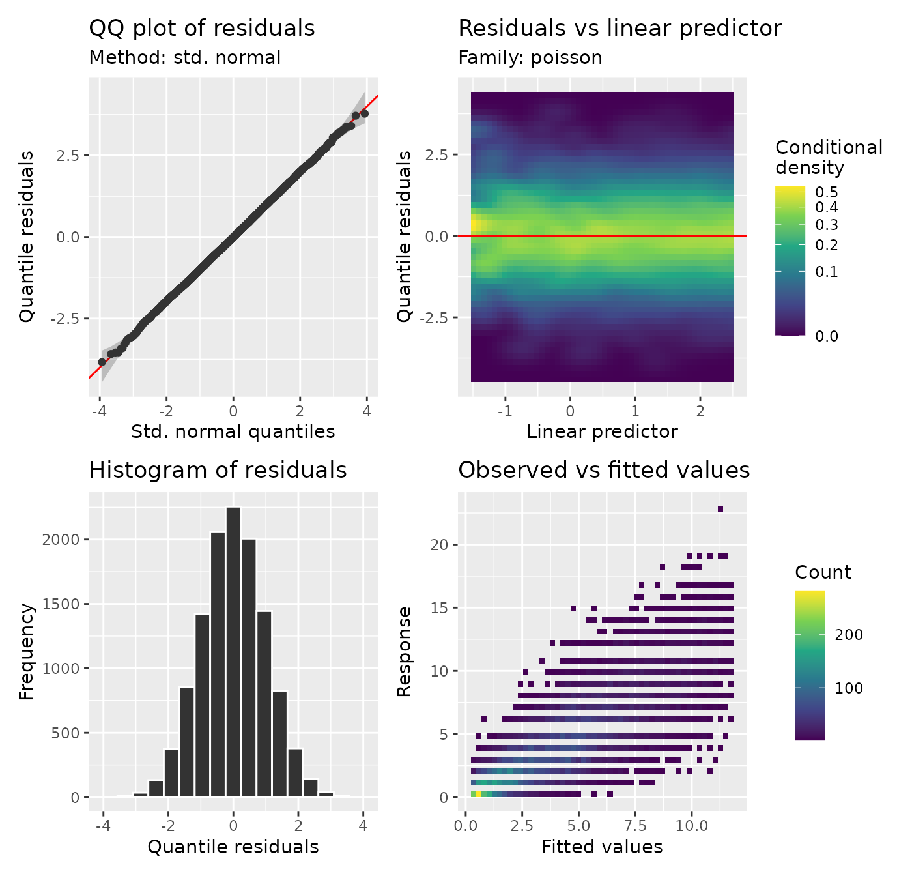

At 10,000 fitted observations
[`appraise()`](https://gavinsimpson.github.io/gratia/reference/appraise.md)
switches automatically to scalable plots. These use all observations,
summarised on grids or into quantile bins. They reveal the response
distribution without drawing 12,000 overlapping points. A straight QQ
plot and residual spread that stays roughly similar across fitted values
are consistent with the simulated Poisson model. The
observed-versus-fitted panel shows Poisson variation around the fitted
means.

### Put different responses on a common diagnostic scale

For a count y with fitted cumulative distribution function F, a PIT
residual is a random draw between F(y-1) and F(y). Quantile residuals
apply the standard-normal quantile function to that probability. This
randomisation avoids artificial steps caused by integer responses. For
continuous outcomes the probability is simply F(y).

``` r

u <- quantile_residuals(count_fit, type = "pit", seed = 302)
r <- quantile_residuals(count_fit, type = "quantile", seed = 302)
head(data.frame(observed = insects$count, fitted = fitted(count_fit),
  probability = u, normal_score = r))
#>   observed    fitted probability normal_score
#> 1        6 4.8295420  0.72883035    0.6092793
#> 2        3 0.7658596  0.98856666    2.2756548
#> 3        1 0.5058428  0.80581932    0.8625928
#> 4        1 4.1404109  0.03528062   -1.8082909
#> 5        5 4.3879965  0.61980026    0.3049562
#> 6        5 4.3668547  0.64330424    0.3673050
```

Under a suitable fitted distribution these probabilities should be
approximately uniform, and their normal scores approximately standard
normal. A normal reference for quantile residuals is justified by this
transformation. Traditional Poisson deviance residuals do not have
exactly a normal distribution.

``` r

qq_plot(count_fit, type = "deviance", method = "simulate",
  n_simulate = 50, seed = 303)
```

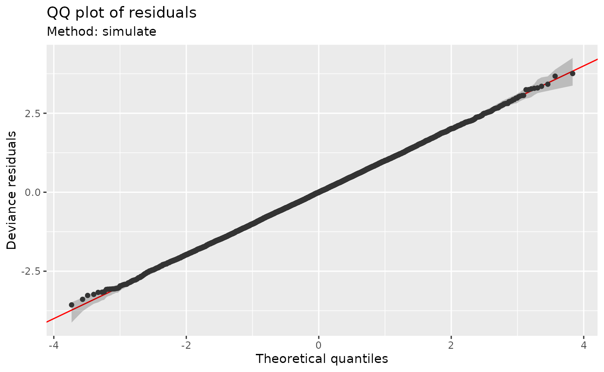

Here the reference comes from responses simulated at the fitting
covariates. Each observation’s fitted mean enters its simulated
response. `method = "uniform"` instead averages ordered residuals
obtained from the fitted inverse CDF. `method = NULL` chooses this
method for most independent GAMs and simulation for Tweedie models to
avoid costly numerical quantile inversion. An explicit method overrides
that choice where supported. A worm plot subtracts reference quantiles
from observed ordered residuals.

``` r

scalable_worm_plot(count_fit, type = "quantile", qq_bins = 80, seed = 302)
```

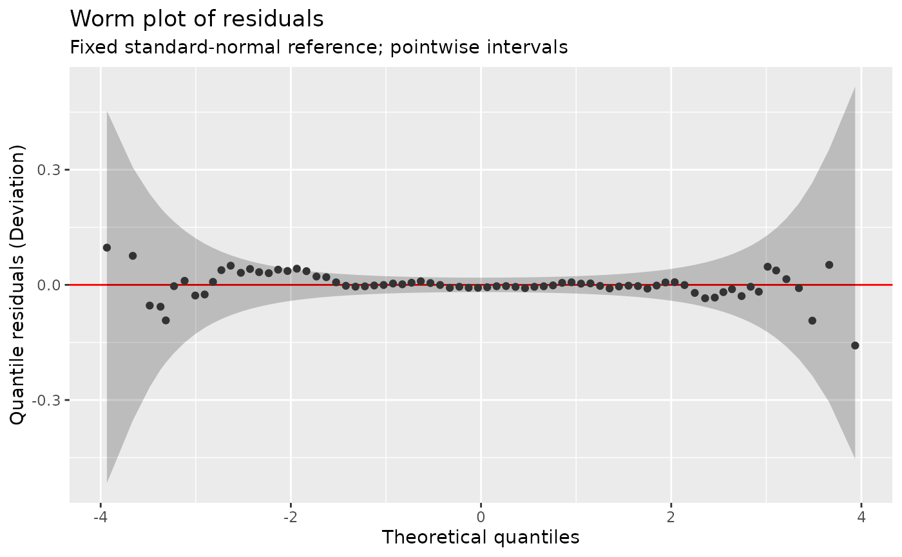

### Look for what the QQ plot could miss

A response distribution can look plausible when observations are pooled
while systematic lack of fit remains at some covariate values. Remove
the curved relationship to temperature to see this:

``` r

linear_fit <- glm(count ~ temperature + wind, data = insects,
  family = poisson())
scalable_residuals_covariate_plot(linear_fit,
  covariates = c("temperature", "wind"), type = "pearson")
```

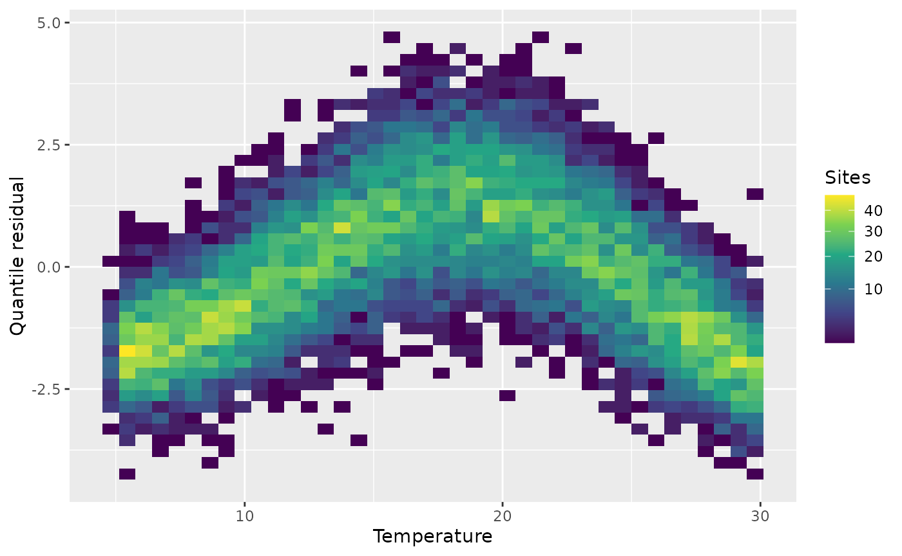

The curved residual mean against temperature shows where the linear
effect misses the response shape. Pearson residuals account for the
Poisson mean–variance relationship. Response residuals also target the
mean but retain the count units. For a broader distributional check, use
`type = "quantile"` or `type = "pit"` to examine location, spread and
tails against each covariate. Non-Gaussian deviance residuals need not
have zero conditional mean, so their mean curve need not lie on zero
even when the model fits.

Both versions default to `smooth = NULL`, which fits the residual mean
trend only for groups with at most 20,000 eligible observations. Use
`smooth = TRUE` to fit trends for larger groups, or `smooth = FALSE` to
omit them. The threshold is applied separately within each response,
family component and `by` group.

The ordinary version shows individual residuals. It is useful for
smaller teaching examples; both versions use all eligible observations:

``` r

small_insects <- insects[seq_len(500), ]
small_fit <- gam(count ~ temperature + wind, data = small_insects,
  family = poisson(), method = "REML")
residuals_covariate_plot(small_fit, covariates = "temperature", type = "pearson")
```

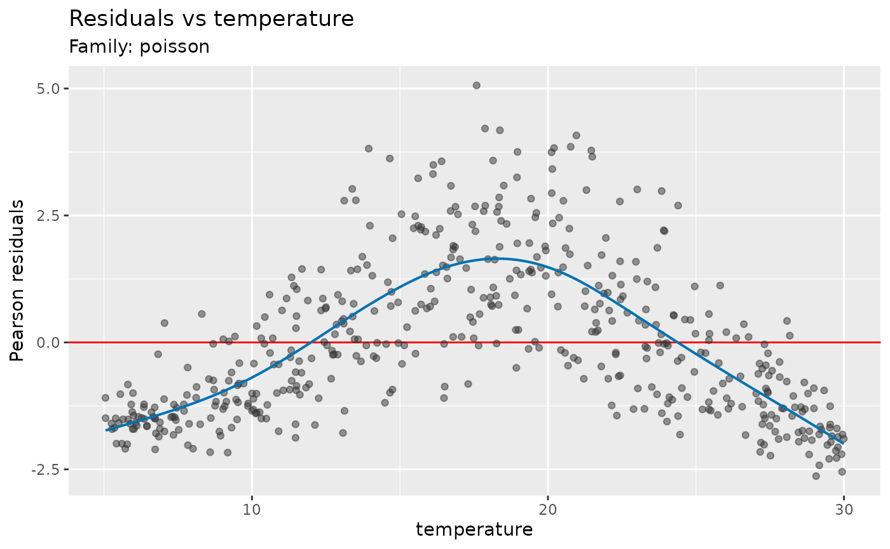

By default each distinct model covariate gets one panel. To select
covariates through a smooth, supply its exact label from
`smooths(count_fit)`:

``` r

smooths(count_fit)
#> [1] "s(temperature)"
scalable_residuals_covariate_plot(count_fit, terms = "s(temperature)",
  type = "quantile", seed = 302)
```

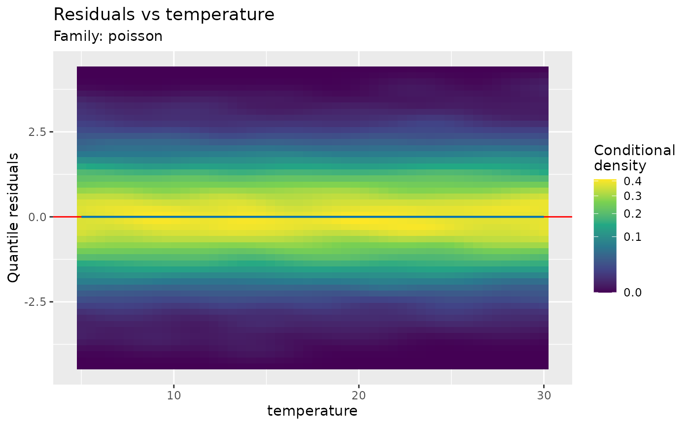

For tensor products use labels such as `"te(temperature,wind)"`, without
adding spaces. `terms` accepts smooth labels only, while `covariates`
can also select linear predictors or covariates absent from the model.
Supply the original fitting `data` for omitted covariates or when raw
transformed covariates are unavailable. For a categorical covariate, the
functions show residual boxplots and group means; `by = "group"`
separates patterns into group facets.

Separate panels can miss a remaining interaction. Here the mean contains
a product of two independent, centred covariates. Averaging over either
covariate hides the interaction in the other covariate’s residual mean:

``` r

set.seed(306)
interaction_data <- data.frame(x = runif(4000, -1, 1), z = runif(4000, -1, 1))
interaction_data$y <- 4 * interaction_data$x * interaction_data$z + rnorm(4000)
additive_fit <- gam(y ~ s(x) + s(z), data = interaction_data, method = "REML")
scalable_residuals_covariate_plot(additive_fit, covariates = c("x", "z"),
  pairs = list(c("x", "z")), bins = c(10, 10), type = "pearson")
```

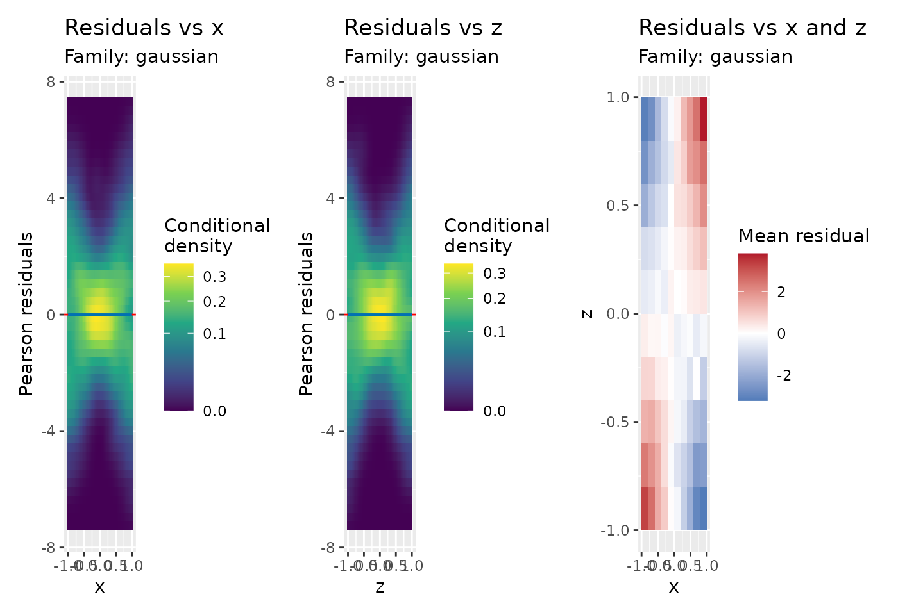

The joint map shows the mean residual within each occupied covariate
cell. Opposite corners have residuals with the same sign, suggesting
that the two covariates need to enter the mean together. Cells with
fewer than `min_n` observations are blank. Use `statistic = "sd"` to
inspect changes in spread instead; this is particularly useful with
quantile or PIT residuals. Joint maps are descriptive summaries, without
significance tests. Correlated covariates can share residual patterns,
so check a revised model before attributing the pattern to one
particular effect. For a fitted smooth, a remaining curve can also
motivate increasing its basis dimension `k` and checking the refitted
model.

### Choose compact displays without changing the question

``` r

scalable_residuals_linpred_plot(count_fit, type = "quantile", seed = 302)
```

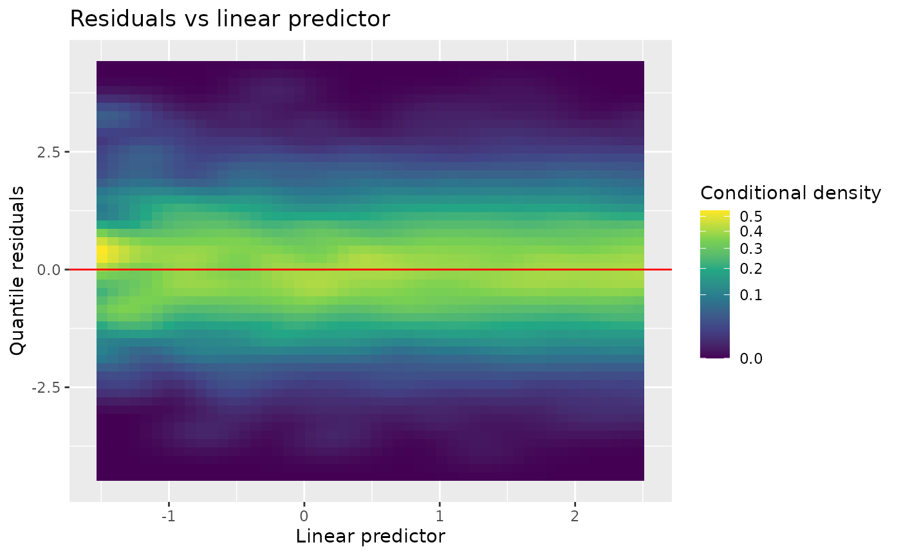

``` r

scalable_residuals_linpred_plot(count_fit, type = "quantile", seed = 302,
  density_method = "histogram")
```

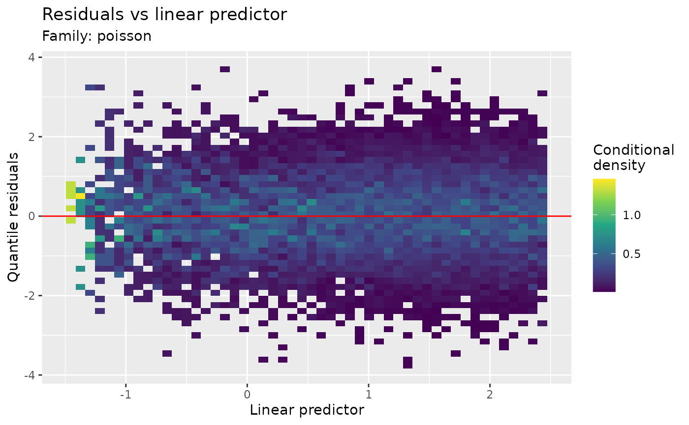

``` r

scalable_observed_fitted_plot(count_fit)
```

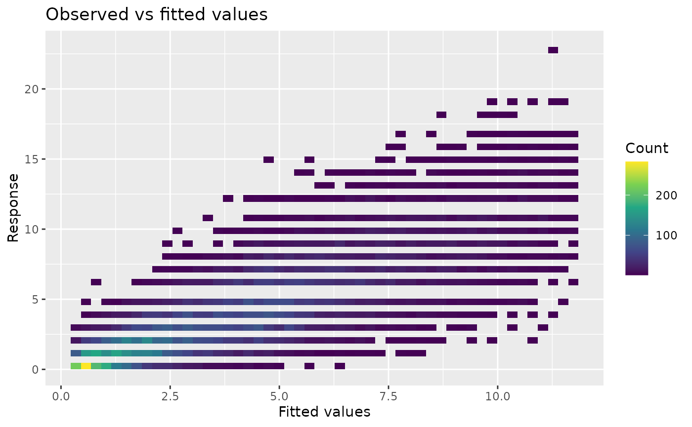

``` r

scalable_residuals_hist_plot(count_fit, type = "quantile", seed = 302)
```

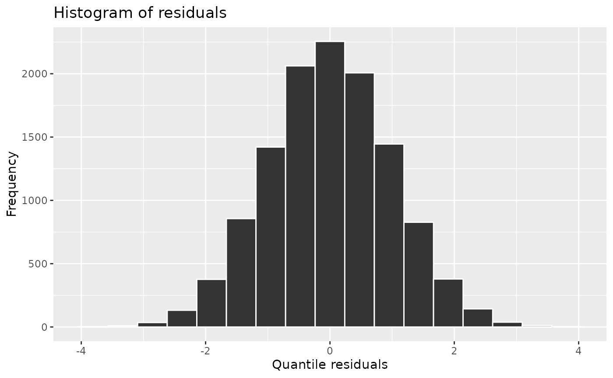

The default residual heatmap uses a kernel estimate of density at each
predictor value. Its square-root colour scale keeps low-density regions
visible. The histogram option uses unsmoothed bins; `bandwidth` controls
smoothing on both axes. Observed-versus-fitted count heatmaps remain
unsmoothed. The scalable functions also include
[`scalable_qq_plot()`](https://gavinsimpson.github.io/gratia/reference/scalable_qq_plot.md);
ordinary plots remain available with `appraise(..., scalable = FALSE)`,
and `scalable_threshold` changes the automatic cutoff. Plot summaries
are compact, but simulation still generates a response for every
observation. QQ calculations average inverse-CDF draws as they are
generated. When simulated references exceed
`options(gratia.diagnostics.max_cells = 1e7)`, exact quantiles use
temporary files, reducing memory at the cost of disk access. One
response vector and the reference output still need to fit in memory.
Marginal simulation ranks use `gratia.diagnostics.marginal_draws`
(default 249, minimum 19); increase it and check stability, especially
in the tails.

``` r

posterior_predictive_plot(count_fit, n = 50, seed = 304, scalable = TRUE)
```

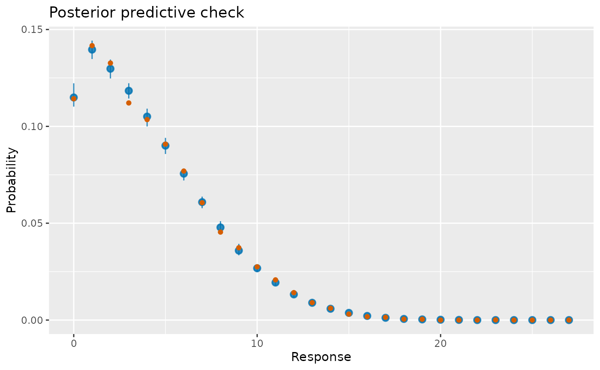

The discrete posterior predictive check shows observed probabilities and
the median and 90% intervals of replicated probability masses. It draws
approximate coefficient uncertainty as well as response variation. Large
datasets are summarised on a common grid; more than 512 distinct
discrete response values use 512 labelled bins. These bars concern
variation across whole replicated datasets. They are not confidence
intervals on the fitted mean. `appraise(ppcheck = TRUE, n_ppc = 50)`
replaces the residual histogram with this comparison. Offsets supplied
as fitting arguments are retained in posterior response draws. Explicit
seeds preserve the caller’s random-number state; coefficient draws and
response draws use separate streams.

## Repeated measurements: fixed effects, fitted groups and new groups

The Orthodont data contain dental measurements on 27 children at ages 8,
10, 12 and 14. Each child contributes several observations, so their
values can share an individual growth trajectory. A Gaussian linear
mixed model with sex-specific age slopes and correlated child intercepts
and slopes is a useful starting point. With only four occasions per
child, very detailed individual curves are not supported.

``` r

library("nlme")
library("lme4")
library("gamm4")
data("Orthodont", package = "nlme")
growth <- transform(Orthodont, age_c = age - 11)
growth_fit <- lme(distance ~ Sex * age_c, random = ~ age_c | Subject,
  data = growth, method = "REML")
summary(growth_fit)$tTable
#>                      Value  Std.Error DF   t-value      p-value
#> (Intercept)     24.9687500 0.48600069 79 51.375956 1.812707e-62
#> SexFemale       -2.3210227 0.76141675 25 -3.048295 5.375051e-03
#> age_c            0.7843750 0.08599951 79  9.120692 5.654744e-14
#> SexFemale:age_c -0.3048295 0.13473534 79 -2.262432 2.641752e-02
```

The age coefficient describes mean growth in the reference sex, and the
interaction describes a difference in age slopes. The fitted random
effects describe departures for these children. The positive fitted age
slopes describe growth between ages 8 and 14.

``` r

qq_plot(growth_fit, type = "quantile", conditioning = "conditional", seed = 305)
```

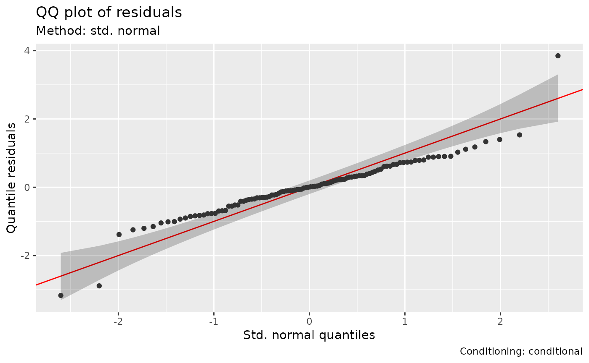

``` r

qq_plot(growth_fit, type = "quantile", conditioning = "marginal",
  n_simulate = 50, seed = 305)
```

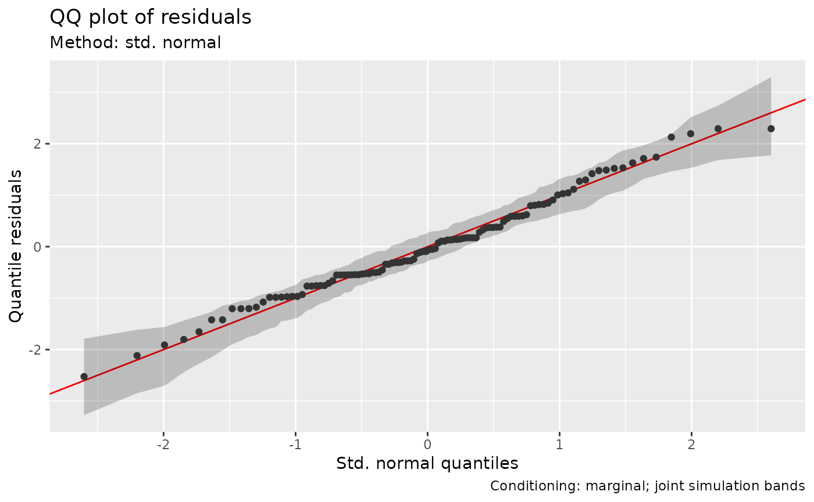

The conditional comparison holds each child’s fitted intercept and slope
fixed and checks remaining measurement variation. The marginal
comparison generates new child trajectories. All four measurements of a
simulated child share its new intercept and slope; the simulator retains
their covariance. Setting those effects to zero would give the mean
trajectory, not this marginal distribution. In this fit the conditional
scores have a compressed centre and one large positive tail departure.
The marginal plot averages over different child trajectories and is
closer to its reference. Investigate the observation responsible for the
largest conditional score alongside that child’s trajectory.

The marginal QQ reference must preserve the shared effects. Gratia uses
joint response draws for its bands, rather than bands derived for
independent scores.

The QQ plot pools the ordered residuals. To check the shared child
effects, also plot trajectories or residuals against age, grouped by
child: systematic patterns within children can be hidden by pooling.

``` r

posterior_predictive_plot(growth_fit, conditioning = "conditional", n = 50,
  seed = 306)
```

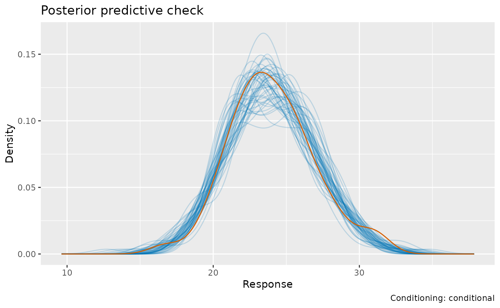

``` r

posterior_predictive_plot(growth_fit, conditioning = "marginal", n = 50,
  seed = 306)
```

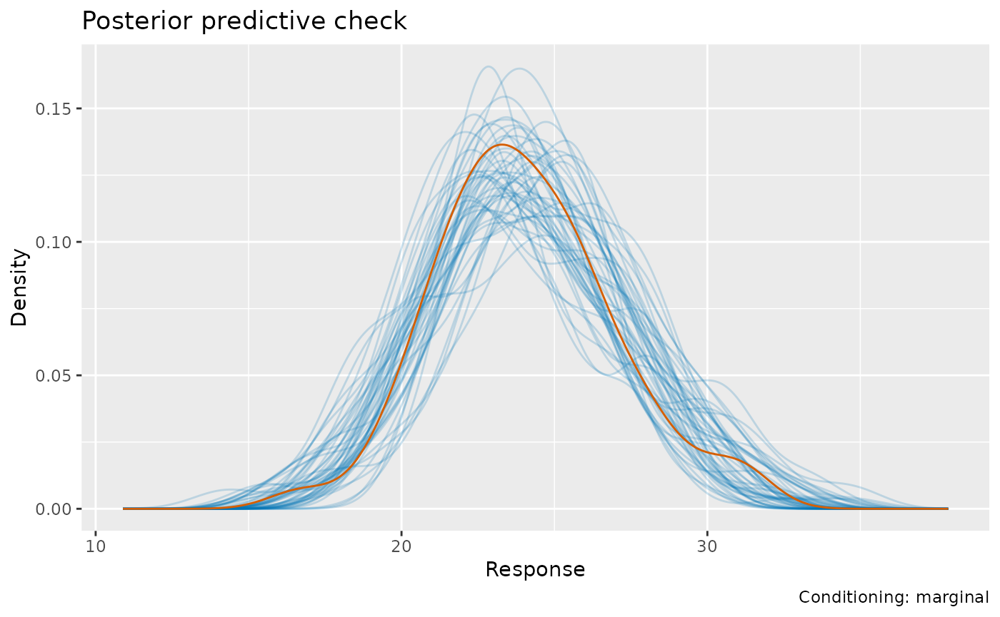

The conditional posterior predictive check draws uncertainty in the
fitted child effects together with fixed effects, allowing more response
variation than the conditional QQ reference at fixed effect estimates.
The marginal posterior predictive check draws new effects from their
fitted population covariance as well. Covariance parameters remain at
fitted values in these nlme approximations. The density overlays pool
the measurements across ages and children; use the trajectory plots to
examine where that variation occurs.

### Apply the same distinction to other mixed-model fits

``` r

growth_lmer <- lmer(distance ~ Sex * age_c + (age_c | Subject),
  data = growth, REML = TRUE)
appraise(growth_lmer, conditioning = "conditional", type = "quantile", seed = 305)
```

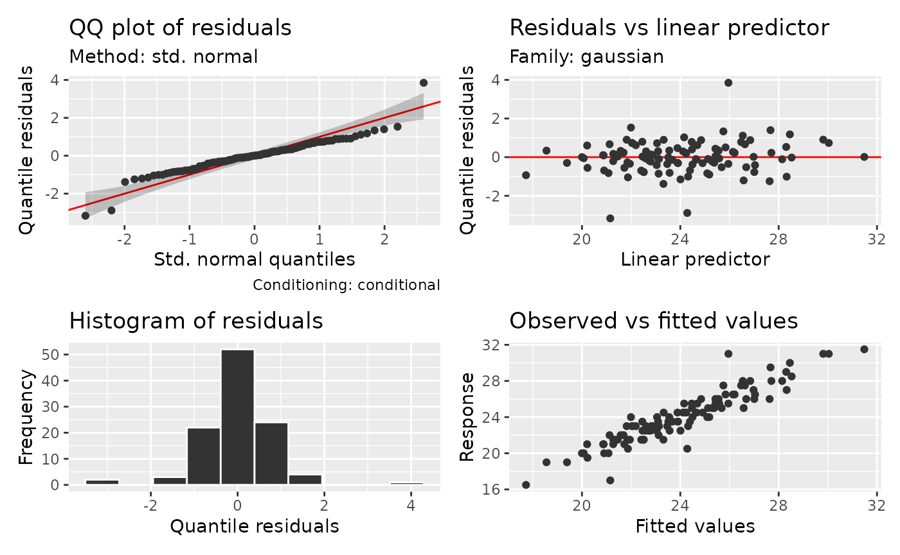

``` r

growth_smooth <- gamm4(distance ~ Sex + s(age, k = 4),
  random = ~(1 | Subject), data = growth)
draw(growth_smooth)
```

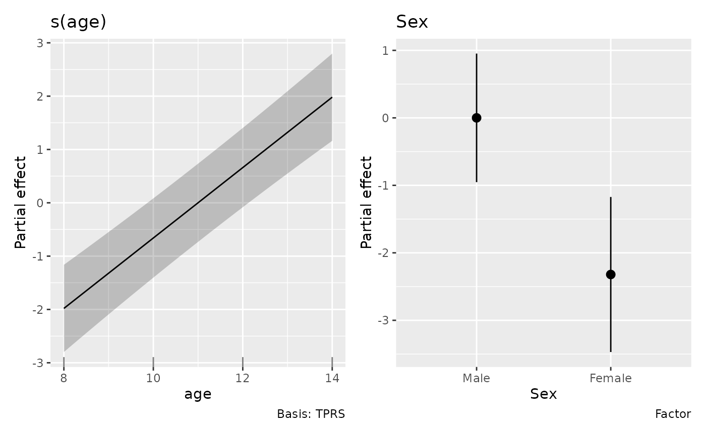

``` r

variance_comp(growth_smooth)
#> # A tibble: 3 × 5
#>   .component          .variance .std_dev .lower_ci .upper_ci
#>   <chr>                   <dbl>    <dbl>     <dbl>     <dbl>
#> 1 Subject:(Intercept)      3.27     1.81        NA        NA
#> 2 s(age)                   0        0           NA        NA
#> 3 scale                    2.05     1.43        NA        NA
```

The direct [`lmer()`](https://rdrr.io/pkg/lme4/man/lmer.html) fit
answers the same linear-growth question. The
[`gamm4()`](https://rdrr.io/pkg/gamm4/man/gamm4.html) fit instead asks
whether a shared population age curve is curved, with child intercepts
accounting for repeated observations. It can be passed directly to
gratia.
[`draw()`](https://gavinsimpson.github.io/gratia/reference/draw.md),
predictions, derivatives and fitted-value draws describe its population
GAM component; group terms specified in `random` are excluded from those
calculations. Variance components include both smooth penalties and
native group effects, with missing interval bounds where the fit
provides none.

``` r

appraise(growth_smooth, conditioning = "conditional", seed = 307)
```

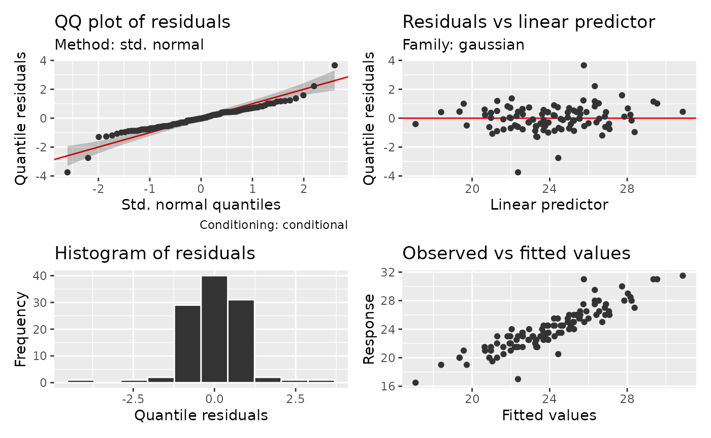

``` r

posterior_predictive_plot(growth_smooth, n = 50, seed = 307)
```

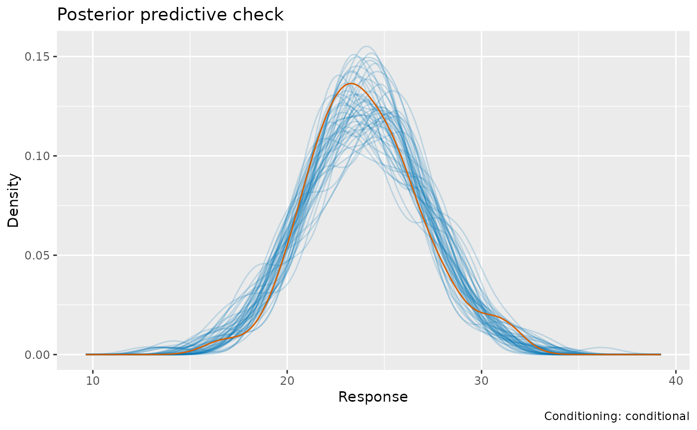

``` r

population_grid <- data.frame(age = seq(8, 14, length.out = 30),
  Sex = factor("Female", levels = levels(growth$Sex)))
fitted_values(growth_smooth, data = population_grid) |> head()
#> # A tibble: 6 × 8
#>    .row   age Sex    .parameter .fitted   .se .lower_ci .upper_ci
#>   <int> <dbl> <fct>  <chr>        <dbl> <dbl>     <dbl>     <dbl>
#> 1     1  8    Female mean          20.7 0.615      19.5      21.9
#> 2     2  8.21 Female mean          20.8 0.611      19.6      22.0
#> 3     3  8.41 Female mean          20.9 0.607      19.7      22.1
#> 4     4  8.62 Female mean          21.1 0.604      19.9      22.3
#> 5     5  8.83 Female mean          21.2 0.601      20.0      22.4
#> 6     6  9.03 Female mean          21.4 0.599      20.2      22.5
```

Diagnostics and response simulations for `gamm4` now default to the full
conditional mixed model, including fitted child and smooth effects.
Posterior response draws default to uncertainty in those fitted effects.
Explicit `conditioning = "gam_component"` selects the extracted GAM
calculations, and is required for posterior response draws at new data
or supplied coefficient draws. `conditioning = "marginal"` generates new
mixed-model effects; for gamm4 this includes the spline effects
represented as random effects, so it asks a different question from new
measurement errors around a fixed age curve. The existing
[`gamm()`](https://rdrr.io/pkg/mgcv/man/gamm.html) response simulator
still defaults to its GAM component; request full-model conditioning
explicitly there. See
[`gamm4_support`](https://gavinsimpson.github.io/gratia/reference/gamm4_support.md)
for covariance and sampling restrictions. Use fitting-package prediction
on the `mer` component for predictions conditional on a particular
child’s effects.

## Serial observations: a response model or a fitting correction?

Time order carries information that a histogram discards. The following
simulation represents regularly spaced measurements from four
independent monitoring series with a slowly changing mean and Gaussian
AR1 errors. We supply the simulation’s known correlation, 0.6, through
`rho`; BAM treats it as fixed during fitting.

``` r

set.seed(308)
monitor <- expand.grid(time = seq_len(120), station = factor(seq_len(4)))
monitor$start <- monitor$time == 1
monitor$measurement <- 2 + sin(monitor$time / 25) +
  unlist(lapply(seq_len(4), function(i)
    as.numeric(arima.sim(list(ar = 0.6), n = 120, sd = 0.5))))
serial_fit <- bam(measurement ~ s(time, bs = "cr", k = 12), data = monitor,
  rho = 0.6, AR.start = start, discrete = TRUE)
qq_plot(serial_fit, method = "simulate", n_simulate = 50, seed = 309)
```

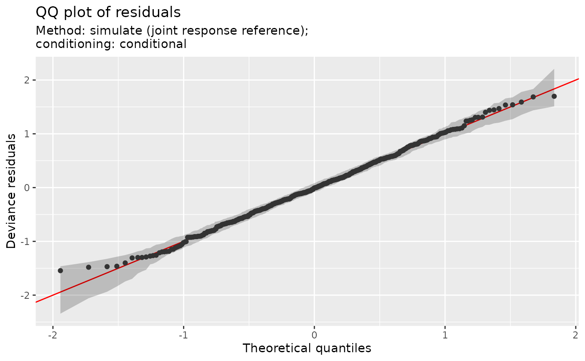

``` r

residual_correlation_plot(serial_fit, lag_max = 15)
```

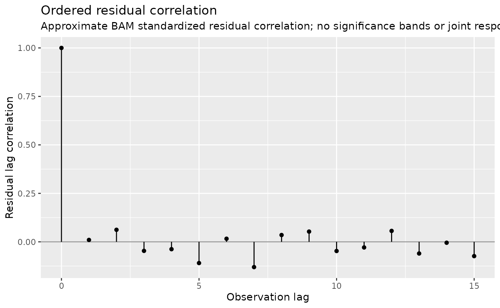

``` r

residual_correlation(serial_fit, lag_max = 3)
#> # A tibble: 4 × 3
#>     lag correlation n_pairs
#>   <int>       <dbl>   <int>
#> 1     0     1           480
#> 2     1     0.00981     476
#> 3     2     0.0620      472
#> 4     3    -0.0465      468
```

Gaussian identity-link BAM defines a joint response distribution.
Simulated references preserve the AR1 covariance and start a fresh
series at each `AR.start`. The ordered check uses the stored
standardised residuals by default and can reveal correlation remaining
after adjustment. There are no significance bands based on independence.
The companion table reports the correlation and number of usable
observation pairs at each lag; fewer pairs are available at larger lags.
Lags count observation positions, not elapsed time. Specify series, sort
the fitting data, and consider a fitting-package covariance model
appropriate to irregular time intervals.

For counts, BAM with `discrete = TRUE` applies nonzero `rho` to its
*working residuals*, the quantities used during iterative fitting. This
is a generalised estimating equations (GEE) approximation. It does not
define a unique joint count distribution. We generate the next dataset
from a latent correlated process, then use BAM’s working correction when
fitting its mean.

``` r

set.seed(310)
monitor$count <- rpois(nrow(monitor), exp(1 + monitor$measurement / 2))
working_fit <- bam(count ~ s(time, bs = "cr", k = 12), data = monitor,
  family = poisson(), discrete = TRUE, rho = 0.6, AR.start = start)
qq_plot(working_fit, type = "quantile", seed = 311)
```

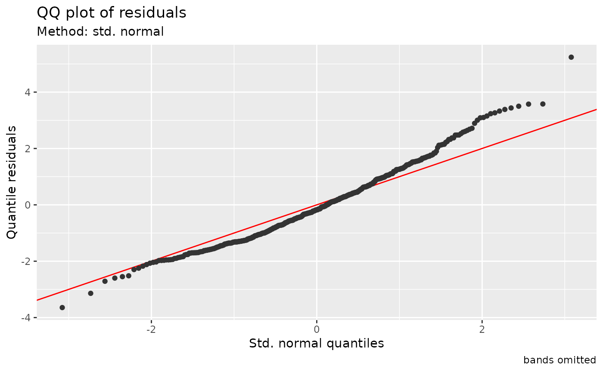

``` r

residual_correlation_plot(working_fit, type = "working.standardized", lag_max = 15)
```

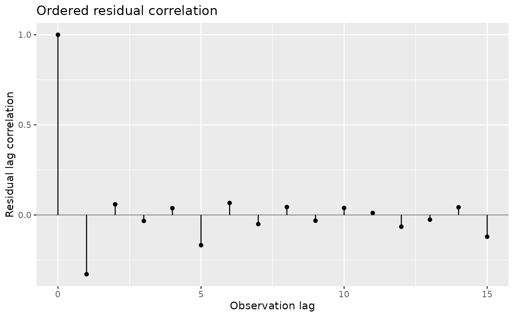

The marginal Poisson probabilities still locate each count in its fitted
univariate distribution. The QQ plot omits dependence bands. A default
QQ plot of traditional residuals uses a pooled marginal reference; it
neither assumes independence nor silently switches to a normal
reference. Comparing whitened working residuals at different lags is an
approximate serial check. `type = "standardized"` instead uses mgcv’s
stored `std.rsd`, which is not necessarily the weighted working residual
used during non-Gaussian fitting. Here the large negative lag-one
correlation after whitening suggests that the supplied working
correction is too strong. We supplied the latent Gaussian correlation,
whereas the correction acts on working residuals from the count model.
These correlations can differ. The upper-tail departure in the QQ plot
also reflects variation from the latent process that the Poisson
distribution omits. Use these two checks to examine the working
correction and the response distribution separately.

`qq_plot(working_fit, method = "simulate")`, joint
[`simulate()`](https://gavinsimpson.github.io/gratia/reference/simulate.md)
and
[`posterior_predictive_plot()`](https://gavinsimpson.github.io/gratia/reference/posterior_predictive_plot.md)
are explicitly unsupported. The same restriction applies to nonidentity
Gaussian and extended-family working AR1 BAM fits, and to correlated
non-Gaussian PQL [`gamm()`](https://rdrr.io/pkg/mgcv/man/gamm.html)
fits. Approximate PQL checks without residual working correlation remain
available. A generative non-Gaussian mixed model with a justified
temporal covariance, for example in glmmTMB, is an alternative when
joint predictive simulation is the scientific aim. It requires a choice
of temporal covariance, such as AR1 effects on the log mean.

## Choose checks for the part of the model you want to examine

Use PIT or quantile checks for response distributions, predictor plots
for mean and variance structure, and ordered or spatial displays for
dependence. Conditional and marginal comparisons can disagree because
they ask different questions. The sdmTMB article develops four choices
for fitted fields, including one posterior field draw and integration
over fitted-field uncertainty; these are separate from simulating new
fields or drawing parameter uncertainty.

[`diagnostic_support`](https://gavinsimpson.github.io/gratia/reference/diagnostic_support.md)
lists the precise supported families and conditioning modes. Unsupported
cases remain errors: quasi families have no response probability law,
censored posterior checks need an observation mechanism, and a working
correlation alone is insufficient for a joint simulator. Models with
independent responses use analytic uniform/normal score references where
available. Dependent responses use joint simulation for bands where
possible; otherwise the plot explains their omission.
