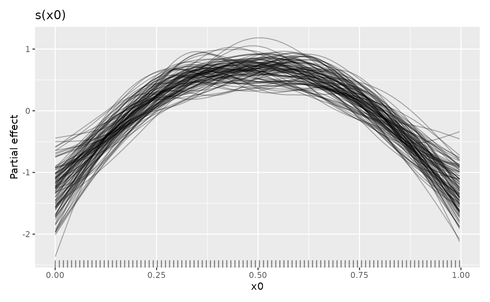
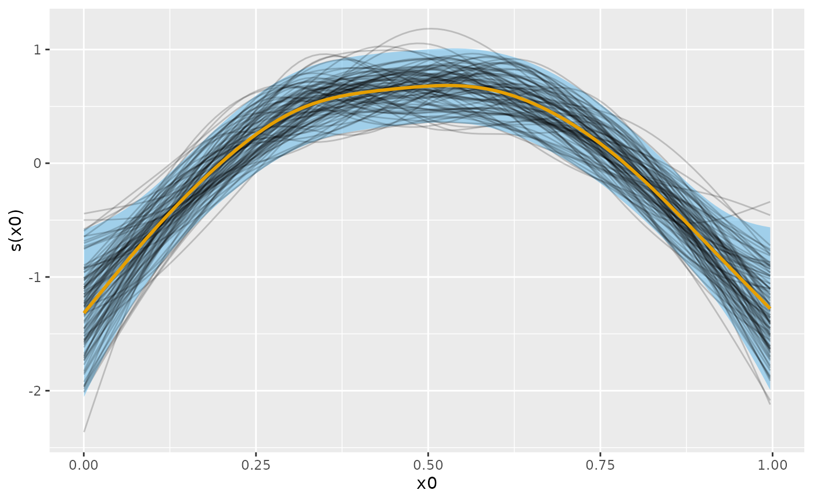
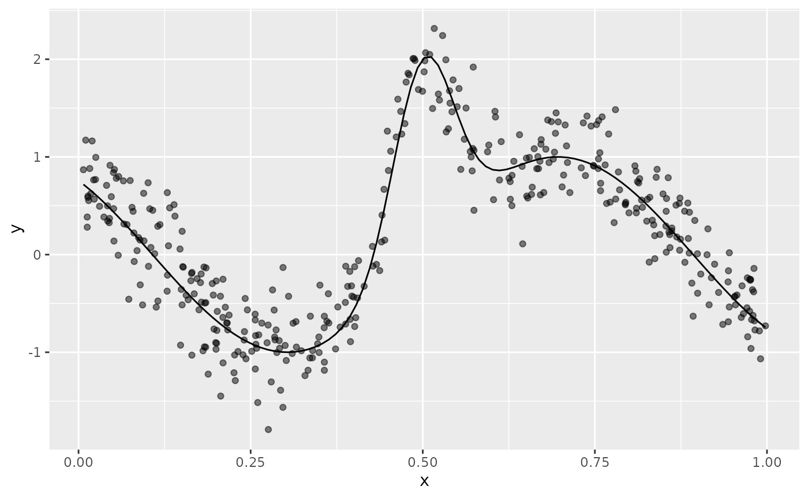
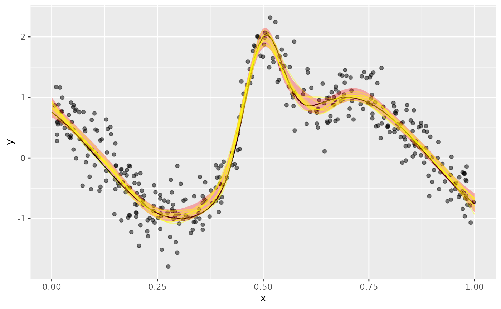
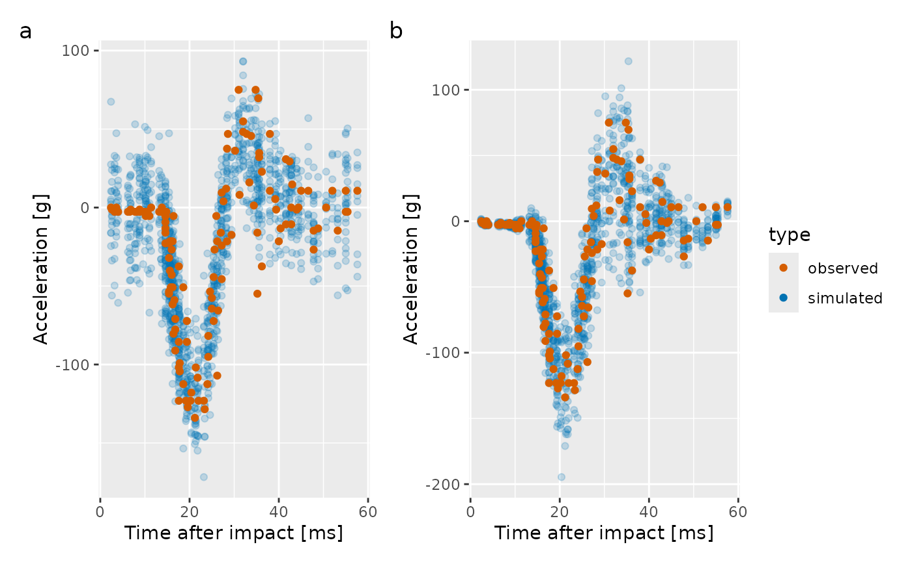
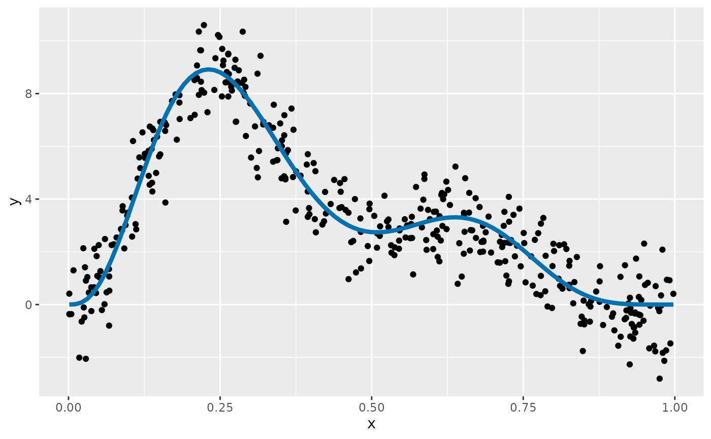
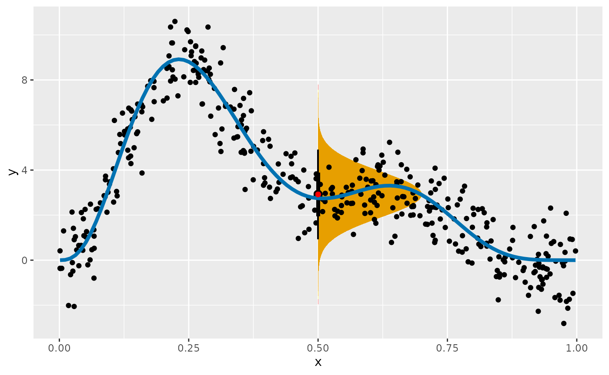
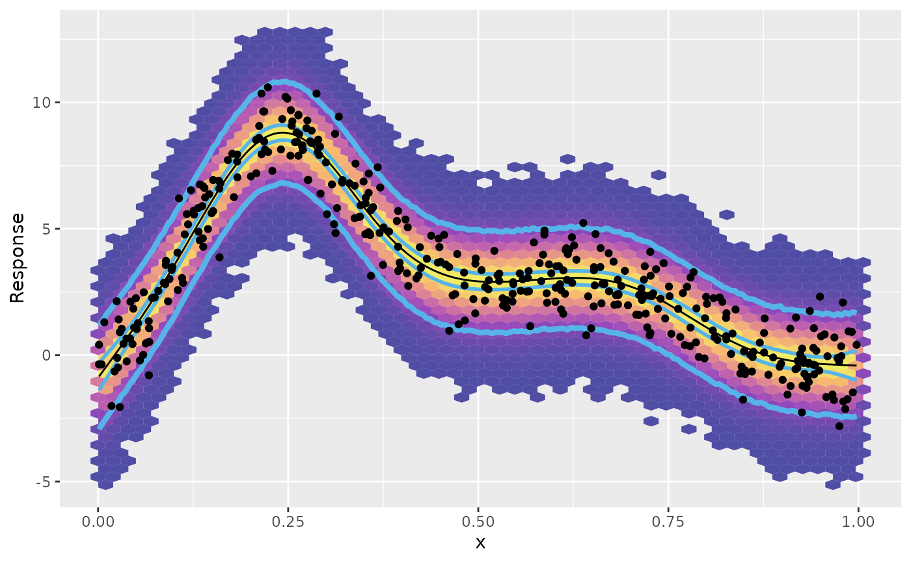
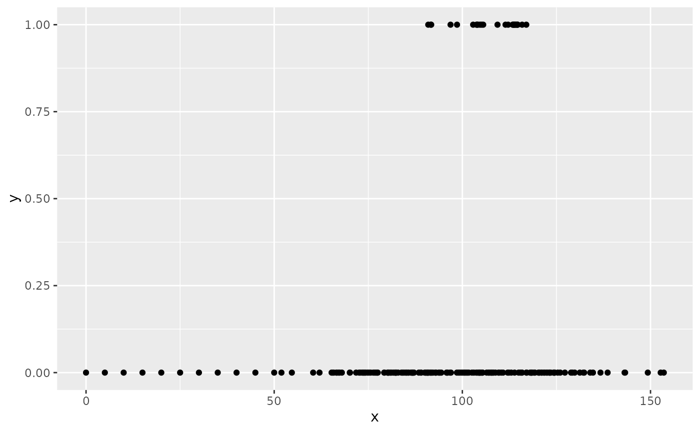
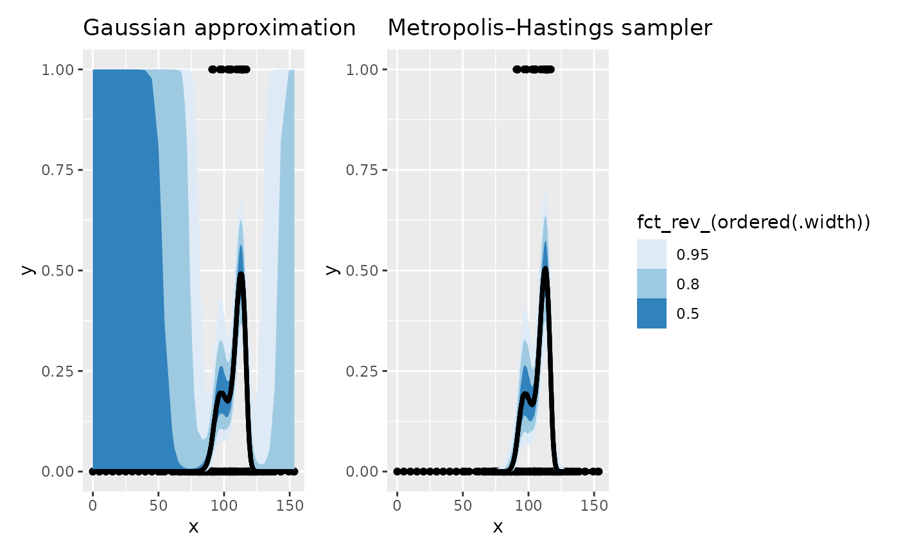

# Posterior Simulation

Posterior simulation represents uncertainty in a fitted GAM by drawing
model coefficients and evaluating smooths or predictions at each draw.
It can also generate possible new responses, combining coefficient
uncertainty with variation between observations. This article shows how
to choose the sampled quantity, plot the resulting curves, and construct
prediction intervals.

Load the packages for fitting models, drawing samples and plotting the
results.

``` r

library("mgcv")
library("gratia")
library("dplyr")
library("tidyr")
library("ggplot2")
library("ggdist")
library("distributional")
library("tibble")
library("withr")
library("patchwork")
```

For a generalized additive model (GAM) with a single linear predictor
for the mean, we can write the model as

g(\mu_i) = \eta_i = A_i + \mathbf{X}\_i \boldsymbol{\gamma} +
\sum\_{j=1}^{J} f_j(x\_{ij}), \\ y_i \sim \mathcal{D}(\mu_i, \phi)

Here g is the link function, A_i is an offset, and
\mathbf{X}\_i\boldsymbol{\gamma} contains the parametric terms. Each f_j
is a smooth function of covariate x_j. The response distribution
\mathcal{D} has mean \mu_i and may have a scale parameter \phi.

Each smooth is a weighted sum of known basis functions:

f_j(x\_{ij}) = \sum\_{k=1}^{K_j} \beta\_{jk} b\_{jk}(x\_{ij}).

The coefficients \beta\_{jk} determine the shape of the fitted function.
The penalty \sum_j \lambda_j
\boldsymbol{\beta}^{\mathsf{T}}\mathbf{S}\_j \boldsymbol{\beta}
discourages excessive wiggliness, with smoothing parameters \lambda_j
controlling its strength.

After fitting the GAM with {mgcv}, we obtain a vector of coefficient
estimates \hat{\boldsymbol{\beta}} that includes the parametric
coefficients and the coefficients of all the smooths. Under the Bayesian
view of smoothing (Miller, 2025), we can approximate their posterior as

\boldsymbol{\beta} \mid \mathbf{y}, \mathbf{B},
\hat{\boldsymbol{\lambda}}, \hat{\phi}
\\\overset{\mathrm{approx}}{\sim}\\
\mathrm{MVN}(\hat{\boldsymbol{\beta}}, \mathbf{V}\_{\mathrm{b}}).

Here \mathbf{y} is the observed response vector and \mathbf{B} is the
full model matrix, including the parametric terms and spline bases. The
smoothing parameters \hat{\boldsymbol{\lambda}} and, where estimated,
the response scale \hat{\phi} are held at their fitted values.
\mathbf{V}\_{\mathrm{b}} is the model’s Bayesian coefficient covariance
matrix. Its off-diagonal entries describe which coefficients tend to
vary together in the posterior draws.

For a Gaussian identity-link GAM with the usual quadratic smoothing
penalty, the coefficient posterior is exactly multivariate normal when
the response variance \sigma^2 = \phi and smoothing parameters are held
fixed, provided the posterior is proper and the coefficients are free of
inequality constraints. For other distributions or links, normality is
generally an approximation. The Metropolis–Hastings example below shows
a case where that approximation performs poorly.

## What are we simulating?

Choose a function according to the quantity whose variation you want to
see:

| Function | What varies between draws? |
|:---|:---|
| [`smooth_samples()`](https://gavinsimpson.github.io/gratia/reference/smooth_samples.md) | An individual smooth contribution, evaluated using its coefficients from each joint coefficient draw |
| [`fitted_samples()`](https://gavinsimpson.github.io/gratia/reference/fitted_samples.md) | Distribution parameters, or the expected response with `quantity = "expectation"`, evaluated using each joint coefficient draw |
| [`predicted_samples()`](https://gavinsimpson.github.io/gratia/reference/predicted_samples.md) | New observations generated with coefficients held at their fitted values |
| [`posterior_samples()`](https://gavinsimpson.github.io/gratia/reference/posterior_samples.md) | New observations generated after drawing coefficients, combining coefficient uncertainty and response variation |

For example, uncertainty in a mean curve and variation between future
observations answer different questions. Use
[`fitted_samples()`](https://gavinsimpson.github.io/gratia/reference/fitted_samples.md)
with `quantity = "expectation"` for the former, and
[`posterior_samples()`](https://gavinsimpson.github.io/gratia/reference/posterior_samples.md)
for the latter when coefficient uncertainty should also be included.

By default, coefficient draws use \mathbf{V}\_{\mathrm{b}}, holding the
selected smoothing parameters fixed. For many mgcv models fitted with
REML or ML, a corrected covariance matrix \mathbf{V}\_{\mathrm{c}} is
also available. Setting `unconditional = TRUE` uses this correction to
approximately account for smoothing-parameter uncertainty. It does not
draw smoothing parameters or a dispersion estimate stored outside the
coefficient vector. Scale parameters represented by coefficients, as in
[`gaulss()`](https://rdrr.io/pkg/mgcv/man/gaulss.html), vary with those
coefficient draws.

{gratia} also supplies
[`simulate()`](https://gavinsimpson.github.io/gratia/reference/simulate.md)
methods for [`gam()`](https://rdrr.io/pkg/mgcv/man/gam.html),
[`bam()`](https://rdrr.io/pkg/mgcv/man/bam.html),
[`gamm()`](https://rdrr.io/pkg/mgcv/man/gamm.html) and {scam} fits. For
the univariate examples here, each column contains one simulated
response dataset, with rows corresponding to observations.
[`derivative_samples()`](https://gavinsimpson.github.io/gratia/reference/derivative_samples.md)
evaluates rates of change using the same coefficient draws at
neighbouring covariate values. See [Comparing treatments and finding
rates of
change](https://gavinsimpson.github.io/gratia/articles/prediction-comparisons.md)
for examples of response derivatives.

## Sample and plot individual smooth contributions

For a selected smooth f_j, we retain its coefficients
\boldsymbol{\beta}\_j^{\ast} from each joint coefficient draw and
evaluate \mathbf{f}\_j^{\ast} =
\mathbf{B}\_j\boldsymbol{\beta}\_j^{\ast}, where \mathbf{B}\_j contains
the smooth’s basis functions at the requested covariate values. Under
the Gaussian approximation, the marginal distribution of these
coefficients is \mathrm{MVN}(\hat{\boldsymbol{\beta}}\_j,
\mathbf{V}\_{\mathrm{b},jj}), where \mathbf{V}\_{\mathrm{b},jj} is their
block of the full covariance matrix.
[`smooth_samples()`](https://gavinsimpson.github.io/gratia/reference/smooth_samples.md)
uses the same joint coefficient draws for all selected smooths,
preserving dependence between their sampled contributions.

To illustrate smooth uncertainty, we simulate independent covariates
`x0` to `x3` uniformly on the unit interval. The response combines
nonlinear effects of `x0`, `x1` and `x2` with independent Gaussian noise
of standard deviation two; `x3` has no effect. This is Gu & Wahba’s
example, available through
[`data_sim()`](https://gavinsimpson.github.io/gratia/reference/data_sim.md).

``` r

ss_df <- data_sim("eg1", seed = 42)
```

We fit a GAM with a smooth for each covariate, selecting smoothing
parameters by REML.

``` r

m_ss <- gam(y ~ s(x0) + s(x1) + s(x2) + s(x3), data = ss_df, method = "REML")
```

The contribution of f(x_0) uses coefficients 2 through 10 of this model.
The other coefficients are not included when evaluating this smooth
contribution.

``` r

s_x0 <- get_smooth(m_ss, "s(x0)")
smooth_coef_indices(s_x0)
#> [1]  2  3  4  5  6  7  8  9 10
```

We use `select` to sample the contribution of `s(x0)` on 100 specified
values of `x0`. Omitting `select` would sample all smooths in the model.

``` r

sm_grid <- data_slice(m_ss, x0 = evenly(x0, n = 100))
sm_samp <- smooth_samples(m_ss, select = "s(x0)", data = sm_grid,
  n_draws = 100, seed = 21)
```

Here we supply 100 evenly spaced values of `x0` through `data` so that
we can reuse exactly the same grid for the interval below. Without
`data`, `n_grid` controls the number of covariate evaluation points
constructed by
[`smooth_samples()`](https://gavinsimpson.github.io/gratia/reference/smooth_samples.md).
`n_draws` controls the number of coefficient draws and hence sampled
smooths; here we request 100.

Plotting the sampled curves with
[`draw()`](https://gavinsimpson.github.io/gratia/reference/draw.md)
shows how the shape varies between coefficient draws:

``` r

draw(sm_samp) & theme(gratia.alpha.sample = 0.3)
```


Set `n_samples` in
[`draw()`](https://gavinsimpson.github.io/gratia/reference/draw.md) to
display a randomly selected subset of curves. Its `seed` argument makes
the selection repeatable.

We now compare the sampled contribution of `s(x0)` with its pointwise
95% credible interval on the same grid.
[`smooth_samples()`](https://gavinsimpson.github.io/gratia/reference/smooth_samples.md)
draws only the selected smooth contribution. We therefore set
`overall_uncertainty = FALSE` in
[`smooth_estimates()`](https://gavinsimpson.github.io/gratia/reference/smooth_estimates.md)
to omit overall-mean uncertainty from the interval too.

``` r

# evaluate the fitted smooth over x0 and add on a credible interval
sm_est <- smooth_estimates(m_ss, select = "s(x0)", data = sm_grid,
  overall_uncertainty = FALSE) |>
  add_confint()
# plot the smooth, credible interval, and posterior smooths
sm_est |>
  ggplot(aes(x = x0)) +
  geom_lineribbon(aes(ymin = .lower_ci, ymax = .upper_ci),
    orientation = "vertical", fill = "#56B4E9", alpha = 0.5
  ) +
  geom_line(
    data = sm_samp,
    aes(y = .value, group = .draw), alpha = 0.2
  ) +
  geom_line(aes(y = .estimate), linewidth = 1, colour = "#E69F00") +
  labs(y = smooth_label(s_x0))
```



At a fixed value of x_0, the blue interval has approximately 95%
posterior probability for the smooth contribution, conditional on the
observed data, model design and fitted smoothing and variance
parameters. With many posterior draws, about 95% of the sampled values
at that particular x_0 would fall inside it. This does not mean that 95%
of complete sampled curves stay inside the interval over the whole grid.

Marra & Wood (2012) study frequentist coverage averaged over the
function. Imagine repeatedly generating data from the same true
function, refitting the GAM and constructing intervals. For each fit,
record the proportion of covariate values at which the interval contains
the true function. The average of those proportions estimates the
coverage studied in the paper. It can be close to the nominal level when
smoothing bias is small. For nearly linear smooths, the coverage of
centred components can be poor and can improve if the interval includes
uncertainty in the overall mean. The intervals here exclude that
uncertainty to match the sampled smooth contribution.

## Sample expected responses with `fitted_samples()`

In this section we request `quantity = "expectation"` explicitly. For an
ordinary mean-based GAM, these are draws of the same expected response
estimated by `predict(..., type = "response")`. Distributional models
can have several predictors, and their first parameter need not be the
expected response. The default `quantity = "parameters"` returns those
parameters instead;
[`family_parameters()`](https://gavinsimpson.github.io/gratia/reference/family_parameters.md)
describes their meanings.

The next example uses a mean function with a narrow peak superimposed on
a sine wave, from example 6 of Luo & Wahba (1997):

\sin(2(4x - 2)) + 2\exp(-256(x - 0.5)^2).

We sample `x` on the unit interval and add independent Gaussian noise
with standard deviation 0.3. Plotting the generating function with the
observations shows the local change in shape that the model needs to
capture.

``` r

f <- function(x) {
  sin(2 * ((4 * x) - 2)) + (2 * exp(-256 * (x - 0.5)^2))
}
df <- data_sim("lwf6", dist = "normal", scale = 0.3, seed = 2)
plt <- df |>
  ggplot(aes(x = x, y = y)) +
  geom_point(alpha = 0.5) +
  geom_function(fun = f)
plt
```



An adaptive smooth allows the strength of smoothing to vary over `x`,
helping it represent both the narrow peak and the broader sine-wave
pattern:

``` r

m <- gam(y ~ s(x, k = 25, bs = "ad"), data = df, method = "REML")
```

We create 200 prediction points between zero and one, adding `.row` to
match each point with its sampled values later:

``` r

new_df <- data_slice(m, x = evenly(x, lower = 0, upper = 1, n = 200)) |>
  mutate(.row = row_number())
```

First,
[`fitted_values()`](https://gavinsimpson.github.io/gratia/reference/fitted_values.md)
gives the estimated mean and credible interval at each prediction point:

``` r

fv <- fitted_values(m, quantity = "expectation", data = new_df)
```

We then draw ten mean curves with
[`fitted_samples()`](https://gavinsimpson.github.io/gratia/reference/fitted_samples.md)
and join their prediction coordinates. Every curve uses one joint
coefficient draw:

``` r

fs <- fitted_samples(m, quantity = "expectation", data = new_df, n_draws = 10, seed = 4) |>
  left_join(new_df |> select(.row, x), by = join_by(.row == .row))
```

To compare the sampled curves with the pointwise credible interval, add
them to the data plot. The ribbon shows uncertainty in the mean
response, and the yellow lines show the ten sampled means:

``` r

plt +
  geom_ribbon(data = fv, aes(y = .fitted, ymin = .lower_ci, ymax = .upper_ci),
    fill = "red", alpha = 0.3) +
  geom_line(data = fs, aes(group = .draw, x = x, y = .fitted),
    colour = "yellow", alpha = 0.4)
```



Here the expected-response draws include the intercept and its
uncertainty. The earlier
[`smooth_samples()`](https://gavinsimpson.github.io/gratia/reference/smooth_samples.md)
example isolated a centred smooth contribution.

## Simulate responses when both mean and variability change

Some models have separate predictors for distribution parameters such as
the mean and standard deviation.
[`predicted_samples()`](https://gavinsimpson.github.io/gratia/reference/predicted_samples.md)
and
[`posterior_samples()`](https://gavinsimpson.github.io/gratia/reference/posterior_samples.md)
support these models when their fitted family supplies a response
generator. We adapt Matteo Fasiolo’s {mgcViz} example using the `mcycle`
data from {MASS}, which record acceleration at times after impact in
simulated motorcycle accidents.

Load the observations and add `.row` so simulated responses can be
matched to their measurement times:

``` r

data(mcycle, package = "MASS")
mcycle <- mcycle |>
  mutate(
    .row = row_number()
  ) |>
  relocate(.row, .before = 1L)
```

To these data we fit a standard Gaussian GAM for the conditional mean of
`accel`.

``` r

m_gau <- gam(accel ~ s(times, k = 20),
  data = mcycle, method = "REML"
)
```

We generate ten responses at each observed time with
[`predicted_samples()`](https://gavinsimpson.github.io/gratia/reference/predicted_samples.md).
The code joins the measurement times, combines simulations with
observations, and adds labels and transparency values for the comparison
plot:

``` r

n_sim <- 10
n_data <- nrow(mcycle)

sim_gau <- predicted_samples(m_gau, n_draws = n_sim, seed = 10) |>
  left_join(mcycle |> select(-accel), # join on the observed data for times
    by = ".row"
  ) |>
  rename(accel = .response) |>        # rename
  bind_rows(mcycle |>
    relocate(.after = last_col())) |> # bind on observer data
  mutate(                             # add indicator: simulated or observed
    type = rep(c("simulated", "observed"),
      times = c(n_sim * n_data, n_data)
    ),
    .alpha = rep(                     # set alpha values for sims & observed
      c(0.2, 1), times = c(n_sim * n_data, n_data)
    )
  )
```

We prepare a plot with observed points opaque and simulated points
transparent, so the spread of the simulations can be compared with the
observations:

``` r

plt_labs <- labs(
  x = "Time after impact [ms]",
  y = "Acceleration [g]"
)

plt_gau <- sim_gau |>
  ggplot(aes(x = times)) +
  geom_point(aes(y = accel, colour = type, alpha = .alpha)) +
  plt_labs +
  scale_colour_manual(values = gratia_palette()(9)[c(6, 5)]) +
  scale_alpha_identity()
```

This plot appears on the left of the comparison below. The
constant-variance model produces similar residual spread at every time,
whereas the observations suggest that spread changes after impact.

We now fit [`gaulss()`](https://rdrr.io/pkg/mgcv/man/gaulss.html), with
separate smooths for the mean and scale parameter. This allows the
conditional variance to change with time as well:

``` r

m_gaulss <- gam(
  list(accel ~ s(times, k = 20, bs = "tp"),
    ~ s(times, bs = "tp")
  ), data = mcycle, family = gaulss()
)
```

Generate responses from this model at the same measurement times and
prepare the same labels for plotting:

``` r

sim_gaulss <- predicted_samples(m_gaulss, n_draws = n_sim, seed = 20) |>
  left_join(mcycle |> select(-accel),
    by = ".row"
  ) |>
  rename(accel = .response) |>
  bind_rows(mcycle |> relocate(.after = last_col())) |>
  mutate(
    type = rep(c("simulated", "observed"),
      times = c(n_sim * n_data, n_data)
    ),
    .alpha = rep(c(0.2, 1), times = c(n_sim * n_data, n_data))
  )
```

We reuse the earlier plot with the new simulations and place both models
side by side to compare how well they reproduce the observed spread:

``` r

plt_gaulss <- plt_gau + sim_gaulss

plt_gau + plt_gaulss +
  plot_annotation(tag_levels = "a") +
  plot_layout(guides = "collect", ncol = 2)
```



The model on the right can reproduce the changing spread more closely.
This comparison concerns response variation at the fitted parameter
values:
[`predicted_samples()`](https://gavinsimpson.github.io/gratia/reference/predicted_samples.md)
holds coefficients fixed in both panels.

## Construct prediction intervals for new observations

A prediction interval describes plausible values of a new observation.
To construct one, we combine uncertainty in the estimated mean with
response variation around that mean. For a Gaussian model, these come
from coefficient uncertainty and the Gaussian error distribution,
respectively.

We illustrate the calculation using 400 observations. The mean follows
Gu & Wahba’s curved function f_2, evaluated at independent uniform `x`
values between zero and one. Independent Gaussian errors have variance
\sigma^2 = 1.

``` r

df <- data_sim("gwf2", n = 400, scale = 1, dist = "normal", seed = 8)
```

Plot the observations against the generating mean curve to see their
spread:

``` r

df |>
  ggplot(aes(x = x, y = y)) +
  geom_point() +
  geom_function(fun = gw_f2, colour = "#0072B2", linewidth = 1.5)
```



We estimate that mean curve with a single smooth of `x`, selecting its
smoothness by REML:

``` r

m <- gam(y ~ s(x), data = df, method = "REML", family = gaussian())
```

Use [`predict()`](https://rdrr.io/r/stats/predict.html) to estimate the
mean response at a new covariate value, `x = 0.5`.

``` r

mu <- predict(m, newdata = data.frame(x = 0.5))
mu
#>        1 
#> 2.919094
```

This fitted value is the mean of the response distribution at `x = 0.5`.
To describe its spread, take the square root of the fitted Gaussian
scale parameter, which estimates the residual variance. This gives the
standard deviation required by
[`dist_normal()`](https://pkg.mitchelloharawild.com/distributional/reference/dist_normal.html)
below:

``` r

sigma <- sqrt(m$scale)
sigma
#> [1] 1.009666
```

We use {ggdist} to draw the fitted response density at `x = 0.5`,
alongside the data and generating mean curve:

``` r

df |>
  ggplot(aes(x = x, y = y)) +
  stat_halfeye(aes(ydist = dist_normal(mean = mu, sd = sigma)),
    x = 0.5, scale = 0.2, slab_fill = "#E69F00", slab_alpha = 0.7
  ) +
  geom_point() +
  geom_function(fun = gw_f2, colour = "#0072B2", linewidth = 1.5) +
  geom_point(x = 0.5, y = mu, colour = "red")
```



The orange region shows the fitted response distribution at `x = 0.5`,
with the mean and variance fixed at their estimates. Use
[`fitted_values()`](https://gavinsimpson.github.io/gratia/reference/fitted_values.md)
to see how uncertain the mean itself is at that value of `x`.

``` r

fitted_values(m, quantity = "expectation", data = data.frame(x = 0.5))
#> # A tibble: 1 × 7
#>    .row     x .parameter  .fitted   .se .lower_ci .upper_ci
#>   <int> <dbl> <chr>         <dbl> <dbl>     <dbl>     <dbl>
#> 1     1   0.5 expectation    2.92 0.161      2.60      3.23
```

The `.se` column gives the standard error of the estimated mean in
`.fitted`. `.lower_ci` and `.upper_ci` give its 95% credible interval.
The fitted response variance \phi = \sigma^2 is held fixed in these
calculations.

We next extend the calculation over the observed range of `x`, combining
mean uncertainty with response variation using
[`posterior_samples()`](https://gavinsimpson.github.io/gratia/reference/posterior_samples.md).
Start with 200 evenly spaced prediction points:

``` r

ds <- data_slice(m, x = evenly(x, n = 200)) |>
  mutate(.row = row_number())
```

The `.row` column matches simulated responses to the rows in `ds`. We
compute fitted means and credible intervals at the same covariate
values. We set `unconditional = TRUE` here and in
[`posterior_samples()`](https://gavinsimpson.github.io/gratia/reference/posterior_samples.md)
below so both use the same covariance correction for uncertainty in the
smoothing parameter.

``` r

fv <- fitted_values(m, quantity = "expectation", data = ds, unconditional = TRUE)
```

We will plot these mean intervals alongside the prediction intervals,
making the additional variation between observations visible.

Use
[`posterior_samples()`](https://gavinsimpson.github.io/gratia/reference/posterior_samples.md)
to generate new responses at each prediction point. Join by `.row` to
recover the corresponding `x` values for plotting.

``` r

ps <- posterior_samples(m, n_draws = 10000, data = ds, seed = 24,
  unconditional = TRUE) |>
  left_join(ds, by = join_by(.row == .row))
ps
#> # A tibble: 2,000,000 × 4
#>     .row .draw .response       x
#>    <int> <int>     <dbl>   <dbl>
#>  1     1     1   -0.589  0.00129
#>  2     2     1   -0.483  0.00629
#>  3     3     1   -1.27   0.0113 
#>  4     4     1    0.399  0.0163 
#>  5     5     1    0.0368 0.0213 
#>  6     6     1    0.443  0.0263 
#>  7     7     1   -0.249  0.0313 
#>  8     8     1   -0.406  0.0363 
#>  9     9     1    0.683  0.0413 
#> 10    10     1   -0.417  0.0463 
#> # ℹ 1,999,990 more rows
```

We request 10,000 response draws at each prediction point. The
`unconditional = TRUE` covariance correction approximately includes
uncertainty in the estimated smoothing parameter. The fitted response
variance remains fixed. Increasing `n_draws` reduces Monte Carlo
variation in the estimated interval endpoints; check their stability
when an analysis depends on a limit.

`ps` has `n_draws * nrow(ds)` rows. Each `.draw` identifies a simulated
set of responses, one per prediction point. To form an interval at each
`x`, we group the responses by `.row` using {dplyr} and calculate their
quantiles. Wrap [`quantile()`](https://rdrr.io/r/stats/quantile.html) in
a function that returns the probabilities and their quantiles as columns
so they can be used with
[`reframe()`](https://dplyr.tidyverse.org/reference/reframe.html).

``` r

quantile_fun <- function(x, probs = c(0.025, 0.5, 0.975), ...) {
  tibble::tibble(
    .value = quantile(x, probs = probs, ...),
    .q = probs * 100
  )
}
```

We apply this function to the simulated responses, grouping by `.row` to
summarise the posterior predictive distribution separately at each new
value of `x`.
[`reframe()`](https://dplyr.tidyverse.org/reference/reframe.html)
applies `quantile_fun()` within each group. We then pivot the summary
from long to wide format and join the covariate values using `.row`.

``` r

p_int <- ps |>
  group_by(.row) |>
  reframe(quantile_fun(.response)) |>
  pivot_wider(
    id_cols = .row, names_from = .q, values_from = .value,
    names_prefix = ".q"
  ) |>
  left_join(ds, by = join_by(.row == .row))
p_int
#> # A tibble: 200 × 5
#>     .row  .q2.5    .q50 .q97.5       x
#>    <int>  <dbl>   <dbl>  <dbl>   <dbl>
#>  1     1 -2.93  -0.859    1.17 0.00129
#>  2     2 -2.68  -0.644    1.38 0.00629
#>  3     3 -2.47  -0.414    1.62 0.0113 
#>  4     4 -2.24  -0.236    1.80 0.0163 
#>  5     5 -2.03  -0.0245   2.02 0.0213 
#>  6     6 -1.83   0.195    2.20 0.0263 
#>  7     7 -1.58   0.376    2.41 0.0313 
#>  8     8 -1.43   0.601    2.60 0.0363 
#>  9     9 -1.16   0.843    2.80 0.0413 
#> 10    10 -0.975  1.04     3.05 0.0463 
#> # ℹ 190 more rows
```

The printed tibble shows the 95% pointwise prediction interval for the
first 10 rows of `ds`. `.q50` is the median of the posterior predictive
distribution at each value of `x`.

We plot the fitted mean, its credible interval and the prediction
interval together. Black points show observations. Hexagonal bins
summarise the two million simulated responses without drawing each point
separately:

``` r

fv |>
  ggplot(aes(x = x, y = .fitted)) +
  # summarise the posterior samples
  geom_hex(
    data = ps, aes(x = x, y = .response, fill = after_stat(count)),
    bins = 50, alpha = 0.7
  ) +
  # add the lower and upper prediction intervals
  geom_line(data = p_int, aes(y = .q2.5), colour = "#56B4E9",
    linewidth = 1.5) +
  geom_line(data = p_int, aes(y = .q97.5), colour = "#56B4E9",
    linewidth = 1.5) +
  # add the lower and upper credible intervals
  geom_line(aes(y = .lower_ci), colour = "#56B4E9", linewidth = 1) +
  geom_line(aes(y = .upper_ci), colour = "#56B4E9", linewidth = 1) +
  # add the fitted model
  geom_line() +
  # add the observed data
  geom_point(data = df, aes(x = x, y = y)) +
  scale_fill_viridis_c(option = "plasma") +
  theme(legend.position = "none") +
  labs(y = "Response")
```



The outer pair of blue lines shows the 95% pointwise posterior
predictive interval for a new response at each value of `x`. It combines
coefficient uncertainty with response variation, while holding the
response variance at its fitted value. The inner pair shows uncertainty
in the fitted mean alone. The hexagonal bins summarise the simulated
responses, with warmer colours indicating larger counts.

## Compare Gaussian draws with Metropolis–Hastings sampling

The Gaussian approximation can be poor when the coefficient posterior is
strongly asymmetric. Simon Wood’s
[`mgcv::gam.mh()`](https://rdrr.io/pkg/mgcv/man/gam.mh.html) example
illustrates this with binary data containing long stretches of zero
responses. A Metropolis–Hastings (MH) sampler evaluates the conditional
posterior directly through the penalised likelihood, while holding
smoothing and other fitted family parameters fixed.

We adapt that example below. The function keeps a fixed sequence of
binary responses and generates unevenly distributed covariate values; it
does not simulate responses from a known probability curve. This lets us
compare two sampling methods for the same sparse response pattern.

``` r

ga_fail <- function(seed) {
  df <- tibble(y = c(
    rep(0, 89), 1, 0, 1, 0, 0, 1, rep(0, 13), 1, 0, 0, 1,
    rep(0, 10), 1, 0, 0, 1, 1, 0, 1, rep(0, 4), 1, rep(0, 3),
    1, rep(0, 3), 1, rep(0, 10), 1, rep(0, 4), 1, 0, 1, 0, 0,
    rep(1, 4), 0, rep(1, 5), rep(0, 4), 1, 1, rep(0, 46)
  )) |>
    mutate(
      x = withr::with_seed(
        seed,
        sort(c(0:10 * 5, rnorm(length(y) - 11) * 20 + 100))
      ),
      .row = row_number()
    ) |>
    relocate(.row, .before = 1L)
  df
}
```

Generate the covariate values and plot the resulting response pattern:

``` r

df <- ga_fail(3)

df |>
  ggplot(aes(x = x, y = y)) +
  geom_point()
```



Successes occur in a limited part of the covariate range; many other
values of `x` have only failures. We fit a binomial GAM with a logit
link to estimate the response probability across this range.

``` r

m_logit <- gam(y ~ s(x, k = 15), data = df, method = "REML", family = binomial)
```

Draw expected response probabilities first using the Gaussian
approximation, then using MH sampling, so both results can be summarised
on the same scale:

``` r

fs_ga <- fitted_samples(m_logit, quantity = "expectation", n_draws = 2000, seed = 2)
fs_mh <- fitted_samples(m_logit, quantity = "expectation",
  n_draws = 2000, seed = 2, method = "mh", thin = 2,
  rw_scale = 0.4
)
```

With `method = "mh"`, `thin = 2` retains every second iteration after
burn-in. `rw_scale = 0.4` multiplies the approximate posterior
covariance by 0.4 for the Gaussian random-walk proposals. The default
`burnin = 1000` discards the first 1,000 iterations. `t_df = 40` sets
the degrees of freedom for the independent multivariate *t* proposals.

[`mgcv::gam.mh()`](https://rdrr.io/pkg/mgcv/man/gam.mh.html) alternates
those *t* proposals, centred on the fitted coefficients, with Gaussian
random-walk proposals. Each proposed draw is accepted or rejected using
the conditional posterior density. Consequently, the distribution of
retained chain states can differ from the Gaussian approximation.
Rejected proposals leave repeated states in the chain.

Summarise each set of probability draws into 50%, 80% and 95% intervals
with
[`ggdist::median_qi()`](https://mjskay.github.io/ggdist/reference/point_interval.html),
then join the covariate values for plotting:

``` r

excl_col <- c(".draw", ".parameter", ".row")
int_ga <- fs_ga |>
  group_by(.row) |>
  median_qi(.width = c(0.5, 0.8, 0.95), .exclude = excl_col) |>
  left_join(df, by = join_by(.row == .row))

int_mh <- fs_mh |>
  group_by(.row) |>
  median_qi(.width = c(0.5, 0.8, 0.95), .exclude = excl_col) |>
  left_join(df, by = join_by(.row == .row))
```

We place the Gaussian and MH intervals side by side, using the same
observed points and probability scale in each panel:

``` r

plt_ga <- df |>
  ggplot(aes(x = x, y = y)) +
  geom_point() +
  geom_lineribbon(
    data = int_ga,
    aes(x = x, y = .fitted, ymin = .lower, ymax = .upper)
  ) +
  scale_fill_brewer() +
  labs(title = "Gaussian approximation")

plt_mh <- df |>
  ggplot(aes(x = x, y = y)) +
  geom_point() +
  geom_lineribbon(
    data = int_mh,
    aes(x = x, y = .fitted, ymin = .lower, ymax = .upper)
  ) +
  scale_fill_brewer() +
  labs(title = "Metropolis–Hastings sampler")

plt_ga + plt_mh + plot_layout(guides = "collect")
```



The Gaussian approximation gives much wider probability intervals in
parts of the range containing only zero responses. The MH intervals
concentrate closer to zero there. This difference shows that the choice
of coefficient sampler can matter for the resulting response intervals.
Before using the MH limits in an analysis, check several chains using
the workflow below: this single-chain illustration does not assess
mixing or interval coverage.

## Multiple chains and sampling diagnostics

Several chains let us check whether separate sampling sequences explore
the same coefficient distribution. `n_draws` is the total number of
retained coefficient draws across chains. Four chains with
`n_draws = 1000` retain 250 draws each. Each MH chain has its own
burn-in period. Use `n_cores` to run chains concurrently with {mirai}.
gratia reuses an active mirai pool; if none is available, it creates and
removes a temporary pool. The following call requests posterior
responses and diagnostics from four coefficient chains:

``` r

response_draws <- posterior_samples(
  m_ss, n_draws = 1000, chains = 4, n_cores = 4,
  method = "mh", burnin = 1000, seed = 281,
  diagnostics = TRUE
)
sampling_diagnostics(response_draws)
```

The returned table includes `.chain` and `.iteration`. `.draw`
identifies a draw across all chains. `diagnostics = TRUE` requires the
{posterior} package and attaches coefficient summaries, including R-hat,
bulk and tail effective sample sizes, and Monte Carlo standard errors.
The effective sample sizes measure how much information remains after
allowing for correlation between successive draws. A total of 1,000
retained draws need not provide the information of 1,000 independent
draws. R-hat compares variation within and between chains; it should be
close to one when the chains explore the same distribution. Monte Carlo
standard errors describe uncertainty from using a finite number of
draws.

These summaries describe the coefficient chains before response
simulation. Response noise can conceal poor mixing of the coefficient
chains. To examine coefficient trace plots and then reuse the same draws
for response sampling, generate the coefficients once:

``` r

coefficients <- post_draws(
  m_ss, n_draws = 1000, chains = 4, n_cores = 4,
  method = "mh", burnin = 1000, seed = 281,
  diagnostics = TRUE
)
bayesplot::mcmc_trace(as_mcmc_draws(coefficients, format = "array"))
response_draws <- posterior_samples(
  m_ss, method = "user", draws = coefficients, seed = 282
)
```

[`as_mcmc_draws()`](https://gavinsimpson.github.io/gratia/reference/as_mcmc_draws.md)
also converts fitted values, smooths, derivatives, and response samples.
Select the observations or smooths of interest before converting a large
table: each sampled quantity becomes one variable. Choose
`"draws_array"` or `"draws_df"` for posterior, `"mcmc.list"` for {coda},
or `"array"` for an ordinary array with iteration, chain and variable
dimensions, accepted by {bayesplot}. Conversions require the same
consecutive retained iterations in each chain. Keep the chain columns
when manipulating sampled tables; ordinary matrix subsetting can remove
the chain mapping attached to coefficient matrices.

### Sample coefficients from models fitted with `bam()`

[`mgcv::gam.mh()`](https://rdrr.io/pkg/mgcv/man/gam.mh.html) does not
support bam fits. Use `mh_backend = "gratia"` for
independent-observation bam fits, or to use the compiled evaluator for a
gam. To illustrate the sampling call, we first generate 1,000
independent Poisson observations. The four covariates are independent
and uniform on the unit interval; `x0`, `x1` and `x2` affect the mean,
while `x3` has no effect.

``` r

bam_data <- data_sim("eg1", n = 1000, dist = "poisson", seed = 281)
```

The reduced model below includes smooths of `x0` and `x1`. We use it to
show how to request 1,000 posterior response draws across four MH
chains; the example does not assess recovery of all the simulated
effects.

``` r

b <- mgcv::bam(y ~ s(x0) + s(x1), data = bam_data, family = poisson())
response_draws <- posterior_samples(
  b, n_draws = 1000, chains = 4, n_cores = 4, method = "mh",
  mh_backend = "gratia", diagnostics = TRUE, seed = 281
)
```

This backend currently supports Gaussian identity, Poisson log, binomial
logit, Gamma log, and negative binomial log models. It holds smoothing
parameters, dispersion, and any negative binomial shape at their fitted
values. It rejects AR1 dependence, additional penalties specified
through `paraPen` or `H`, and fits made from pre-fit `G` objects. For
discrete bam fits it evaluates the fitted bases at the original
covariates; it does not use a compressed, discretised likelihood.

Small model matrices are cached. Large designs are evaluated in blocks,
controlled by `block_size`, without retaining the full matrix. This
reduces memory use but repeatedly constructs the basis matrices. The
`dense_limit` argument sets the maximum number of elements in a cached
design matrix; zero forces blockwise evaluation.

For Gaussian identity-link GAMs with no coefficient inequality
constraints, a quadratic smoothing penalty, fixed response variance and
fixed smoothing parameters, the proper coefficient posterior is
Gaussian, as described above. `method = "gaussian"` therefore provides
direct independent draws from that conditional posterior. Its
`unconditional = TRUE` covariance correction can approximately account
for smoothing-parameter uncertainty when mgcv supplies it; it does not
integrate over response-variance uncertainty. The MH backends also hold
smoothing parameters and dispersion fixed.

## References

Luo, Z., & Wahba, G. (1997). Hybrid adaptive splines. *Journal of the
American Statistical Association*, *92*(437), 107–116.

Marra, G., & Wood, S. N. (2012). Coverage properties of confidence
intervals for generalized additive model components. *Scandinavian
Journal of Statistics, Theory and Applications*, *39*(1), 53–74.

Miller, D. L. (2025). Bayesian views of generalized additive modelling.
*Methods Ecol. Evol.* <https://doi.org/10.1111/2041-210x.14498>
