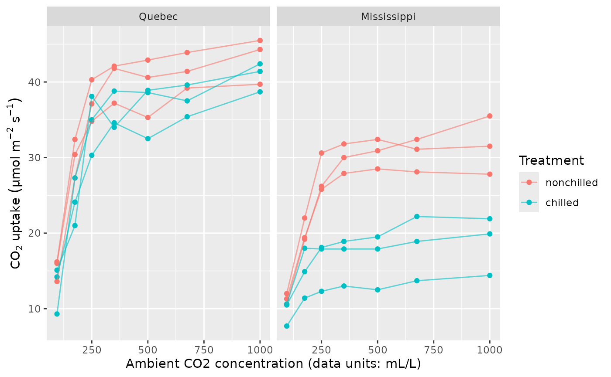
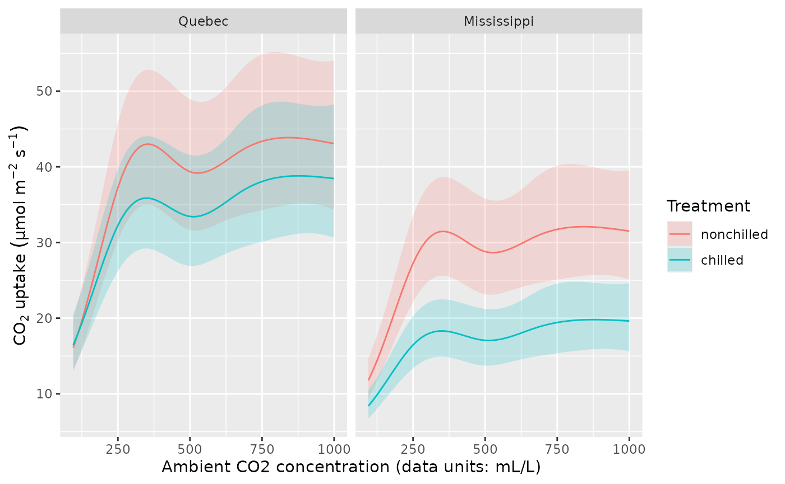
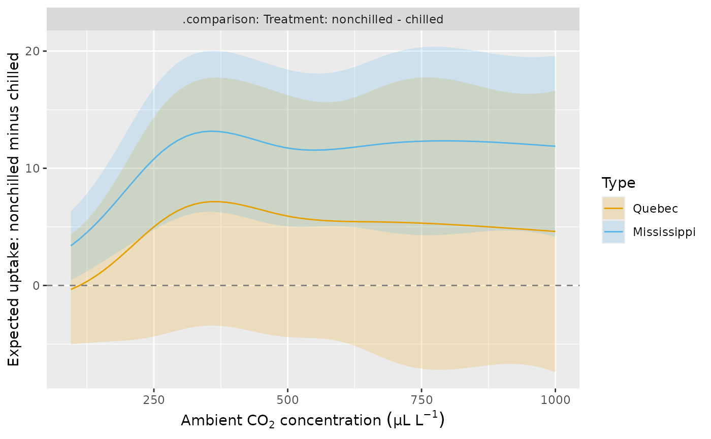
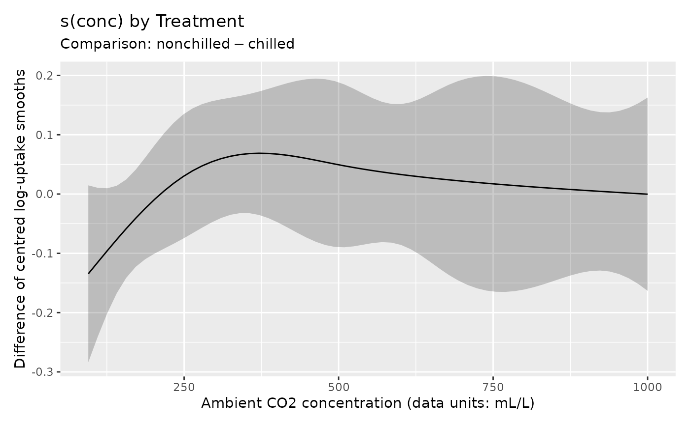
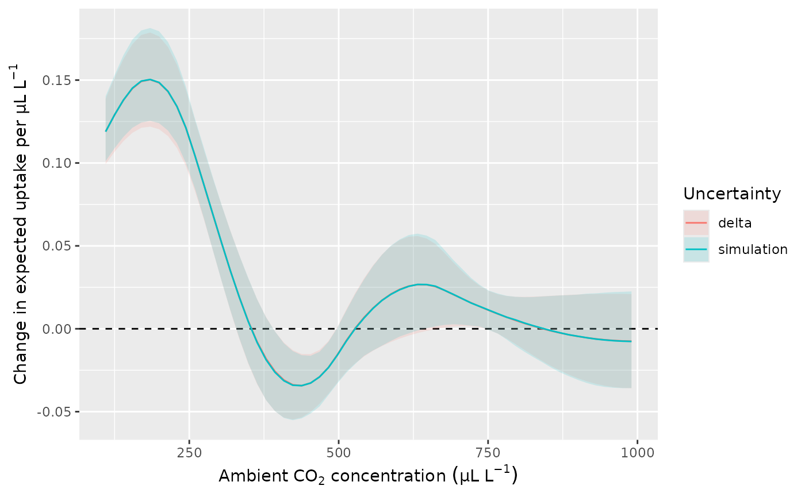
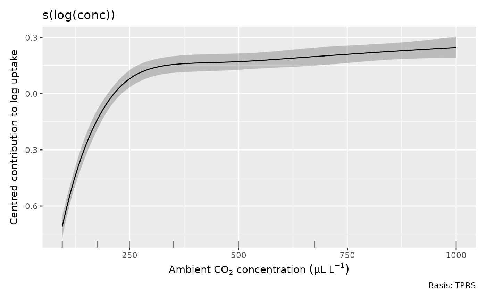
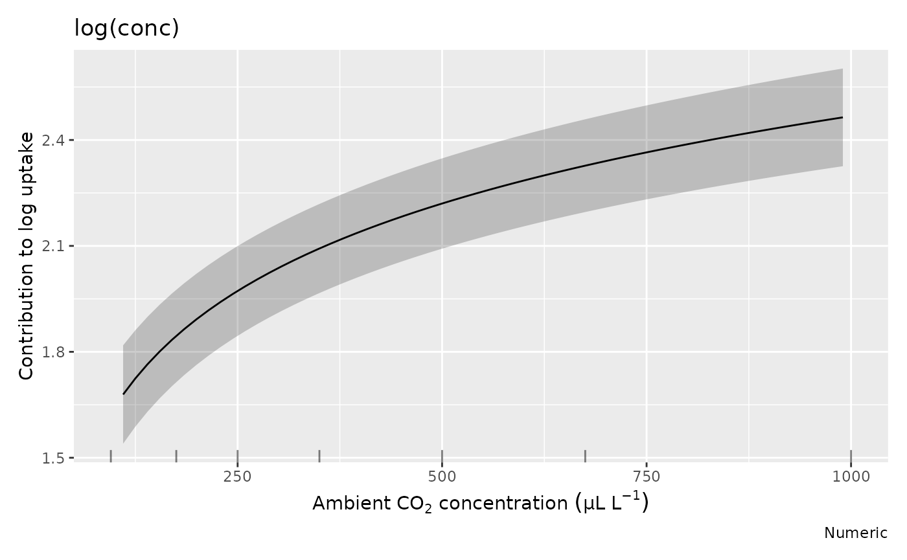

# Comparing treatments and finding rates of change

Does chilling reduce carbon dioxide uptake, and does the answer depend
on carbon dioxide concentration or plant origin? When does increasing
concentration produce the largest increase in uptake? These questions
require comparisons of fitted responses and their rates of change,
rather than inspection of individual smooths alone. This article uses
the same model to answer each question and to explain how the choice of
interval changes the conclusion.

The examples use the `CO2` dataset distributed with R, plus {mgcv},
{gratia}, {dplyr} and {ggplot2}. We use 2,000 coefficient draws for the
bands and posterior calculations. If a conclusion depends on an interval
limit, increase this count and check that the limit is stable. We load
the packages before preparing the data.

``` r

library("gratia")
load_mgcv()
library("dplyr")
library("ggplot2")
```

## Fit treatment curves to the plant experiment

The `CO2` data come from an experiment on cold tolerance in *Echinochloa
crus-galli*. The researchers measured uptake at seven concentrations in
each of twelve plants, with three plants per combination of origin and
treatment. The chilled plants were cooled during the day and allowed to
recover overnight before measurement. Uptake is measured in micromoles
per square metre per second. The original study reports `conc` in
microlitres per litre (\mu\mathrm{L}\\\mathrm{L}^{-1}), which we use for
the axes and rates of change below. [Potvin et
al. (1990)](https://doi.org/10.2307/1938276)

``` r

plant <- as.data.frame(datasets::CO2)
plant$Plant <- factor(plant$Plant, ordered = FALSE)

uptake_label <- expression(CO[2]~uptake~(mu*mol~m^{-2}~s^{-1}))
concentration_label <- expression(
  Ambient ~ CO[2] ~ concentration ~ (mu * L ~ L^{-1})
)

ggplot(plant, aes(conc, uptake, colour = Treatment, group = Plant)) +
  geom_point() +
  geom_line(alpha = 0.6) +
  facet_wrap(~ Type) +
  labs(x = concentration_label, y = uptake_label, colour = "Treatment")
```



Uptake increases quickly at lower concentrations and then tends to level
off. The chilled Mississippi plants have particularly low uptake. We fit
a separate smooth concentration response for each treatment, and allow
the treatment contrast in average log uptake to differ by origin. A
plant random intercept allows measurements from the same plant to share
a persistent deviation from the fitted curve.

All responses are positive. The log link ensures positive fitted means,
and the Gamma model assumes that residual standard deviation is
proportional to the mean. On the log scale the model uses the same
concentration smooth for both origins within a treatment. The
origin-by-treatment interaction allows the difference in curve height
between origins to vary by treatment. Sharing smooths lets both origins
inform the estimated shape for each treatment.

``` r

m_uptake <- gam(
  uptake ~ Type * Treatment + s(conc, by = Treatment, k = 5) +
    s(Plant, bs = "re"),
  data = plant, family = Gamma(link = "log"), method = "REML"
)
overview(m_uptake)
#> 
#> Generalized Additive Model with 7 terms
#> 
#>   term                             type        k   edf ref.edf statistic p.value
#>   <chr>                            <chr>   <dbl> <dbl>   <dbl>     <dbl> <chr>  
#> 1 Intercept                        parame…    NA  1       1        54.7  < 0.001
#> 2 TypeMississippi                  parame…    NA  1       1        -3.44 0.00102
#> 3 Treatmentchilled                 parame…    NA  1       1        -1.25 0.21582
#> 4 TypeMississippi:Treatmentchilled parame…    NA  1       1        -2.80 0.00668
#> 5 s(conc):Treatmentnonchilled      TPRS        4  3.91    3.99    102.   < 0.001
#> 6 s(conc):Treatmentchilled         TPRS        4  3.88    3.99     69.9  < 0.001
#> 7 s(Plant)                         Random…    12  6.92    8         6.96 < 0.001
```

`k = 5` sets the basis dimension for each treatment smooth. REML
estimates how strongly to penalise wiggliness within that basis. The
plant intercept accounts for persistent differences in curve height.
Residual patterns against concentration can show whether plant
differences also involve curve shape. See the [diagnostic
workflow](https://gavinsimpson.github.io/gratia/articles/model-checking.md)
for checks with fitted and simulated effects. The experiment paired
chilled and control plants within each origin. This example accounts for
the seven repeated measurements per plant and treats plants as
independent in the model. An analysis using the full experimental design
would also account for the pairing.

## Compare expected uptake over the observed concentration range

For each origin and treatment, evaluate concentration across its
observed range. `.by` evaluates expressions within observed groups. This
matters when groups have different ranges: using the overall range can
extrapolate for some groups. Here the experimental concentration range
is the same in all four groups.

``` r

uptake_grid <- data_slice(m_uptake,
  conc = evenly(conc, n = 60),
  Plant = level(Plant, as.character(Plant[1])),
  .by = c(Type, Treatment)
)
uptake_grid |>
  group_by(Type, Treatment) |>
  summarise(lower = min(conc), upper = max(conc), .groups = "drop")
#> # A tibble: 4 × 4
#>   Type        Treatment  lower upper
#>   <fct>       <fct>      <dbl> <dbl>
#> 1 Quebec      nonchilled    95  1000
#> 2 Quebec      chilled       95  1000
#> 3 Mississippi nonchilled    95  1000
#> 4 Mississippi chilled       95  1000
```

The `Plant` expression supplies one actual plant identifier in each
group. We set its random effect to zero with `exclude = "s(Plant)"`, so
every curve describes expected uptake for a plant with a zero random
intercept. Averaging over the population of plants would give a higher
expected uptake because a positive random intercept raises uptake by
more than an equally large negative intercept lowers it. The bands
describe uncertainty in the curves of expected uptake. Prediction
intervals for new measurements would also include variation around those
curves.

``` r

uptake_fitted <- fitted_values(m_uptake,
  data = uptake_grid, exclude = "s(Plant)",
  interval = "simultaneous", n_sim = 2000, seed = 2026
)

ggplot(uptake_fitted, aes(conc, .fitted, colour = Treatment, fill = Treatment)) +
  geom_ribbon(aes(ymin = .lower_ci, ymax = .upper_ci), alpha = 0.2,
    colour = NA) +
  geom_line() +
  facet_wrap(~ Type) +
  labs(x = concentration_label, y = uptake_label,
    colour = "Treatment", fill = "Treatment")
```



The fitted Mississippi curves are lower, especially after chilling. For
the Quebec plants the treatment curves are closer. Overlap between two
prediction bands is not a direct test of their difference: both curves
depend on the same estimated coefficients, and their errors are
correlated.

The default `interval = "confidence"` gives a separate pointwise
interval at each row. `interval = "simultaneous"` constructs one band
with approximate posterior coverage across all 240 supplied rows
together, including both origins and treatments. This joint coverage
applies to the evaluated rows.
[`fitted_values()`](https://gavinsimpson.github.io/gratia/reference/fitted_values.md)
constructs the band on the link scale and then transforms the limits to
the uptake scale. The returned `.se` is on the link scale.

## Estimate the treatment difference directly

[`conditional_differences()`](https://gavinsimpson.github.io/gratia/reference/conditional_differences.md)
compares whole-model predictions, including the parametric origin and
treatment effects. Put `Treatment` in `by` and `Type` in `condition` to
compare treatments *within* each origin.

``` r

treatment_difference <- conditional_differences(m_uptake,
  by = "Treatment", condition = c("conc", "Type"),
  exclude = "s(Plant)", scale = "response",
  uncertainty = "delta", interval = "simultaneous",
  simultaneous_scope = "contrast", n_vals = 60, n_sim = 2000, seed = 2026
)
draw(treatment_difference) +
  labs(x = concentration_label,
    y = "Expected uptake: nonchilled minus chilled")
```



The factor level order makes this the nonchilled mean minus the chilled
mean. A positive difference means lower expected uptake after chilling.
Where the band lies above zero, the fitted model supports a positive
difference. It does so over much of the concentration range in
Mississippi, with weaker evidence in Quebec. The band covers
concentrations for both origins jointly because there is one treatment
contrast.

The default delta method uses a linear approximation to how changes in
the coefficients affect predicted differences on the response scale. We
next apply the inverse link to the predictions from each draw and then
take the difference. This can give asymmetric intervals on the response
scale.

``` r

treatment_simulation <- conditional_differences(m_uptake,
  by = "Treatment",
  condition = list(conc = c(250, 500, 750), "Type"),
  exclude = "s(Plant)", scale = "response", uncertainty = "simulation",
  n_sim = 2000, seed = 2026
)
treatment_simulation
#> # A tibble: 6 × 10
#>   .contrast .level_1  .level_2 .diff   .se .lower_ci .upper_ci  conc Type  Plant
#>       <int> <fct>     <fct>    <dbl> <dbl>     <dbl>     <dbl> <dbl> <fct> <fct>
#> 1         1 nonchill… chilled   5.00  3.45     -1.45      12.1   250 Queb… Qn1  
#> 2         1 nonchill… chilled  10.8   2.17      6.70      15.2   250 Miss… Qn1  
#> 3         1 nonchill… chilled   5.92  3.82     -1.42      13.4   500 Queb… Qn1  
#> 4         1 nonchill… chilled  11.7   2.45      7.29      16.7   500 Miss… Qn1  
#> 5         1 nonchill… chilled   5.32  4.61     -3.55      14.4   750 Queb… Qn1  
#> 6         1 nonchill… chilled  12.3   2.88      6.60      18.1   750 Miss… Qn1
```

For each posterior draw, gratia predicts both treatments with the
**same** coefficient vector and subtracts within that draw. Sampling
treatments independently would lose their covariance. These pointwise
intervals are equal-tailed posterior quantiles; they need not be
symmetric about `.diff`, which is always the difference of the fitted
predictions.

The choice of what is covered jointly matters when comparing more than
two groups. Putting both factors in `by` compares all four combinations
of origin and treatment, giving six pairwise contrasts.
`simultaneous_scope = "contrast"` constructs a separate band for each
pair across the concentration grid. Choose `"all"` if you plan to
inspect all six comparisons and want joint coverage across both the
pairs and the concentrations.

``` r

all_differences <- conditional_differences(m_uptake,
  by = c("Type", "Treatment"), condition = "conc", exclude = "s(Plant)",
  uncertainty = "simulation", interval = "simultaneous",
  simultaneous_scope = "all", n_vals = 60, n_sim = 2000, seed = 2026
)
all_differences |>
  group_by(.contrast, Type_1, Treatment_1, Type_2, Treatment_2) |>
  slice_min(abs(conc - 500), n = 1) |>
  ungroup()
#> # A tibble: 6 × 12
#>   .contrast Type_1      Type_2     Treatment_1 Treatment_2 .diff   .se .lower_ci
#>       <int> <fct>       <fct>      <fct>       <fct>       <dbl> <dbl>     <dbl>
#> 1         1 Quebec      Quebec     nonchilled  chilled      5.97  3.83    -5.70 
#> 2         2 Quebec      Mississip… nonchilled  nonchilled  10.6   3.22     0.793
#> 3         3 Quebec      Mississip… nonchilled  chilled     22.4   3.17    12.7  
#> 4         4 Quebec      Mississip… chilled     nonchilled   4.61  3.24    -5.25 
#> 5         5 Quebec      Mississip… chilled     chilled     16.4   2.50     8.78 
#> 6         6 Mississippi Mississip… nonchilled  chilled     11.8   2.46     4.29 
#> # ℹ 4 more variables: .upper_ci <dbl>, conc <dbl>, Plant <fct>, .crit <dbl>
```

Simultaneous simulation bands are symmetric about `.diff`; their widths
are chosen for joint coverage. Both uncertainty methods describe
differences in mean responses, excluding observation noise.
[`conditional_differences()`](https://gavinsimpson.github.io/gratia/reference/conditional_differences.md)
supports ordinary GAM and BAM families with one linear predictor,
including Gamma, negative binomial and Tweedie. Families with several
linear predictors remain unsupported.

The same comparisons are available for supported {scam} models. Their
intervals condition on the fitted smoothing parameters, so retain
`unconditional = FALSE`. The [scam
article](https://gavinsimpson.github.io/gratia/articles/scam-support.md)
explains the coefficient transformations used for their analytic
intervals and simulation draws.

### Compare shape separately from complete responses

To ask whether the *centred smooth shapes* differ, use
[`difference_smooths()`](https://gavinsimpson.github.io/gratia/reference/difference_smooths.md).
This omits parametric treatment and origin effects by default.

``` r

shape_difference <- difference_smooths(m_uptake, select = "s(conc)",
  interval = "simultaneous", n = 60, n_sim = 2000, seed = 2026
)
draw(shape_difference) +
  labs(x = concentration_label, y = "Difference of centred log-uptake smooths")
```



Much of this band contains zero. Thus the marked difference in expected
Mississippi uptake need not imply a comparably marked difference in
smooth shape. `group_means = TRUE` can add the means for the smooth’s
grouping factor, but for this model the origin-by-treatment interaction
makes whole-model
[`conditional_differences()`](https://gavinsimpson.github.io/gratia/reference/conditional_differences.md)
the clearer choice. Smooth differences remain on the link scale, with
simultaneous coverage separately for each pair; they do not provide
joint coverage across several pairs.

## Where does uptake change fastest?

The derivative of expected uptake measures how much the mean response
changes for a small increase in concentration, in uptake units per
concentration unit. We compare delta-method and simulation intervals
while holding origin and treatment fixed. Evaluation points lie inside
the observed range so the finite differences do not require predictions
beyond its endpoints.

``` r

rate_grid <- data_slice(m_uptake,
  conc = evenly(conc, n = 60, lower = 110, upper = 990),
  Type = level(Type, "Quebec"),
  Treatment = level(Treatment, "nonchilled")
)
rate_delta <- response_derivatives(m_uptake,
  focal = "conc", data = rate_grid, type = "central",
  uncertainty = "delta", exclude = "s(Plant)"
)
rate_simulation <- response_derivatives(m_uptake,
  focal = "conc", data = rate_grid, type = "central",
  uncertainty = "simulation", n_sim = 2000, seed = 2026,
  exclude = "s(Plant)"
)
rates <- bind_rows(delta = rate_delta, simulation = rate_simulation,
  .id = "Uncertainty")
ggplot(rates, aes(conc, .derivative, colour = Uncertainty, fill = Uncertainty)) +
  geom_hline(yintercept = 0, linetype = 2) +
  geom_ribbon(aes(ymin = .lower_ci, ymax = .upper_ci), alpha = 0.15,
    colour = NA) +
  geom_line() +
  labs(x = concentration_label,
    y = expression("Change in expected uptake per" ~ mu * L ~ L^{-1}))
```



For the nonchilled Quebec curve, the fastest fitted increase is at low
concentrations; further increases have a smaller effect over much of the
remaining range. The spline also has local decreases: this fit has no
monotonicity or asymptote constraint. Near the upper end, intervals
include zero, so the estimated small changes have no clearly supported
direction.

Both methods return **pointwise** derivative intervals and `.se`. Delta
uncertainty uses the finite difference of fitted predictions and normal
intervals; simulation uses the median and quantiles of derivative draws.
The plotted methods agree closely where uncertainty is modest.
Differences can grow when the inverse link strongly transforms uncertain
coefficients. Delta uncertainty supports single-predictor GAM/BAM
families and SCAM fits. For SCAM fits it uses the
transformed-coefficient covariance, conditional on the fitted smoothing
parameters. General families with several predictors do not support
delta uncertainty; their existing simulation support is unchanged.

The default `eps = NULL` chooses the perturbation from the fitted
covariate range, derivative order and finite-difference method. This
reduces dependence on measurement units and avoids many rounding
problems in second derivatives. It is a heuristic: near a domain
boundary or with unusual scales, supply a positive absolute `eps` and
check stability using nearby values. Set `order = 2` to estimate
curvature; the first derivative above is the rate of uptake change.

## Plot transformed covariates and differentiate in the intended units

An alternative model uses a smooth of log concentration. The log
transformation stretches differences among lower concentrations, where
uptake changes quickly. This example also uses a common concentration
smooth across treatments. We use it to show how a transformed covariate
affects the plotting coordinates and derivative units.

``` r

m_log_conc <- gam(
  uptake ~ Type * Treatment + s(log(conc), k = 6) + s(Plant, bs = "re"),
  data = plant, family = Gamma(link = "log"), method = "REML"
)
draw(m_log_conc, select = "s(log(conc))", back_transform = TRUE,
  envir = environment()) +
  labs(x = concentration_label, y = "Centred contribution to log uptake")
```



`back_transform = TRUE` displays concentration in its original units. It
changes the horizontal axis, not the meaning of the partial effect on
the vertical axis. `smooth_estimates(..., back_transform = TRUE)` also
generates a grid evenly spaced in the raw covariate. The default grid is
evenly spaced in `log(conc)`. Supply raw `conc` values in `data` for
predictions; gratia evaluates the expression.

Here `envir = environment()` identifies the article’s evaluation
environment so the original `plant` data can be recovered even when the
model’s stored formula environment does not locate them. This is useful
in notebooks and within fitting functions as well as for custom
transformations.

The same coordinate choice applies to parametric effects. For
comparison, a model containing a linear `log(conc)` term assumes a
constant log-uptake change per proportional concentration change. It
cannot represent the plateau as flexibly as a smooth:

``` r

m_log_linear <- gam(
  uptake ~ Type * Treatment + log(conc) + s(Plant, bs = "re"),
  data = plant, family = Gamma(link = "log"), method = "REML"
)
linear_effect <- parametric_effects(m_log_linear, terms = "log(conc)",
  data = rate_grid, envir = environment())
draw(linear_effect, back_transform = TRUE) +
  labs(x = concentration_label, y = "Contribution to log uptake")
```



The horizontal axis uses concentration, while the effect remains a
contribution to log uptake. Drawing the same object with
`back_transform = FALSE` uses log concentration without changing the
estimates. The straight relationship in log concentration appears curved
when drawn against concentration in its original units.

For a smooth of log concentration, the derivative can be taken with
respect to either log concentration or concentration itself. We compute
both and use the chain rule to check that they agree after converting
units.

``` r

log_coordinate_rate <- derivatives(m_log_conc,
  select = "s(log(conc))", data = rate_grid, type = "central"
)
concentration_rate <- derivatives(m_log_conc,
  select = "s(log(conc))", data = rate_grid, type = "central",
  wrt = "covariate"
)
data.frame(conc = rate_grid$conc,
  derivative_per_concentration = concentration_rate$.derivative,
  derivative_per_log_concentration_divided_by_conc =
    log_coordinate_rate$.derivative / rate_grid$conc) |>
  slice(c(1, 20, 40, 60))
#>        conc derivative_per_concentration
#> 1  110.0000                 0.0090013402
#> 20 393.3898                 0.0001036051
#> 40 691.6949                 0.0001670112
#> 60 990.0000                 0.0001294328
#>    derivative_per_log_concentration_divided_by_conc
#> 1                                      0.0090013402
#> 20                                     0.0001036051
#> 40                                     0.0001670112
#> 60                                     0.0001294328
```

For a smooth contribution f(\log c) the chain rule gives df/dc =
(df/d\log c)/c. The two columns agree up to numerical approximation.
Both concern the smooth’s contribution to **log uptake**, not uptake
itself. `response_derivatives(..., focal = "conc")` differentiates
complete fitted responses in raw concentration units instead. For tensor
smooths such as `te(log(conc), temperature)`, use
[`partial_derivatives()`](https://gavinsimpson.github.io/gratia/reference/partial_derivatives.md)
with `wrt = "covariate", focal = "conc"` while holding temperature
fixed. See [Predictions, plots and derivatives with transformed
covariates](https://gavinsimpson.github.io/gratia/articles/transformed-covariates.md)
for worked tensor, transformed-offset and local-function examples.
Preserve the fitting environment, or pass `envir`, if expressions need
local functions or constants at new data.

## Keep each plant with its observed origin and treatment

[`all_levels()`](https://gavinsimpson.github.io/gratia/reference/evenly.md)
is a clearly named alias of
[`evenly()`](https://gavinsimpson.github.io/gratia/reference/evenly.md)
for factors. It keeps their fitted levels, which is useful when
deliberately requesting a full factor grid. Such a grid is not always
scientifically sensible: each plant in this experiment belongs to only
one origin and treatment.

``` r

all_levels(plant$Treatment)
#> [1] nonchilled chilled   
#> Levels: nonchilled chilled
observed_plants <- conditional_values(m_uptake,
  condition = c("conc", "Plant", "Treatment", "Type"),
  n_vals = 7, complete = FALSE
)
observed_plants |>
  distinct(Plant, Treatment, Type)
#> # A tibble: 12 × 3
#>    Plant Treatment  Type       
#>    <fct> <fct>      <fct>      
#>  1 Qn1   nonchilled Quebec     
#>  2 Qn2   nonchilled Quebec     
#>  3 Qn3   nonchilled Quebec     
#>  4 Qc1   chilled    Quebec     
#>  5 Qc3   chilled    Quebec     
#>  6 Qc2   chilled    Quebec     
#>  7 Mn3   nonchilled Mississippi
#>  8 Mn2   nonchilled Mississippi
#>  9 Mn1   nonchilled Mississippi
#> 10 Mc2   chilled    Mississippi
#> 11 Mc3   chilled    Mississippi
#> 12 Mc1   chilled    Mississippi
```

`complete = FALSE` keeps only the observed combinations of the
*conditioned* factors, here the twelve actual plants with their assigned
origin and treatment. It still creates a numeric concentration grid; it
does not restrict predictions to measured concentrations, or to a joint
region of support for continuous covariates. Include every factor whose
combinations need restricting. An omitted factor is still held at its
typical value.

[`fitted_values()`](https://gavinsimpson.github.io/gratia/reference/fitted_values.md)
reports rows containing combinations of known categorical levels absent
from the fitting data. Treat that message as a prompt to examine the
prediction design. For example, plant Qn1 was never a chilled
Mississippi plant:

``` r

hypothetical_grid <- data_slice(m_uptake,
  conc = 500, Type = level(Type, "Mississippi"),
  Treatment = level(Treatment, "chilled"), Plant = level(Plant, "Qn1")
)
fitted_values(m_uptake, data = hypothetical_grid, exclude = "s(Plant)")
#> Prediction data contain 1 row with combinations of categorical predictor levels
#> absent from the fitting data.
#> ℹ Factors: `Type`, `Treatment`, and `Plant`. Input rows: 1.
#> # A tibble: 1 × 10
#>    .row  conc Type        Treatment Plant .parameter .fitted    .se .lower_ci
#>   <int> <dbl> <fct>       <fct>     <fct> <chr>        <dbl>  <dbl>     <dbl>
#> 1     1   500 Mississippi chilled   Qn1   mean          17.1 0.0730      14.8
#> # ℹ 1 more variable: .upper_ci <dbl>
```

The message checks categorical combinations even when a responsible term
is excluded. In the earlier treatment contrast, holding a plant
identifier fixed while excluding `s(Plant)` is intentional: its
contribution is zero in both scenarios. When predicting for an observed
plant with its random effect included, use that plant’s assigned origin
and treatment.

### Preserve observation positions when measurements are missing

With [`na.exclude()`](https://rdrr.io/r/stats/na.fail.html), results
evaluated on the fitting data restore excluded rows as `NA`. This keeps
predictions aligned with the original observation records. For
illustration, remove one measured response and refit:

``` r

plant_missing <- plant
plant_missing$uptake[1] <- NA_real_
m_missing <- gam(
  uptake ~ Type * Treatment + s(conc, by = Treatment, k = 5) +
    s(Plant, bs = "re"),
  data = plant_missing, family = Gamma(link = "log"), method = "REML",
  na.action = na.exclude
)
fitted_missing <- fitted_values(m_missing)
fitted_missing |>
  mutate(uptake = plant_missing$uptake) |>
  slice_head(n = 3)
#> # A tibble: 3 × 11
#>    .row Type   Treatment   conc Plant .parameter .fitted     .se .lower_ci
#>   <int> <fct>  <fct>      <dbl> <fct> <chr>        <dbl>   <dbl>     <dbl>
#> 1     1 NA     NA            NA NA    mean          NA   NA           NA  
#> 2     2 Quebec nonchilled   175 Qn1   mean          25.5  0.0484      23.2
#> 3     3 Quebec nonchilled   250 Qn1   mean          35.6  0.0489      32.4
#> # ℹ 2 more variables: .upper_ci <dbl>, uptake <dbl>
```

The first observation was excluded from fitting, so its default fitted
result is missing. In contrast, explicit prediction data with a missing
response can still give a fitted mean when their predictors are present:

``` r

prediction_missing <- plant_missing[1:3, ]
prediction_missing$conc[2] <- NA_real_
fitted_values(m_missing, data = prediction_missing)
#> # A tibble: 3 × 11
#>    .row Plant Type   Treatment  conc uptake .parameter .fitted     .se .lower_ci
#>   <int> <fct> <fct>  <fct>     <dbl>  <dbl> <chr>        <dbl>   <dbl>     <dbl>
#> 1     1 Qn1   Quebec nonchill…    95   NA   mean          15.3  0.0629      13.5
#> 2     2 Qn1   Quebec nonchill…    NA   30.4 mean          NA   NA           NA  
#> 3     3 Qn1   Quebec nonchill…   250   34.8 mean          35.6  0.0489      32.4
#> # ℹ 1 more variable: .upper_ci <dbl>
```

The first prediction is available; the second has a missing required
predictor and retains its row with an `NA` result.
[`na.omit()`](https://rdrr.io/r/stats/na.fail.html) retains only fitting
rows instead. Partial residuals, fitted/posterior samples and
simulations likewise respect
[`na.exclude()`](https://rdrr.io/r/stats/na.fail.html) positions;
diagnostic functions align the retained observations before checking
their distributions.

## Choose the coefficient covariance for intervals

The examples use mgcv’s approximate Bayesian coefficient covariance,
conditional on estimated smoothing parameters. `unconditional = TRUE`
requests the correction for smoothing-parameter uncertainty when it is
available.
[`get_vcov()`](https://gavinsimpson.github.io/gratia/reference/get_vcov.md)
exposes the same matrix for custom calculations:

``` r

V <- get_vcov(m_uptake)
dim(V)
#> [1] 24 24
dim(get_vcov(m_uptake, term = "s(conc):Treatmentnonchilled"))
#> [1] 4 4
```

For functions that provide `frequentist`, including
[`difference_smooths()`](https://gavinsimpson.github.io/gratia/reference/difference_smooths.md),
[`derivatives()`](https://gavinsimpson.github.io/gratia/reference/derivatives.md)
and
[`smooth_estimates()`](https://gavinsimpson.github.io/gratia/reference/smooth_estimates.md),
setting it to `TRUE` selects the covariance of the penalised coefficient
estimators instead. This describes their sampling variability, while the
default covariance supplies the approximate posterior intervals used
above. `get_vcov(..., frequentist = TRUE)` gives that matrix, and
`get_vcov(..., term = "s(conc):Treatmentnonchilled")` extracts a term’s
coefficient covariance. Keeping the full matrix is essential when
comparing two terms whose estimates are correlated.

Distribution parameters and link functions also require explicit choices
in models with several predictors. For example,
`link(gaulss(), parameter = "location")` selects the mean’s link,
whereas `inv_link(gaulss(), parameter = "scale")` selects the scale
predictor’s inverse link:

``` r

link(gaulss(), parameter = "location")(c(1, 2))
#> [1] 1 2
inv_link(gaulss(), parameter = "scale")(c(-1, 0, 1))
#> [1] 2.646347 0.990099 0.366531
```

The functions follow the fitting package’s parameterisation. As
explained in the [mgcv gaulss
documentation](https://stat.ethz.ch/R-manual/R-devel/library/mgcv/html/gaulss.html),
the second inverse link returns **inverse standard deviation**, so it
should not be labelled standard deviation without taking its reciprocal.
These utilities do not remove the multiple-predictor restrictions of the
comparison or delta derivative methods.
