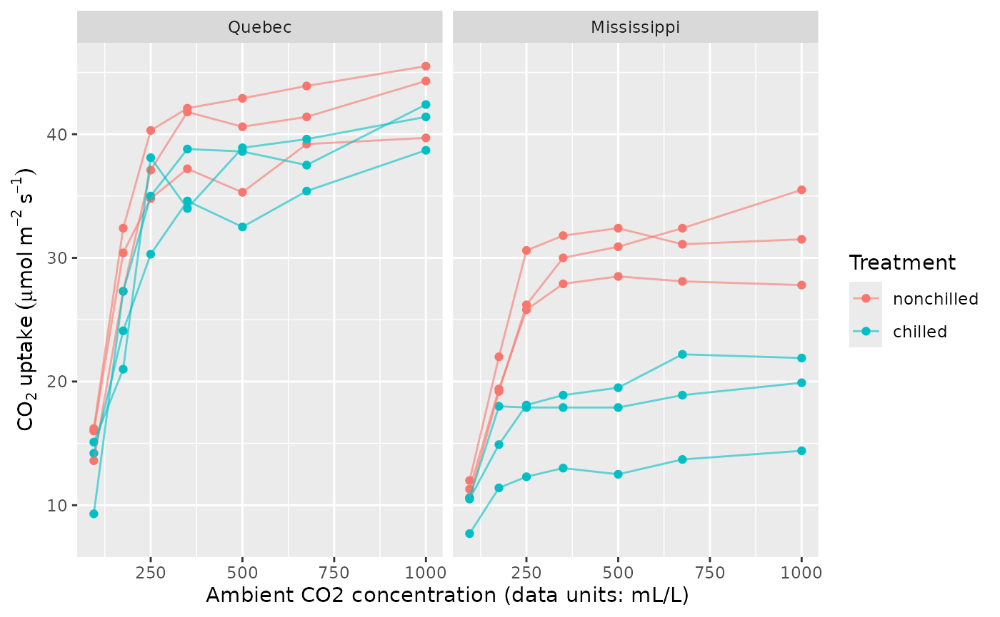
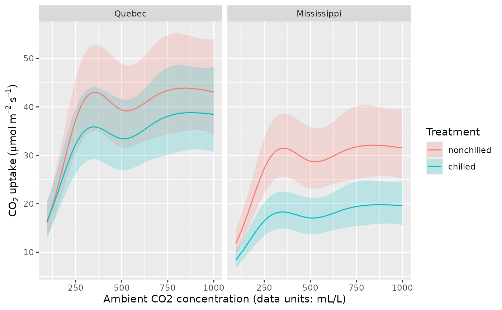
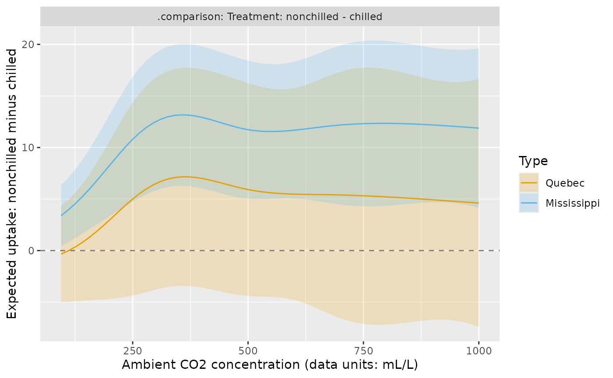
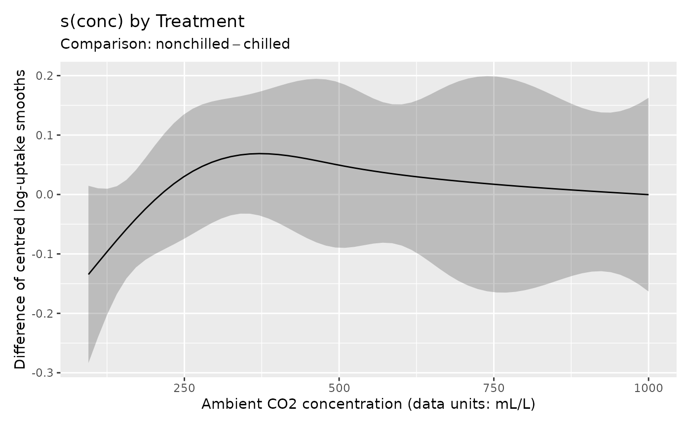
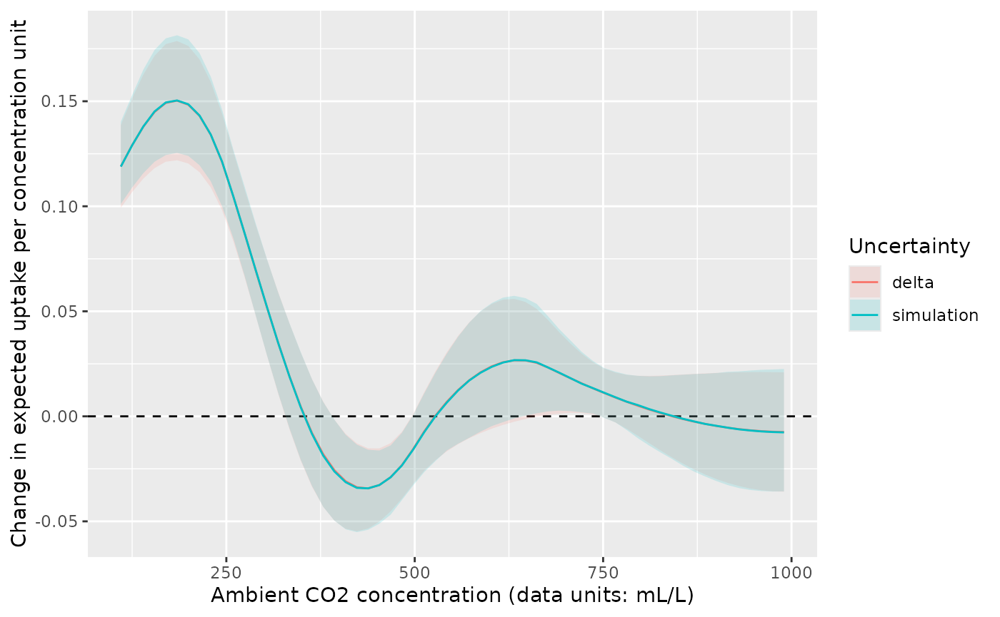
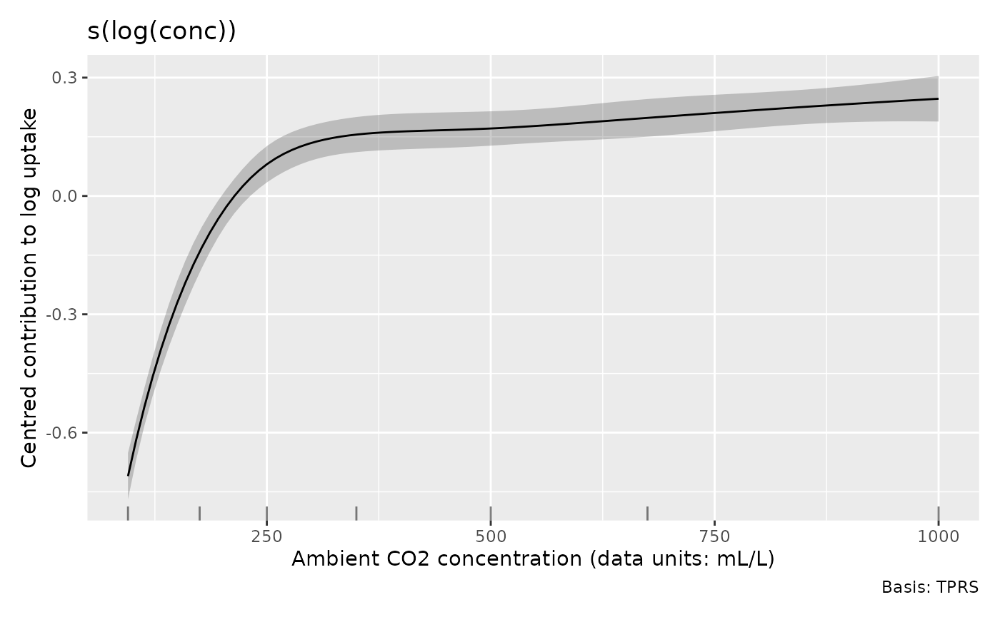
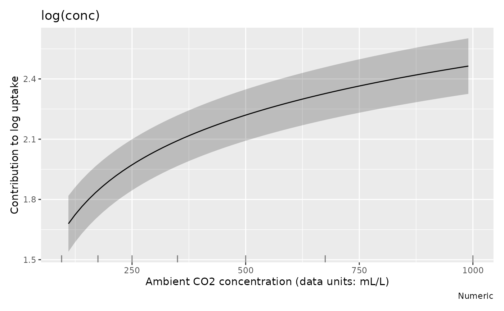

# Comparing treatments and finding rates of change

Does chilling reduce carbon dioxide uptake, and does the answer depend
on carbon dioxide concentration or plant origin? When does increasing
concentration produce the largest increase in uptake? These questions
require comparisons of fitted responses and their rates of change,
rather than inspection of individual smooths alone. This article uses
the same model to answer each question and to explain how the choice of
interval changes the conclusion.

The examples use the small `CO2` data set distributed with R, plus mgcv,
gratia, dplyr and ggplot2. No additional modelling package is needed. We
use 2,000 coefficient draws for the illustrated bands and posterior
calculations. If a conclusion depends on an interval limit, increase
this count and check that the limit is stable.

``` r

library("gratia")
load_mgcv()
library("dplyr")
library("ggplot2")
```

## What was measured, and what model is useful?

The [R documentation for
CO2](https://stat.ethz.ch/R-manual/R-devel/library/datasets/help/CO2.html)
describes an experiment on cold tolerance in *Echinochloa crus-galli*.
Uptake was measured at seven concentrations in each of twelve plants,
with three plants in each origin and treatment combination. Chilled
plants were cooled overnight. The response is uptake in micromoles per
square metre per second; `conc` records ambient concentration in the
units supplied with the data (mL/L). These repeated measurements
describe curves for individual plants.

``` r

plant <- as.data.frame(datasets::CO2)
plant$Plant <- factor(plant$Plant, ordered = FALSE)

uptake_label <- expression(CO[2]~uptake~(mu*mol~m^{-2}~s^{-1}))
concentration_label <- "Ambient CO2 concentration (data units: mL/L)"

ggplot(plant, aes(conc, uptake, colour = Treatment, group = Plant)) +
  geom_point() +
  geom_line(alpha = 0.6) +
  facet_wrap(~ Type) +
  labs(x = concentration_label, y = uptake_label, colour = "Treatment")
```



Uptake increases quickly at lower concentrations and then tends to level
off. The chilled Mississippi plants have particularly low uptake. We fit
a separate smooth concentration response for each treatment, and allow
the treatment contrast in average log uptake to differ by origin. A
plant random intercept allows measurements from the same plant to share
a persistent deviation from the fitted curve.

All responses are positive. A Gamma distribution with a log link
preserves positive fitted means and assumes that residual variability
grows with the mean. The model assumes that the *shape* of each
treatment curve on the log scale is shared between origins. The origin
interaction changes its height. With three plants per combination,
sharing those shapes lets us estimate treatment curves without fitting a
separate shape to every origin and treatment combination.

``` r

m_uptake <- gam(
  uptake ~ Type * Treatment + s(conc, by = Treatment, k = 5) +
    s(Plant, bs = "re"),
  data = plant, family = Gamma(link = "log"), method = "REML"
)
overview(m_uptake)
#> 
#> Generalized Additive Model with 7 terms
#> 
#>   term                             type        k   edf ref.edf statistic p.value
#>   <chr>                            <chr>   <dbl> <dbl>   <dbl>     <dbl> <chr>  
#> 1 Intercept                        parame…    NA  1       1        54.7  < 0.001
#> 2 TypeMississippi                  parame…    NA  1       1        -3.44 0.00102
#> 3 Treatmentchilled                 parame…    NA  1       1        -1.25 0.21582
#> 4 TypeMississippi:Treatmentchilled parame…    NA  1       1        -2.80 0.00668
#> 5 s(conc):Treatmentnonchilled      TPRS        4  3.91    3.99    102.   < 0.001
#> 6 s(conc):Treatmentchilled         TPRS        4  3.88    3.99     69.9  < 0.001
#> 7 s(Plant)                         Random…    12  6.92    8         6.96 < 0.001
```

`k = 5` limits each treatment curve’s complexity; REML estimates the
penalties that control its smoothness. It does not force five effective
degrees of freedom. The plant intercept accounts for persistent
differences in curve height. Residual patterns against concentration can
show whether plant differences also involve curve shape; the [diagnostic
workflow](https://gavinsimpson.github.io/gratia/articles/model-checking.md)
explains checks with fitted effects and simulated effects. The treatment
comparison has three independent plants per combination, even though
each plant contributes seven measurements.

## Compare expected uptake on a supported grid

For each origin and treatment, evaluate concentration across its
observed range. `.by` evaluates expressions within observed groups. This
matters when groups have different ranges: using the overall range can
extrapolate for some groups. Here the experimental concentration range
is the same in all four groups.

``` r

uptake_grid <- data_slice(m_uptake,
  conc = evenly(conc, n = 60),
  Plant = level(Plant, as.character(Plant[1])),
  .by = c(Type, Treatment)
)
uptake_grid |>
  group_by(Type, Treatment) |>
  summarise(lower = min(conc), upper = max(conc), .groups = "drop")
#> # A tibble: 4 × 4
#>   Type        Treatment  lower upper
#>   <fct>       <fct>      <dbl> <dbl>
#> 1 Quebec      nonchilled    95  1000
#> 2 Quebec      chilled       95  1000
#> 3 Mississippi nonchilled    95  1000
#> 4 Mississippi chilled       95  1000
```

The `Plant` expression supplies one actual plant identifier in each
group. We exclude its random effect below, so every curve describes a
plant whose random intercept is zero. With a log link, this does **not**
give the mean obtained by averaging over the population distribution of
random intercepts. It also excludes measurement noise: the bands concern
conditional expected uptake, not future measurements.

``` r

uptake_fitted <- fitted_values(m_uptake,
  data = uptake_grid, exclude = "s(Plant)",
  interval = "simultaneous", n_sim = 2000, seed = 2026
)

ggplot(uptake_fitted, aes(conc, .fitted, colour = Treatment, fill = Treatment)) +
  geom_ribbon(aes(ymin = .lower_ci, ymax = .upper_ci), alpha = 0.2,
    colour = NA) +
  geom_line() +
  facet_wrap(~ Type) +
  labs(x = concentration_label, y = uptake_label,
    colour = "Treatment", fill = "Treatment")
```



The fitted Mississippi curves are lower, especially after chilling. For
the Quebec plants the treatment curves are closer. Overlap between two
prediction bands is not a direct test of their difference: both curves
depend on the same estimated coefficients, and their errors are
correlated.

The default `interval = "confidence"` gives a separate, pointwise
interval at each row. `interval = "simultaneous"` instead calibrates one
band across all 240 supplied rows, including both origins and
treatments. It uses the joint coefficient covariance on the link scale
and then transforms the limits. Coverage is approximate posterior
coverage on this finite grid. It does not extend outside the grid, or
guarantee coverage between its points. The returned `.se` remains a
standard error on the link scale.

## Estimate the treatment difference directly

[`conditional_differences()`](https://gavinsimpson.github.io/gratia/reference/conditional_differences.md)
compares whole-model predictions, including the parametric origin and
treatment effects. Put `Treatment` in `by` and `Type` in `condition` to
compare treatments *within* each origin.

``` r

treatment_difference <- conditional_differences(m_uptake,
  by = "Treatment", condition = c("conc", "Type"),
  exclude = "s(Plant)", scale = "response",
  uncertainty = "delta", interval = "simultaneous",
  simultaneous_scope = "contrast", n_vals = 60, n_sim = 2000, seed = 2026
)
draw(treatment_difference) +
  labs(x = concentration_label,
    y = "Expected uptake: nonchilled minus chilled")
```



The factor level order determines subtraction: nonchilled minus chilled
here. A positive difference means lower uptake after chilling. The
Mississippi difference becomes clearly positive over much of the range;
the evidence for a difference in Quebec is weaker. The zero reference
line and interval limits show which evaluated concentrations support a
positive contrast. Where the interval contains zero, the direction of
the treatment difference remains unresolved.

The delta method approximates a response-scale difference by its local
linear change with the coefficients, then propagates their joint
covariance. On the link scale the contrast calculation is linear; on the
response scale it is an approximation. Simulation can better describe
asymmetric uncertainty after a nonlinear inverse link:

``` r

treatment_simulation <- conditional_differences(m_uptake,
  by = "Treatment",
  condition = list(conc = c(250, 500, 750), "Type"),
  exclude = "s(Plant)", scale = "response", uncertainty = "simulation",
  n_sim = 2000, seed = 2026
)
treatment_simulation |>
  select(Type, conc, .level_1, .level_2, .diff, .se, .lower_ci, .upper_ci)
#> # A tibble: 6 × 8
#>   Type         conc .level_1   .level_2 .diff   .se .lower_ci .upper_ci
#>   <fct>       <dbl> <fct>      <fct>    <dbl> <dbl>     <dbl>     <dbl>
#> 1 Quebec        250 nonchilled chilled   5.00  3.45     -1.45      12.1
#> 2 Mississippi   250 nonchilled chilled  10.8   2.17      6.70      15.2
#> 3 Quebec        500 nonchilled chilled   5.92  3.82     -1.42      13.4
#> 4 Mississippi   500 nonchilled chilled  11.7   2.45      7.29      16.7
#> 5 Quebec        750 nonchilled chilled   5.32  4.61     -3.55      14.4
#> 6 Mississippi   750 nonchilled chilled  12.3   2.88      6.60      18.1
```

For each posterior draw, gratia predicts both treatments with the
**same** coefficient vector and subtracts within that draw. Sampling
treatments independently would lose their covariance. These pointwise
intervals are equal-tailed posterior quantiles; they need not be
symmetric about `.diff`, which is always the difference of the fitted
predictions.

The choice of what is covered jointly matters when comparing more than
two groups. Putting both factors in `by` compares the four joint
combinations, giving six pairwise contrasts.
`simultaneous_scope = "contrast"` covers each pair separately across
every concentration and conditioning stratum; `"all"` covers all
returned pairs together. Use the latter when the scientific claim
concerns any of those six comparisons.

``` r

all_differences <- conditional_differences(m_uptake,
  by = c("Type", "Treatment"), condition = "conc", exclude = "s(Plant)",
  uncertainty = "simulation", interval = "simultaneous",
  simultaneous_scope = "all", n_vals = 60, n_sim = 2000, seed = 2026
)
all_differences |>
  group_by(.contrast, Type_1, Treatment_1, Type_2, Treatment_2) |>
  slice_min(abs(conc - 500), n = 1) |>
  ungroup() |>
  select(Type_1, Treatment_1, Type_2, Treatment_2, conc,
    .diff, .lower_ci, .upper_ci)
#> # A tibble: 6 × 8
#>   Type_1      Treatment_1 Type_2     Treatment_2  conc .diff .lower_ci .upper_ci
#>   <fct>       <fct>       <fct>      <fct>       <dbl> <dbl>     <dbl>     <dbl>
#> 1 Quebec      nonchilled  Quebec     chilled      494.  5.97    -5.70       17.6
#> 2 Quebec      nonchilled  Mississip… nonchilled   494. 10.6      0.793      20.4
#> 3 Quebec      nonchilled  Mississip… chilled      494. 22.4     12.7        32.0
#> 4 Quebec      chilled     Mississip… nonchilled   494.  4.61    -5.25       14.5
#> 5 Quebec      chilled     Mississip… chilled      494. 16.4      8.78       24.0
#> 6 Mississippi nonchilled  Mississip… chilled      494. 11.8      4.29       19.3
```

Simultaneous simulation bands are symmetric calibrated bands about
`.diff`, not equal-tailed pointwise intervals. Both uncertainty methods
concern mean differences, not observation noise. They support ordinary
single-predictor GAM and BAM families, including Gamma, negative
binomial and Tweedie. General families with multiple linear predictors
remain unsupported by
[`conditional_differences()`](https://gavinsimpson.github.io/gratia/reference/conditional_differences.md).

SCAM fits with supported single-predictor families also support link-
and response-scale differences, with delta or simulation uncertainty and
pointwise or simultaneous intervals. Delta intervals use the local
covariance of the transformed coefficients. With
`uncertainty = "simulation"`, the default `method = "gaussian"` draws
unrestricted fitting coefficients and applies the fitted positivity
transformation. `method = "user"` accepts transformed coefficient draws
that satisfy the fitted coefficient constraints; MH sampling is
unavailable for SCAM fits. Smoothing-parameter uncertainty is
unavailable for both uncertainty methods, so retain
`unconditional = FALSE`.

### Compare shape separately from complete responses

To ask whether the *centred smooth shapes* differ, use
[`difference_smooths()`](https://gavinsimpson.github.io/gratia/reference/difference_smooths.md).
This omits parametric treatment and origin effects by default.

``` r

shape_difference <- difference_smooths(m_uptake, select = "s(conc)",
  interval = "simultaneous", n = 60, n_sim = 2000, seed = 2026
)
draw(shape_difference) +
  labs(x = concentration_label, y = "Difference of centred log-uptake smooths")
```



Much of this band contains zero. Thus the marked difference in expected
Mississippi uptake need not imply a comparably marked difference in
smooth shape. `group_means = TRUE` can add the means for the smooth’s
grouping factor, but for this model the origin-by-treatment interaction
makes whole-model
[`conditional_differences()`](https://gavinsimpson.github.io/gratia/reference/conditional_differences.md)
the clearer choice. Smooth differences remain on the link scale, with
simultaneous coverage separately for each pair; they do not provide
joint coverage across several pairs.

## Where does uptake change fastest?

The derivative of expected uptake answers how much uptake changes for a
small increase in concentration. This is different from differentiating
a centred log-uptake smooth. Hold origin and treatment fixed, and
evaluate within the range rather than perturbing an endpoint beyond it.

``` r

rate_grid <- data_slice(m_uptake,
  conc = evenly(conc, n = 60, lower = 110, upper = 990),
  Type = level(Type, "Quebec"),
  Treatment = level(Treatment, "nonchilled")
)
rate_delta <- response_derivatives(m_uptake,
  focal = "conc", data = rate_grid, type = "central",
  uncertainty = "delta", exclude = "s(Plant)"
)
rate_simulation <- response_derivatives(m_uptake,
  focal = "conc", data = rate_grid, type = "central",
  uncertainty = "simulation", n_sim = 2000, seed = 2026,
  exclude = "s(Plant)"
)
rates <- bind_rows(delta = rate_delta, simulation = rate_simulation,
  .id = "Uncertainty")
ggplot(rates, aes(conc, .derivative, colour = Uncertainty, fill = Uncertainty)) +
  geom_hline(yintercept = 0, linetype = 2) +
  geom_ribbon(aes(ymin = .lower_ci, ymax = .upper_ci), alpha = 0.15,
    colour = NA) +
  geom_line() +
  labs(x = concentration_label,
    y = "Change in expected uptake per concentration unit")
```



For the nonchilled Quebec curve, the fastest fitted increase is at low
concentrations; further increases have a smaller effect over much of the
remaining range. The spline also has local decreases: this fit has no
monotonicity or asymptote constraint. Near the upper end, intervals
include zero, so the estimated small changes have no clearly supported
direction.

Both methods return **pointwise** derivative intervals and `.se`. Delta
uncertainty uses the finite difference of fitted predictions and normal
intervals; simulation uses the median and quantiles of derivative draws.
The plotted methods agree closely where uncertainty is modest.
Differences can grow when the inverse link strongly transforms uncertain
coefficients. Delta uncertainty supports single-predictor GAM/BAM
families and SCAM fits. For SCAM fits it uses the
transformed-coefficient covariance, conditional on the fitted smoothing
parameters. General families with several predictors do not support
delta uncertainty; their existing simulation support is unchanged.

The default `eps = NULL` chooses the perturbation from the fitted
covariate range, derivative order and finite-difference method. This
reduces dependence on measurement units and avoids many rounding
problems in second derivatives. It is a heuristic: near a domain
boundary or with unusual scales, supply a positive absolute `eps` and
check stability using nearby values. Set `order = 2` to estimate
curvature; the first derivative above is the rate of uptake change.

## Keep covariate transformations and derivative units distinct

An alternative model uses a smooth of log concentration. This gives more
resolution to the lower concentrations where uptake changes quickly. It
also assumes a common concentration shape across treatments. We use it
to show how a transformed covariate changes the plotting coordinates and
derivative units.

``` r

m_log_conc <- gam(
  uptake ~ Type * Treatment + s(log(conc), k = 6) + s(Plant, bs = "re"),
  data = plant, family = Gamma(link = "log"), method = "REML"
)
draw(m_log_conc, select = "s(log(conc))", back_transform = TRUE,
  envir = environment()) +
  labs(x = concentration_label, y = "Centred contribution to log uptake")
```



`back_transform = TRUE` displays concentration in its original units. It
changes the horizontal axis, not the meaning of the partial effect on
the vertical axis. `smooth_estimates(..., back_transform = TRUE)` also
generates a grid evenly spaced in the raw covariate. The default grid is
evenly spaced in `log(conc)`. Supply raw `conc` values in `data` for
predictions; gratia evaluates the expression.

Here `envir = environment()` identifies the article’s evaluation
environment so the original `plant` data can be recovered even when the
model’s stored formula environment does not locate them. This is useful
in notebooks and within fitting functions as well as for custom
transformations.

The same coordinate choice applies to parametric effects. For
comparison, a model containing a linear `log(conc)` term assumes a
constant log-uptake change per proportional concentration change. It
cannot represent the plateau as flexibly as a smooth:

``` r

m_log_linear <- gam(
  uptake ~ Type * Treatment + log(conc) + s(Plant, bs = "re"),
  data = plant, family = Gamma(link = "log"), method = "REML"
)
linear_effect <- parametric_effects(m_log_linear, terms = "log(conc)",
  data = rate_grid, envir = environment())
draw(linear_effect, back_transform = TRUE) +
  labs(x = concentration_label, y = "Contribution to log uptake")
```



The horizontal axis uses concentration, while the effect remains a
contribution to log uptake. Drawing the same object with
`back_transform = FALSE` uses log concentration without changing the
estimates. The straight relationship in log concentration appears curved
when drawn against concentration in its original units.

``` r

log_coordinate_rate <- derivatives(m_log_conc,
  select = "s(log(conc))", data = rate_grid, type = "central"
)
concentration_rate <- derivatives(m_log_conc,
  select = "s(log(conc))", data = rate_grid, type = "central",
  wrt = "covariate"
)
data.frame(conc = rate_grid$conc,
  derivative_per_concentration = concentration_rate$.derivative,
  derivative_per_log_concentration_divided_by_conc =
    log_coordinate_rate$.derivative / rate_grid$conc) |>
  slice(c(1, 20, 40, 60))
#>        conc derivative_per_concentration
#> 1  110.0000                 0.0090013402
#> 20 393.3898                 0.0001036051
#> 40 691.6949                 0.0001670112
#> 60 990.0000                 0.0001294328
#>    derivative_per_log_concentration_divided_by_conc
#> 1                                      0.0090013402
#> 20                                     0.0001036051
#> 40                                     0.0001670112
#> 60                                     0.0001294328
```

For a smooth contribution f(\log c) the chain rule gives df/dc =
(df/d\log c)/c. The two columns agree up to numerical approximation.
Both concern the smooth’s contribution to **log uptake**, not uptake
itself. `response_derivatives(..., focal = "conc")` differentiates
complete fitted responses in raw concentration units instead. For tensor
smooths such as `te(log(conc), temperature)`, use
[`partial_derivatives()`](https://gavinsimpson.github.io/gratia/reference/partial_derivatives.md)
with `wrt = "covariate", focal = "conc"` while holding temperature
fixed. See [Functions of covariates and evaluation
environments](https://gavinsimpson.github.io/gratia/articles/transformed-covariates.md)
for worked tensor, transformed-offset and local-function examples.
Preserve the fitting environment, or pass `envir`, if expressions need
local functions or constants at new data.

## Respect the study design when generating predictions

[`all_levels()`](https://gavinsimpson.github.io/gratia/reference/evenly.md)
is a clearly named alias of
[`evenly()`](https://gavinsimpson.github.io/gratia/reference/evenly.md)
for factors. It keeps their fitted levels, which is useful when
deliberately requesting a full factor grid. Such a grid is not always
scientifically sensible: each plant in this experiment belongs to only
one origin and treatment.

``` r

all_levels(plant$Treatment)
#> [1] nonchilled chilled   
#> Levels: nonchilled chilled
observed_plants <- conditional_values(m_uptake,
  condition = c("conc", "Plant", "Treatment", "Type"),
  n_vals = 7, complete = FALSE
)
observed_plants |>
  distinct(Plant, Treatment, Type)
#> # A tibble: 12 × 3
#>    Plant Treatment  Type       
#>    <fct> <fct>      <fct>      
#>  1 Qn1   nonchilled Quebec     
#>  2 Qn2   nonchilled Quebec     
#>  3 Qn3   nonchilled Quebec     
#>  4 Qc1   chilled    Quebec     
#>  5 Qc3   chilled    Quebec     
#>  6 Qc2   chilled    Quebec     
#>  7 Mn3   nonchilled Mississippi
#>  8 Mn2   nonchilled Mississippi
#>  9 Mn1   nonchilled Mississippi
#> 10 Mc2   chilled    Mississippi
#> 11 Mc3   chilled    Mississippi
#> 12 Mc1   chilled    Mississippi
```

`complete = FALSE` keeps only the observed combinations of the
*conditioned* factors, here the twelve actual plants with their assigned
origin and treatment. It still creates a numeric concentration grid; it
does not restrict predictions to measured concentrations, or to a joint
region of support for continuous covariates. Include every factor whose
combinations need restricting. An omitted factor is still held at its
typical value.

[`fitted_values()`](https://gavinsimpson.github.io/gratia/reference/fitted_values.md)
reports rows containing combinations of known categorical levels absent
from the fitting data. Treat that message as a prompt to examine the
prediction design. For example, plant Qn1 was never a chilled
Mississippi plant:

``` r

hypothetical_grid <- data_slice(m_uptake,
  conc = 500, Type = level(Type, "Mississippi"),
  Treatment = level(Treatment, "chilled"), Plant = level(Plant, "Qn1")
)
fitted_values(m_uptake, data = hypothetical_grid, exclude = "s(Plant)")
#> Prediction data contain 1 row with combinations of categorical predictor levels
#> absent from the fitting data.
#> ℹ Factors: `Type`, `Treatment`, and `Plant`. Input rows: 1.
#> # A tibble: 1 × 10
#>    .row  conc Type        Treatment Plant .parameter .fitted    .se .lower_ci
#>   <int> <dbl> <fct>       <fct>     <fct> <chr>        <dbl>  <dbl>     <dbl>
#> 1     1   500 Mississippi chilled   Qn1   mean          17.1 0.0730      14.8
#> # ℹ 1 more variable: .upper_ci <dbl>
```

The message checks categorical combinations even when a responsible term
is excluded. In the earlier treatment contrast, holding a plant
identifier fixed while excluding `s(Plant)` is intentional: its
contribution is zero in both scenarios. When predicting for an observed
plant with its random effect included, use that plant’s assigned origin
and treatment.

### Preserve observation positions when measurements are missing

With `na.exclude`, results evaluated on the fitting data restore
excluded rows as `NA`. This keeps predictions aligned with the original
observation records. For illustration, remove one measured response and
refit:

``` r

plant_missing <- plant
plant_missing$uptake[1] <- NA_real_
m_missing <- gam(
  uptake ~ Type * Treatment + s(conc, by = Treatment, k = 5) +
    s(Plant, bs = "re"),
  data = plant_missing, family = Gamma(link = "log"), method = "REML",
  na.action = na.exclude
)
fitted_missing <- fitted_values(m_missing)
fitted_missing |>
  mutate(uptake = plant_missing$uptake) |>
  select(.row, conc, uptake, .fitted) |>
  slice_head(n = 3)
#> # A tibble: 3 × 4
#>    .row  conc uptake .fitted
#>   <int> <dbl>  <dbl>   <dbl>
#> 1     1    NA   NA      NA  
#> 2     2   175   30.4    25.5
#> 3     3   250   34.8    35.6
```

The first observation was excluded from fitting, so its default fitted
result is missing. In contrast, explicit prediction data with a missing
response can still give a fitted mean when their predictors are present:

``` r

prediction_missing <- plant_missing[1:3, ]
prediction_missing$conc[2] <- NA_real_
fitted_values(m_missing, data = prediction_missing) |>
  select(.row, conc, uptake, .fitted)
#> # A tibble: 3 × 4
#>    .row  conc uptake .fitted
#>   <int> <dbl>  <dbl>   <dbl>
#> 1     1    95   NA      15.3
#> 2     2    NA   30.4    NA  
#> 3     3   250   34.8    35.6
```

The first prediction is available; the second has a missing required
predictor and retains its row with an `NA` result. `na.omit` retains
only fitting rows instead. Partial residuals, fitted/posterior samples
and simulations likewise respect `na.exclude` positions; diagnostic
functions align the retained observations before checking their
distributions.

## Which uncertainty is being propagated?

The examples use mgcv’s approximate Bayesian coefficient covariance,
conditional on estimated smoothing parameters. `unconditional = TRUE`
requests the correction for smoothing-parameter uncertainty when it is
available.
[`get_vcov()`](https://gavinsimpson.github.io/gratia/reference/get_vcov.md)
exposes the same matrix for custom calculations:

``` r

V <- get_vcov(m_uptake)
dim(V)
#> [1] 24 24
dim(get_vcov(m_uptake, term = "s(conc):Treatmentnonchilled"))
#> [1] 4 4
```

For APIs that provide `frequentist`, including
[`difference_smooths()`](https://gavinsimpson.github.io/gratia/reference/difference_smooths.md),
[`derivatives()`](https://gavinsimpson.github.io/gratia/reference/derivatives.md)
and
[`smooth_estimates()`](https://gavinsimpson.github.io/gratia/reference/smooth_estimates.md),
setting it to `TRUE` selects the covariance of the penalised coefficient
estimators instead. This describes their sampling variability, while the
default covariance supplies the approximate posterior intervals used
above. `get_vcov(..., frequentist = TRUE)` gives that matrix, and
`get_vcov(..., term = "s(conc):Treatmentnonchilled")` extracts a term’s
coefficient covariance. Keeping the full matrix is essential when
comparing two terms whose estimates are correlated.

Distribution parameters and link functions also require explicit choices
in models with several predictors. For example,
`link(gaulss(), parameter = "location")` selects the mean’s link,
whereas `inv_link(gaulss(), parameter = "scale")` selects the scale
predictor’s inverse link:

``` r

link(gaulss(), parameter = "location")(c(1, 2))
#> [1] 1 2
inv_link(gaulss(), parameter = "scale")(c(-1, 0, 1))
#> [1] 2.646347 0.990099 0.366531
```

The functions follow the fitting package’s parameterisation. As
explained in the [mgcv gaulss
documentation](https://stat.ethz.ch/R-manual/R-devel/library/mgcv/html/gaulss.html),
the second inverse link returns **inverse standard deviation**, so it
should not be labelled standard deviation without taking its reciprocal.
These utilities do not remove the multiple-predictor restrictions of the
comparison or delta derivative methods.

The fitted model supports lower expected uptake for chilled Mississippi
plants over much of the measured range. The Quebec comparison has wider
intervals relative to its estimated difference, leaving its direction
less clear. For nonchilled Quebec plants, uptake rises fastest at low
concentrations and changes more slowly over the remaining range.
