# Checking different response distributions

[Model
diagnostics](https://gavinsimpson.github.io/gratia/articles/model-checking.md)
explains PIT residuals, reference bands and dependence. Here we consider
measurements whose variance, zero probability, category or detection
limit changes what a residual means. The examples use mgcv and gratia;
the motorcycle dataset needs the optional MASS package, and the
comparison of fitting packages needs the optional GJRM package. Each
simulation describes its measurement protocol and response distribution.

``` r

library("mgcv")
library("gratia")
library("ggplot2")
```

## Does variability change during a process?

The [`MASS::mcycle`](https://rdrr.io/pkg/MASS/man/mcycle.html) data
record acceleration at times after impact in simulated motorcycle
accidents. The mean acceleration changes rapidly after impact, and its
spread also appears to vary. A constant-variance Gaussian model can
represent the mean while failing to capture that spread.

The fits assume independent measurement errors. The available columns,
time and acceleration, provide no accident identifiers for estimating
correlation between measurements from the same accident.

``` r

data("mcycle", package = "MASS")
ggplot(mcycle, aes(times, accel)) + geom_point() +
  labs(x = "Time after impact (ms)", y = "Acceleration (g)")
```

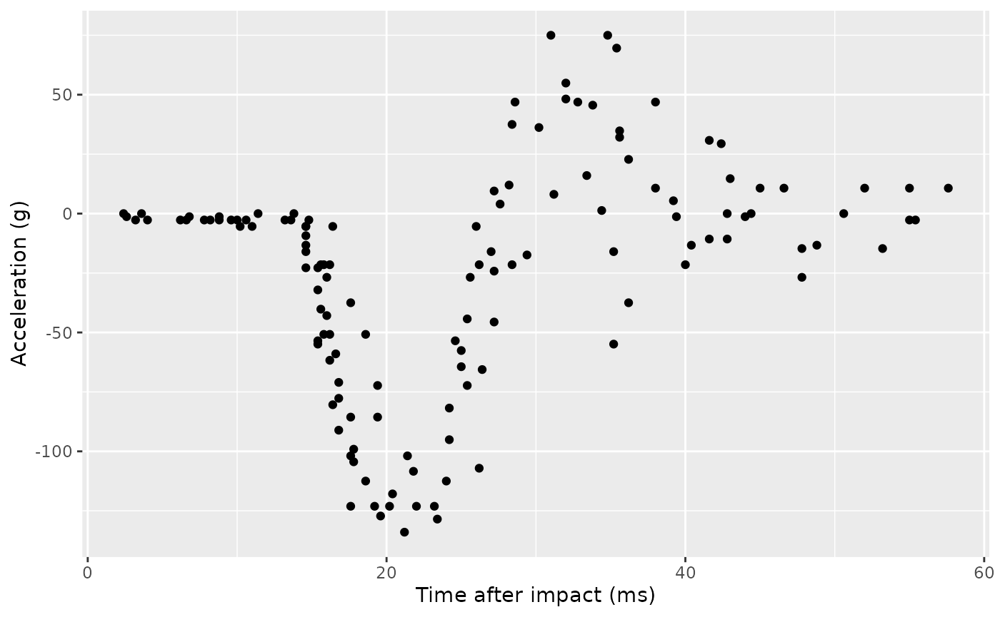

``` r

constant <- gam(accel ~ s(times, k = 20), data = mcycle, method = "REML")
```

``` r

varying <- gam(list(accel ~ s(times, k = 20), ~ s(times, k = 6)),
  data = mcycle, family = gaulss(), method = "REML")
draw(varying)
```

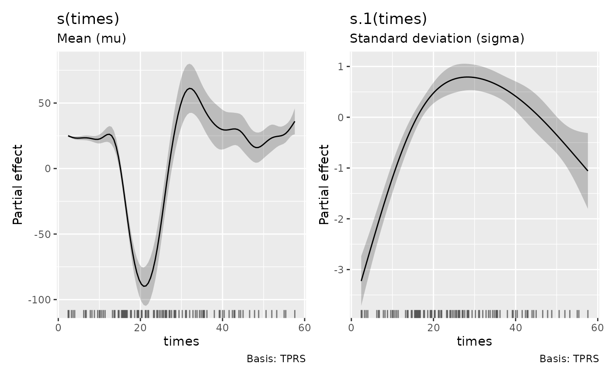

``` r

appraise(constant, type = "quantile", seed = 401)
```

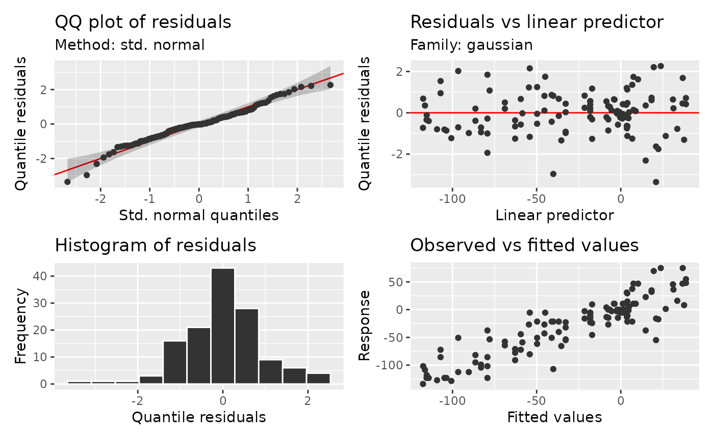

``` r

appraise(varying, type = "quantile", seed = 401)
```

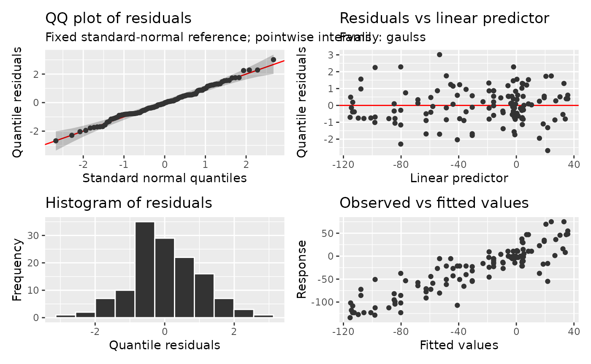

The first smooth describes mean acceleration; the second describes the
scale predictor. Their subtitles identify the distributional parameter.
The family represents scale internally by inverse standard deviation, so
interpret that curve through the family link rather than assuming it is
a curve of residual variance. We extract the inverse link for the scale
parameter to do this:

``` r

impact_grid <- data.frame(times = seq(min(mcycle$times), max(mcycle$times),
  length.out = 100))
eta <- predict(varying, newdata = impact_grid, type = "link")
mean_acceleration <- inv_link(varying, parameter = "location")(eta[, 1])
precision <- inv_link(varying, parameter = "scale")(eta[, 2])
ggplot(data.frame(impact_grid, sd = 1 / precision), aes(times, sd)) +
  geom_line() + labs(x = "Time after impact (ms)", y = "Fitted standard deviation (g)")
```

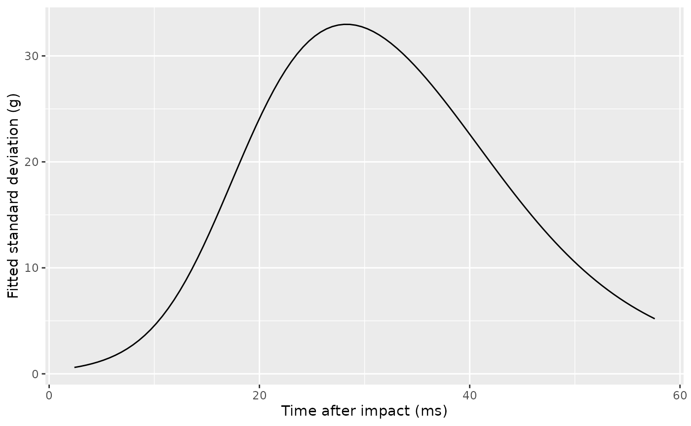

The spread increases around the period of rapid change. Modelling it
reduces a systematic residual pattern and describes how both mean
acceleration and its spread change with time after impact.

### Estimate means and variability

[`fitted_moments()`](https://gavinsimpson.github.io/gratia/reference/fitted_moments.md)
converts the model’s distribution parameters into response moments and
propagates their joint uncertainty. It can evaluate the fitting
observations or supplied prediction rows:

``` r

head(fitted_moments(varying, data = impact_grid,
  moments = c("mean", "variance", "sd")))
#> # A tibble: 6 × 8
#>    .row .parameter .fitted   .se .lower_ci .upper_ci .status times
#>   <int> <chr>        <dbl> <dbl>     <dbl>     <dbl> <chr>   <dbl>
#> 1     1 mean        -0.506 0.465    -1.42      0.405 ok       2.4 
#> 2     1 variance     0.364 0.179     0.139     0.954 ok       2.4 
#> 3     1 sd           0.603 0.148     0.373     0.977 ok       2.4 
#> 4     2 mean        -1.24  0.332    -1.89     -0.586 ok       2.96
#> 5     2 variance     0.494 0.230     0.199     1.23  ok       2.96
#> 6     2 sd           0.703 0.163     0.446     1.11  ok       2.96
```

Each `.parameter` identifies a requested quantity. For variance rows,
`.fitted` contains the estimated response variance, and `.se` describes
uncertainty in that estimate. Standard errors and interval bounds are on
the quantity’s own scale. By default the delta method differentiates the
moment formulas and combines those derivatives with the full parameter
covariance.

[`conditional_moments()`](https://gavinsimpson.github.io/gratia/reference/conditional_moments.md)
builds the same covariate grid as
[`conditional_values()`](https://gavinsimpson.github.io/gratia/reference/conditional_values.md).
Other covariates are held at their typical values. Choose posterior
simulation to evaluate the moments at joint parameter draws, then
summarise those values:

``` r

conditional_moments(varying, condition = "times", moments = c("mean", "sd"),
  uncertainty = "simulation", n_draws = 1000, seed = 419) |>
  draw()
```

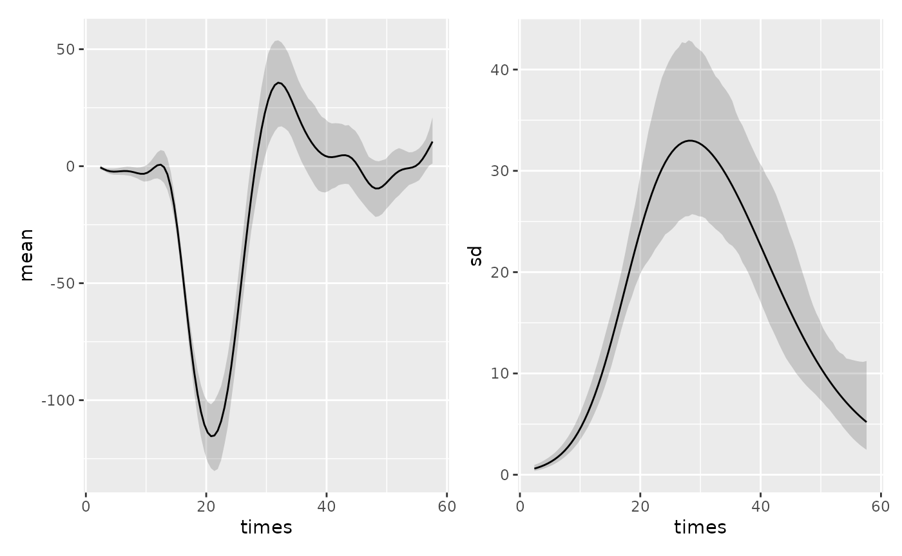

The available quantities are mean, variance, SD, coefficient of
variation (`"cv"`), skewness, kurtosis and excess kurtosis;
`moments = "all"` requests all seven. CV requires a positive mean, so it
is inappropriate where predicted acceleration is negative. Kurtosis is
the fourth central moment divided by squared variance; excess kurtosis
subtracts three.

For a Gamma response with mean `mu` and dispersion `phi`, variance is
`phi * mu^2`, CV is `sqrt(phi)`, skewness is `2 * sqrt(phi)`, and excess
kurtosis is `6 * phi`. [`Gamma()`](https://rdrr.io/r/stats/family.html)
estimates a global dispersion, whereas
[`gammals()`](https://rdrr.io/pkg/mgcv/man/gammals.html) can let it vary
with covariates. The default `nuisance = "estimated"` includes
uncertainty in estimated global parameters using the fitting criterion’s
second derivatives and the change in fitted coefficients as those
parameters vary. Unsupported fitting configurations give an error;
`nuisance = "fixed"` explicitly conditions on their fitted values.
Parameters represented by coefficients, including scale and shape
predictors, retain their joint uncertainty.

For ML/REML fits, the moments use the likelihood dispersion in
`reml.scale`, and rescale the conditional coefficient covariance to that
same dispersion. This can differ from the Pearson/Fletcher estimate in
`sig2`. The saved curvature describes the likelihood estimate, so it
must be paired with that estimate when propagating uncertainty.
Smoothing uncertainty uses curvature and coefficient sensitivities at
the fitted parameters, including the mapping for linked or fixed
smoothing parameters.

Moments must exist at the fitted parameters and at the draws used for an
interval. For example, GEV skewness requires shape below one third and
kurtosis requires shape below one quarter. Undefined results are
retained with a `.status`. Simulation also reports `.p_defined`; it
withholds intervals if any draw is undefined instead of silently
dropping those draws. See
[`fitted_moments()`](https://gavinsimpson.github.io/gratia/reference/fitted_moments.md)
for family coverage, categorical scoring, grouped models, and the
distinction between latent and censored observations.

``` r

posterior_predictive_plot(varying, n = 50, seed = 402)
```

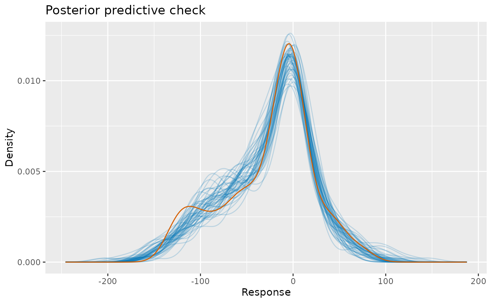

All mean and scale coefficients are drawn together for this check,
retaining their covariance. Parameters outside the coefficient vector
remain fitted. A kernel density overlay compares the full response
distribution; it can conceal local failures, so retain the predictor
plots too.

### The same question with GJRM

[`GJRM::gamlss()`](https://rdrr.io/pkg/GJRM/man/gamlss.html) also fits
univariate distributional regression. This Gaussian fit asks the same
mean-and-spread question with a different fitting procedure. It need not
return identical smoothing estimates to mgcv.

``` r

library("GJRM")
impact_gjrm <- GJRM::gamlss(list(accel ~ s(times, k = 20), ~ s(times, k = 6)),
  data = mcycle, family = "N")
gratia::draw(impact_gjrm)
```

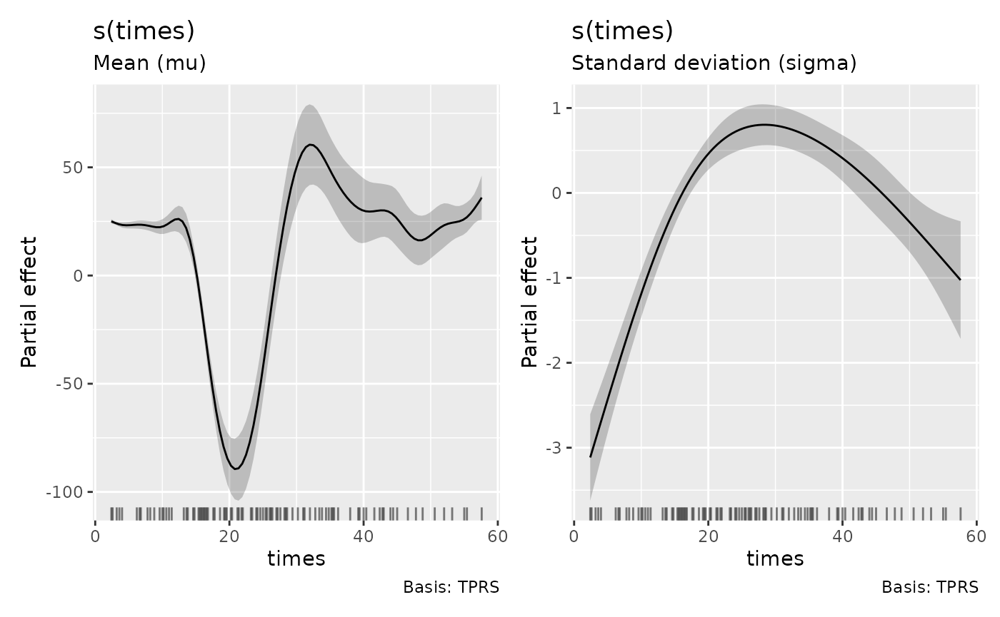

``` r

appraise(impact_gjrm, seed = 403)
```

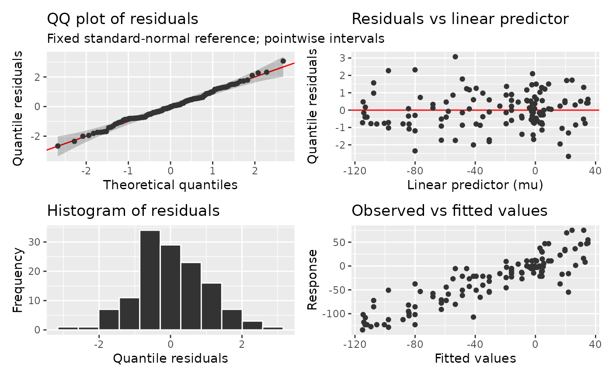

``` r

posterior_predictive_plot(impact_gjrm, n = 50, seed = 404)
```

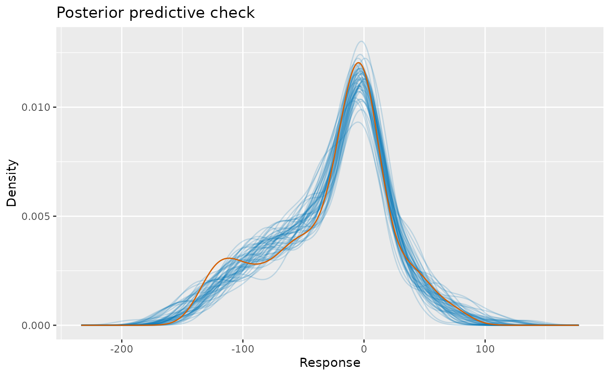

Gratia uses final fitted distribution parameters for the response mean
and randomised quantile residuals, with a standard-normal reference.
Smooths identify their parameter in subtitles. Agreement between
diagnostic patterns across fits helps distinguish a modelling issue from
one fitting procedure’s choice of smoothness.

Supported uncensored univariate GJRM distributions are N, LN, GA, GAi,
P, NBI, NBII, BE (beta), LO (logistic), WEI (Weibull), IG (inverse
Gaussian), GU and rGU (the two Gumbel orientations). Other joint,
survival and censored models remain unsupported. GAi parameterisation is
supported by the diagnostic adapter where an appropriate fit is
available; some GJRM versions do not accept GAi in
[`gamlss()`](https://rdrr.io/pkg/GJRM/man/gamlss.html). NB family names
differ across packages: GJRM NBII has size equal to fitted mean divided
by its dispersion parameter. Gratia uses that likelihood definition,
rather than a stored Poisson CDF present in some upstream versions.

For Weibull fits, the first predictor controls scale rather than the
response mean. For logistic and Gumbel fits it controls location; a
Gumbel location is also different from its mean. Gratia calculates
response means and variances from both fitted parameters for
observed-versus-fitted and Pearson residual plots. Posterior predictive
checks draw both equations’ coefficients together, using the logit scale
link for beta fits and the log scale link for the others.

All these families support PIT/quantile, response, Pearson and
DHARMa-style residuals in ordinary and scalable plots. Deviance
residuals are available for N, GA, GAi and P. For example, a fitted beta
model `beta_fit` can be checked with `appraise(beta_fit, seed = 405)` or
`appraise(beta_fit, ppcheck = TRUE, n_ppc = 50, seed = 405)`. To
simulate a QQ reference for Pearson residuals, use
`qq_plot(beta_fit, type = "pearson", method = "simulate", seed = 405)`.
The default quantile residuals instead use a fixed standard-normal
reference.

## Positive observations and precision weights

Suppose a chemical concentration is measured in samples with different
amounts of replication. Averaging more independent measurements can
reduce variance without changing the mean. We simulate positive
concentrations whose squared coefficient of variation is
`0.4 / precision`. A Gamma log-link model describes this protocol. The
precision weights are part of the response distribution, not merely
plotting weights.

``` r

set.seed(405)
chemical <- data.frame(flow = runif(400, 0, 10),
  precision = rep(c(1, 2, 4, 8), length.out = 400))
mu <- exp(1 + 0.5 * sin(chemical$flow / 3))
chemical$concentration <- rgamma(400, shape = chemical$precision / 0.4,
  scale = mu * 0.4 / chemical$precision)
gamma_fit <- gam(concentration ~ s(flow, k = 10), data = chemical,
  weights = precision, family = Gamma(link = "log"), method = "REML")
appraise(gamma_fit, type = "quantile", seed = 406)
```

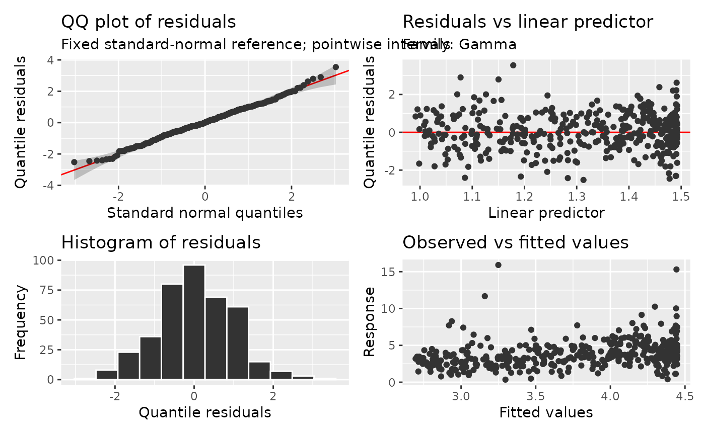

The diagnostics compare each observation with its own precision.
Response simulation also respects those fitted weights. The expected
variance is \phi\mu_i^2/w_i, where w_i is precision and \phi is
estimated dispersion. A larger weight narrows the response distribution.
Explicit sampling weights in gratia replace these defaults; they should
represent a different measurement protocol, not a cosmetic adjustment.

An inverse Gaussian alternative uses variance \phi\mu_i^3/w_i. It
therefore allows variability to increase more rapidly with the mean. Fit
it when that relationship is plausible and examine the tails, rather
than selecting it because both families have positive support.

``` r

ig_fit <- gam(concentration ~ s(flow, k = 10), data = chemical,
  weights = precision, family = inverse.gaussian(link = "log"), method = "REML")
qq_plot(ig_fit, type = "quantile", seed = 406)
```

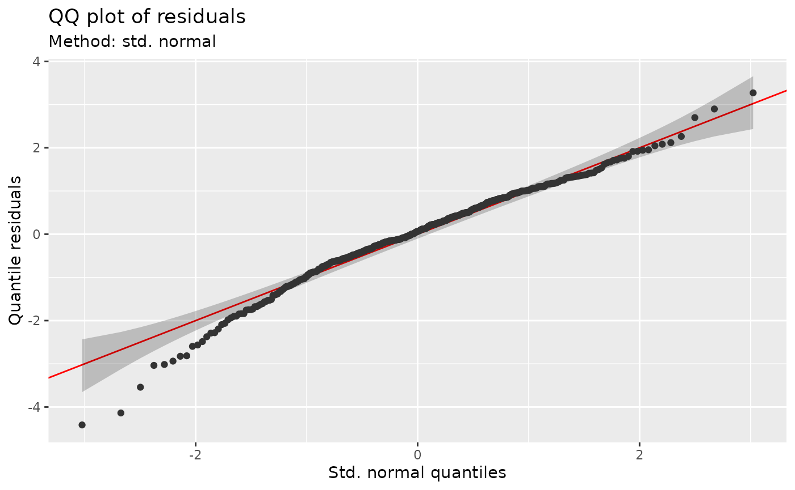

``` r

worm_plot(ig_fit, method = "uniform", seed = 407)
```

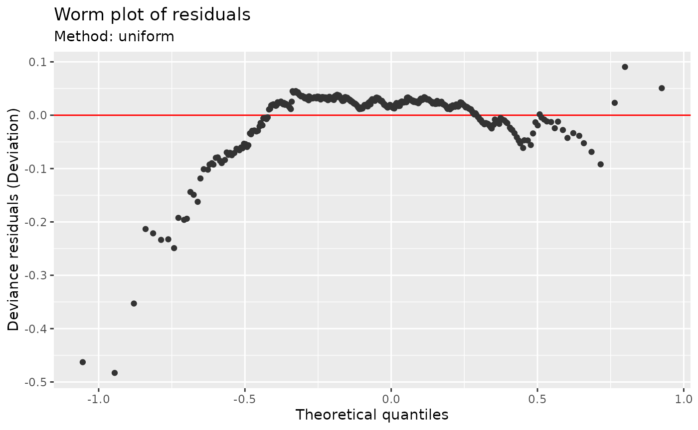

Inverse Gaussian CDF and quantile calculations now work without an
additional package, including observation weights. Both models can fit
similar means while predicting different tails. The known Gamma
generator provides a baseline for comparing those tails with the inverse
Gaussian fit, whose variance increases more rapidly with its mean.

## Exact zeros and positive amounts

Biomass, rainfall amounts and expenditure can have exact zeros together
with positive continuous observations. A Tweedie distribution with power
between one and two represents a compound Poisson sum of positive Gamma
amounts. It links the zero probability and positive distribution through
the mean, dispersion and power. A delta model instead estimates separate
occurrence and positive components; see [Spatial survey
analysis](https://gavinsimpson.github.io/gratia/articles/sdmTMB-support.md).

``` r

set.seed(408)
rain <- data.frame(elevation = runif(400, 0, 1))
rain$amount <- mgcv::rTweedie(exp(-0.6 + 1.5 * rain$elevation), p = 1.5, phi = 1)
rain_fit <- gam(amount ~ s(elevation, k = 10), data = rain,
  family = tw(), method = "REML")
qq_plot(rain_fit, seed = 409)
```

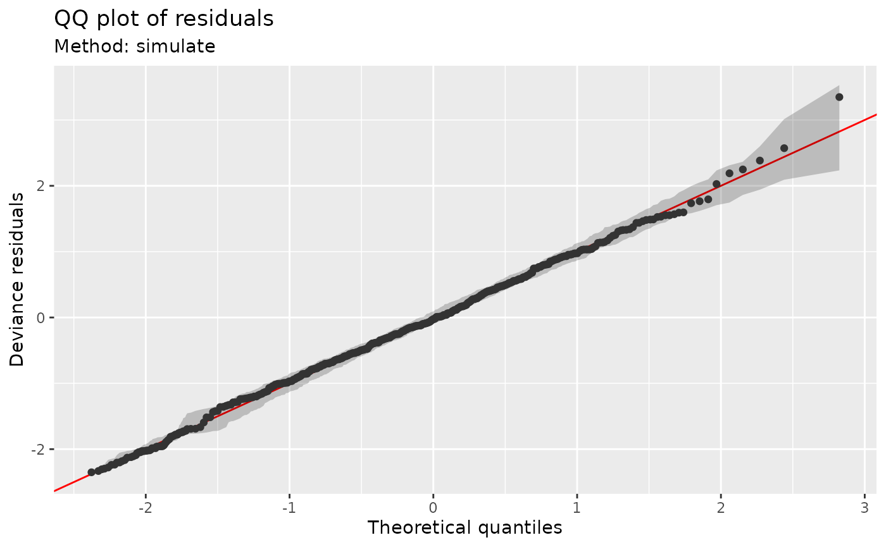

``` r

appraise(rain_fit, type = "quantile", seed = 409)
```

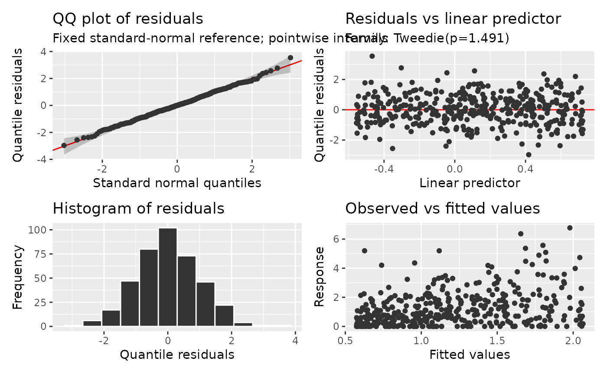

``` r

posterior_predictive_plot(rain_fit, n = 50, seed = 410)
```

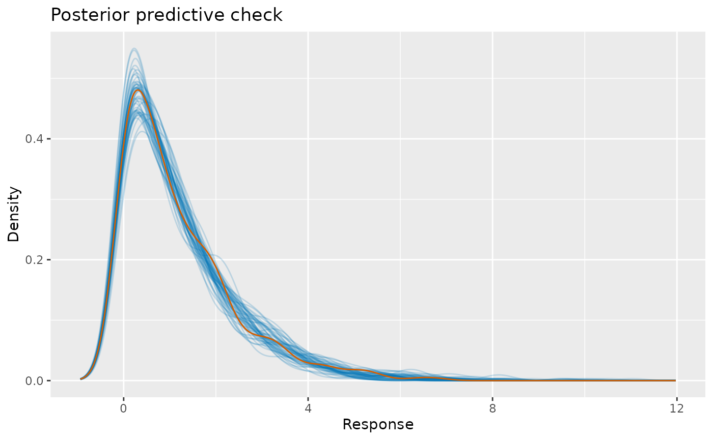

The default QQ reference for traditional Tweedie residuals uses
simulation. PIT and quantile residuals use fast Poisson-Gamma mixture
CDF calculations. At zero they randomise over the fitted zero mass,
which is not a left-tail continuous density. The continuous-response
posterior plot uses a kernel density overlay, so it smooths the zeros
into a peak; that peak is not the height of an actual continuous density
at zero. Its formula gives a useful independent calculation:

``` r

p <- rain_fit$family$getTheta(TRUE)
phi <- summary(rain_fit)$scale
zero_probability <- exp(-fitted(rain_fit)^(2 - p) / (phi * (2 - p)))
zero_pit <- quantile_residuals(rain_fit, type = "pit", seed = 409)
data.frame(observed_zero_fraction = mean(rain$amount == 0),
  fitted_zero_fraction = mean(zero_probability),
  largest_zero_probability_rank = max(zero_pit[rain$amount == 0] /
    zero_probability[rain$amount == 0]))
#>   observed_zero_fraction fitted_zero_fraction largest_zero_probability_rank
#> 1                  0.125            0.1253626                     0.9931912
```

The rank ratio stays within the zero mass. Compare observed and expected
zero fractions as one check, and inspect the positive tail as another.
Native Gamma functions handle power two. Work limits can produce
warnings and approximate mixture results; expensive inversion fallback
requires the optional tweedie package. Increasing simulation is often
preferable to requesting numerical QQ quantiles on a large dataset.

## Observations below a detection limit

A nondetect tells us that the latent concentration lies below a
threshold. Replacing it with the threshold creates an artificial point
mass and discards that information. To demonstrate the encoding clearly
we simulate normally distributed log concentrations, with exact
measurements above a fixed limit. The
[`cnorm()`](https://rdrr.io/pkg/mgcv/man/cnorm.html) response stores the
limit and a censoring bound in two columns.

``` r

set.seed(411)
assay <- data.frame(dose = runif(300, 0, 4))
latent <- rnorm(300, mean = 0.3 + 0.5 * assay$dose, sd = 0.7)
limit <- 0.6
assay$reading <- pmax(latent, limit)
assay$bound <- ifelse(latent < limit, -Inf, latent)
censored_fit <- gam(cbind(reading, bound) ~ s(dose, k = 8), data = assay,
  family = cnorm(), method = "REML")
```

``` r

u <- quantile_residuals(censored_fit, type = "pit", seed = 412)
qq_plot(censored_fit, type = "quantile", seed = 412)
```

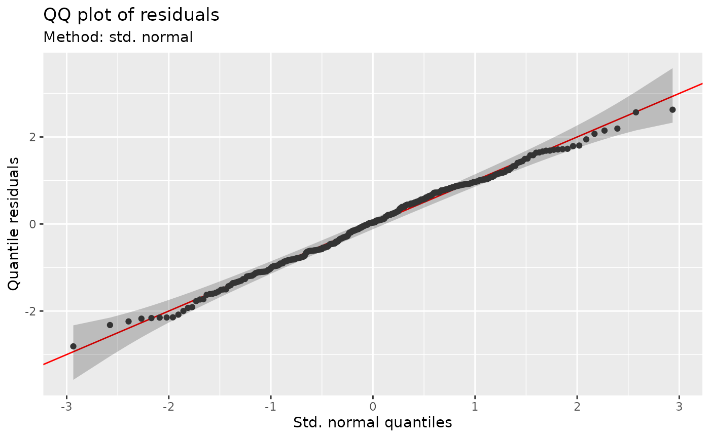

``` r

ggplot(data.frame(assay, pit = u), aes(dose, pit)) +
  geom_point(aes(colour = bound == -Inf)) +
  labs(x = "Dose", y = "PIT residual", colour = "Below limit")
```

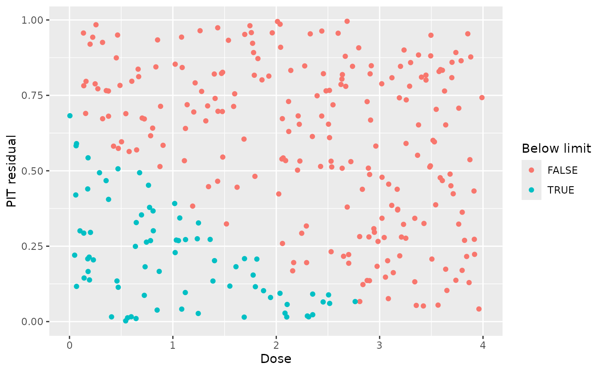

An exact observation uses its fitted CDF. A nondetect is randomised
within the CDF interval below the limit; right and interval censoring
use their relevant bounds.
[`cpois()`](https://rdrr.io/pkg/mgcv/man/cpois.html) and
[`clog()`](https://rdrr.io/pkg/mgcv/man/clog.html) have corresponding
count and logistic latent families. Their distribution helpers and
predictions are also supported. Censored response draws describe the
latent response. A posterior predictive plot of the observed censored
values remains unsupported: it needs an explicit censoring process
applied to each draw. For a known fixed limit, you can draw latent
responses and apply that threshold yourself to reproduce the measurement
mechanism.

## Binary trials and ordered categories

Binomial sampling weights have a different meaning from precision
weights: they count trials. A numeric success proportion with 20 trials
can take values in steps of 1/20; a factor-valued Bernoulli response
still has one binary trial, even if it carries likelihood weights.
Gratia preserves this distinction in residuals and response draws. Here
several sites have different visit totals:

``` r

set.seed(413)
visits <- data.frame(cover = runif(240), trials = rep(c(5, 10, 20), 80))
visits$success <- rbinom(240, visits$trials, plogis(-1 + 2 * visits$cover))
visits$failure <- visits$trials - visits$success
visit_fit <- gam(cbind(success, failure) ~ s(cover, k = 8), data = visits,
  family = binomial(), method = "REML")
appraise(visit_fit, type = "quantile", seed = 414)
```

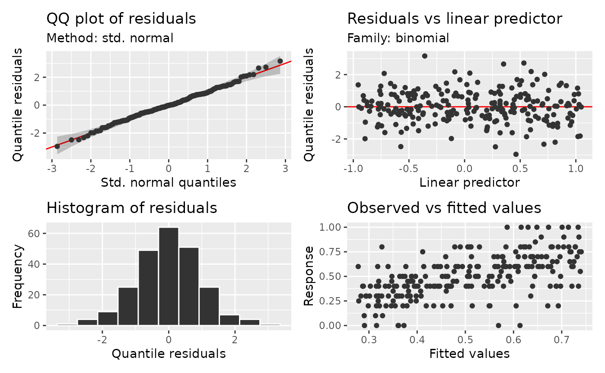

``` r

posterior_predictive_plot(visit_fit, n = 50, seed = 414)
```

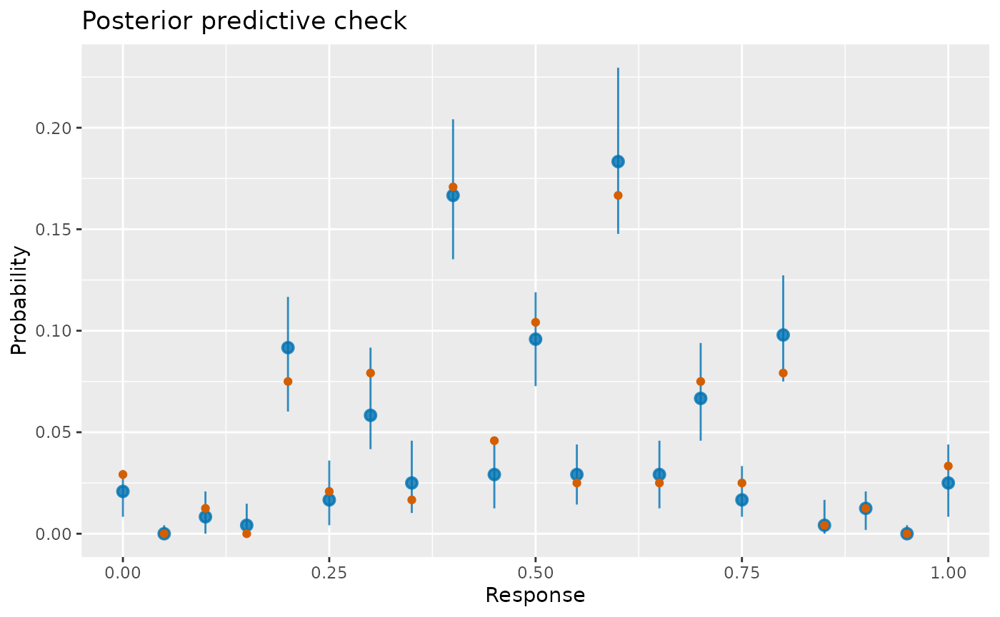

The generating probability has a linear logit, so a familiar ordinary
logistic regression also answers this question. The same public
diagnostics accept its `glm` object directly:

``` r

visit_glm <- glm(cbind(success, failure) ~ cover, data = visits,
  family = binomial())
qq_plot(visit_glm, type = "quantile", seed = 414)
```

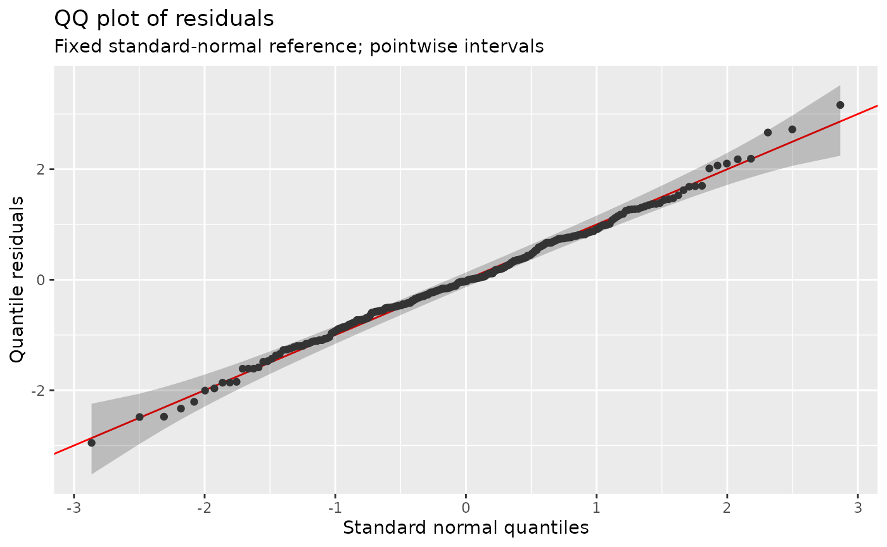

The smooth model allows departure from that linear relationship, at the
cost of estimating more flexibility. Similar checks across the fits are
consistent with the simple relationship used in this simulation.

Randomisation spans one success, not a full unit of proportion.
Posterior predictive plots display proportions at fitting observations
and give each row equal weight in the empirical distribution. A site
with 20 trials has more precisely distributed proportions, but does not
contribute 20 plotted rows. These checks concern the response as encoded
in the model.

An ordered response, such as a four-level condition score, instead has
category thresholds and an implicit ordering. A demonstration with
custom thresholds can use gratia’s data simulator:

``` r

ordinal_data <- data_sim("eg1", n = 400, dist = "ocat", n_cat = 4,
  cuts = c(-1, 3, 7), seed = 415)
ordinal_fit <- gam(y ~ s(x0) + s(x1) + s(x2) + s(x3), data = ordinal_data,
  family = ocat(R = 4), method = "REML")
qq_plot(ordinal_fit, type = "quantile", seed = 416)
```

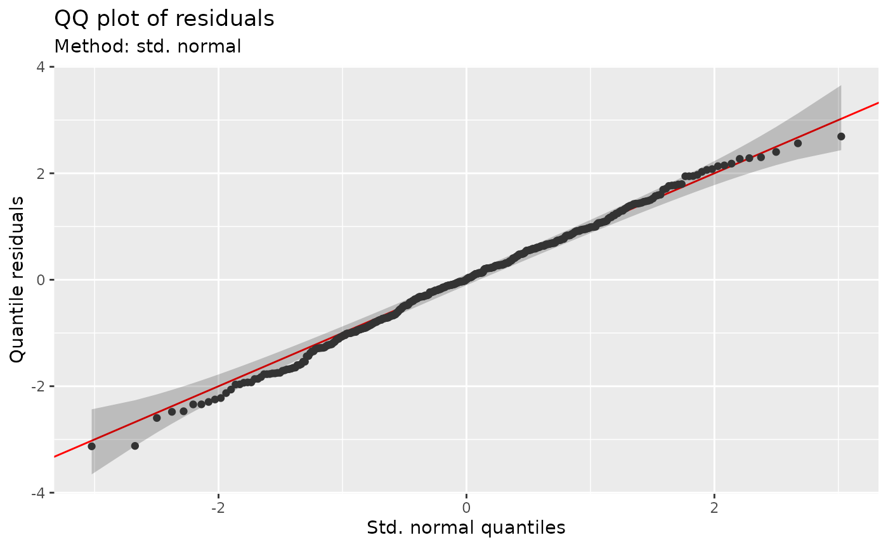

The thresholds define a simulated rating process; they must be finite
and strictly increasing. These checks randomise within ordered category
mass. For nominal categories, `mgcv::multinom(K)` models one outcome
coded `0, ..., K`. gratia accumulates probabilities in that existing
coding order:

F(q) = \sum\_{j=0}^{\lfloor q \rfloor} p_j, \qquad Q(u) = \min\\j : F(j)
\ge u\\, \quad 0 \< u \< 1.

The CDF is zero below category 0 and one at or above category K.
Quantiles at lower-tail probabilities zero and one are 0 and K,
respectively; upper-tail probabilities reverse these endpoints. Both
functions accept log probabilities and upper tails. Internally, their
`mu` argument contains K logits relative to category 0, as in mgcv’s
native random generator, rather than the K+1 probabilities returned by
`predict(type = "response")`.

A PIT for an observed category `j` is `F(j - 1) + V * p_j`, with `V`
uniform on `(0, 1)`. Thus randomization spans the entire mass of that
category. This is the ordinary randomized probability transform
described by [Brockwell
(2007)](https://pmc.ncbi.nlm.nih.gov/articles/PMC2211730/). Each fixed
enumeration gives a uniform transform under the true model. Changing the
enumeration can change individual residuals and diagnostic sensitivity:
the probabilities before a given category change. The coding does not
turn the multinomial likelihood into an ordinal model.

``` r

set.seed(417)
category_data <- data.frame(x = runif(300))
category_data$y <- sample(0:2, nrow(category_data), replace = TRUE)
category_fit <- gam(list(y ~ s(x), ~s(x)), data = category_data,
  family = multinom(K = 2), method = "REML")
qq_plot(category_fit, type = "quantile", seed = 418)
```


These residuals transform cumulative category probabilities; they are
distinct from the latent-utility surrogate residuals for nominal models
studied by [Cheng, Wang and Zhang
(2021)](https://pmc.ncbi.nlm.nih.gov/articles/PMC8018589/).

Use
[`surrogate_residuals()`](https://gavinsimpson.github.io/gratia/reference/surrogate_residuals.md)
or `appraise(fit, type = "surrogate", seed = 417)` for a GAM fitted with
[`multinom()`](https://rdrr.io/pkg/mgcv/man/multinom.html). These
residuals draw continuous utilities conditional on the observed choice,
then subtract each fitted location and the Gumbel mean. The result is a
matrix with columns labelled `0`, …, `K`, including the reference
category. Every component has a centred Gumbel reference, with mean zero
and variance `pi^2 / 6`. Even binary `multinom(K = 1)` fits retain two
utility components; the difference between them has a logistic
reference. This construction uses the whole utility vector and does not
assign an order to the nominal outcomes.

``` r

set.seed(417)
nominal_data <- data.frame(x = runif(400, -2, 2))
locations <- cbind(0, nominal_data$x, -.5 - nominal_data$x)
utilities <- locations - log(-log(matrix(runif(1200), nrow = 400)))
nominal_data$y <- max.col(utilities) - 1L
nominal_fit <- gam(list(y ~ s(x, k = 6), ~ s(x, k = 6)),
  data = nominal_data, family = multinom(K = 2), method = "REML")
head(surrogate_residuals(nominal_fit, seed = 418))
#>               0          1          2
#> [1,]  0.2642662 -0.7456620 -0.4193910
#> [2,] -1.2404136  3.2844008 -1.0975267
#> [3,] -2.1688542 -2.1006100 -0.6264208
#> [4,]  2.4842765 -1.5569361  0.5762615
#> [5,] -1.1996106  1.4861575 -0.2546800
#> [6,] -1.3084249  0.1337424  0.4076122
appraise(nominal_fit, type = "surrogate", seed = 418)
```

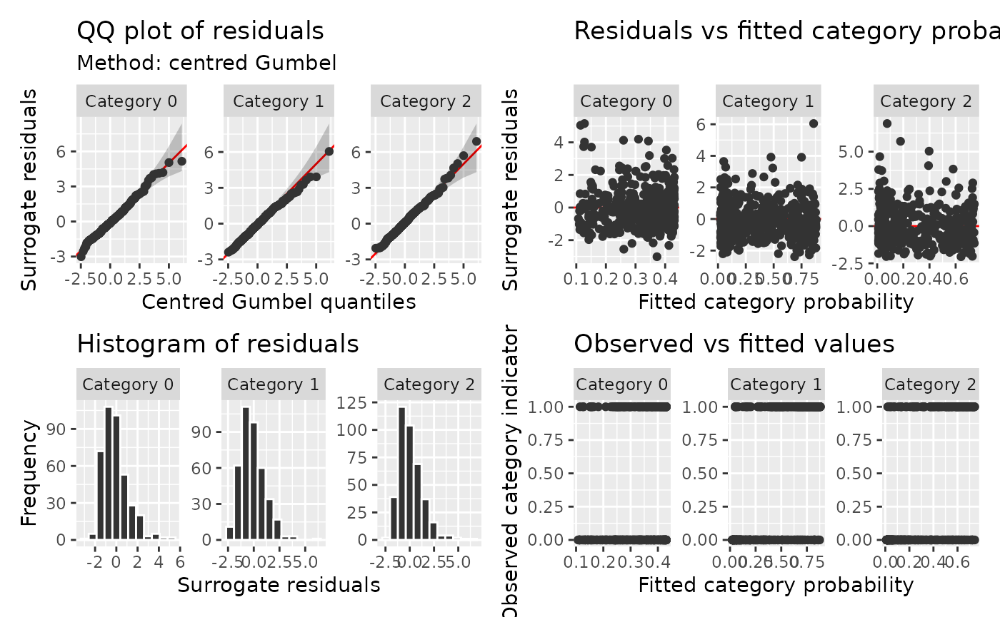

QQ and worm plots show each category separately against centred Gumbel
quantiles. Their pointwise bands treat fitted parameters as fixed and
apply separately to each component. Residual-versus-fitted panels use
each category’s fitted probability, including category 0.
Observed-versus-fitted panels compare category indicators with those
probabilities. All panels share a single draw. For larger data,
`scalable = TRUE` summarises each category separately while retaining
the same underlying draws for the same seed. Automatic dispatch counts
observations. See
[`surrogate_residuals()`](https://gavinsimpson.github.io/gratia/reference/surrogate_residuals.md)
for the sampling identity and reference distributions.

## Other distributions and limits to interpretation

The same public diagnostics cover the following additions. Choose a
family from its support and scientific sampling mechanism, then inspect
the whole fitted distribution, rather than interpreting every first
predictor as a mean. These are extensions of the calculations above, not
additional worked datasets.

| Family or model | What changes in the checks? |
|----|----|
| [`gaulss()`](https://rdrr.io/pkg/mgcv/man/gaulss.html), [`gammals()`](https://rdrr.io/pkg/mgcv/man/gammals.html), [`gumbls()`](https://rdrr.io/pkg/mgcv/man/gumbls.html), [`gevlss()`](https://rdrr.io/pkg/mgcv/man/gevlss.html), [`ziplss()`](https://rdrr.io/pkg/mgcv/man/ziplss.html) | CDF and quantile references use all distributional predictors; zero-inflated models include the point mass |
| [`twlss()`](https://rdrr.io/pkg/mgcv/man/twlss.html) | Mean, power and dispersion vary; select `parameter = "power"` for the second link and `"scale"`, `"sigma"` or `"phi"` for the third |
| [`shash()`](https://rdrr.io/pkg/mgcv/man/shash.html) | Skewness and tail weight matter; PIT checks remain useful when the package’s deviance contrast is invalid |
| [`ziP()`](https://rdrr.io/pkg/mgcv/man/ziP.html) | Zero-inflated count probabilities include fitted zero mass; it is a different model from separate [`ziplss()`](https://rdrr.io/pkg/mgcv/man/ziplss.html) predictors |
| [`betar()`](https://rdrr.io/pkg/mgcv/man/Beta.html) | Native simulation clips at epsilon endpoints, so diagnostics include their probability mass; this remains an approximation to the fitting likelihood |
| [`scat()`](https://rdrr.io/pkg/mgcv/man/scat.html) | Scaled-t references retain the fitted heavy-tail parameters |
| [`mvn()`](https://rdrr.io/pkg/mgcv/man/mvn.html) | PIT checks each response separately; joint simulation retains covariance between responses |
| [`bcg()`](https://rdrr.io/pkg/mgcv/man/bcg.html) and optional mgcvUtils `clognorm()` | Link extraction and response predictions are supported; this does not imply every diagnostic or sampler is available |

For models with several parameters use
[`link()`](https://gavinsimpson.github.io/gratia/reference/link.md),
[`inv_link()`](https://gavinsimpson.github.io/gratia/reference/link.md)
or
[`extract_link()`](https://gavinsimpson.github.io/gratia/reference/link.md)
with the appropriate parameter. For multivariate normal and multinomial
families, explicit `which_eta` selects and validates the predictor.
Unsupported parameters are errors; a single-link user family can use its
own functions without a family-name whitelist.

``` r

inv_link(twlss(), parameter = "power")(0)
#> [1] 0
inv_link(twlss(), parameter = "phi")(0)
#> [1] 0
inv_link(mvn(d = 2), which_eta = 2)(1)
#> [1] 1
```

GEV means exist only when shape is below one, and variances only below
one-half. PIT and quantile checks do not require these moments. If an
expected response is undefined, gratia explains why an
observed-versus-fitted mean panel is unavailable instead of displaying a
spurious value. GEV signed deviance checks also require shape at least
minus one. For sinh-arcsinh fits, a density above one can give a
negative package-defined deviance contrast; use PIT/quantile checks
rather than replacing the residual with zero. Deviance magnitudes from
these definitions are not comparable standardised scores across
families.

Stable tail calculations retain log probabilities where supported,
reducing artificial infinite residuals in extreme count or censored
observations. Unsupported tail conversions still produce explanatory
errors. The
[`diagnostic_support`](https://gavinsimpson.github.io/gratia/reference/diagnostic_support.md)
reference lists supported distributions and restrictions, including
quasi families and working correlations without a response model. Use
fitting-package methods or an explicitly justified observation model
when a requested comparison is unavailable.
