# Model diagnostics for distributional, discrete and censored responses

[Model
diagnostics](https://gavinsimpson.github.io/gratia/articles/model-checking.md)
explains the shared diagnostic methods. This article applies them to
models with changing variance, exact zeros, censoring and categorical
responses. In each case, the response distribution determines how
residuals and replicated observations should be calculated. The examples
use {mgcv} for fitting, {gratia} for diagnostics and {ggplot2} for
plotting. The motorcycle data come from {MASS}, and the second fit to
these data uses {GJRM}.

``` r

library("gratia")
load_mgcv()
library("ggplot2")
```

## Fit a Gaussian model with changing variance

The [`MASS::mcycle`](https://rdrr.io/pkg/MASS/man/mcycle.html) data
record head acceleration after a simulated motorcycle impact. The mean
acceleration changes rapidly after impact, and its spread also appears
to vary. A constant-variance Gaussian model can represent the mean while
failing to capture that spread.

The fits assume independent measurement errors. The available columns,
time and acceleration, provide no accident identifiers for estimating
correlation between measurements from the same accident. We plot the
observations and start with a model that allows mean acceleration to
vary smoothly with time but assumes constant variance:

``` r

data("mcycle", package = "MASS")
ggplot(mcycle, aes(times, accel)) + geom_point() +
  labs(x = "Time after impact (ms)", y = "Acceleration (g)")
```

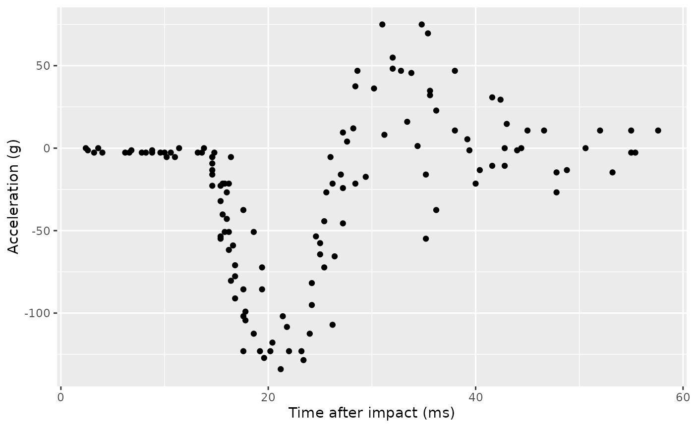

``` r

constant <- gam(accel ~ s(times, k = 20), data = mcycle, method = "REML")
```

Next we use [`gaulss()`](https://rdrr.io/pkg/mgcv/man/gaulss.html) to
let both the mean and standard deviation vary with time. We plot its two
smooths and compare the diagnostics with those from the
constant-variance model:

``` r

varying <- gam(list(accel ~ s(times, k = 20), ~ s(times, k = 6)),
  data = mcycle, family = gaulss(), method = "REML")
draw(varying)
```

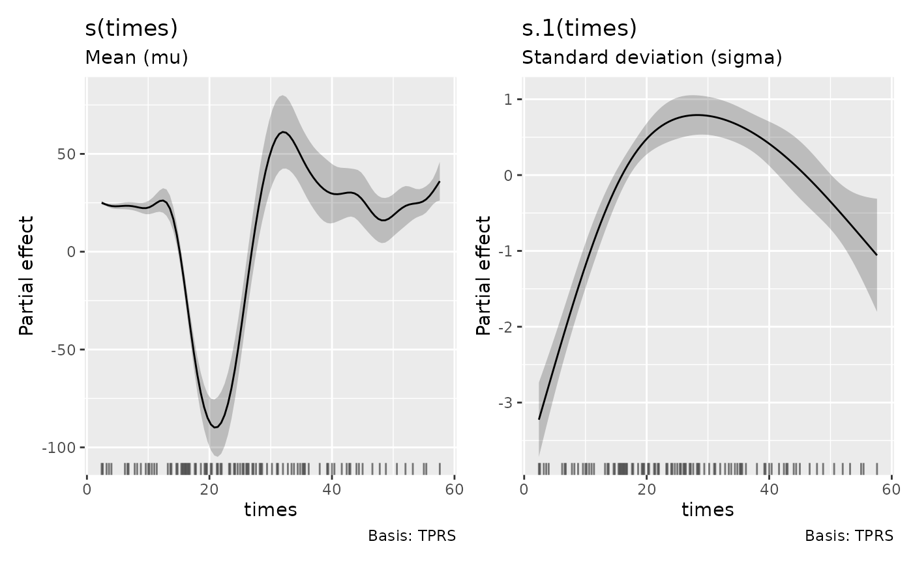

``` r

appraise(constant, type = "quantile", seed = 401)
```

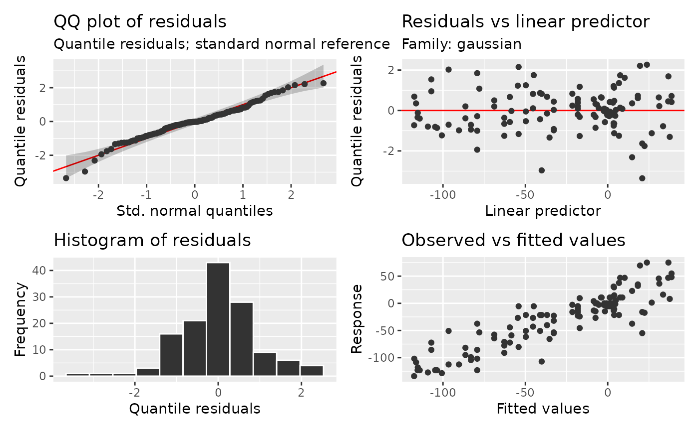

``` r

appraise(varying, type = "quantile", seed = 401)
```

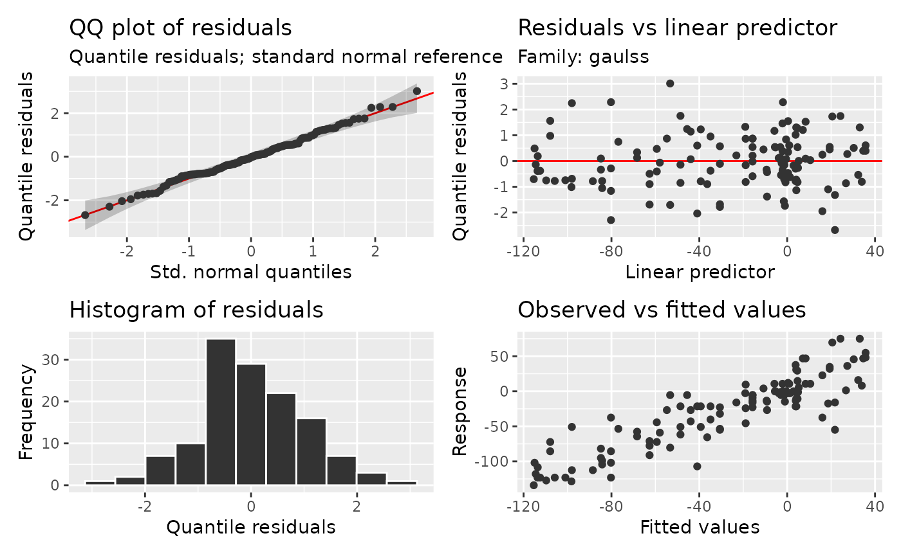

The first smooth contributes to mean acceleration. The second
contributes to the predictor for the standard deviation. For
[`gaulss()`](https://rdrr.io/pkg/mgcv/man/gaulss.html), the inverse link
returns the reciprocal standard deviation. We take its reciprocal to
plot the fitted standard deviation in the original units.

``` r

impact_grid <- data.frame(times = seq(min(mcycle$times), max(mcycle$times),
  length.out = 100))
eta <- predict(varying, newdata = impact_grid, type = "link")
inverse_sd <- inv_link(varying, parameter = "scale")(eta[, 2])
ggplot(data.frame(impact_grid, sd = 1 / inverse_sd), aes(times, sd)) +
  geom_line() + labs(x = "Time after impact (ms)", y = "Fitted standard deviation (g)")
```

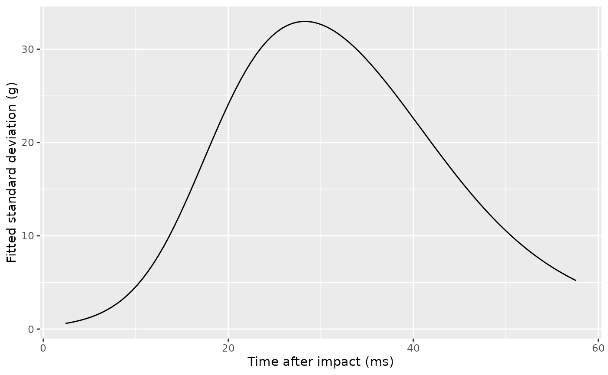

The spread increases around the period of rapid change. Modelling it
reduces a systematic residual pattern and describes how both mean
acceleration and its spread change with time after impact.

### Estimate means and variability

[`fitted_moments()`](https://gavinsimpson.github.io/gratia/reference/fitted_moments.md)
calculates quantities such as the response mean, variance and standard
deviation from the fitted distribution parameters. It uses the joint
uncertainty in those parameters. We evaluate all three quantities at
three times after impact so that the output shows each quantity.

``` r

fitted_moments(varying, data = data.frame(times = c(10, 25, 45)),
  moments = c("mean", "variance", "sd"))
#> # A tibble: 9 × 8
#>    .row .parameter  .fitted     .se .lower_ci .upper_ci .status times
#>   <int> <chr>         <dbl>   <dbl>     <dbl>     <dbl> <chr>   <dbl>
#> 1     1 mean         -3.02    1.72      -6.40     0.351 ok         10
#> 2     1 variance     20.6     6.21      11.4     37.2   ok         10
#> 3     1 sd            4.54    0.684      3.38     6.10  ok         10
#> 4     2 mean        -68.3     7.46     -82.9    -53.7   ok         25
#> 5     2 variance   1002.    277.       583.    1723.    ok         25
#> 6     2 sd           31.7     4.38      24.1     41.5   ok         25
#> 7     3 mean          0.941   6.77     -12.3     14.2   ok         45
#> 8     3 variance    257.     99.2      121.     548.    ok         45
#> 9     3 sd           16.0     3.09      11.0     23.4   ok         45
```

Each `.parameter` identifies a requested quantity. For variance rows,
`.fitted` contains the estimated response variance, and `.se` describes
uncertainty in that estimate. Standard errors and interval bounds are on
the quantity’s own scale. By default the delta method approximates how
changes in the model parameters affect each quantity and accounts for
their covariance.

[`conditional_moments()`](https://gavinsimpson.github.io/gratia/reference/conditional_moments.md)
builds the same covariate grid as
[`conditional_values()`](https://gavinsimpson.github.io/gratia/reference/conditional_values.md).
Other covariates are held at their typical values. Choose posterior
simulation to evaluate the moments at joint parameter draws, then
summarise those values:

``` r

conditional_moments(varying, condition = "times", moments = c("mean", "sd"),
  uncertainty = "simulation", n_draws = 1000, seed = 419) |>
  draw()
```

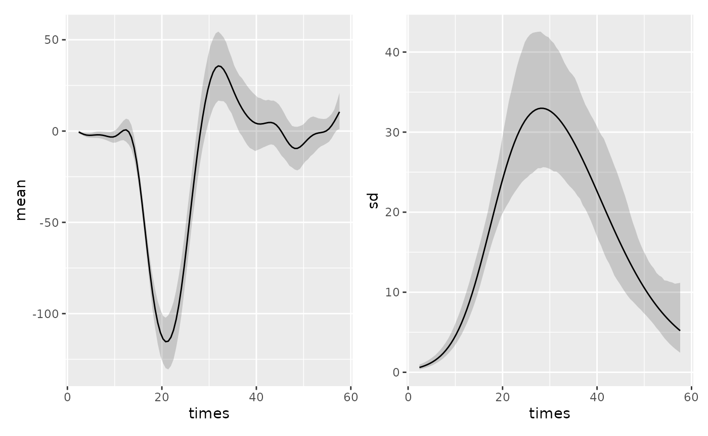

Other available quantities are the coefficient of variation (`"cv"`),
skewness, kurtosis and excess kurtosis; `moments = "all"` requests all
seven. CV requires a positive mean, so it is inappropriate where
predicted acceleration is negative.

For models with a global dispersion or shape parameter, the default
`nuisance = "estimated"` includes its uncertainty where the fitting
method provides the required information. Use `nuisance = "fixed"` to
hold such parameters at their estimates. Parameters modelled by
coefficients, including the changing scale in this example, retain their
joint uncertainty.

Some distributions have undefined moments for particular parameter
values. These results carry a `.status` explaining the problem. With
simulation, `.p_defined` records the proportion of draws with a defined
moment; an interval is withheld if any draw is undefined. See
[`fitted_moments()`](https://gavinsimpson.github.io/gratia/reference/fitted_moments.md)
for the supported families and uncertainty calculations.

Finally, compare the observed acceleration distribution with replicated
datasets. This check draws the mean and scale coefficients together,
retaining their covariance:

``` r

posterior_predictive_plot(varying, n = 50, seed = 402)
```

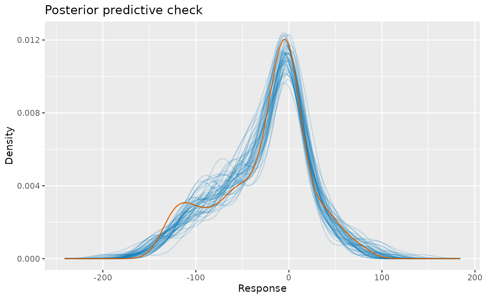

This check compares the overall acceleration distributions, pooling
measurements across time. Use the residual-versus-predictor panels above
to see whether the model captures changes in spread after impact.

### Fit the mean and standard deviation with GJRM

Fit the same two smooths using
[`GJRM::gamlss()`](https://rdrr.io/pkg/GJRM/man/gamlss.html), which
estimates their smoothness with a different fitting procedure. Then plot
the smooths and check the fitted Gaussian distribution.

``` r

library("GJRM")
impact_gjrm <- GJRM::gamlss(list(accel ~ s(times, k = 20), ~ s(times, k = 6)),
  data = mcycle, family = "N")
gratia::draw(impact_gjrm)
```

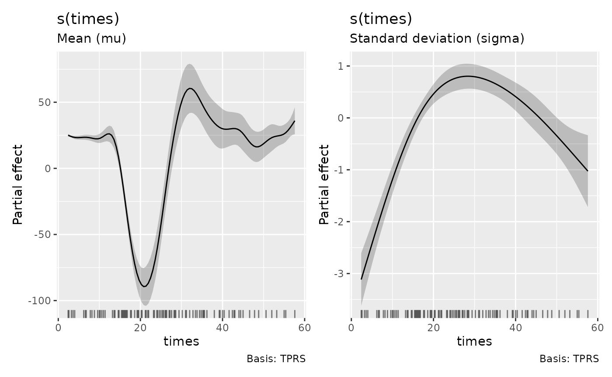

``` r

appraise(impact_gjrm, seed = 403)
```

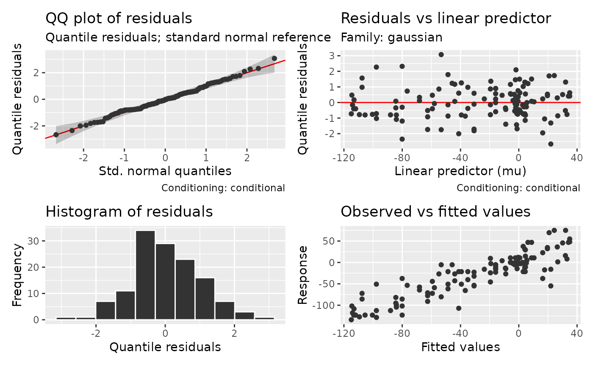

``` r

posterior_predictive_plot(impact_gjrm, n = 50, seed = 404)
```

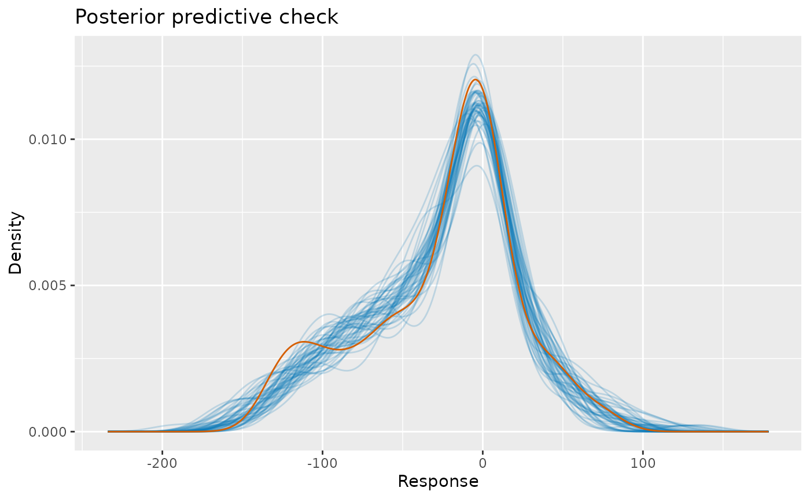

The smooth subtitles show which distribution parameter each curve
describes. Compare the quantile residuals and posterior predictive
checks with those from the mgcv fit to see whether the two fits show
similar departures.

These diagnostics also support several other uncensored univariate GJRM
families, including Poisson, negative binomial, beta, Gamma and Weibull.
See
[`diagnostic_support`](https://gavinsimpson.github.io/gratia/reference/diagnostic_support.md)
for the full list. For some joint models fitted with
[`GJRM::gjrm()`](https://rdrr.io/pkg/GJRM/man/gjrm.html), gratia can
check each response distribution separately. The help topic specifies
which model structures and diagnostic functions are supported.

For Weibull fits, the first predictor controls scale rather than the
response mean. For logistic and Gumbel fits it controls location; a
Gumbel location is also different from its mean. gratia calculates
response means and variances from both fitted parameters for
observed-versus-fitted and Pearson residual plots. Posterior predictive
checks draw both equations’ coefficients together, so uncertainty in
both equations contributes to the replicated responses.

All these families support PIT, quantile, response and Pearson
residuals, as well as simulation-based residuals in the style of
{DHARMa}. These work in ordinary and scalable plots. Deviance residuals
are available for Gaussian (`"N"`), Gamma (`"GA"` or `"GAi"`) and
Poisson (`"P"`) fits. For example, a fitted beta model `beta_fit` can be
checked with `appraise(beta_fit, seed = 405)` or
`appraise(beta_fit, ppcheck = TRUE, n_ppc = 50, seed = 405)`. To
simulate a QQ reference for Pearson residuals, use
`qq_plot(beta_fit, type = "pearson", method = "simulate", seed = 405)`.
The default quantile residuals instead use a fixed standard-normal
reference.

## Positive observations and precision weights

Suppose a chemical concentration is measured in samples with different
amounts of replication. Averaging more independent measurements can
reduce variance without changing the mean. We simulate positive
concentrations whose squared coefficient of variation is
`0.4 / precision`, with a mean that changes smoothly with flow:

``` r

set.seed(405)
chemical <- data.frame(flow = runif(400, 0, 10),
  precision = rep(c(1, 2, 4, 8), length.out = 400))
mu <- exp(1 + 0.5 * sin(chemical$flow / 3))
chemical$concentration <- rgamma(400, shape = chemical$precision / 0.4,
  scale = mu * 0.4 / chemical$precision)
```

We fit a smooth flow effect with a Gamma family and log link, supplying
the precision weights so the fitted variance reflects the different
amounts of replication. We then inspect the quantile residual
diagnostics:

``` r

gamma_fit <- gam(concentration ~ s(flow, k = 10), data = chemical,
  weights = precision, family = Gamma(link = "log"), method = "REML")
appraise(gamma_fit, type = "quantile", seed = 406)
```

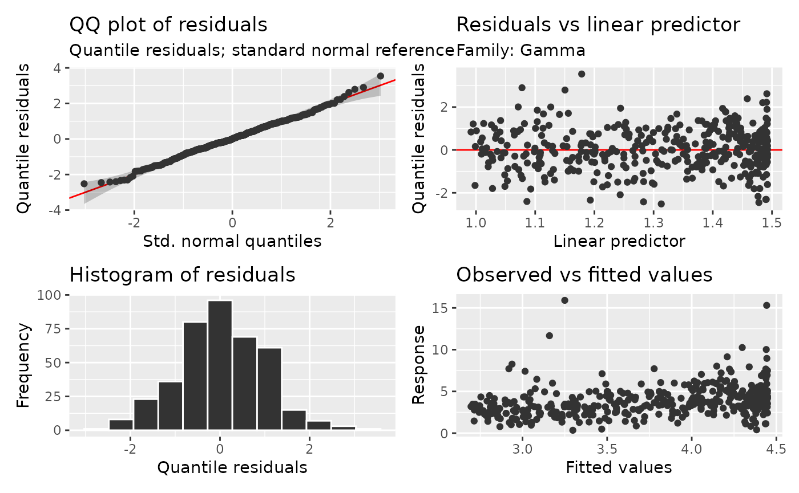

The diagnostics and simulations use each observation’s weight to
calculate its response distribution. The fitted variance is
\phi\mu_i^2/w_i, where w_i is precision and \phi is estimated
dispersion. A larger weight narrows the response distribution. Supplying
weights when sampling with gratia replaces the fitting weights, so use
values appropriate to the measurements you want to simulate.

An inverse Gaussian alternative uses variance \phi\mu_i^3/w_i. It
therefore allows variability to increase more rapidly with the mean. Fit
it to the same data and compare the tails of the residual plots.

``` r

ig_fit <- gam(concentration ~ s(flow, k = 10), data = chemical,
  weights = precision, family = inverse.gaussian(link = "log"), method = "REML")
qq_plot(ig_fit, type = "quantile", seed = 406)
```

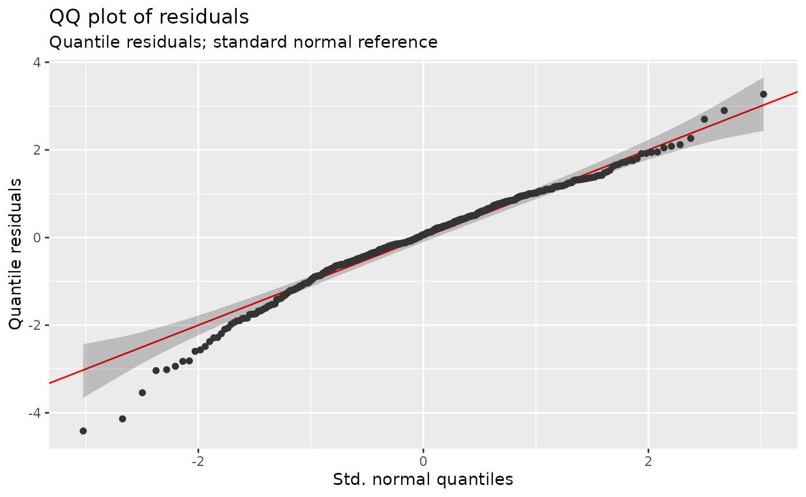

``` r

worm_plot(ig_fit, method = "uniform", seed = 407)
```

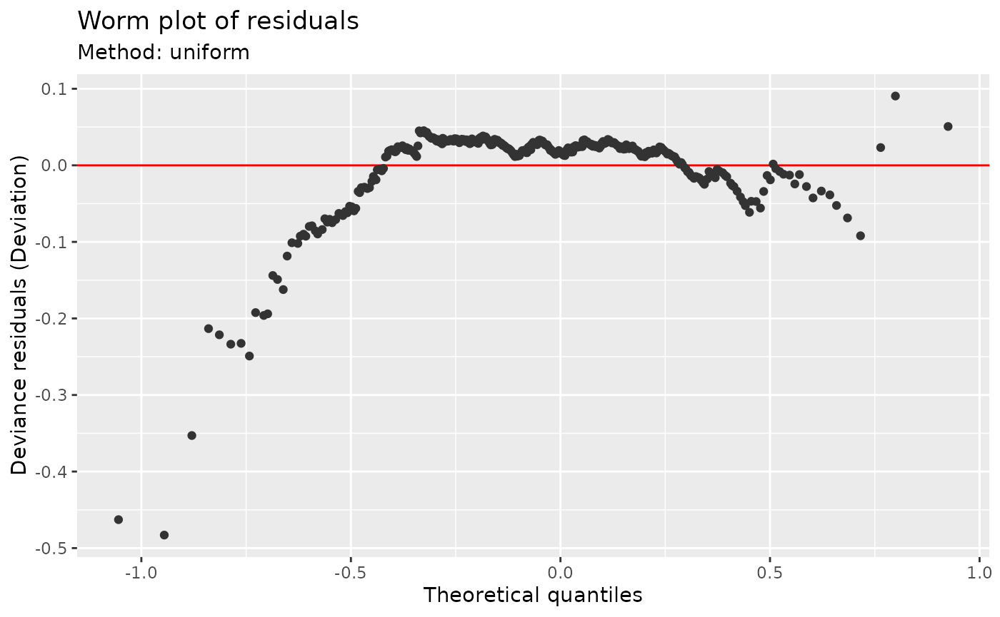

Both models can fit similar means while predicting different tails. In
this example, the data were generated from the Gamma distribution, so
the Gamma fit provides a reference for comparison.

## Check responses with exact zeros and positive amounts

Biomass, rainfall amounts and expenditure can have exact zeros together
with positive continuous observations. A Tweedie distribution with power
between one and two describes the sum of a Poisson-distributed number of
positive Gamma amounts. The sum is zero when that number is zero. The
model links the zero probability and positive distribution through the
mean, dispersion and power. A delta model instead estimates separate
occurrence and positive components. See [Working with sdmTMB models in
gratia](https://gavinsimpson.github.io/gratia/articles/sdmTMB-support.md).
We simulate rainfall amounts whose expected value increases with
elevation:

``` r

set.seed(408)
rain <- data.frame(elevation = runif(400, 0, 1))
rain$amount <- mgcv::rTweedie(exp(-0.6 + 1.5 * rain$elevation), p = 1.5, phi = 1)
```

We fit a Tweedie model and compare its residual diagnostics and
replicated response distributions:

``` r

rain_fit <- gam(amount ~ s(elevation, k = 10), data = rain,
  family = tw(), method = "REML")
qq_plot(rain_fit, seed = 409)
```

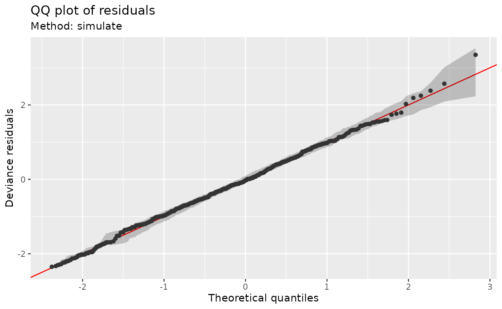

``` r

appraise(rain_fit, type = "quantile", seed = 409)
```

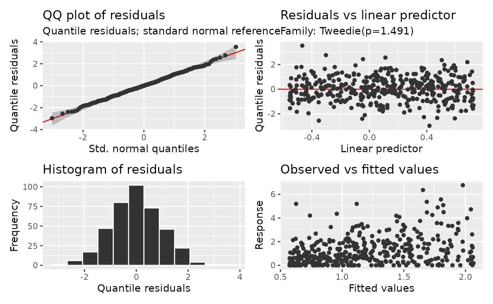

``` r

posterior_predictive_plot(rain_fit, n = 50, seed = 410)
```

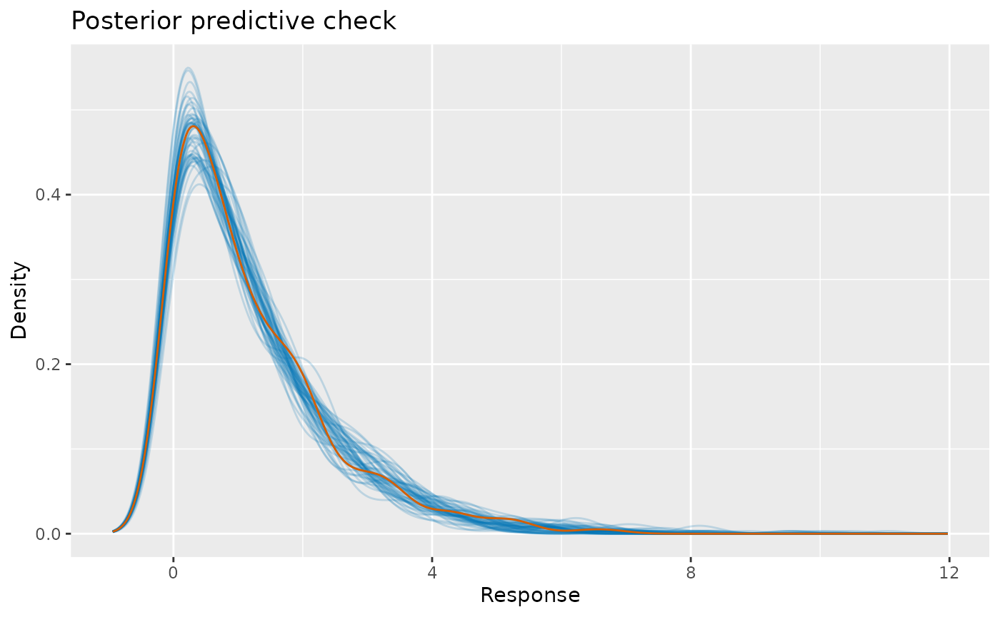

The default QQ reference for traditional Tweedie residuals uses
simulation. At zero, PIT residuals draw a uniform value between zero and
the fitted probability of a zero. The posterior predictive plot smooths
the zeros into a peak with the kernel density estimate. To check the
zeros directly, compare their expected and observed proportions. We also
check that every PIT residual for a zero falls within its allowed range.

``` r

p <- rain_fit$family$getTheta(TRUE)
phi <- summary(rain_fit)$scale
zero_probability <- exp(-fitted(rain_fit)^(2 - p) / (phi * (2 - p)))
zero_pit <- quantile_residuals(rain_fit, type = "pit", seed = 409)
data.frame(observed_zero_fraction = mean(rain$amount == 0),
  fitted_zero_fraction = mean(zero_probability),
  largest_zero_probability_rank = max(zero_pit[rain$amount == 0] /
    zero_probability[rain$amount == 0]))
#>   observed_zero_fraction fitted_zero_fraction largest_zero_probability_rank
#> 1                  0.125            0.1253626                     0.9931912
```

Dividing a zero’s PIT residual by its fitted probability of zero gives a
number between zero and one. Tweedie inverse-CDF calculations can be
expensive for large datasets. Simulated QQ references are often quicker.

## Observations below a detection limit

A nondetect tells us that the latent concentration lies below a
threshold. Treating the threshold as an exact observation discards that
information. Instead, we record the threshold together with a bound
indicating that the true value is smaller. To demonstrate the encoding
we simulate normally distributed log concentrations. Their mean
increases with dose, and independent Gaussian errors have standard
deviation 0.7. We record exact measurements above a fixed limit and
censored measurements below it. For
[`cnorm()`](https://rdrr.io/pkg/mgcv/man/cnorm.html), record the
detection limit in the first column and `-Inf` in the second for a
nondetect. Repeat exact readings in both columns.

``` r

set.seed(411)
assay <- data.frame(dose = runif(300, 0, 4))
latent <- rnorm(300, mean = 0.3 + 0.5 * assay$dose, sd = 0.7)
limit <- 0.6
assay$reading <- pmax(latent, limit)
assay$bound <- ifelse(latent < limit, -Inf, latent)
```

We fit a smooth dose effect with
[`cnorm()`](https://rdrr.io/pkg/mgcv/man/cnorm.html), using the two
response columns to retain the information in censored observations:

``` r

censored_fit <- gam(cbind(reading, bound) ~ s(dose, k = 8), data = assay,
  family = cnorm(), method = "REML")
```

We now calculate PIT residuals, draw their quantile QQ plot, and plot
the PIT values against dose, distinguishing censored and exact
observations:

``` r

u <- quantile_residuals(censored_fit, type = "pit", seed = 412)
qq_plot(censored_fit, type = "quantile", seed = 412)
```

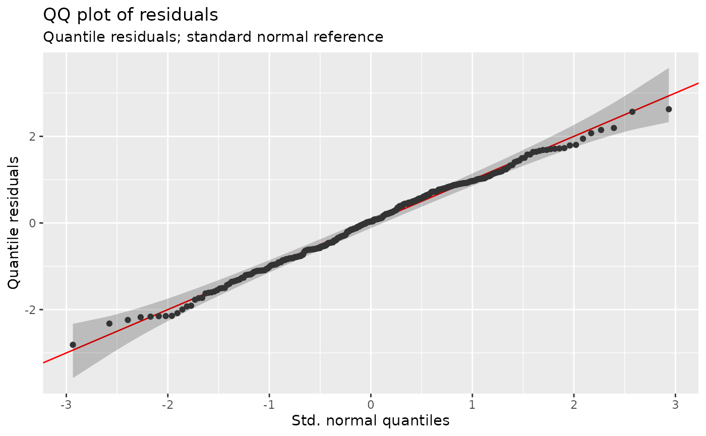

``` r

ggplot(data.frame(assay, pit = u), aes(dose, pit)) +
  geom_point(aes(colour = bound == -Inf)) +
  labs(x = "Dose", y = "PIT residual", colour = "Below limit")
```

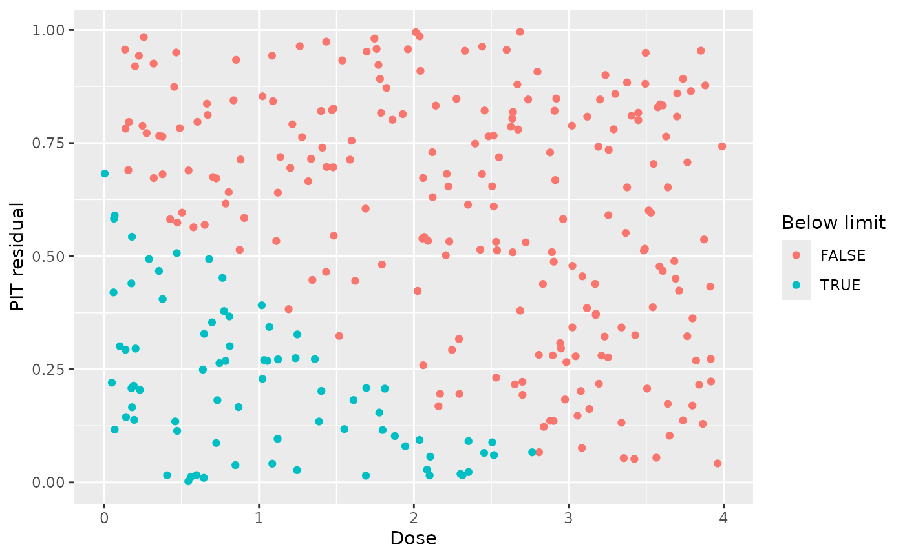

An exact observation uses the fitted probability of a response at or
below its measured value. A nondetect draws uniformly from zero to the
probability of falling below the detection limit. For right or interval
censoring, the range is determined by the supplied bounds.
[`cpois()`](https://rdrr.io/pkg/mgcv/man/cpois.html) and
[`clog()`](https://rdrr.io/pkg/mgcv/man/clog.html) have corresponding
count and logistic latent families. Their distribution helpers and
predictions are also supported. Censored response draws describe the
latent response. A posterior predictive plot of the observed censored
values remains unsupported: it needs an explicit censoring process
applied to each draw. For a known fixed limit, you can draw latent
responses and apply that threshold yourself to reproduce the measurement
mechanism.

## Check binomial and categorical responses

Binomial sampling weights have a different meaning from precision
weights: they count trials. A numeric success proportion with 20 trials
can take values in steps of 1/20; a factor-valued Bernoulli response
still has one binary trial, even if it carries likelihood weights.
Gratia preserves this distinction in residuals and response draws. Here
we simulate detections at sites with different visit totals. Detection
probability increases with cover, and each site’s success count follows
a binomial distribution:

``` r

set.seed(413)
visits <- data.frame(cover = runif(240), trials = rep(c(5, 10, 20), 80))
visits$success <- rbinom(240, visits$trials, plogis(-1 + 2 * visits$cover))
visits$failure <- visits$trials - visits$success
```

We fit the successes and failures with a binomial GAM, then inspect
residual and posterior predictive checks:

``` r

visit_fit <- gam(cbind(success, failure) ~ s(cover, k = 8), data = visits,
  family = binomial(), method = "REML")
appraise(visit_fit, type = "quantile", seed = 414)
```

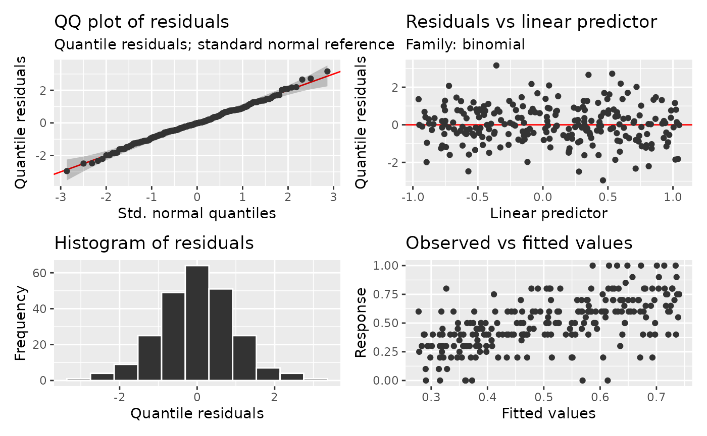

``` r

posterior_predictive_plot(visit_fit, n = 50, seed = 414)
```

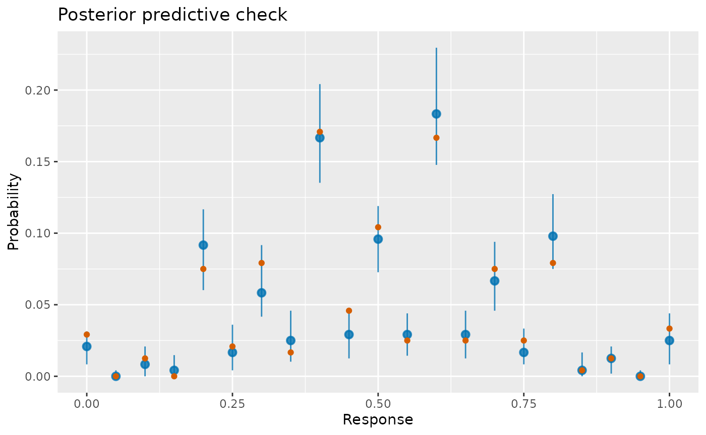

The generating probability has a linear logit, so a familiar ordinary
logistic regression also answers this question. The same public
diagnostics accept its `glm` object directly:

``` r

visit_glm <- glm(cbind(success, failure) ~ cover, data = visits,
  family = binomial())
qq_plot(visit_glm, type = "quantile", seed = 414)
```

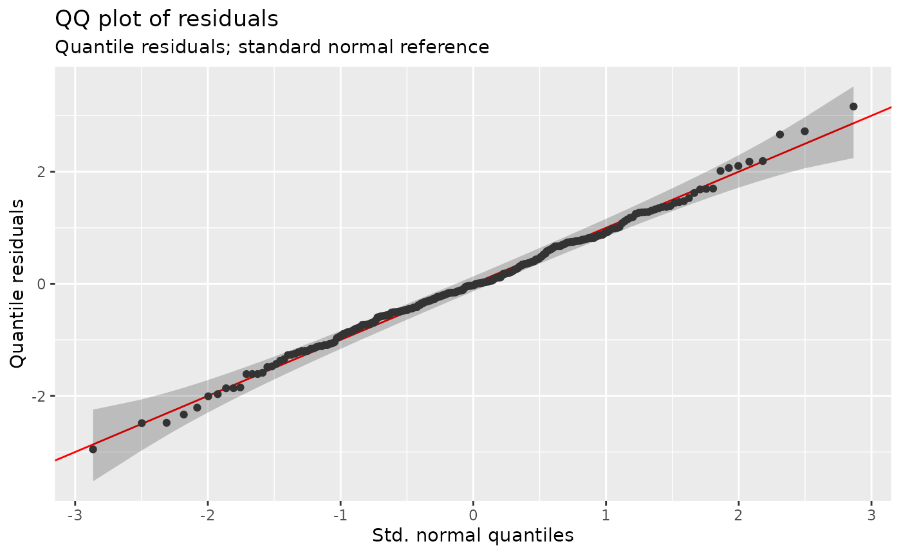

The smooth model allows the log odds to curve with cover. The QQ plots
for both fits look similar, consistent with the linear relationship used
to generate the log odds.

The PIT randomisation uses the probability of the site’s observed
success count. The posterior predictive plot uses each site’s success
proportion, giving every site equal weight. Sites with 20 visits have
less variable success proportions than sites with five visits at the
same fitted detection probability.

### Ordered response categories

An ordinal model can describe an ordered response, such as a four-level
condition score, by placing thresholds on an underlying continuous
variable. We use gratia’s `"eg1"` example with four independent
covariates. The latent response combines nonlinear effects of `x0`, `x1`
and `x2` with standard logistic noise. `x3` has no true effect.
Thresholds at -1, 3 and 7 produce four categories.

``` r

ordinal_data <- data_sim("eg1", n = 400, dist = "ocat", n_cat = 4,
  cuts = c(-1, 3, 7), seed = 415)
```

We fit a smooth for each covariate with an ordinal family containing
four categories, then check the quantile residuals:

``` r

ordinal_fit <- gam(y ~ s(x0) + s(x1) + s(x2) + s(x3), data = ordinal_data,
  family = ocat(R = 4), method = "REML")
qq_plot(ordinal_fit, type = "quantile", seed = 416)
```


The thresholds define the simulated rating process. Quantile residuals
randomise within the probability of each observed category before
applying the standard-normal transformation.

### Nominal response categories

For unordered categories,
[`mgcv::multinom()`](https://rdrr.io/pkg/mgcv/man/multinom.html) models
outcomes coded `0, ..., K`. To calculate PIT residuals, gratia
accumulates probabilities in that coding order and randomises within the
probability of the observed category. This is the randomised probability
transform described by [Brockwell
(2007)](https://pmc.ncbi.nlm.nih.gov/articles/PMC2211730/). For the same
fitted probabilities, changing their accumulation order can change
individual residuals and the patterns they reveal.

We illustrate this with three equally probable categories and a
covariate that has no effect on their probabilities:

``` r

set.seed(417)
category_data <- data.frame(x = runif(300))
category_data$y <- sample(0:2, nrow(category_data), replace = TRUE)
```

We fit the three-category response with two smooth predictors, then
inspect a quantile QQ plot:

``` r

category_fit <- gam(list(y ~ s(x), ~s(x)), data = category_data,
  family = multinom(K = 2), method = "REML")
qq_plot(category_fit, type = "quantile", seed = 418)
```

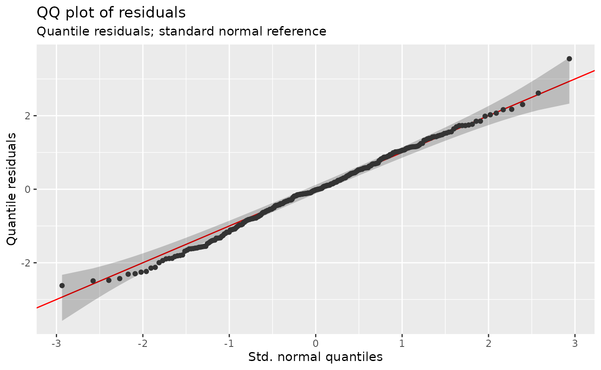

### Surrogate residuals for nominal categories

Surrogate residuals offer another way to check a
[`multinom()`](https://rdrr.io/pkg/mgcv/man/multinom.html) model without
accumulating probabilities in a category order. They treat each category
as having an unobserved score, or *utility*, with the highest score
determining the observed choice. gratia draws these scores conditional
on that choice, then subtracts their fitted locations and the Gumbel
mean. The construction follows [Cheng, Wang and Zhang
(2021)](https://pmc.ncbi.nlm.nih.gov/articles/PMC8018589/).

In the next simulation, category 0 has a constant score location,
category 1’s location increases with `x`, and category 2’s decreases.
Independent Gumbel noise creates variation in the choices at each
covariate value:

``` r

set.seed(417)
nominal_data <- data.frame(x = runif(400, -2, 2))
locations <- cbind(0, nominal_data$x, -.5 - nominal_data$x)
utilities <- locations - log(-log(matrix(runif(1200), nrow = 400)))
nominal_data$y <- max.col(utilities) - 1L
```

We fit a multinomial GAM, extract surrogate residuals for its
categories, and plot the diagnostics:

``` r

nominal_fit <- gam(list(y ~ s(x, k = 6), ~ s(x, k = 6)),
  data = nominal_data, family = multinom(K = 2), method = "REML")
head(surrogate_residuals(nominal_fit, seed = 418))
#>               0          1          2
#> [1,]  0.2642662 -0.7456620 -0.4193910
#> [2,] -1.2404136  3.2844008 -1.0975267
#> [3,] -2.1688542 -2.1006100 -0.6264208
#> [4,]  2.4842765 -1.5569361  0.5762615
#> [5,] -1.1996106  1.4861575 -0.2546800
#> [6,] -1.3084249  0.1337424  0.4076122
appraise(nominal_fit, type = "surrogate", seed = 418)
```

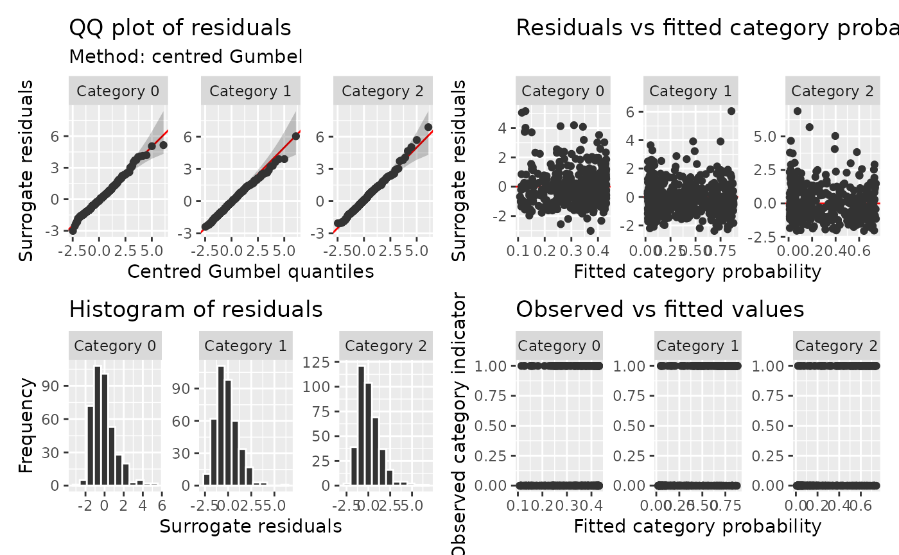

[`surrogate_residuals()`](https://gavinsimpson.github.io/gratia/reference/surrogate_residuals.md)
returns one column per category, including reference category 0. QQ and
worm plots show each category separately against centred Gumbel
quantiles. Their pointwise bands treat fitted parameters as fixed and
apply separately to each component. Residual-versus-fitted panels use
each category’s fitted probability, including category 0.
Observed-versus-fitted panels compare category indicators with those
probabilities. All panels share a single draw. For large datasets,
`scalable = TRUE` summarises each category separately while retaining
the same residual draws for the same seed. See
[`surrogate_residuals()`](https://gavinsimpson.github.io/gratia/reference/surrogate_residuals.md)
for the calculation and reference distributions.

## Choose diagnostics for other response families

Other supported response families use the same diagnostic functions. The
following table identifies features of their fitted distributions that
matter when interpreting the results:

| Family or model | What changes in the checks? |
|----|----|
| [`gaulss()`](https://rdrr.io/pkg/mgcv/man/gaulss.html), [`gammals()`](https://rdrr.io/pkg/mgcv/man/gammals.html), [`gumbls()`](https://rdrr.io/pkg/mgcv/man/gumbls.html), [`gevlss()`](https://rdrr.io/pkg/mgcv/man/gevlss.html), [`ziplss()`](https://rdrr.io/pkg/mgcv/man/ziplss.html) | CDF and quantile references use all distributional predictors; zero-inflated models include the point mass |
| [`twlss()`](https://rdrr.io/pkg/mgcv/man/twlss.html) | Mean, power and dispersion vary; select `parameter = "power"` for the second link and `"scale"`, `"sigma"` or `"phi"` for the third |
| [`shash()`](https://rdrr.io/pkg/mgcv/man/shash.html) | Skewness and tail weight matter; PIT checks remain useful when the package’s deviance contrast is invalid |
| [`ziP()`](https://rdrr.io/pkg/mgcv/man/ziP.html) | Zero-inflated count probabilities include fitted zero mass; it is a different model from separate [`ziplss()`](https://rdrr.io/pkg/mgcv/man/ziplss.html) predictors |
| [`betar()`](https://rdrr.io/pkg/mgcv/man/Beta.html) | Native simulation clips at epsilon endpoints, so diagnostics include their probability mass; this remains an approximation to the fitting likelihood |
| [`scat()`](https://rdrr.io/pkg/mgcv/man/scat.html) | Scaled-t references retain the fitted heavy-tail parameters |
| [`mvn()`](https://rdrr.io/pkg/mgcv/man/mvn.html) | PIT checks each response separately; joint simulation retains covariance between responses |
| [`mgcv::bcg()`](https://rdrr.io/pkg/mgcv/man/bcg.html) and {mgcvUtils}’s `clognorm()` | Link extraction and response predictions are supported. See the help topic below for diagnostic support. |

For models with several distribution parameters, specify which link you
want when using
[`link()`](https://gavinsimpson.github.io/gratia/reference/link.md),
[`inv_link()`](https://gavinsimpson.github.io/gratia/reference/link.md)
or
[`extract_link()`](https://gavinsimpson.github.io/gratia/reference/link.md).
Here we recover the Tweedie power and dispersion from their linear
predictors, then select the second predictor of a multivariate normal
family:

``` r

inv_link(twlss(), parameter = "power")(0)
#> [1] 0
inv_link(twlss(), parameter = "phi")(0)
#> [1] 0
inv_link(mvn(d = 2), which_eta = 2)(1)
#> [1] 1
```

For the generalised extreme value (GEV) family, the mean exists when
shape is below one and the variance when shape is below one-half. If any
fitted mean is undefined, gratia retains the PIT and quantile panels and
omits the observed-versus-fitted mean panel. Signed deviance residuals
also require shape to be at least minus one. For sinh-arcsinh fits, use
PIT or quantile residuals if the deviance calculation fails because a
fitted density exceeds one. These checks use fitted probabilities and
work even when deviance residuals are undefined.

The
[`diagnostic_support`](https://gavinsimpson.github.io/gratia/reference/diagnostic_support.md)
reference lists the supported distributions and restrictions, including
quasi families and working correlations that do not define a joint
response distribution.
