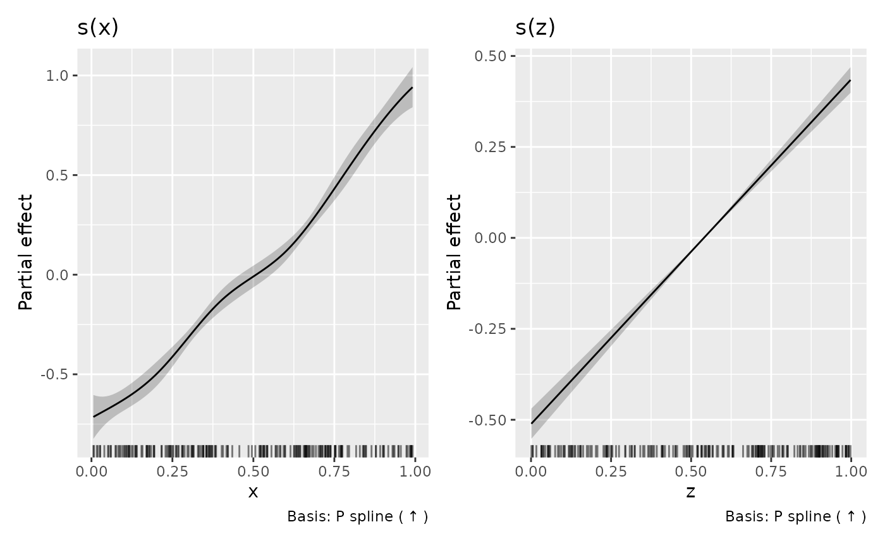
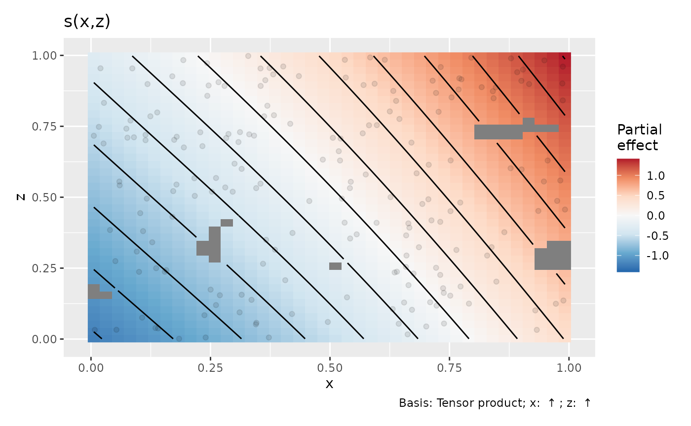
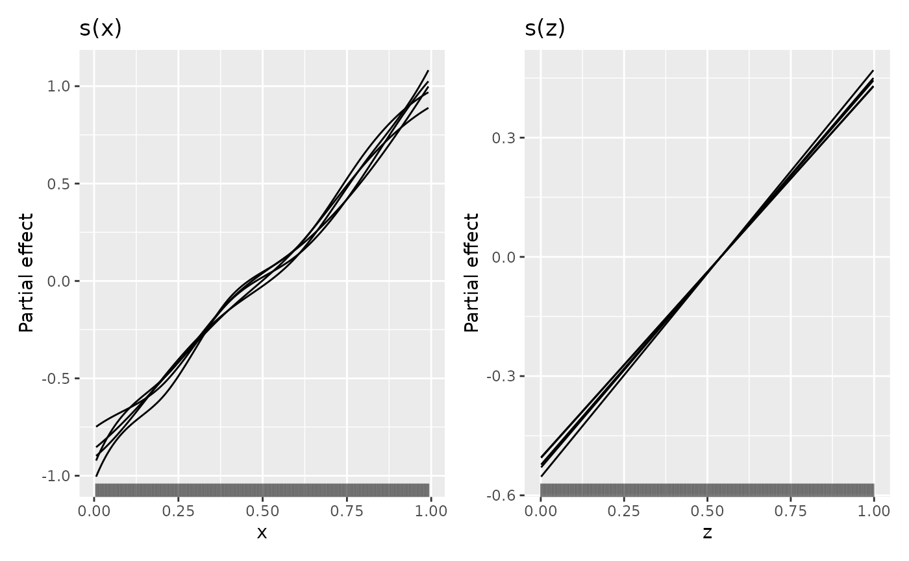
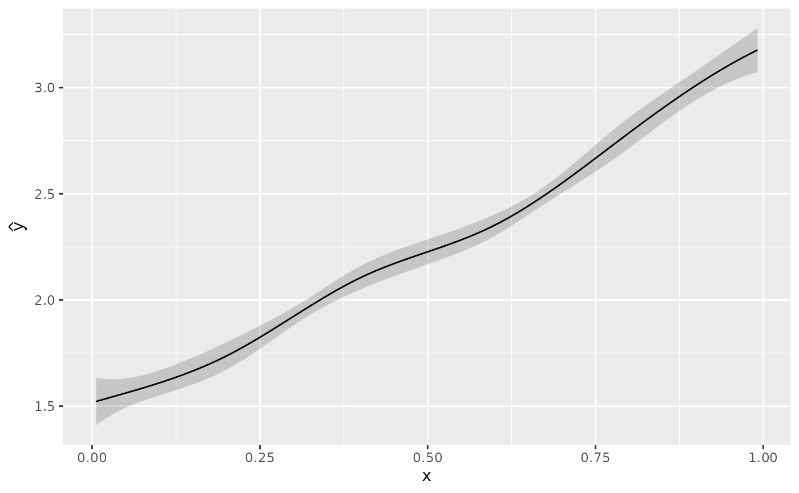
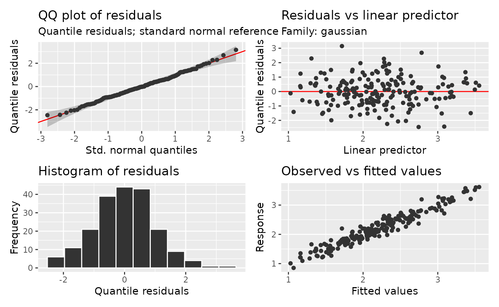

# Working with shape-constrained additive models

This article shows how to plot smooths fitted with {scam}, extract
estimates and intervals, sample fitted functions, and check predictions.
We use increasing effects of two covariates to illustrate these
operations. {gratia} also supports scam’s other one- and two-dimensional
shape-constrained smooths and ordinary {mgcv} smooths fitted through
[`scam()`](https://rdrr.io/pkg/scam/man/scam.html).

We load gratia and scam before simulating the example.

``` r

library("gratia")
load_mgcv()
library("scam")
```

The response below combines an increasing curved effect of `x` and a
linear effect of `z`, with independent Gaussian noise of standard
deviation 0.15. The covariates are independently sampled on the unit
interval.

``` r

set.seed(46)
d <- data.frame(x = runif(200), z = runif(200))
d$y <- exp(d$x) + d$z + rnorm(nrow(d), sd = 0.15)
```

We fit increasing smooths for both covariates and plot their estimated
contributions.

``` r

m <- scam(y ~ s(x, bs = "mpi", k = 8) + s(z, bs = "mpi", k = 8),
  data = d, not.exp = TRUE)
draw(m)
```



## Plot smooth contributions

The captions identify the spline basis and its shape constraints. Arrows
indicate increasing or decreasing effects. For a tensor product smooth,
the caption identifies the constraint on each covariate. The same
captions appear when drawing estimates saved with
[`smooth_estimates()`](https://gavinsimpson.github.io/gratia/reference/smooth_estimates.md).

By default,
[`draw()`](https://gavinsimpson.github.io/gratia/reference/draw.md) uses
the fitted smooth’s centring, so the plotted value at a given location
stays the same if you change the evaluation grid. For bivariate smooths,
scam subtracts the average across the plotted grid. Use
`centre = "plot"` to match that convention in
[`draw()`](https://gavinsimpson.github.io/gratia/reference/draw.md) or
[`assemble()`](https://gavinsimpson.github.io/gratia/reference/assemble.md).
The following example fits a surface that increases with both covariates
and centres it on the plotted grid.

``` r

b <- scam(y ~ s(x, z, bs = "tedmi", k = c(5, 5)), data = d,
  not.exp = TRUE)
draw(b, centre = "plot", n_2d = 40)
```



For univariate smooths, scam uses two standard errors for its default
limits. gratia uses `qnorm(0.975)` for 95% normal limits. The packages
can also calculate different standard errors for the same curve. gratia
uses the derivative of the plotted function with respect to the fitted
coefficients to calculate how their uncertainty affects the curve.

## Estimate intervals, derivatives and sampled functions

For intervals and derivatives, gratia uses the covariance of the
coefficients after scam applies its shape constraints. The intervals use
local normal approximations, with the smoothing parameters held at their
fitted values. `frequentist = TRUE` selects the frequentist covariance.
Use `overall_uncertainty = FALSE` to leave out the intercept’s
uncertainty. First extract pointwise smooth intervals, estimate the
slope of the `x` smooth, and request a simultaneous band for that
smooth. A simultaneous band describes uncertainty over the evaluated
curve, whereas the pointwise limits apply to each location separately.

``` r

e <- smooth_estimates(m, overall_uncertainty = FALSE)
e <- add_confint(e)
head(e)
#> # A tibble: 6 × 9
#>   .smooth .type         .by   .estimate    .se       x     z .lower_ci .upper_ci
#>   <chr>   <chr>         <chr>     <dbl>  <dbl>   <dbl> <dbl>     <dbl>     <dbl>
#> 1 s(x)    P spline (in… NA       -0.714 0.0561 0.00591    NA    -0.824    -0.604
#> 2 s(x)    P spline (in… NA       -0.705 0.0490 0.0159     NA    -0.801    -0.609
#> 3 s(x)    P spline (in… NA       -0.696 0.0431 0.0258     NA    -0.781    -0.612
#> 4 s(x)    P spline (in… NA       -0.687 0.0383 0.0358     NA    -0.762    -0.612
#> 5 s(x)    P spline (in… NA       -0.678 0.0346 0.0457     NA    -0.746    -0.611
#> 6 s(x)    P spline (in… NA       -0.669 0.0318 0.0557     NA    -0.732    -0.607
derivatives(m, select = "s(x)")
#> # A tibble: 100 × 9
#>    .smooth .by   .fs   .derivative   .se .crit .lower_ci .upper_ci       x
#>    <chr>   <chr> <chr>       <dbl> <dbl> <dbl>     <dbl>     <dbl>   <dbl>
#>  1 s(x)    NA    NA          0.901 0.963  1.96   -0.986       2.79 0.00591
#>  2 s(x)    NA    NA          0.895 0.865  1.96   -0.800       2.59 0.0159 
#>  3 s(x)    NA    NA          0.893 0.774  1.96   -0.625       2.41 0.0258 
#>  4 s(x)    NA    NA          0.895 0.692  1.96   -0.462       2.25 0.0358 
#>  5 s(x)    NA    NA          0.902 0.619  1.96   -0.311       2.11 0.0457 
#>  6 s(x)    NA    NA          0.914 0.553  1.96   -0.171       2.00 0.0557 
#>  7 s(x)    NA    NA          0.930 0.496  1.96   -0.0434      1.90 0.0657 
#>  8 s(x)    NA    NA          0.950 0.448  1.96    0.0730      1.83 0.0756 
#>  9 s(x)    NA    NA          0.975 0.406  1.96    0.179       1.77 0.0856 
#> 10 s(x)    NA    NA          1.01  0.372  1.96    0.276       1.73 0.0955 
#> # ℹ 90 more rows
confint(m, parm = "s(x)", type = "simultaneous", seed = 53)
#> # A tibble: 100 × 9
#>    .smooth .type        .by         x .estimate    .se .crit .lower_ci .upper_ci
#>    <chr>   <chr>        <chr>   <dbl>     <dbl>  <dbl> <dbl>     <dbl>     <dbl>
#>  1 s(x)    P spline (i… NA    0.00591    -0.714 0.0561  2.85    -0.874    -0.554
#>  2 s(x)    P spline (i… NA    0.0159     -0.705 0.0490  2.85    -0.845    -0.565
#>  3 s(x)    P spline (i… NA    0.0258     -0.696 0.0431  2.85    -0.819    -0.573
#>  4 s(x)    P spline (i… NA    0.0358     -0.687 0.0383  2.85    -0.796    -0.578
#>  5 s(x)    P spline (i… NA    0.0457     -0.678 0.0346  2.85    -0.777    -0.580
#>  6 s(x)    P spline (i… NA    0.0557     -0.669 0.0318  2.85    -0.760    -0.578
#>  7 s(x)    P spline (i… NA    0.0657     -0.660 0.0300  2.85    -0.745    -0.575
#>  8 s(x)    P spline (i… NA    0.0756     -0.651 0.0288  2.85    -0.733    -0.568
#>  9 s(x)    P spline (i… NA    0.0856     -0.641 0.0283  2.85    -0.722    -0.560
#> 10 s(x)    P spline (i… NA    0.0955     -0.631 0.0281  2.85    -0.712    -0.551
#> # ℹ 90 more rows
```

scam fits unconstrained parameters and transforms some of them to
positive coefficients to enforce the smooth’s shape. Coefficient
sampling draws from a normal approximation for those unconstrained
parameters, then applies the same transformation. This preserves the
shape constraints in every sampled curve. Because the transformation is
nonlinear, the samples and the analytic intervals use different
uncertainty approximations. In particular, the endpoints of an analytic
interval need not satisfy the fitted shape constraint.

Use
[`gaussian_draws()`](https://gavinsimpson.github.io/gratia/reference/gaussian_draws.md)
to obtain a matrix with one coefficient vector per row. Check its
dimensions to confirm the number of draws and coefficients.
[`smooth_samples()`](https://gavinsimpson.github.io/gratia/reference/smooth_samples.md)
evaluates sampled smooth curves directly. We produce five draws of each
smooth and plot them with
[`draw()`](https://gavinsimpson.github.io/gratia/reference/draw.md) to
see how the curves vary while retaining the fitted shape constraints.

``` r

draws <- gaussian_draws(m, n_draws = 100, seed = 54)
dim(draws)
#> [1] 100  15
samples <- smooth_samples(m, n_draws = 5, seed = 55)
head(samples)
#> # A tibble: 6 × 9
#>   .smooth .term .type          .by    .row .draw .value       x     z
#>   <chr>   <chr> <chr>          <chr> <int> <int>  <dbl>   <dbl> <dbl>
#> 1 s(x)    s(x)  P spline (inc) NA        1     1 -1.00  0.00591    NA
#> 2 s(x)    s(x)  P spline (inc) NA        1     2 -0.853 0.00591    NA
#> 3 s(x)    s(x)  P spline (inc) NA        1     3 -0.749 0.00591    NA
#> 4 s(x)    s(x)  P spline (inc) NA        1     4 -0.922 0.00591    NA
#> 5 s(x)    s(x)  P spline (inc) NA        1     5 -0.898 0.00591    NA
#> 6 s(x)    s(x)  P spline (inc) NA        2     1 -0.985 0.0109     NA
draw(samples)
```



The `.smooth` column identifies the smooth, `.draw` identifies the
coefficient draw, and `.value` gives the sampled function’s value at
each covariate value. Fitted, derivative and response sampling functions
use the same coefficient transformation. See
[`smooth_samples()`](https://gavinsimpson.github.io/gratia/reference/smooth_samples.md)
and
[`gaussian_draws()`](https://gavinsimpson.github.io/gratia/reference/gaussian_draws.md)
for the returned columns and options for supplying your own coefficient
draws.

## Predictions and model checks

To predict the mean response as `x` varies, use
[`conditional_values()`](https://gavinsimpson.github.io/gratia/reference/conditional_values.md).
It combines both smooths and the intercept, holding `z` at the observed
value closest to its median. The bands show uncertainty in the mean
response.

``` r

predictions <- conditional_values(m, condition = "x")
predictions
#> # A tibble: 100 × 8
#>     .row       x     z .parameter .fitted    .se .lower_ci .upper_ci
#>    <int>   <dbl> <dbl> <chr>        <dbl>  <dbl>     <dbl>     <dbl>
#>  1     1 0.00591 0.555 mean          1.52 0.0572      1.41      1.63
#>  2     2 0.0159  0.555 mean          1.53 0.0502      1.43      1.63
#>  3     3 0.0258  0.555 mean          1.54 0.0444      1.45      1.63
#>  4     4 0.0358  0.555 mean          1.55 0.0398      1.47      1.63
#>  5     5 0.0457  0.555 mean          1.56 0.0362      1.49      1.63
#>  6     6 0.0557  0.555 mean          1.57 0.0336      1.50      1.63
#>  7     7 0.0657  0.555 mean          1.58 0.0319      1.51      1.64
#>  8     8 0.0756  0.555 mean          1.59 0.0308      1.53      1.65
#>  9     9 0.0856  0.555 mean          1.59 0.0303      1.54      1.65
#> 10    10 0.0955  0.555 mean          1.60 0.0302      1.55      1.66
#> # ℹ 90 more rows
draw(predictions)
```



Use
[`appraise()`](https://gavinsimpson.github.io/gratia/reference/appraise.md)
to check how the model describes the observed responses. Here, quantile
residuals compare each observation with its fitted Gaussian
distribution. Look for departures from the reference line in the QQ plot
and for changes in the spread of residuals across the linear predictor.

``` r

appraise(m, type = "quantile", seed = 56)
```



The [model diagnostics
article](https://gavinsimpson.github.io/gratia/articles/model-checking.md)
explains how to interpret the panels and their reference bands.

## Other GAM operations

Many gratia methods for GAMs also work with scam fits, including smooth
differences, response derivatives and concurvity. For custom
predictions,
[`lp_matrix()`](https://gavinsimpson.github.io/gratia/reference/lp_matrix.md)
and [`model.matrix()`](https://rdrr.io/r/stats/model.matrix.html) return
a model matrix whose columns match `coef(m)`. When predicting with new
data, gratia reuses any constants estimated when evaluating formula
terms, such as means from
[`scale()`](https://rdrr.io/r/base/scale.html), and evaluates offsets
specified in the formula. Predictions at the original observations also
retain offsets supplied through the `offset` argument.

For supported response families with independent observations,
leave-one-out cross-validation (LOO) and WAIC use the coefficient
sampling approximation described above. Smoothing parameters and other
fitted family parameters stay fixed.
[`variance_comp()`](https://gavinsimpson.github.io/gratia/reference/variance_comp.md)
reports the fitted response scale divided by each smoothing parameter.
These ratios describe the penalties on the coefficients before
transformation.

For Gaussian identity-link fits with AR1 dependence, response simulation
uses the fitted correlation and `AR.start` series boundaries, including
observation weights. Supply the original observations so that the
simulator can use their order and series boundaries. For other families,
scam’s working AR1 correction alone does not define a joint response
distribution. The likelihood methods for independent observations
require a fit without AR1 dependence.

For GCV and UBRE fits, the covariance needed to include smoothing
parameter uncertainty is unavailable. If you request
`model_edf(type = "unconditional")` for these fits, gratia warns and
returns the usual effective degrees of freedom. Confidence limits for
the penalty-based variance components and MH and INLA coefficient
sampling are unavailable for scam fits. To impose a supported shape
restriction on an interval for a scam smooth, supply estimates and a
grid directly to
[`shape_intervals()`](https://gavinsimpson.github.io/gratia/reference/shape_intervals.md).
