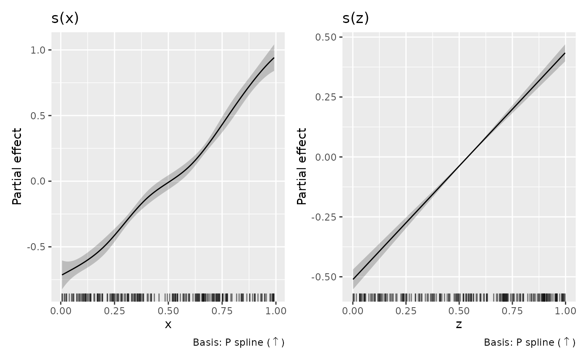
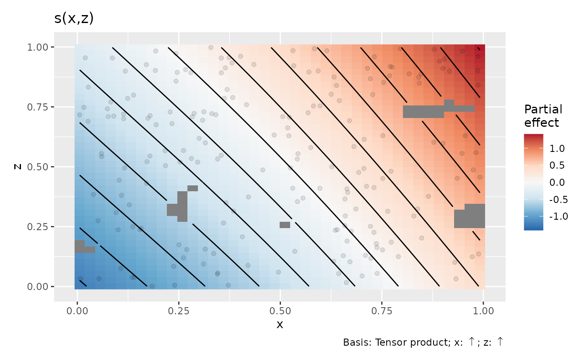

# Working with shape-constrained additive models

gratia supports the 24 univariate and 17 bivariate smooth constructors
in scam 1.2-22, including cyclic margins, endpoint constraints, local
constraints, `by` smooths and smooth interactions. Ordinary mgcv smooths
fitted through [`scam()`](https://rdrr.io/pkg/scam/man/scam.html) are
also supported. The same fitted coefficient mapping is used for smooth
estimates, bases, derivatives, predictions and sampled smooths.

``` r

library("mgcv")
library("scam")
library("gratia")

set.seed(46)
d <- data.frame(x = runif(200), z = runif(200))
d$y <- exp(d$x) + d$z + rnorm(nrow(d), sd = 0.15)
m <- scam(y ~ s(x, bs = "mpi", k = 8) + s(z, bs = "mpi", k = 8),
  data = d, not.exp = TRUE)
draw(m)
```



## Fitted functions and native plots

Plot captions describe basis and shape separately. Increasing and
decreasing constraints use arrows; tensor captions name the covariate
for each constraint. Local constraints show their fitted change point.
These captions are also available when drawing saved
[`smooth_estimates()`](https://gavinsimpson.github.io/gratia/reference/smooth_estimates.md).
The `.type` column and
[`smooth_type()`](https://gavinsimpson.github.io/gratia/reference/smooth_type.md)
retain compact ASCII labels such as `P spline (inc)` and
`Tensor (inc, free)`.

By default,
[`draw()`](https://gavinsimpson.github.io/gratia/reference/draw.md)
retains the fitted function’s centring. Evaluating a smooth on a
different grid therefore evaluates the same function. This agrees with
scam’s univariate plots. Its bivariate plots instead subtract the mean
of the evaluated surface. Use `centre = "plot"` to match that
convention; both estimates and their covariance receive the same
centring operation.
[`assemble()`](https://gavinsimpson.github.io/gratia/reference/assemble.md)
accepts the same argument. Match grids and exclusion distances when
comparing plots from the two packages.

``` r

b <- scam(y ~ s(x, z, bs = "tedmi", k = c(5, 5)), data = d,
  not.exp = TRUE)
draw(b, centre = "plot", n_2d = 40)
```



scam’s default univariate limits use two standard errors; gratia’s
default 95% normal limits use `qnorm(0.975)`. Some scam smooth classes
also use a different coefficient gradient for the displayed function and
its standard error. gratia computes uncertainty for the actual function
it returns, using its coefficient gradient. This can produce different
limits even when the fitted curves agree.

## Conditional uncertainty and sampled functions

Pointwise intervals, simultaneous smooth bands, smooth derivatives and
contrasts use scam’s covariance for the transformed coefficients
(`Vp.t`, or `Ve.t` with `frequentist = TRUE`). These are local Gaussian
or delta approximations, conditional on the fitted smoothing parameters.
Including intercept uncertainty is controlled by `overall_uncertainty`.

``` r

e <- smooth_estimates(m, overall_uncertainty = FALSE)
e <- add_confint(e)
head(e)
#> # A tibble: 6 × 9
#>   .smooth .type         .by   .estimate    .se       x     z .lower_ci .upper_ci
#>   <chr>   <chr>         <chr>     <dbl>  <dbl>   <dbl> <dbl>     <dbl>     <dbl>
#> 1 s(x)    P spline (in… NA       -0.714 0.0561 0.00591    NA    -0.824    -0.604
#> 2 s(x)    P spline (in… NA       -0.705 0.0490 0.0159     NA    -0.801    -0.609
#> 3 s(x)    P spline (in… NA       -0.696 0.0431 0.0258     NA    -0.781    -0.612
#> 4 s(x)    P spline (in… NA       -0.687 0.0383 0.0358     NA    -0.762    -0.612
#> 5 s(x)    P spline (in… NA       -0.678 0.0346 0.0457     NA    -0.746    -0.611
#> 6 s(x)    P spline (in… NA       -0.669 0.0318 0.0557     NA    -0.732    -0.607
derivatives(m, select = "s(x)")
#> # A tibble: 100 × 9
#>    .smooth .by   .fs   .derivative   .se .crit .lower_ci .upper_ci       x
#>    <chr>   <chr> <chr>       <dbl> <dbl> <dbl>     <dbl>     <dbl>   <dbl>
#>  1 s(x)    NA    NA          0.901 0.963  1.96   -0.986       2.79 0.00591
#>  2 s(x)    NA    NA          0.895 0.865  1.96   -0.800       2.59 0.0159 
#>  3 s(x)    NA    NA          0.893 0.774  1.96   -0.625       2.41 0.0258 
#>  4 s(x)    NA    NA          0.895 0.692  1.96   -0.462       2.25 0.0358 
#>  5 s(x)    NA    NA          0.902 0.619  1.96   -0.311       2.11 0.0457 
#>  6 s(x)    NA    NA          0.914 0.553  1.96   -0.171       2.00 0.0557 
#>  7 s(x)    NA    NA          0.930 0.496  1.96   -0.0434      1.90 0.0657 
#>  8 s(x)    NA    NA          0.950 0.448  1.96    0.0730      1.83 0.0756 
#>  9 s(x)    NA    NA          0.975 0.406  1.96    0.179       1.77 0.0856 
#> 10 s(x)    NA    NA          1.01  0.372  1.96    0.276       1.73 0.0955 
#> # ℹ 90 more rows
confint(m, parm = "s(x)", type = "simultaneous", seed = 53)
#> # A tibble: 100 × 9
#>    .smooth .type        .by         x .estimate    .se .crit .lower_ci .upper_ci
#>    <chr>   <chr>        <chr>   <dbl>     <dbl>  <dbl> <dbl>     <dbl>     <dbl>
#>  1 s(x)    P spline (i… NA    0.00591    -0.714 0.0561  2.85    -0.874    -0.554
#>  2 s(x)    P spline (i… NA    0.0159     -0.705 0.0490  2.85    -0.845    -0.565
#>  3 s(x)    P spline (i… NA    0.0258     -0.696 0.0431  2.85    -0.819    -0.573
#>  4 s(x)    P spline (i… NA    0.0358     -0.687 0.0383  2.85    -0.796    -0.578
#>  5 s(x)    P spline (i… NA    0.0457     -0.678 0.0346  2.85    -0.777    -0.580
#>  6 s(x)    P spline (i… NA    0.0557     -0.669 0.0318  2.85    -0.760    -0.578
#>  7 s(x)    P spline (i… NA    0.0657     -0.660 0.0300  2.85    -0.745    -0.575
#>  8 s(x)    P spline (i… NA    0.0756     -0.651 0.0288  2.85    -0.733    -0.568
#>  9 s(x)    P spline (i… NA    0.0856     -0.641 0.0283  2.85    -0.722    -0.560
#> 10 s(x)    P spline (i… NA    0.0955     -0.631 0.0281  2.85    -0.712    -0.551
#> # ℹ 90 more rows
```

Coefficient sampling uses a different approximation: draw a Gaussian
vector in the unrestricted fitting coordinates using `Vp` (or `Ve`),
then apply the positivity transformation used in the fit. This preserves
the fitted shape constraints. This is a Gaussian approximation in
fitting coordinates, rather than an exact constrained posterior. Because
the transformation is nonlinear, these samples need not have the mean or
covariance used for analytic intervals. Individual analytic interval
endpoints need not satisfy the shape constraint.

Fitted, smooth, derivative and response sampling functions project these
same transformed coefficient draws.
[`response_derivatives()`](https://gavinsimpson.github.io/gratia/reference/response_derivatives.md)
also uses them with its default `uncertainty = "simulation"`;
`uncertainty = "delta"` instead uses the local transformed-coefficient
covariance.

``` r

draws <- gaussian_draws(m, n_draws = 100, seed = 54)
samples <- smooth_samples(m, n_draws = 5, seed = 55)
head(samples)
#> # A tibble: 6 × 9
#>   .smooth .term .type          .by    .row .draw .value       x     z
#>   <chr>   <chr> <chr>          <chr> <int> <int>  <dbl>   <dbl> <dbl>
#> 1 s(x)    s(x)  P spline (inc) NA        1     1 -1.00  0.00591    NA
#> 2 s(x)    s(x)  P spline (inc) NA        1     2 -0.853 0.00591    NA
#> 3 s(x)    s(x)  P spline (inc) NA        1     3 -0.749 0.00591    NA
#> 4 s(x)    s(x)  P spline (inc) NA        1     4 -0.922 0.00591    NA
#> 5 s(x)    s(x)  P spline (inc) NA        1     5 -0.898 0.00591    NA
#> 6 s(x)    s(x)  P spline (inc) NA        2     1 -0.985 0.0109     NA
```

`method = "user"` requires finite draws in the transformed coordinates,
with columns in `coef(m)` order and nonnegative constrained
coefficients. `gaussian_draws(m, parametrized = FALSE)` returns
unrestricted draws for inspection; these cannot be supplied as
transformed draws. A singular positive semidefinite covariance is
supported. A materially indefinite covariance is rejected. When a very
large unrestricted variance causes the exponential transformation to
overflow, sampling reports an error; it does not truncate those draws.
Finite transformed draws from an appropriate alternative sampler can
still be supplied.

## Other GAM operations

Supported methods include model summaries and term extraction,
parametric effects, fitted and conditional predictions, smooth
differences, analytic response derivatives, accumulated local effects,
residual helpers, concurvity, penalties and response diagnostics.
[`lp_matrix()`](https://gavinsimpson.github.io/gratia/reference/lp_matrix.md)
and [`model.matrix()`](https://rdrr.io/r/stats/model.matrix.html) return
a design whose columns match `coef(m)`. Formula expressions retain their
fitted prediction parameters, formula offsets are evaluated on new data,
and training predictions also retain an `offset` argument used in
fitting. Missing-row handling is shared across these methods.

Likelihood evaluation and LOO/WAIC use the supported
independent-response family adapters, conditional on smoothing and other
fitted family parameters. They use the same coefficient sampling
approximation described above.
[`variance_comp()`](https://gavinsimpson.github.io/gratia/reference/variance_comp.md)
reports response scale divided by smoothing parameters; these ratios
describe penalties on unrestricted fitting parameters. They are not
Gaussian variances of the transformed smooth coefficients, and their
confidence limits are unavailable.

For Gaussian identity-link fits with AR1 dependence, response simulation
uses the fitted correlation and `AR.start` series boundaries, including
observation weights. It requires the fitting observations: a joint
correlation structure for arbitrary new data is not defined. Other
families with scam’s working AR1 correction do not automatically have a
joint response simulator. Independent pointwise likelihood adapters
reject correlated fits.

GCV and UBRE fits do not supply the smoothing-parameter covariance
needed for `unconditional = TRUE`, unconditional EDF, or
likelihood-based confidence limits for variance components. MH and INLA
coefficient sampling are also unavailable.
`model_edf(type = "unconditional")` follows the shared GAM convention:
it warns and returns standard EDF when the correction is missing.
Automatic `interval_method = "shape"` integration remains specific to
supported scasm smooths;
[`shape_intervals()`](https://gavinsimpson.github.io/gratia/reference/shape_intervals.md)
can be used explicitly on supplied estimates and grids when its named
shape restrictions apply.
