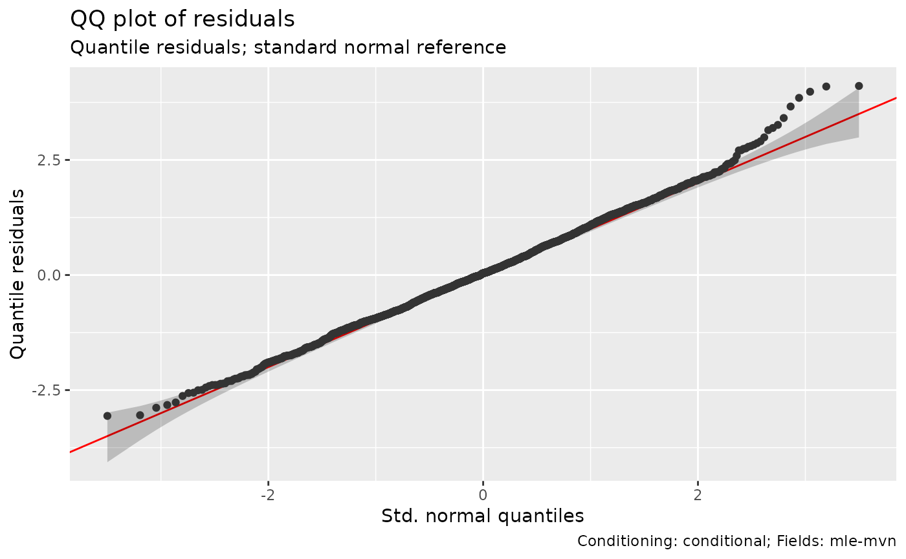
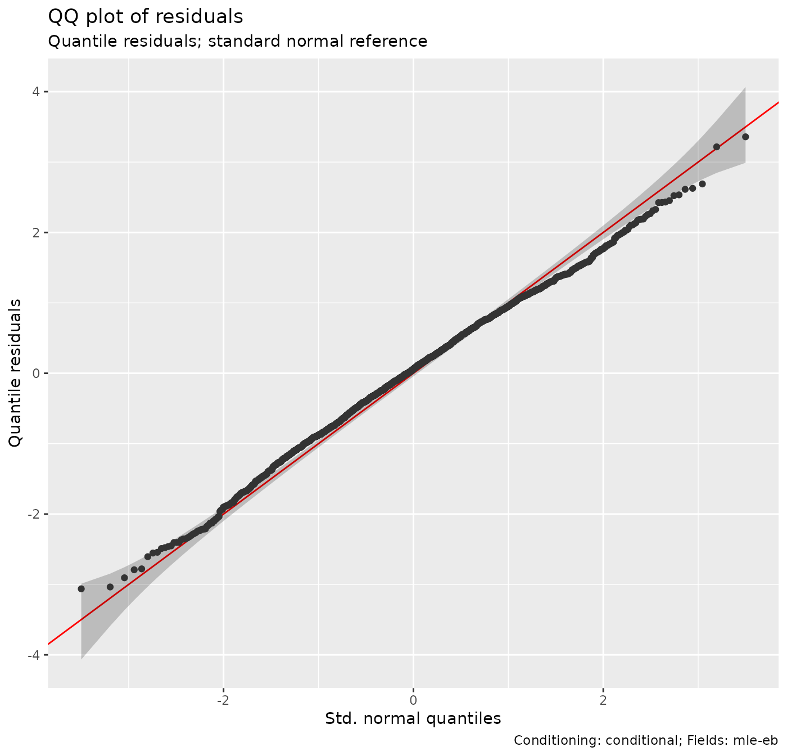
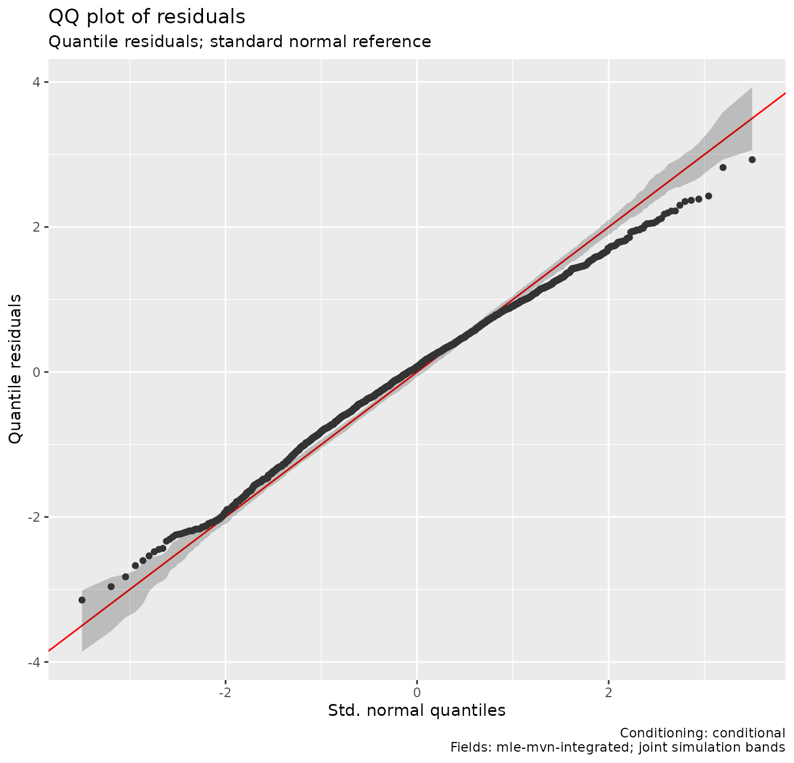
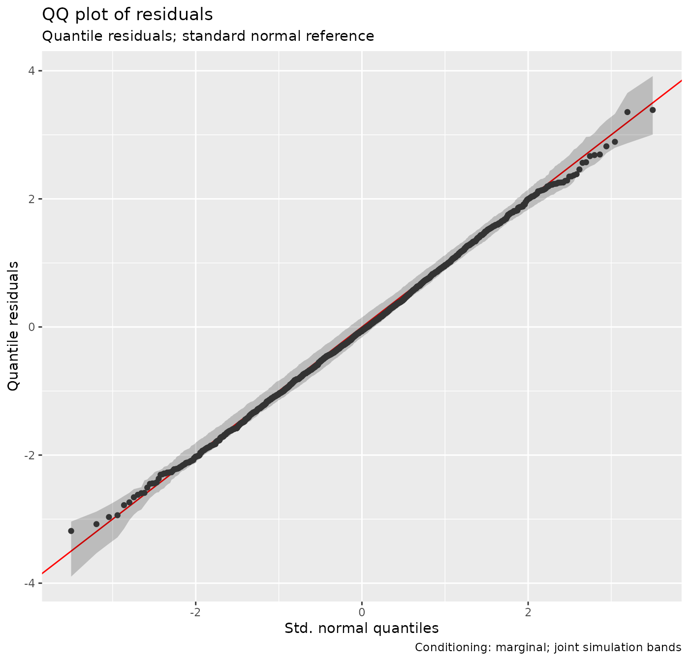
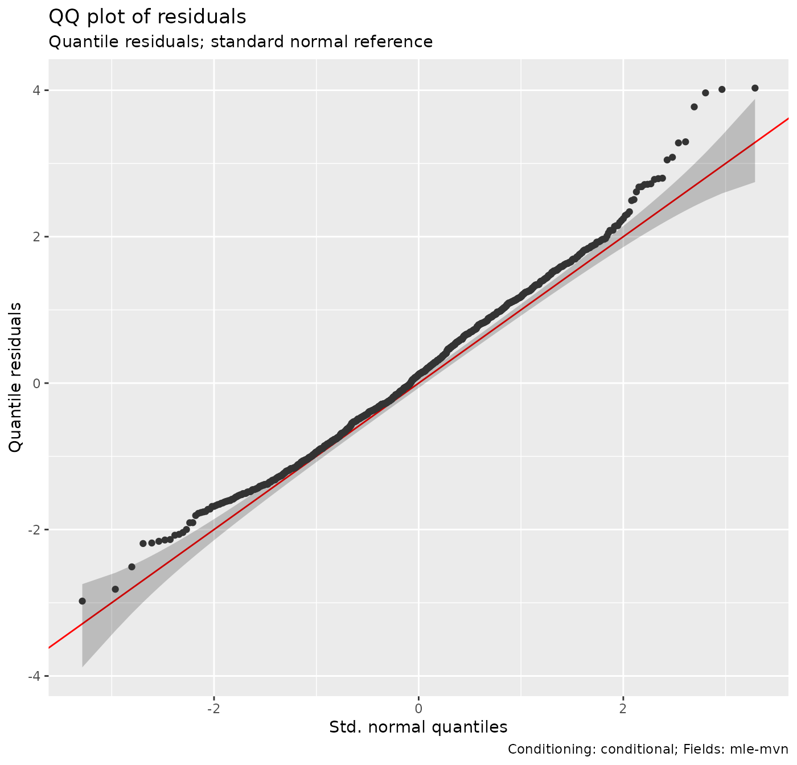
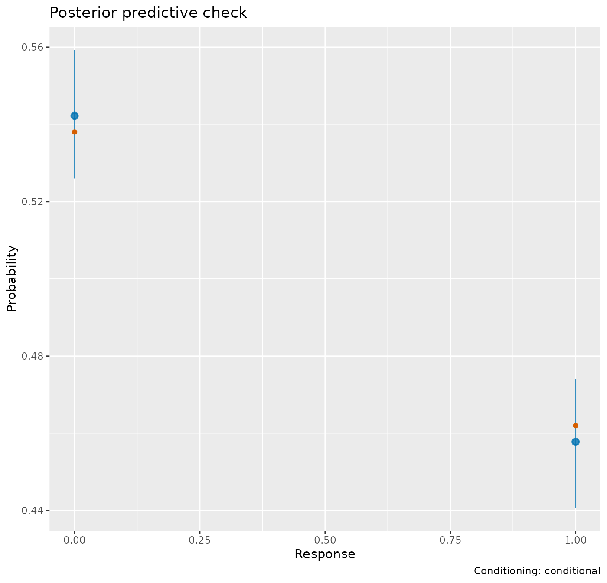

# Working with sdmTMB models in gratia

Use {gratia} to extract and plot effects and check response
distributions from models fitted with {sdmTMB}. Effect plots show
individual terms, such as a smooth or a contrast between survey years.
For predictions and model checks, we show how to account for spatial and
temporal random effects.

We use a Pacific cod survey to demonstrate smooths, survey-year effects,
prediction maps and residual checks. Smaller simulated examples then
show breakpoint curves, logistic curves and coefficients that vary over
time. The [diagnostics
article](https://gavinsimpson.github.io/gratia/articles/model-checking.md)
explains the shared ideas behind residuals, dependence and posterior
predictive checks.

## Fit a delta-Gamma model to survey catches

We adapt the Pacific cod survey examples in sdmTMB’s
[introduction](https://sdmtmb.github.io/sdmTMB/articles/basic-intro.html)
and [delta-model
article](https://sdmtmb.github.io/sdmTMB/articles/delta-models.html).
The data are trawl tows in Queen Charlotte Sound, British Columbia.
Biomass density is measured in kg/km²; `X` and `Y` are UTM coordinates
in kilometres. We retain all survey years and use a persistent spatial
field and separate year-specific fields. We add a factor for survey
year, set the depth smooth’s basis dimension to six, and use the
introduction’s 10 km mesh cutoff.

You need the optional package **sdmTMB \>= 1.2.0** and models fitted
with its {RTMB} backend, which is the default. Refit older models or
{TMB} fits with `control = sdmTMBcontrol(backend = "rtmb")`. {mgcv}
supplies the smooth syntax. The example also uses {dplyr}, {tidyr},
{ggplot2} and {patchwork}. Fitting and simulation cost more than
plotting an ordinary GAM, so we use modest simulation counts. Load the
packages and survey data, then summarise the number of tows, fraction of
zero catches and mean density in each year.

``` r

library("sdmTMB")
library("gratia")
load_mgcv()
library("dplyr")
library("ggplot2")
library("patchwork")

set.seed(1401)
cod <- pcod
cod$year_f <- factor(cod$year)
cod |>
  group_by(year) |>
  summarise(tows = n(), proportion_zero = mean(density == 0),
    mean_density = mean(density), .groups = "drop")
#> # A tibble: 9 × 4
#>    year  tows proportion_zero mean_density
#>   <int> <int>           <dbl>        <dbl>
#> 1  2003   232           0.565         29.2
#> 2  2004   230           0.487         64.8
#> 3  2005   224           0.442         68.2
#> 4  2007   255           0.588         17.4
#> 5  2009   233           0.592         22.2
#> 6  2011   251           0.610         44.1
#> 7  2013   240           0.442         40.2
#> 8  2015   238           0.479         53.5
#> 9  2017   240           0.625         25.2
```

The zero proportions and means vary between years. A mean calculated
from the observed tows is also influenced by where those tows occurred;
it is not an area-standardised biomass index. Map the observations by
year to see where the survey sampled and how catches vary across its
area.

``` r

ggplot(cod, aes(X, Y, colour = density)) +
  geom_point(size = 0.8) +
  facet_wrap(~year, ncol = 4) +
  coord_equal() +
  scale_colour_viridis_c(transform = "log1p", breaks = c(0, 10, 100, 1000, 5000)) +
  labs(x = "Easting (km)", y = "Northing (km)",
    colour = "Density (kg/km²)")
```


The colour scale uses [`log1p()`](https://rdrr.io/r/base/Log.html), the
logarithm of one plus density, to distinguish the many smaller catches
while retaining zeros and the largest catches. There are many exact
zeros and a long positive tail. A **delta-Gamma model** separates the
chance of catching cod from the density when cod are caught. Its first
component models whether density is positive using a binomial
distribution with a logit link. Its second models positive density using
a Gamma distribution with a log link. The expected density over all tows
is

E(Y_i) = \Pr(Y_i \> 0)\\E(Y_i\mid Y_i\>0).

Depth need not have the same effect on both components. Each has its own
smooth coefficients and spatial fields. A persistent field represents
geographical variation shared across survey years; an independent field
for each survey year represents additional geographical variation in
that year. These fields allow nearby tows to share unexplained
variation. We choose independent year fields because this survey did not
run every year. An AR1 model would require an explicit decision about
missing time steps and assumptions about correlation between years.
Build a mesh for the spatial fields, then fit a depth smooth and
separate survey-year means in each response component. The mesh cutoff
is in kilometres, matching `X` and `Y`.

``` r

cod_mesh <- make_mesh(cod, c("X", "Y"), cutoff = 10)
cod_fit <- sdmTMB(
  density ~ year_f + s(depth, k = 6),
  data = cod, mesh = cod_mesh, time = "year",
  spatial = "on", spatiotemporal = "iid", family = delta_gamma()
)
sanity(cod_fit)
```

The year factor gives each survey year a different intercept in each
response component. The two components use the same smooth basis and
estimate their own coefficients, so the depth curves can differ. If you
specify two formulas for a delta model, sdmTMB requires the smooth terms
to match.

[`sanity()`](https://sdmTMB.github.io/sdmTMB/reference/sanity.html)
checks estimation and convergence. The fitted positive-density field has
a range of about 12 km, close to the 10 km mesh cutoff. That suggests
checking whether predictions change when the mesh is finer.

## Extract and plot depth effects

Start with
[`smooths()`](https://gavinsimpson.github.io/gratia/reference/smooths.md)
to find the labels used to select the depth smooth in each response
component.

``` r

smooths(cod_fit)
#> [1] "s(depth)"   "s.1(depth)"
```

`s(depth)` belongs to the encounter component and `s.1(depth)` to the
positive component. The `.1` suffix identifies the second predictor.
Pass both labels to
[`draw()`](https://gavinsimpson.github.io/gratia/reference/draw.md) and
use `wrap = FALSE` to obtain separate plots whose axis labels can be
customised before combining them.

``` r

depth_panels <- draw(cod_fit, select = smooths(cod_fit), n = 100,
  wrap = FALSE)
(depth_panels[[1]] + labs(x = "Depth (m)", y = "Contribution to log odds")) |
  (depth_panels[[2]] + labs(x = "Depth (m)", y = "Contribution to log density"))
```


The first curve contributes to the **log odds of encounter** and the
second to the **log of mean positive density**. Both curves peak near
140–150 m. The encounter curve falls especially sharply in deeper water.
The rug marks along the axes show how few tows support the curves at the
greatest depths.

These plots show the depth term alone on each component’s link scale. A
full prediction also includes the intercept, survey-year effect and
fields. The pointwise bands include the uncertainty in the intercept by
default. Use `overall_uncertainty = FALSE` for uncertainty in the depth
term alone.

Use
[`smooth_estimates()`](https://gavinsimpson.github.io/gratia/reference/smooth_estimates.md)
to save the estimated effects and their standard errors. Here we locate
the largest contribution on each smooth’s evaluation grid to summarise
the depth at its peak.

``` r

depth_effects <- smooth_estimates(cod_fit, n = 100, interval = "confidence")
depth_effects |>
  group_by(.smooth, .model) |>
  slice_max(.estimate, n = 1)
#> # A tibble: 2 × 10
#> # Groups:   .smooth, .model [2]
#>   .smooth    .type .by   .estimate   .se depth .crit .lower_ci .upper_ci .model 
#>   <chr>      <chr> <chr>     <dbl> <dbl> <dbl> <dbl>     <dbl>     <dbl> <chr>  
#> 1 s(depth)   TPRS  NA        2.41  0.435  140.  1.96     1.55      3.26  Delta …
#> 2 s.1(depth) TPRS  NA        0.529 0.102  146.  1.96     0.330     0.729 Delta …
```

The reported peak depths locate the maxima on the 100-point evaluation
grid. The broad intervals in deeper water reflect sparse observations
there, so the intermediate-depth peak is better supported than the shape
of the deep-water tail.

[`smooth_coefs()`](https://gavinsimpson.github.io/gratia/reference/smooth_coefs.md)
returns coefficients in the constrained mgcv basis. They can be useful
for reproducing a curve from its basis matrix, but individual
coefficients do not have the interpretation of a linear depth slope:

``` r

smooth_coefs(cod_fit, select = "s(depth)")
#> s(depth).1 s(depth).2 s(depth).3 s(depth).4 s(depth).5 
#> -4.4187762  2.5591291  1.0347497 -0.2311792  2.8689836
```

## Compare survey-year effects

Use
[`parametric_terms()`](https://gavinsimpson.github.io/gratia/reference/parametric_terms.md)
to find the year-effect labels and
[`parametric_effects()`](https://gavinsimpson.github.io/gratia/reference/parametric_effects.md)
to extract them. Select `year_f` and `year_f.1` to compare changes in
encounter and positive density separately. Setting
`overall_uncertainty = FALSE` requests uncertainty in the year contrasts
alone.

``` r

parametric_terms(cod_fit)
#>   year_f year_f.1 
#> "year_f" "year_f"
year_effects <- parametric_effects(cod_fit,
  terms = c("year_f", "year_f.1"), overall_uncertainty = FALSE)
year_plot <- draw(year_effects)
year_plot[[1]] <- year_plot[[1]] +
  labs(x = "Survey year", y = "Change in log odds", subtitle = "Encounter")
year_plot[[2]] <- year_plot[[2]] +
  labs(x = "Survey year", y = "Change in log positive density",
    subtitle = "Positive density")
year_plot
```


Under the fitted treatment contrasts, 2003 is the reference year and has
a zero contribution. The other estimates are changes from that reference
on their respective link scales, after accounting for depth and fields.
For the positive-density component, exponentiating the contribution
gives a ratio of conditional mean positive density relative to 2003. For
the encounter component it gives an odds ratio, not a probability ratio.
A difference in the positive component alone is not a change in total
expected density: occurrence also matters. For example, the 2011
estimate is lower than 2003 for encounter but higher for positive
density. Looking at either component alone would miss this distinction.

Here we requested term-only uncertainty. The reference year consequently
has no uncertainty interval for its *contrast with itself*. Request the
default `overall_uncertainty = TRUE` to include intercept uncertainty in
the plotted parametric contributions. Use full predictions to estimate
actual densities.

## Plot a smooth interaction between depth and survey year

The delta model above gives each component a common depth curve and
separate year means. A different question is whether the *shape* of the
depth association changed through time. We now adapt the binomial
encounter model in sdmTMB’s
[introduction](https://sdmtmb.github.io/sdmTMB/articles/basic-intro.html):
replace its quadratic depth effect with a joint smooth of depth and
survey year, while retaining the spatial and independent year-specific
fields and every survey tow. This extension focuses on encounter; the
delta model remains the analysis for combined encounter and positive
catch density.

A [tensor product
smooth](https://stat.ethz.ch/R-manual/R-devel/library/mgcv/html/t2.html)
uses a separate basis for each covariate and combines them to fit a
surface. This lets us control smoothness along depth (in metres) and
time (in years) separately. Fit the encounter model with
[`t2()`](https://rdrr.io/pkg/mgcv/man/t2.html) to allow the depth curve
to change smoothly across survey years.

``` r

cod$year_centered <- cod$year - 2011
cod_encounter <- sdmTMB(
  present ~ t2(depth, year_centered, k = c(5, 4)),
  data = cod, mesh = cod_mesh, time = "year", family = binomial(),
  spatial = "on", spatiotemporal = "iid"
)
sanity(cod_encounter)
```

The joint smooth allows a gradual relationship across actual elapsed
years. The year-specific fields still represent geographical departures
in each survey, with no correlation assumed between those fields. A
smooth temporal relationship in the mean and correlation between random
fields are different assumptions. Here the smooth includes both depth
and year main effects, so we do not add the previous `year_f` factor.
Centring year at 2011 only changes its coordinate origin.

The optimiser converges, but
[`sanity()`](https://sdmTMB.github.io/sdmTMB/reference/sanity.html)
flags large standard errors for smoothing parameters. Inspect the
standard deviations that determine how strongly different parts of the
surface are penalised.

``` r

sdmTMB::tidy(cod_encounter, effects = "ran_pars") |>
  filter(grepl("sd__", term))
#> # A tibble: 3 × 5
#>   term                            estimate std.error conf.low conf.high
#>   <chr>                              <dbl>     <dbl>    <dbl>     <dbl>
#> 1 sd__t2(depth,year_centered)_1  0.0000311        NA      0       Inf  
#> 2 sd__t2(depth,year_centered)_2  0.00166          NA      0       Inf  
#> 3 sd__t2(depth,year_centered)_3 50.1              NA     27.2      92.2
```

Two standard deviations are close to zero, indicating strong smoothing
for those parts of the surface. The wide intervals show that the data
give little information about those smoothing parameters. Plot the
estimated surface with
[`draw()`](https://gavinsimpson.github.io/gratia/reference/draw.md) and
label the vertical axis with the actual survey years.

``` r

tensor_panel <- draw(cod_encounter, n_2d = 30, dist = 0.1,
  wrap = FALSE)[[1]]
tensor_panel +
  scale_y_continuous(breaks = c(-8, -4, 0, 4, 6),
    labels = c(2003, 2007, 2011, 2015, 2017)) +
  labs(x = "Depth (m)", y = "Survey year") +
  guides(fill = guide_colourbar(title = "Log-odds\ncontribution"))
```


The mostly vertical contours indicate that depth dominates the displayed
association; the preferred intermediate-depth region changes little
through time. The surface is a contribution to log odds, without the
intercept or fields. Its colours show fitted contributions; standard
errors are available from
[`smooth_estimates()`](https://gavinsimpson.github.io/gratia/reference/smooth_estimates.md).
`dist = 0.1` masks combinations far from the observed depth-year pairs
after rescaling each variable to range from zero to one. The sparse
deep-water observations limit what we can say about changes at those
depths.

For custom calculations,
[`get_smooths_by_id()`](https://gavinsimpson.github.io/gratia/reference/get_smooths_by_id.md)
retrieves the fitted mgcv smooth object. Its penalty list records the
independently smoothed parts of the surface;
[`smooth_coefs()`](https://gavinsimpson.github.io/gratia/reference/smooth_coefs.md)
retrieves the corresponding coefficient vector:

``` r

encounter_smooth <- get_smooths_by_id(cod_encounter, id = 1)[[1]]
length(encounter_smooth$S)
#> [1] 3
length(smooth_coefs(cod_encounter, select = smooths(cod_encounter)[1]))
#> [1] 19
```

The three penalties control different parts of one fitted surface,
represented here by nineteen coefficients. Use
`smooth_estimates(cod_encounter, data = ...)` to evaluate that surface
and its standard errors at specific depth-year combinations before
carrying the results into another calculation.

## Map expected density with full predictions

Full predictions require both components and the fields. Use sdmTMB’s
public [prediction
method](https://sdmtmb.github.io/sdmTMB/reference/predict.sdmTMB.html)
for this calculation. For a standard delta-Gamma model we can
independently verify the response mean from the two link-scale
predictors:

``` r

link_prediction <- predict(cod_fit)
response_prediction <- predict(cod_fit, type = "response")
combined_mean <- plogis(link_prediction$est1) * exp(link_prediction$est2)
max(abs(combined_mean - response_prediction$est))
#> [1] 0
```

For other delta links, use the fitting package’s response
transformation; this product of inverse links does not apply unchanged
to a coupled Poisson-link delta model.

For mapping, use the supplied survey-area grid. Restricting the display
to 2011 and 2017 keeps the figure readable; the fit still uses every
survey year.

``` r

map_data <- replicate_df(qcs_grid, "year", c(2011L, 2017L))
map_data$year_f <- factor(map_data$year, levels = levels(cod$year_f))
cod_map <- predict(cod_fit, newdata = map_data, type = "response")
ggplot(cod_map, aes(X, Y, fill = est)) +
  geom_raster() +
  facet_wrap(~year) +
  coord_equal() +
  scale_fill_viridis_c(transform = "sqrt") +
  labs(x = "Easting (km)", y = "Northing (km)",
    fill = "Mean density\n(kg/km²)")
```


The map combines encounter probability, positive density and
geographical variation. A location can have low expected density through
either a low encounter probability or a low positive mean. The maps show
fitted mean surfaces. sdmTMB’s `predict(..., nsim = ...)` supplies joint
prediction draws for estimating uncertainty at each location or in
derived quantities. Setting `re_form = NA` predicts with the spatial and
spatiotemporal fields set to zero. With nonlinear links this can give
different expected densities from averaging predictions over new field
draws.

## Choose how residual checks use spatial and temporal effects

Residual checks use the response distribution implied by the full model
and need to specify how to handle the random fields. The sdmTMB
[residual-checking
article](https://sdmtmb.github.io/sdmTMB/articles/residual-checking.html)
demonstrates why the choice of fields matters. gratia’s default follows
its approach of drawing the fitted effects once from their approximate
joint posterior, with fixed coefficients and covariance parameters held
at their estimates. Set `gratia.diagnostics.field_seed` to reproduce the
same draw across diagnostic plots.

``` r

cod_field_options <- options(gratia.diagnostics.field_seed = 1402L)
qq_plot(cod_fit, type = "quantile", seed = 1404)
```



Quantile residuals locate each observation within its fitted response
distribution. For zero catches, the calculation draws a value uniformly
between zero and the fitted probability of a zero, then converts it to a
normal score. The model treats responses as independent for the selected
fields, so the QQ plot uses a standard normal reference and pointwise
bands conditional on that draw. To check how much catches vary across
possible fields, use the marginal check below, which draws new fields.

The upper tail rises above the reference, suggesting that some positive
catches are larger than expected under the fitted model. The
positive-component check below helps locate this departure. Change
`gratia.diagnostics.field_seed` to see whether it persists across draws.
The `seed` argument controls randomisation at the zeros.

Examine geographical patterns as well as the pooled residual
distribution:

``` r

cod_residuals <- cod
cod_residuals$residual <- quantile_residuals(cod_fit,
  type = "quantile", seed = 1404)
ggplot(cod_residuals, aes(X, Y, colour = residual)) +
  geom_point(size = 0.8) +
  facet_wrap(~year, ncol = 4) +
  coord_equal() +
  scale_colour_gradient2(low = "blue", mid = "white", high = "red") +
  labs(x = "Easting (km)", y = "Northing (km)",
    colour = "Quantile\nresidual")
```


Clusters of residuals with the same sign deserve attention even if a QQ
plot looks acceptable. Consider omitted spatial covariates, inadequate
field resolution, or a response distribution that cannot represent the
local variation. Use geographical distances to investigate these
patterns: observation-order lags do not describe how far apart the
survey tows are.

Three further choices answer different questions:

| Choice | What varies between reference data sets? | Useful interpretation |
|:---|:---|:---|
| `field_method = "mle-eb"` | Response errors with fitted effects fixed at their estimates | Inspect errors at the estimated fields |
| `field_method = "mle-mvn-integrated"` | Response errors and draws of the fitted effects | Check variation allowing for uncertainty in the fitted effects |
| `conditioning = "marginal"` | Response errors and new spatial and year fields from the fitted field distribution | Check the variation implied by new field realisations |

The default `field_method = "mle-mvn"` draws fitted effects once and
then fixes them. Empirical-Bayes (`mle-eb`) residuals instead use the
estimated fields directly. They can look too concentrated because those
fields were estimated from the same responses; sdmTMB does not recommend
them for goodness-of-fit testing. Compare the three alternatives with
separate QQ plots below. We use 49 reference draws to keep this
comparison quick.

``` r

cod_reference_options <- options(gratia.diagnostics.marginal_draws = 49L,
  gratia.diagnostics.marginal_seed = 1403L)
qq_plot(cod_fit, type = "quantile", field_method = "mle-eb", seed = 1404)
```



``` r

qq_plot(cod_fit, type = "quantile",
  field_method = "mle-mvn-integrated", n_simulate = 49, seed = 1404)
```



``` r

qq_plot(cod_fit, type = "quantile", conditioning = "marginal",
  n_simulate = 49, seed = 1404)
```



The integrated and marginal calculations compare observations with
simulated responses. The integrated calculation draws uncertain fitted
effects, including penalised smooth coefficients, while holding fixed
coefficients and covariance parameters at their estimates. The marginal
calculation generates new spatial and temporal effects while retaining
the fitted smooths. gratia simulates complete response datasets to
retain the dependence induced by shared fields when calculating
reference bands.

The integrated and marginal QQ plots rank each observation against its
own simulated responses. Which responses it is compared with depends on
whether the simulations draw fitted or new fields. With 49 reference
draws, the most extreme ranks can only distinguish a few levels of tail
probability. Increase `gratia.diagnostics.marginal_draws` and
`n_simulate` if you need more precise tail comparisons.

## Check encounter and positive-density components separately

Component checks help locate a mismatch hidden in a full-response check.
For the positive component, only observed positive tows are retained;
the binomial component retains the complete presence/absence sample.

``` r

qq_plot(cod_fit, type = "quantile", component = "positive", seed = 1404)
```



``` r

posterior_predictive_plot(cod_fit, component = "binomial",
  n = 25, seed = 1405)
```



The upper tail still rises above the reference in the positive-catch QQ
plot. To see whether a heavier tail describes the largest catches
better, refit with
[`sdmTMB::delta_lognormal()`](https://sdmTMB.github.io/sdmTMB/reference/families.html)
and repeat the positive-component check.

The occurrence plot compares the observed proportions at 0 and 1 with
proportions in replicated data. Its intervals include parameter and
fitted-field uncertainty. This checks the overall occurrence frequency;
the residual map can identify geographical patterns that cancel in that
overall proportion.

Posterior predictive checks draw the fixed and smooth coefficients,
other distribution parameters and fitted fields together from the
approximate joint posterior. With `conditioning = "marginal"`, they
simulate new fields using the covariance parameters from each draw. Use
`field_method` for the residual checks above.

Use
[`posterior_samples()`](https://gavinsimpson.github.io/gratia/reference/posterior_samples.md)
for checks of quantities important to the survey analysis. Here we
compare the observed fraction of zero tows and 95th percentile of
density with their values in replicated data. Conditional draws allow
uncertainty in the fitted fields; marginal draws generate new fields.

``` r

cod_summaries <- function(x) {
  c(proportion_zero = mean(x == 0), density_95th = unname(quantile(x, 0.95)))
}
observed_summary <- cod_summaries(cod$density)
conditional_draws <- posterior_samples(cod_fit, n_draws = 25, seed = 1405)
marginal_draws <- posterior_samples(cod_fit, n_draws = 25,
  conditioning = "marginal", seed = 1405)

summarise_draws <- function(x, description) {
  x |>
    group_by(.draw) |>
    summarise(proportion_zero = mean(.response == 0),
      density_95th = quantile(.response, 0.95), .groups = "drop") |>
    tidyr::pivot_longer(-.draw, names_to = "summary", values_to = "value") |>
    mutate(check = description)
}
summary_draws <- bind_rows(
  summarise_draws(conditional_draws, "Uncertain fitted fields"),
  summarise_draws(marginal_draws, "New fields")
)
observed_table <- data.frame(summary = names(observed_summary),
  observed = unname(observed_summary))
summary_draws |>
  group_by(check, summary) |>
  summarise(median = median(value), lower = quantile(value, 0.05),
    upper = quantile(value, 0.95), .groups = "drop") |>
  left_join(observed_table, by = "summary")
#> # A tibble: 4 × 6
#>   check                   summary          median   lower   upper observed
#>   <chr>                   <chr>             <dbl>   <dbl>   <dbl>    <dbl>
#> 1 New fields              density_95th    187.    143.    214.     157.   
#> 2 New fields              proportion_zero   0.518   0.414   0.630    0.538
#> 3 Uncertain fitted fields density_95th    160.    144.    183.     157.   
#> 4 Uncertain fitted fields proportion_zero   0.542   0.526   0.559    0.538
```

The conditional comparison asks whether new responses around the
inferred survey fields reproduce these summaries. The marginal
comparison asks whether new field realisations at the survey locations
reproduce them. About 54% of observed tows are zero, and the observed
95th percentile is about 157 kg/km². Both fall within the displayed
predictive ranges, while the conditional QQ plot still identifies
unusually large catches further into the positive tail. The 95th
percentile and the largest catches describe different parts of that
tail. Marginal ranges are wider because the simulated fields can give a
large part of the area high or low density. These are 90% predictive
ranges from just 25 replicates; increase `n_draws` to assess whether a
discrepancy persists.

## Plot breakpoint and logistic curves

sdmTMB also offers two structured alternatives to a smooth. `breakpt(x)`
fits a line up to an estimated breakpoint and a constant beyond it.
`logistic(x)` fits a sigmoid curve. gratia draws these as parametric
effects, with one curve for each component of a delta model. The
argument of either term must name a column in the fitting data,
following sdmTMB’s formula restrictions.

We simulate two Gaussian responses to a covariate `x`, sampled uniformly
between zero and two. One mean increases linearly to `x = 0.9` and then
levels off; the other follows a logistic curve with midpoint `x = 0.8`.
Both have independent noise with standard deviation 0.15.

``` r

set.seed(312)
threshold_data <- data.frame(x = runif(400, 0, 2))
threshold_data$breakpt_y <- 0.4 + 1.8 * pmin(threshold_data$x, 0.9) +
  rnorm(nrow(threshold_data), sd = 0.15)
threshold_data$logistic_y <- 0.4 +
  2.2 * plogis(log(19) * (threshold_data$x - 0.8) / 0.6) +
  rnorm(nrow(threshold_data), sd = 0.15)
```

Fit a breakpoint model to the first response and a logistic model to the
second. Spatial fields are switched off so these fits isolate the curve
shapes. Starting values place the breakpoint within the observed range
and give the logistic curve a positive distance between its 50% and 95%
locations.

``` r

breakpt_fit <- sdmTMB(
  breakpt_y ~ breakpt(x), data = threshold_data, spatial = "off",
  control = sdmTMBcontrol(backend = "rtmb",
    start = list(b_threshold = matrix(c(1.5, 0.8), ncol = 1)))
)
logistic_fit <- sdmTMB(
  logistic_y ~ logistic(x), data = threshold_data, spatial = "off",
  control = sdmTMBcontrol(backend = "rtmb",
    start = list(b_threshold = matrix(c(0.8, log(0.6), 2), ncol = 1)))
)
sanity(breakpt_fit)
sanity(logistic_fit)
```

Select these curves using `terms`, as for the survey-year effects above.
[`parametric_terms()`](https://gavinsimpson.github.io/gratia/reference/parametric_terms.md)
lists their labels. In a delta model, `breakpt(x).1` or `logistic(x).1`
selects the second component. `parametric = FALSE` suppresses threshold
curves; selecting smooths with `select` excludes parametric effects
unless `parametric = TRUE` is also supplied.

``` r

parametric_terms(breakpt_fit)
#>   breakpt(x) 
#> "breakpt(x)"
parametric_terms(logistic_fit)
#>   logistic(x) 
#> "logistic(x)"
threshold_panels <- c(
  draw(breakpt_fit, terms = "breakpt(x)", n = 100, wrap = FALSE),
  assemble(logistic_fit, terms = "logistic(x)", n = 100)
)
wrap_plots(threshold_panels, ncol = 2)
```


Each curve is its uncentred contribution to the linear predictor. The
intercept is not added to that contribution. The bands use pointwise
delta-method standard errors from the joint covariance of the fitted
threshold parameters. By default, they also include the intercept’s
uncertainty and its covariance with those parameters. Use
`overall_uncertainty = FALSE` for uncertainty in the threshold
contribution alone. Threshold bands remain pointwise when
`interval = "simultaneous"` is requested for smooths in the same model.

By default, `n` controls the number of plotted covariate values;
breakpoint plots also include the estimated breakpoint so the line
changes slope at the fitted location. Supply `data` to evaluate the
effect at particular locations. For example, extract the logistic
contribution at three chosen values of `x`.

``` r

parametric_effects(logistic_fit, terms = "logistic(x)",
  data = data.frame(x = c(0.25, 0.75, 1.25)),
  overall_uncertainty = FALSE)
#> # A tibble: 3 × 5
#>   .term       .type   .value .partial    .se
#>   <chr>       <chr>    <dbl>    <dbl>  <dbl>
#> 1 logistic(x) numeric   0.25    0.112 0.0156
#> 2 logistic(x) numeric   0.75    0.930 0.0351
#> 3 logistic(x) numeric   1.25    1.97  0.0246
```

## Plot coefficients that vary through time

A covariate’s coefficient can change through time in sdmTMB. For
example, temperature may have a stronger association with abundance in
some years than in others. The `time_varying` formula specifies which
coefficients vary, while `time_varying_type` defines the process
connecting successive values. `~ 1` varies the intercept;
`~ 0 + temperature` varies just the temperature coefficient;
`~ temperature` varies both.

The three processes differ in how they represent the coefficient’s
level:

- `"rw"` estimates the first coefficient freely and penalises changes
  between time steps. Omit its corresponding ordinary term from the main
  formula. If the intercept varies, omit the main formula’s intercept
  too.
- `"rw0"` uses a random walk with a mean-zero normal prior on its first
  value. Include an ordinary coefficient for the baseline effect.
- `"ar1"` uses a first-order autoregressive process for deviations
  around zero. Include an ordinary coefficient for the average effect.

We simulate a temperature coefficient that changes over 20 years, with
35 observations per year. Its departures from 0.8 follow an AR1 process,
so neighbouring years tend to have similar coefficients. Temperature
varies independently between observations. The Gaussian response has
mean 0.6 plus that year’s coefficient times temperature, with
independent noise of standard deviation 0.65.

``` r

set.seed(420)
coefficient_years <- 2005:2024
temperature_coefficient <- 0.8 +
  as.numeric(arima.sim(list(ar = 0.72), n = length(coefficient_years), sd = 0.13))
coefficient_data <- data.frame(
  year = rep(coefficient_years, each = 35),
  temperature = rnorm(length(coefficient_years) * 35)
)
coefficient_data$response <- 0.6 +
  rep(temperature_coefficient, each = 35) * coefficient_data$temperature +
  rnorm(nrow(coefficient_data), sd = 0.65)
```

Fit the `rw`, `rw0` and `ar1` coefficient processes to the same
simulated data to compare their estimated trajectories. Spatial fields
are switched off so that the example focuses on the changing temperature
association.

``` r

coefficient_fits <- lapply(c("rw", "rw0", "ar1"), function(process) {
  main_formula <- if (process == "rw") response ~ 1 else response ~ temperature
  sdmTMB(
    main_formula, data = coefficient_data, time = "year",
    time_varying = ~ 0 + temperature, time_varying_type = process,
    spatial = "off", spatiotemporal = "off",
    control = sdmTMBcontrol(backend = "rtmb")
  )
})
names(coefficient_fits) <- c("rw", "rw0", "ar1")
lapply(coefficient_fits, sanity)
#> $rw
#> $rw$hessian_ok
#> [1] TRUE
#> 
#> $rw$eigen_values_ok
#> [1] TRUE
#> 
#> $rw$nlminb_ok
#> [1] TRUE
#> 
#> $rw$range_ok
#> [1] TRUE
#> 
#> $rw$gradients_ok
#> [1] TRUE
#> 
#> $rw$se_magnitude_ok
#> [1] TRUE
#> 
#> $rw$se_na_ok
#> [1] TRUE
#> 
#> $rw$sigmas_ok
#> [1] TRUE
#> 
#> $rw$all_ok
#> [1] TRUE
#> 
#> 
#> $rw0
#> $rw0$hessian_ok
#> [1] TRUE
#> 
#> $rw0$eigen_values_ok
#> [1] TRUE
#> 
#> $rw0$nlminb_ok
#> [1] TRUE
#> 
#> $rw0$range_ok
#> [1] TRUE
#> 
#> $rw0$gradients_ok
#> [1] TRUE
#> 
#> $rw0$se_magnitude_ok
#> [1] TRUE
#> 
#> $rw0$se_na_ok
#> [1] TRUE
#> 
#> $rw0$sigmas_ok
#> [1] TRUE
#> 
#> $rw0$all_ok
#> [1] TRUE
#> 
#> 
#> $ar1
#> $ar1$hessian_ok
#> [1] TRUE
#> 
#> $ar1$eigen_values_ok
#> [1] TRUE
#> 
#> $ar1$nlminb_ok
#> [1] TRUE
#> 
#> $ar1$range_ok
#> [1] TRUE
#> 
#> $ar1$gradients_ok
#> [1] TRUE
#> 
#> $ar1$se_magnitude_ok
#> [1] TRUE
#> 
#> $ar1$se_na_ok
#> [1] TRUE
#> 
#> $ar1$sigmas_ok
#> [1] TRUE
#> 
#> $ar1$all_ok
#> [1] TRUE
```

[`draw()`](https://gavinsimpson.github.io/gratia/reference/draw.md)
plots the full coefficient over time: the fitted trajectory for `rw`, or
the ordinary coefficient plus its temporal deviation for `rw0` and
`ar1`. Points mark the modelled time steps, straight lines connect them,
and a ribbon shows the pointwise interval. The following panels are
ordered `rw`, `rw0` and `ar1`.

``` r

coefficient_panels <- lapply(coefficient_fits, function(fit) {
  assemble(fit, terms = "time_varying(temperature)")[[1L]]
})
wrap_plots(coefficient_panels, ncol = 3)
```


Use `time_varying_style = "pointrange"` to show interval bars at each
time step. This also works when drawing saved estimates.

``` r

coefficient_estimates <- parametric_effects(coefficient_fits$ar1,
  terms = "time_varying(temperature)")
draw(coefficient_estimates, time_varying_style = "pointrange")
```


For a coefficient written as b_t = \beta + \gamma_t, the variance is

\operatorname{Var}(b_t) = \operatorname{Var}(\beta) +
\operatorname{Var}(\gamma_t) + 2\operatorname{Cov}(\beta, \gamma_t).

gratia uses this joint covariance when combining the ordinary
coefficient and temporal deviations. A slope’s interval includes
uncertainty in that slope’s ordinary coefficient, without adding
uncertainty from a separate response intercept. The time-varying panels
always retain uncertainty in the full coefficient, with pointwise
intervals at each modelled year.

Use
[`parametric_terms()`](https://gavinsimpson.github.io/gratia/reference/parametric_terms.md)
to find the available selectors. To extract selected years, supply their
values in the model’s time column through `data`. These must be modelled
time steps; `n` does not create new coefficient estimates between them.
The following call extracts the temperature coefficient for 2005, 2010
and 2020 from the AR1 fit.

``` r

parametric_terms(coefficient_fits$ar1)
#>                 temperature   time_varying(temperature) 
#>               "temperature" "time_varying(temperature)"
parametric_effects(coefficient_fits$ar1,
  terms = "time_varying(temperature)",
  data = data.frame(year = c(2005, 2010, 2020)))
#> # A tibble: 3 × 5
#>   .term                     .type        .value .partial   .se
#>   <chr>                     <chr>         <int>    <dbl> <dbl>
#> 1 time_varying(temperature) time_varying   2005    0.693 0.101
#> 2 time_varying(temperature) time_varying   2010    0.813 0.108
#> 3 time_varying(temperature) time_varying   2020    0.716 0.102
```

## Choose methods for your own sdmTMB model

Use
[`smooth_estimates()`](https://gavinsimpson.github.io/gratia/reference/smooth_estimates.md)
to save smooth contributions and
[`parametric_effects()`](https://gavinsimpson.github.io/gratia/reference/parametric_effects.md)
for regression terms, threshold curves and changing coefficients. Both
return estimates that
[`draw()`](https://gavinsimpson.github.io/gratia/reference/draw.md) can
plot. For complete predictions, including spatial and temporal fields,
use sdmTMB’s prediction method as in the density-map example. Use
[`qq_plot()`](https://gavinsimpson.github.io/gratia/reference/qq_plot.md)
to examine residuals and
[`posterior_predictive_plot()`](https://gavinsimpson.github.io/gratia/reference/posterior_predictive_plot.md)
to compare replicated response summaries with the observations.

Use sdmTMB’s prediction and plotting methods to display the spatial and
temporal fields themselves. The gratia effect plots in this article
describe formula terms. Their intervals use sdmTMB’s joint covariance;
the mgcv options `unconditional = TRUE` and `frequentist = TRUE` are
unavailable. See the `diagnostic_support` help topic for supported
response families and diagnostic options.
