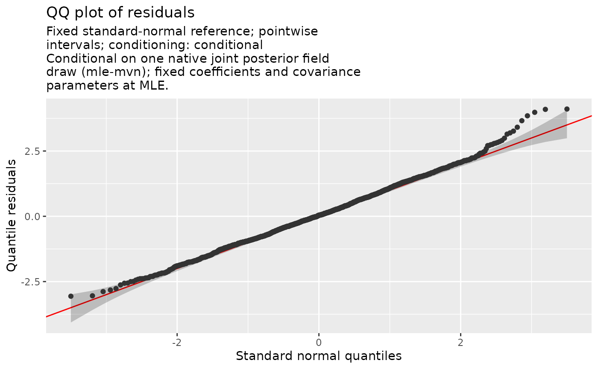
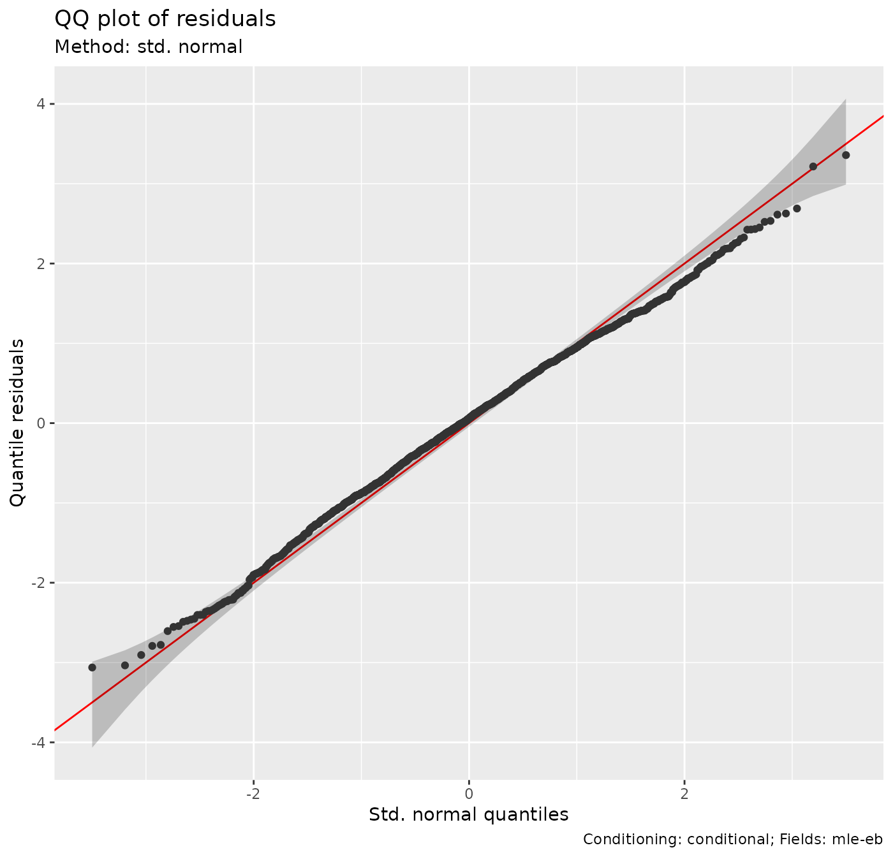
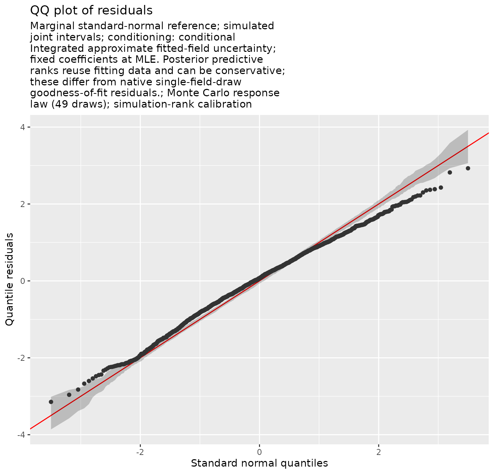
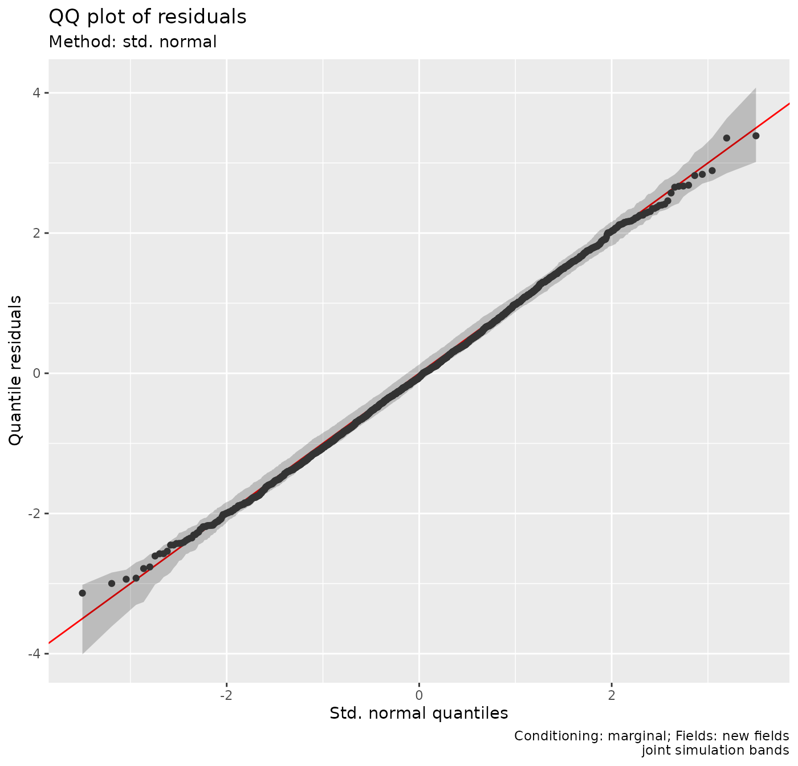
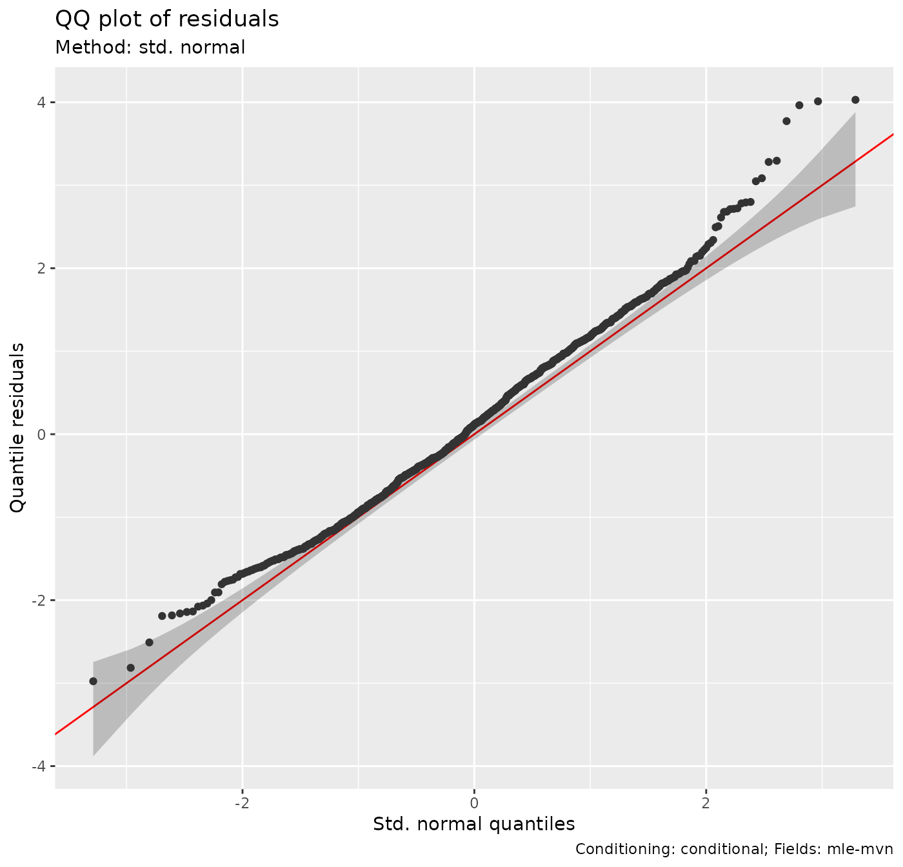
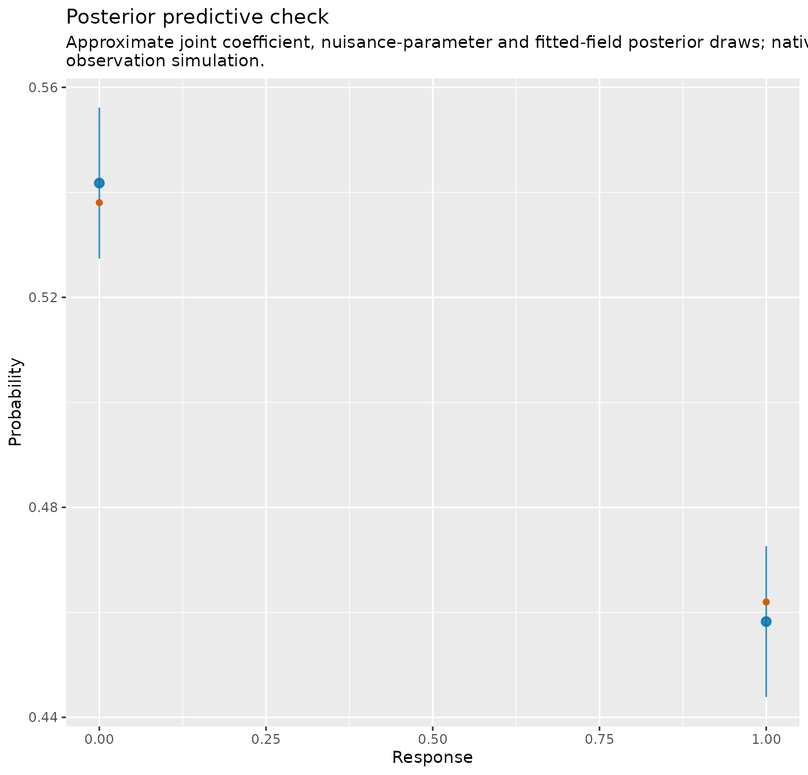

# Depth effects and spatial variation in a trawl survey

A survey tow that catches no fish and a tow that catches a large biomass
tell us different things about habitat. Does depth affect the chance of
encountering Pacific cod, the density when cod are caught, or both? Can
a depth curve explain the geographical patterns in these observations?

This article uses gratia to examine those questions after fitting a
spatial model with sdmTMB. The smooth extraction and effect plots are
new gratia methods for sdmTMB models. The diagnostics also use the
spatial and temporal fields in the complete model. See [Checking a
fitted
model](https://gavinsimpson.github.io/gratia/articles/model-checking.md)
for shared ideas about residuals, dependence and posterior predictive
checks.

## Data and a model for two parts of the survey response

We adapt the Pacific cod survey examples in sdmTMB’s
[introduction](https://sdmtmb.github.io/sdmTMB/articles/basic-intro.html)
and [delta-model
article](https://sdmtmb.github.io/sdmTMB/articles/delta-models.html).
The data are trawl tows in Queen Charlotte Sound, British Columbia.
Biomass density is measured in kg/km²; `X` and `Y` are UTM coordinates
in kilometres. We retain all survey years and the spatial and
year-specific fields. Our adaptations add a separate mean for each
survey year, use six basis functions for the depth smooth, and use the
introduction’s 10 km mesh cutoff.

You need the optional package **sdmTMB \>= 1.1.0**; older fitted objects
may lack the stored smooth information that gratia needs. mgcv supplies
the smooth syntax. The example also uses dplyr, tidyr, ggplot2 and
patchwork. Fitting and simulation cost more than plotting an ordinary
GAM, so we use modest simulation counts.

``` r

library("sdmTMB")
library("mgcv")
library("gratia")
library("dplyr")
library("ggplot2")
library("patchwork")

set.seed(1401)
cod <- pcod
cod$year_f <- factor(cod$year)
cod |>
  group_by(year) |>
  summarise(tows = n(), proportion_zero = mean(density == 0),
    mean_density = mean(density), .groups = "drop")
#> # A tibble: 9 × 4
#>    year  tows proportion_zero mean_density
#>   <int> <int>           <dbl>        <dbl>
#> 1  2003   232           0.565         29.2
#> 2  2004   230           0.487         64.8
#> 3  2005   224           0.442         68.2
#> 4  2007   255           0.588         17.4
#> 5  2009   233           0.592         22.2
#> 6  2011   251           0.610         44.1
#> 7  2013   240           0.442         40.2
#> 8  2015   238           0.479         53.5
#> 9  2017   240           0.625         25.2
```

The zero proportions and means vary between years. A mean calculated
from the observed tows is also influenced by where those tows occurred;
it is not an area-standardised biomass index.

``` r

ggplot(cod, aes(X, Y, colour = density)) +
  geom_point(size = 0.8) +
  facet_wrap(~year, ncol = 4) +
  coord_equal() +
  scale_colour_viridis_c(transform = "log1p", breaks = c(0, 10, 100, 1000, 5000)) +
  labs(x = "Easting (km)", y = "Northing (km)",
    colour = "Density (kg/km²)")
```


The colour scale uses `log1p`, the logarithm of one plus density, to
distinguish the many smaller catches while retaining zeros and the
largest catches. There are many exact zeros and a long positive tail. A
Gaussian response model would allow negative density and impose constant
response variance. A Tweedie model is one useful alternative for zeros
plus continuous positive values. Here a **delta-Gamma model** makes the
encounter and positive-density questions explicit. Its first component
models whether density is positive using a logit link; its second models
positive density using a Gamma distribution and log link. Thus

E(Y_i) = \Pr(Y_i \> 0)\\E(Y_i\mid Y_i\>0).

Depth need not have the same effect on both components. Each has its own
smooth coefficients and spatial fields. A persistent field represents
geographical variation shared across survey years; an independent field
for each survey year represents additional geographical variation in
that year. These fields allow nearby tows to share unexplained
variation. We choose independent year fields because this survey did not
run every year. An AR1 model would require an explicit decision about
missing time steps and assumptions about correlation between years.

``` r

cod_mesh <- make_mesh(cod, c("X", "Y"), cutoff = 10)
cod_fit <- sdmTMB(
  density ~ year_f + s(depth, k = 6),
  data = cod, mesh = cod_mesh, time = "year",
  spatial = "on", spatiotemporal = "iid", family = delta_gamma()
)
sanity(cod_fit)
```

The factor accounts for changes in average encounter probability and
positive catch density between surveys. It prevents the year-specific
fields from being the only way to represent a change in the overall
mean. Both components use the same formula and smooth basis, as required
by sdmTMB for delta models with smooths, but their fitted curves can
differ. Smoothing is estimated during fitting.
[`sanity()`](https://sdmTMB.github.io/sdmTMB/reference/sanity.html)
checks estimation and convergence. The fitted positive-density field has
a range of about 12 km, close to the 10 km mesh cutoff, so compare a
finer mesh before relying on its geographical predictions. The residual
checks below examine the response distribution and remaining spatial
patterns.

## Which part of the response changes with depth?

``` r

smooths(cod_fit)
#> [1] "s(depth)"   "s.1(depth)"
```

`s(depth)` belongs to the encounter component and `s.1(depth)` to the
positive component. The `.1` suffix identifies the second predictor.

``` r

depth_panels <- draw(cod_fit, select = smooths(cod_fit), n = 100,
  wrap = FALSE)
(depth_panels[[1]] + labs(x = "Depth (m)", y = "Contribution to log odds")) |
  (depth_panels[[2]] + labs(x = "Depth (m)", y = "Contribution to log density"))
```


The first curve is a contribution to **log odds of encounter**, the
second to **log mean positive density**. In this fit both curves peak
near 140–150 m. The encounter curve falls especially sharply in deeper
water. The positive component also favours intermediate depths, but its
vertical scale and units differ; compare shapes within each panel rather
than comparing heights across panels. Few observations support the
deepest part of the fitted range, as the rugs show.

These are partial effects. They omit intercepts, survey-year effects and
spatial fields, so their heights are not encounter probabilities or
predicted densities. `fun = exp` would exponentiate a partial effect,
not create a full prediction. The bands use the joint fitted covariance,
retaining the effect of spatial modelling on coefficient uncertainty. By
default, smooth bands also include uncertainty in the component’s
overall mean. They are pointwise bands, not a simultaneous claim about
the entire curve. Use `overall_uncertainty = FALSE` for uncertainty in
the term alone.

For your own plots or calculations, retain the estimates rather than
extracting values from the figure:

``` r

depth_effects <- smooth_estimates(cod_fit, n = 100, interval = "confidence")
depth_effects |>
  group_by(.smooth, .model) |>
  slice_max(.estimate, n = 1) |>
  select(.smooth, .model, depth, .estimate, .se)
#> # A tibble: 2 × 5
#> # Groups:   .smooth, .model [2]
#>   .smooth    .model            depth .estimate   .se
#>   <chr>      <chr>             <dbl>     <dbl> <dbl>
#> 1 s(depth)   Delta component 1  140.     2.41  0.435
#> 2 s.1(depth) Delta component 2  146.     0.529 0.102
```

The reported peak depths locate the maxima on the 100-point evaluation
grid. The broad intervals in deeper water reflect sparse observations
there, so the intermediate-depth peak is better supported than the shape
of the deep-water tail.

[`smooth_coefs()`](https://gavinsimpson.github.io/gratia/reference/smooth_coefs.md)
returns coefficients in the constrained mgcv basis. They can be useful
for reproducing a curve from its basis matrix, but individual
coefficients do not have the interpretation of a linear depth slope:

``` r

smooth_coefs(cod_fit, select = "s(depth)")
#> s(depth).1 s(depth).2 s(depth).3 s(depth).4 s(depth).5 
#> -4.4187762  2.5591291  1.0347497 -0.2311792  2.8689836
```

## How did survey years differ?

``` r

parametric_terms(cod_fit)
#>   year_f year_f.1 
#> "year_f" "year_f"
year_effects <- parametric_effects(cod_fit,
  terms = c("year_f", "year_f.1"), overall_uncertainty = FALSE)
year_plot <- draw(year_effects)
year_plot[[1]] <- year_plot[[1]] +
  labs(x = "Survey year", y = "Change in log odds", subtitle = "Encounter")
year_plot[[2]] <- year_plot[[2]] +
  labs(x = "Survey year", y = "Change in log positive density",
    subtitle = "Positive density")
year_plot
```


Under the fitted treatment contrasts, 2003 is the reference year and has
a zero contribution. The other estimates are changes from that reference
on their respective link scales, after accounting for depth and fields.
For the positive-density component, exponentiating the contribution
gives a ratio of conditional mean positive density relative to 2003. For
the encounter component it gives an odds ratio, not a probability ratio.
A difference in the positive component alone is not a change in total
expected density: occurrence also matters. For example, the 2011
estimate is lower than 2003 for encounter but higher for positive
density. Looking at either component alone would miss this distinction.

Here we requested term-only uncertainty. The reference year consequently
has no uncertainty interval for its *contrast with itself*. Request the
default `overall_uncertainty = TRUE` to include intercept uncertainty in
the plotted parametric contributions. Use full predictions to estimate
actual densities.

## Did the association with depth change over survey years?

The delta model above gives each component a common depth curve and
separate year means. A different question is whether the *shape* of the
depth association changed through time. We now adapt the binomial
encounter model in sdmTMB’s
[introduction](https://sdmtmb.github.io/sdmTMB/articles/basic-intro.html):
replace its quadratic depth effect with a joint smooth of depth and
survey year, while retaining the spatial and independent year-specific
fields and every survey tow. This extension focuses on encounter; the
delta model remains the analysis for combined encounter and positive
catch density.

A [tensor product
smooth](https://stat.ethz.ch/R-manual/R-devel/library/mgcv/html/t2.html)
combines bases for the two covariates and estimates smoothing for
different parts of the surface separately. This is useful when depth is
measured in metres and time in years: there is no reason to equate a
metre of depth with a year of time. The
[`t2()`](https://rdrr.io/pkg/mgcv/man/t2.html) basis has several
penalties; gratia now retains all their fitted coefficient blocks and
joint uncertainty when extracting and plotting sdmTMB effects.

``` r

cod$year_centered <- cod$year - 2011
cod_encounter <- sdmTMB(
  present ~ t2(depth, year_centered, k = c(5, 4)),
  data = cod, mesh = cod_mesh, time = "year", family = binomial(),
  spatial = "on", spatiotemporal = "iid"
)
sanity(cod_encounter)
```

The joint smooth allows a gradual relationship across actual elapsed
years. The year-specific fields still represent geographical departures
in each survey, with no correlation assumed between those fields. A
smooth temporal relationship in the mean and correlation between random
fields are different assumptions. Here the smooth includes both depth
and year main effects, so we do not add the previous `year_f` factor.
Centring year at 2011 only changes its coordinate origin.

In this example the optimizer converges and the Hessian is positive
definite, but
[`sanity()`](https://sdmTMB.github.io/sdmTMB/reference/sanity.html)
flags large standard errors for smoothing parameters. Inspect the
estimated standard deviations controlling the tensor penalties:

``` r

sdmTMB::tidy(cod_encounter, effects = "ran_pars") |>
  filter(grepl("sd__", term)) |>
  select(term, estimate, conf.low, conf.high)
#> # A tibble: 3 × 4
#>   term                            estimate conf.low conf.high
#>   <chr>                              <dbl>    <dbl>     <dbl>
#> 1 sd__t2(depth,year_centered)_1  0.0000311      0       Inf  
#> 2 sd__t2(depth,year_centered)_2  0.00166        0       Inf  
#> 3 sd__t2(depth,year_centered)_3 50.1           27.2      92.2
```

Two standard deviations are close to zero and their intervals are
uninformative. Some directions of curvature are being strongly
penalised, and these data weakly identify the corresponding smoothing
parameters. If changes in the depth relationship are secondary to the
main survey question, the simpler common-depth-curve model above
provides a useful starting point.

``` r

tensor_panel <- draw(cod_encounter, n_2d = 30, dist = 0.1,
  wrap = FALSE)[[1]]
tensor_panel +
  scale_y_continuous(breaks = c(-8, -4, 0, 4, 6),
    labels = c(2003, 2007, 2011, 2015, 2017)) +
  labs(x = "Depth (m)", y = "Survey year") +
  guides(fill = guide_colourbar(title = "Log-odds\ncontribution"))
```


The mostly vertical contours indicate that depth dominates the displayed
association; the preferred intermediate-depth region changes little
through time. The surface is a contribution to log odds, without the
intercept or fields. Its colours show fitted contributions; standard
errors are available from
[`smooth_estimates()`](https://gavinsimpson.github.io/gratia/reference/smooth_estimates.md).
`dist = 0.1` masks combinations far from the observed depth-year pairs
after scaling both covariates to a unit square. The nearly stable
intermediate-depth region is the main pattern here. The smoothing
warning and sparse deep-water observations limit the temporal changes we
can resolve in the tails.

For custom calculations,
[`get_smooths_by_id()`](https://gavinsimpson.github.io/gratia/reference/get_smooths_by_id.md)
retrieves the fitted mgcv smooth object. Its penalty list records the
independently smoothed parts of the surface;
[`smooth_coefs()`](https://gavinsimpson.github.io/gratia/reference/smooth_coefs.md)
retrieves the corresponding coefficient vector:

``` r

encounter_smooth <- get_smooths_by_id(cod_encounter, id = 1)[[1]]
length(encounter_smooth$S)
#> [1] 3
length(smooth_coefs(cod_encounter, select = smooths(cod_encounter)[1]))
#> [1] 19
```

The three penalties control different parts of one fitted surface,
represented here by nineteen coefficients. Use
`smooth_estimates(cod_encounter, data = ...)` to evaluate that surface
and its standard errors at specific depth-year combinations before
carrying the results into another calculation.

## Map expected density with full predictions

Full predictions require both components and the fields. Use sdmTMB’s
public [prediction
method](https://sdmtmb.github.io/sdmTMB/reference/predict.sdmTMB.html)
for this calculation. For a standard delta-Gamma model we can
independently verify the response mean from the two link-scale
predictors:

``` r

link_prediction <- predict(cod_fit)
response_prediction <- predict(cod_fit, type = "response")
combined_mean <- plogis(link_prediction$est1) * exp(link_prediction$est2)
max(abs(combined_mean - response_prediction$est))
#> [1] 1.136868e-13
```

For other delta links, use the fitting package’s response
transformation; this product of inverse links does not apply unchanged
to a coupled Poisson-link delta model.

For mapping, use the supplied survey-area grid. Restricting the display
to 2011 and 2017 keeps the figure readable; the fit still uses every
survey year.

``` r

map_data <- replicate_df(qcs_grid, "year", c(2011L, 2017L))
map_data$year_f <- factor(map_data$year, levels = levels(cod$year_f))
cod_map <- predict(cod_fit, newdata = map_data, type = "response")
ggplot(cod_map, aes(X, Y, fill = est)) +
  geom_raster() +
  facet_wrap(~year) +
  coord_equal() +
  scale_fill_viridis_c(transform = "sqrt") +
  labs(x = "Easting (km)", y = "Northing (km)",
    fill = "Mean density\n(kg/km²)")
```


The map combines encounter probability, positive density and
geographical variation. A location can have low expected density through
either a low encounter probability or a low positive mean. The maps show
fitted mean surfaces. sdmTMB’s `predict(..., nsim = ...)` supplies joint
prediction draws for estimating uncertainty at each location or in
derived quantities. Setting `re_form = NA` removes spatial fields from
predictions. That is a prediction with zero fields, not an average over
new fields; the nonlinear links make these different calculations.

## What should be held fixed when checking the model?

The depth effects above omit fields from the displayed contribution, but
residual checks must use the whole fitted predictor. The sdmTMB
[residual-checking
article](https://sdmtmb.github.io/sdmTMB/articles/residual-checking.html)
demonstrates why the choice of fields matters. gratia’s default follows
its approach of drawing the fitted effects once from their approximate
joint posterior, with fixed coefficients and covariance parameters held
at their estimates. The observed residuals and reference responses use
that same draw.

``` r

cod_field_options <- options(gratia.diagnostics.field_seed = 1402L)
qq_plot(cod_fit, type = "quantile", seed = 1404)
```



The PIT calculation randomises zeros over their fitted probability mass,
then transforms probabilities to normal scores for this QQ plot. Given
the selected fields, response errors are independent, so the reference
is standard normal and its bands condition on those fields. A departure
can indicate problems with the observation distribution or predictor. It
is not a calibrated test of the estimated field covariance. Here, the
upper tail rises above the reference: some positive catches are larger
than this fitted response distribution anticipates. This motivates
checking the positive component and considering, for example, a
delta-lognormal model, whose positive tail differs from the Gamma
distribution. Fit that alternative and repeat the positive-tail checks
to assess whether it represents the large catches better. Repeat with
other `field_seed` values to see whether a feature of the plot depends
on one fitted-field draw; the `seed` argument separately controls
randomisation at the zeros.

Examine geographical patterns as well as the pooled residual
distribution:

``` r

cod_residuals <- cod
cod_residuals$residual <- quantile_residuals(cod_fit,
  type = "quantile", seed = 1404)
ggplot(cod_residuals, aes(X, Y, colour = residual)) +
  geom_point(size = 0.8) +
  facet_wrap(~year, ncol = 4) +
  coord_equal() +
  scale_colour_gradient2(low = "blue", mid = "white", high = "red") +
  labs(x = "Easting (km)", y = "Northing (km)",
    colour = "Quantile\nresidual")
```


Clusters of residuals with the same sign deserve attention even if a QQ
plot looks acceptable. Consider omitted spatial covariates, inadequate
field resolution, or a response distribution that cannot represent the
local variation. Use geographical distances to investigate these
patterns: observation-order lags do not describe how far apart the
survey tows are.

Three further choices answer different questions:

| Choice | What varies between reference data sets? | Useful interpretation |
|:---|:---|:---|
| `field_method = "mle-eb"` | Response errors; estimated fields are fixed | Inspect errors at estimated fields, with shrinkage affecting calibration |
| `field_method = "mle-mvn-integrated"` | Response errors and approximate uncertainty in fitted effects | Check variation around the inferred fields, averaged across their uncertainty |
| `conditioning = "marginal"` | Response errors and new spatial and year fields from the fitted field distribution | Check the variation implied by new field realisations |

The default `field_method = "mle-mvn"` draws fitted effects once and
then fixes them; it is different from all three. Empirical-Bayes
(`mle-eb`) residuals can look too concentrated because fields were
estimated from these same responses. sdmTMB does not recommend them for
goodness-of-fit testing.

``` r

cod_reference_options <- options(gratia.diagnostics.marginal_draws = 49L,
  gratia.diagnostics.marginal_seed = 1403L)
qq_plot(cod_fit, type = "quantile", field_method = "mle-eb", seed = 1404)
```



``` r

qq_plot(cod_fit, type = "quantile",
  field_method = "mle-mvn-integrated", n_simulate = 49, seed = 1404)
```



``` r

qq_plot(cod_fit, type = "quantile", conditioning = "marginal",
  n_simulate = 49, seed = 1404)
```



The integrated and marginal calculations use ranks in joint response
simulations. The former includes approximate uncertainty in fitted
latent effects (including penalised smooth coefficients), while holding
fixed coefficients and covariance parameters at their estimates. The
latter simulates new native spatial and temporal effects, retaining
fitted smooths. Changing `field_method` does not add another
fitted-field draw to a marginal check. These responses share field
contributions, so gratia generates the reference bands from complete
simulated data sets that preserve dependence. Independent uniform
order-statistic bands would answer the wrong question.

Compare the subtitles as well as the curves: each plot identifies its
conditioning. In this example the integrated QQ plot describes errors
around estimated survey fields, whereas the marginal plot also reflects
the wide variation in density between possible geographical surfaces.
The integrated plot has narrower residual spread. Because integration
reuses the fitting data, apparent agreement in that plot can be
conservative. With 49 reference draws, tail resolution and Monte Carlo
accuracy are limited. Increase `gratia.diagnostics.marginal_draws` and
`n_simulate` to check that a conclusion persists; the defaults use more
reference draws.

## Is a problem in occurrence or in positive density?

Component checks help locate a mismatch hidden in a full-response check.
For the positive component, only observed positive tows are retained;
the binomial component retains the complete presence/absence sample.

``` r

qq_plot(cod_fit, type = "quantile", component = "positive", seed = 1404)
```



``` r

posterior_predictive_plot(cod_fit, component = "binomial",
  n = 25, seed = 1405)
```



The occurrence plot compares the observed proportions at 0 and 1 with
replicated proportions. Its intervals describe variation across
posterior replicates, including parameter and fitted-field uncertainty.
These are not the intervals for independent proportions from a binomial
sample. A good aggregate proportion can conceal geographical mismatch,
so retain the spatial residual map and inspect component maps if
necessary.

Unlike residual references with coefficients fixed at their estimates,
posterior predictive checks draw fixed coefficients, nuisance
parameters, smooth coefficients and fields together from the approximate
joint posterior. Conditional checks draw uncertain *fitted* fields;
marginal checks replace these with *new* fields at each parameter draw.
`field_method` selects residual calculations and is not an option for
PPCs.

For the complete density distribution, smoothing a kernel density curve
over an exact-zero spike is hard to interpret. Raw public
[`posterior_samples()`](https://gavinsimpson.github.io/gratia/reference/posterior_samples.md)
allow a targeted comparison of zero frequency and a positive-tail
summary:

``` r

cod_summaries <- function(x) {
  c(proportion_zero = mean(x == 0), density_95th = unname(quantile(x, 0.95)))
}
observed_summary <- cod_summaries(cod$density)
conditional_draws <- posterior_samples(cod_fit, n = 25, seed = 1405)
marginal_draws <- posterior_samples(cod_fit, n = 25,
  conditioning = "marginal", seed = 1405)

summarise_draws <- function(x, description) {
  x |>
    group_by(.draw) |>
    summarise(proportion_zero = mean(.response == 0),
      density_95th = quantile(.response, 0.95), .groups = "drop") |>
    tidyr::pivot_longer(-.draw, names_to = "summary", values_to = "value") |>
    mutate(check = description)
}
summary_draws <- bind_rows(
  summarise_draws(conditional_draws, "Uncertain fitted fields"),
  summarise_draws(marginal_draws, "New fields")
)
observed_table <- data.frame(summary = names(observed_summary),
  observed = unname(observed_summary))
summary_draws |>
  group_by(check, summary) |>
  summarise(median = median(value), lower = quantile(value, 0.05),
    upper = quantile(value, 0.95), .groups = "drop") |>
  left_join(observed_table, by = "summary")
#> # A tibble: 4 × 6
#>   check                   summary          median   lower   upper observed
#>   <chr>                   <chr>             <dbl>   <dbl>   <dbl>    <dbl>
#> 1 New fields              density_95th    180.    149.    241.     157.   
#> 2 New fields              proportion_zero   0.494   0.412   0.614    0.538
#> 3 Uncertain fitted fields density_95th    157.    141.    176.     157.   
#> 4 Uncertain fitted fields proportion_zero   0.542   0.527   0.556    0.538
```

The conditional comparison asks whether new responses around the
inferred survey fields reproduce these summaries. The marginal
comparison asks whether new field realisations at the survey locations
reproduce them. About 54% of observed tows are zero, and the observed
95th percentile is about 157 kg/km². Both fall within the displayed
predictive ranges. This agrees with reproducing these aggregate
summaries, while the conditional QQ plot still flags the more extreme
positive tail. Passing a check of the 95th percentile does not establish
that the largest catches are well represented. Wider marginal variation
is scientifically plausible because these summaries change when a large
part of the area happens to have high or low density. The displayed
intervals are descriptive 90% predictive ranges from just 25 replicates.
Increase the draw count before interpreting an apparent tail
discrepancy. These summaries describe the sampling locations; an
area-standardised biomass index requires predictions across the survey
domain.

## Applying the workflow to another survey

Retain the scientific unit of the response and its zeros when selecting
a family. Consider whether encounter and positive-density processes need
separate predictors, and justify temporal dependence from the survey
schedule. Check convergence before interpreting partial effects. Use
effect plots for formula contributions and full fitting-package
predictions for maps and indices. Match each diagnostic to whether the
scientific question concerns the observed fields or new fields, and
examine spatial patterns alongside marginal distribution plots.

The support has deliberate limits. gratia does not supply partial
residual overlays or random-field effect plots for sdmTMB.
Formula-effect extraction does not cover dispersion formulas, other
multi-predictor families, threshold or nonlocal effects. It cannot use
mapped or profiled coefficients needed for extraction, unavailable
smooth metadata, or a covariance from a non-positive-definite Hessian.
`unconditional = TRUE` and `frequentist = TRUE` are mgcv covariance
choices and do not apply to these joint TMB intervals. Use sdmTMB’s
prediction and plotting methods for fields and unsupported formula
effects. If the covariance is unavailable, investigate convergence
before interpreting intervals. Diagnostic families and additional limits
are listed in
[`?diagnostic_support`](https://gavinsimpson.github.io/gratia/reference/diagnostic_support.md).
