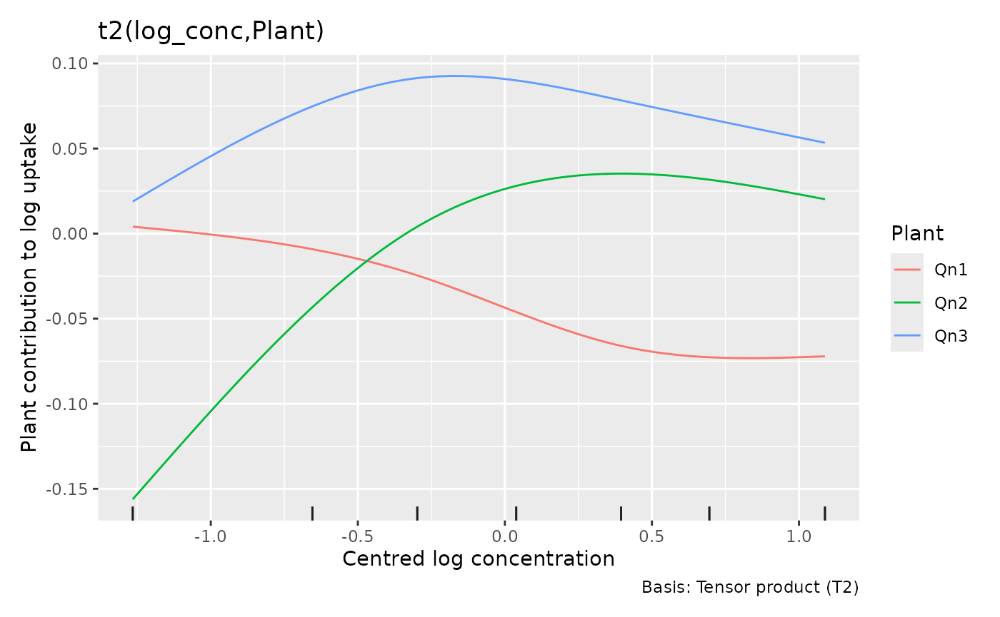
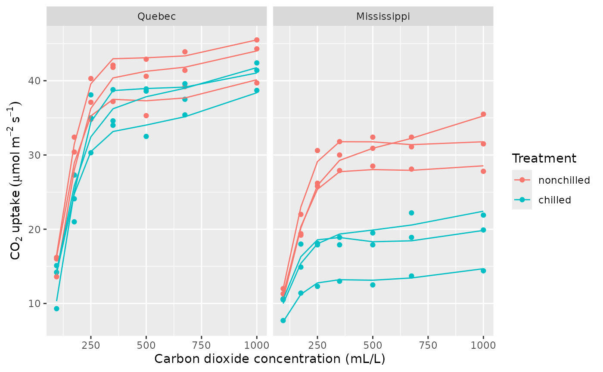
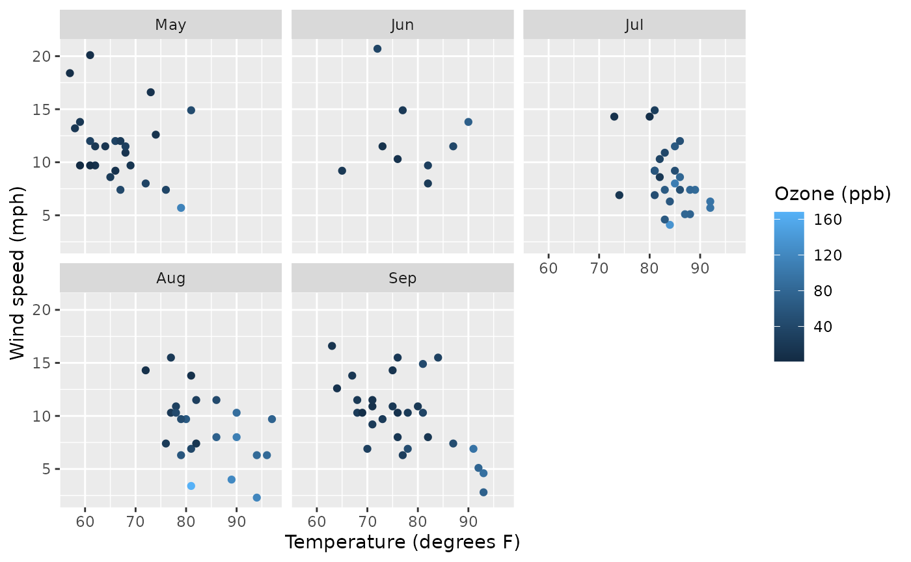
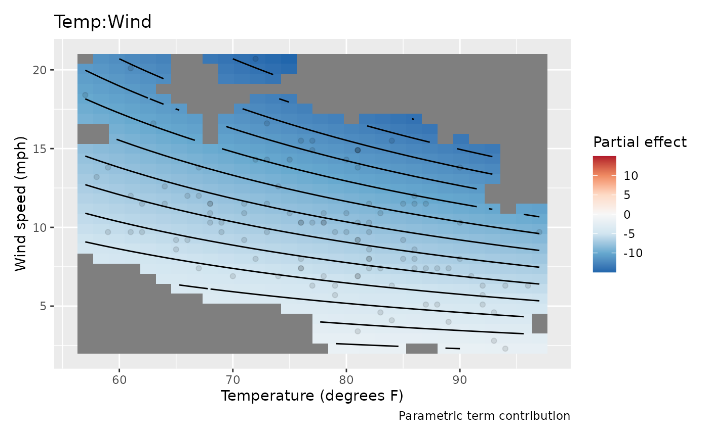
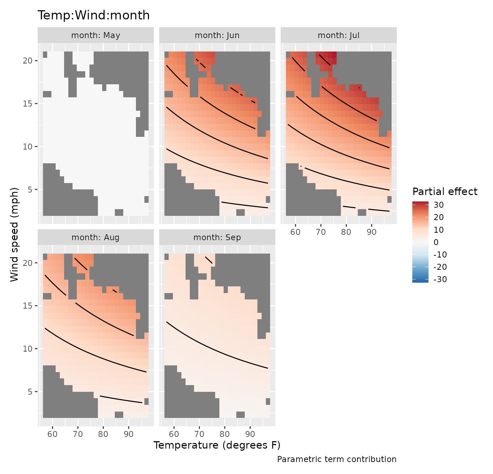
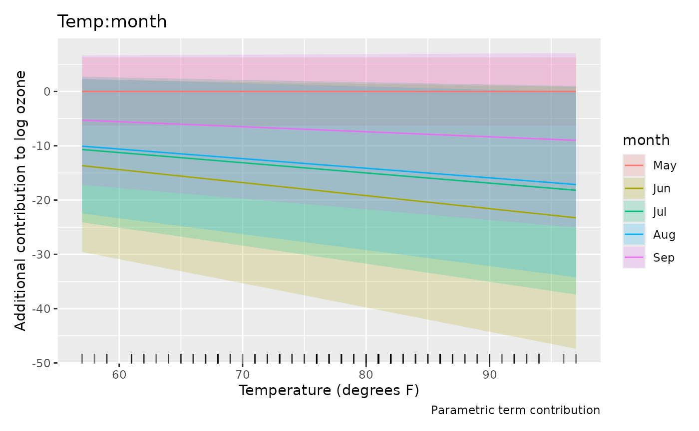
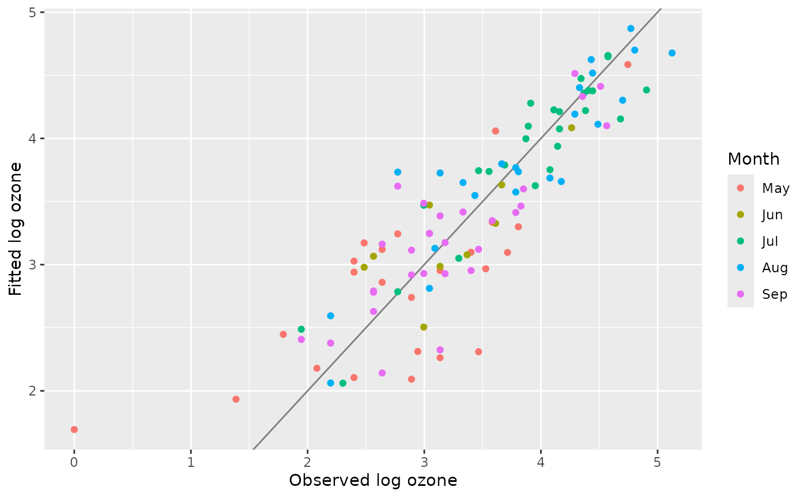
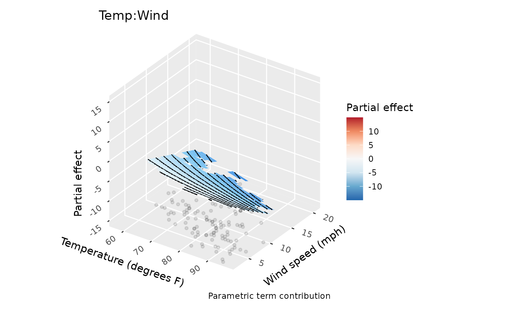

# Read smooth effects, interactions and surfaces

An effect plot isolates one contribution to a model. It helps explain
how the model works, but it need not show the expected response. This
distinction matters especially with interactions, random effects and
nonlinear links. We use the plant experiment from [Smooth trends and
repeated measurements with
glmmTMB](https://gavinsimpson.github.io/gratia/articles/glmmTMB-support.md)
to explore flexible individual curves, then daily air quality
measurements to read interaction surfaces.

``` r

library("gratia")
load_mgcv()
library("ggplot2")
```

## Do plants need different curve shapes?

The carbon dioxide experiment has seven measurements on each of twelve
plants, with three plants in each origin-treatment combination. Positive
uptake and increasing residual spread motivate a Gamma model with a log
link. A shared smooth captures saturation with increasing concentration.
We now allow plant-specific *smooth* deviations, rather than the
straight-line deviations used in the glmmTMB article.

``` r

plant <- as.data.frame(CO2)
plant$Plant <- factor(plant$Plant, ordered = FALSE)
plant$log_conc <- log(plant$conc) - mean(log(plant$conc))
plant_gam <- gam(
  uptake ~ Type * Treatment + s(log_conc, k = 5) +
    t2(log_conc, Plant, bs = c("cr", "re"), k = c(4, 12), full = TRUE),
  data = plant, family = Gamma(link = "log"), method = "REML")
overview(plant_gam)
#> 
#> Generalized Additive Model with 6 terms
#> 
#>   term                             type        k   edf ref.edf statistic p.value
#>   <chr>                            <chr>   <dbl> <dbl>   <dbl>     <dbl> <chr>  
#> 1 Intercept                        parame…    NA  1       1        52.7  < 0.001
#> 2 TypeMississippi                  parame…    NA  1       1        -3.31 0.00181
#> 3 Treatmentchilled                 parame…    NA  1       1        -1.26 0.21419
#> 4 TypeMississippi:Treatmentchilled parame…    NA  1       1        -2.57 0.01349
#> 5 s(log_conc)                      TPRS        4  3.85    3.96     79.2  < 0.001
#> 6 t2(log_conc,Plant)               Tensor…    48 30.3    43         8.76 < 0.001
```

The tensor product combines a cubic regression spline over concentration
with a random-effect basis over plants. It penalises plant-specific
departures and shares information across plants. `full = TRUE` keeps
separate penalties for the parts of this tensor construction. With only
seven observations per plant, the small concentration basis is
deliberate. Each plant’s concentration contribution is the sum of the
common curve and its smooth deviation. The intercept, origin and
treatment terms supply the remaining contributions to its fitted log
uptake.

``` r

smooths(plant_gam)
#> [1] "s(log_conc)"        "t2(log_conc,Plant)"
draw(plant_gam, select = "t2(log_conc,Plant)",
  re_levels = list(Plant = c("Qn1", "Qn2", "Qn3")),
  xlab = "Centred log concentration", ylab = "Plant contribution to log uptake") &
  theme(legend.position = "right") & labs(colour = "Plant")
```



The numeric covariate is always the horizontal axis even if the factor
was specified first in the tensor formula. `re_levels` chooses plants by
name; it does not refit the model or remove their contributions from
predictions. The fitted factor ordering is retained. Selecting plants of
one treatment makes the variation among biological replicates visible.
Treatment comparisons require the origin and treatment terms as well as
these plant deviations.

``` r

plant$mean_uptake <- fitted(plant_gam)
ggplot(plant, aes(conc, uptake, group = Plant, colour = Treatment)) +
  geom_point() +
  geom_line(aes(y = mean_uptake)) +
  facet_wrap(~ Type) +
  labs(x = "Carbon dioxide concentration (mL/L)",
    y = expression(CO[2] ~ uptake ~ (mu * mol ~ m^{-2} ~ s^{-1})))
```



The model explains rapid increases and subsequent flattening in these
observed plants. This is conditional on their fitted deviations, rather
than a forecast for a new plant. The smooth deviations allow each
plant’s curve to bend, whereas straight random slopes only change its
tilt. For treatment comparisons, each plant supplies one independent
curve: three replicates per origin and treatment combination.

``` r

variance_comp(plant_gam)
#> # A tibble: 5 × 5
#>   .component           .variance .std_dev .lower_ci .upper_ci
#>   <chr>                    <dbl>    <dbl>     <dbl>     <dbl>
#> 1 s(log_conc)           0.320      0.566    0.248      1.29  
#> 2 t2(log_conc,Plant)rr  0.000106   0.0103   0.00640    0.0165
#> 3 t2(log_conc,Plant)1r  0.000957   0.0309   0.0186     0.0515
#> 4 t2(log_conc,Plant)2r  0.000502   0.0224   0.0141     0.0355
#> 5 scale                 0.00346    0.0588   0.0471     0.0734
```

These are variance components in the random-effect representation of the
penalised splines. Different tensor components can have different
estimated variances, so one variance alone does not describe all
plant-curve variation. The spline rows are not observation variances;
the `scale` row estimates Gamma dispersion, which multiplies the squared
mean to give response variance. Fits selected by GCV may lack confidence
intervals; the estimates remain available. A model with no extractable
variance components returns an empty table.

Tensor plots follow the same principle in higher dimensions. Two
continuous covariates make a surface; additional numerical dimensions
become conditioning slices and factor dimensions become facets. `n_2d`
controls each surface axis, while `n_3d` and `n_4d` limit conditioning
dimensions. The latter also limit factor levels to the first levels in
fitted order. Use named `re_levels` or explicit evaluation `data` to
choose meaningful groups. With two factor margins, the display is
categorical estimates and intervals, faceted by the second factor; there
is no numeric axis to interpolate between categories. These rules apply
to [`te()`](https://rdrr.io/pkg/mgcv/man/te.html),
[`ti()`](https://rdrr.io/pkg/mgcv/man/te.html) and
[`t2()`](https://rdrr.io/pkg/mgcv/man/t2.html) random-effect tensor
terms.

## Is the temperature association different on calm and windy days?

The `airquality` data contain daily New York measurements from May to
September 1973. Ozone is in parts per billion, temperature in degrees
Fahrenheit, wind speed in miles per hour, and solar radiation in
Langleys; see
[`?datasets::airquality`](https://rdrr.io/r/datasets/airquality.html)
for the sources. We retain complete cases, so our analysis uses the days
with all needed measurements.

The question is whether ozone’s association with temperature depends on
wind, and whether that relationship is stable across summer months. We
model log ozone with a Gaussian distribution, allow a smooth association
with solar radiation, and use a temperature-by-wind-by-month
interaction.

``` r

ozone <- na.omit(airquality[c("Ozone", "Solar.R", "Wind", "Temp", "Month")])
ozone$month <- factor(ozone$Month, labels = month.abb[5:9])
ozone_gam <- gam(log(Ozone) ~ s(Solar.R, k = 6) + Temp * Wind * month,
  data = ozone, method = "REML")
table(ozone$month)
#> 
#> May Jun Jul Aug Sep 
#>  24   9  26  23  29
overview(ozone_gam)
#> 
#> Generalized Additive Model with 21 terms
#> 
#>    term          type           k   edf ref.edf statistic p.value
#>    <chr>         <chr>      <dbl> <dbl>   <dbl>     <dbl> <chr>  
#>  1 Intercept     parametric    NA     1       1     -2.56 0.01214
#>  2 Temp          parametric    NA     1       1      3.64 < 0.001
#>  3 Wind          parametric    NA     1       1      2.50 0.01423
#>  4 monthJun      parametric    NA     1       1      1.99 0.04966
#>  5 monthJul      parametric    NA     1       1      2.31 0.02322
#>  6 monthAug      parametric    NA     1       1      2.88 0.00501
#>  7 monthSep      parametric    NA     1       1      1.40 0.16547
#>  8 Temp:Wind     parametric    NA     1       1     -2.64 0.00975
#>  9 Temp:monthJun parametric    NA     1       1     -2.18 0.03153
#> 10 Temp:monthJul parametric    NA     1       1     -2.41 0.01808
#> # ℹ 11 more rows
```

A three-way interaction gives each month its own temperature-by-wind
surface. That flexibility makes the model useful for exploring
stability, but estimates in sparsely sampled parts of a month’s weather
range may be imprecise. Inspect the distribution of observations before
interpreting a surface:

``` r

ggplot(ozone, aes(Temp, Wind, colour = Ozone)) +
  geom_point() +
  facet_wrap(~ month) +
  labs(x = "Temperature (degrees F)", y = "Wind speed (mph)",
    colour = "Ozone (ppb)")
```



## Start with the interaction, then reconstruct the model

``` r

parametric_terms(ozone_gam)
#>              Temp              Wind             month         Temp:Wind 
#>            "Temp"            "Wind"           "month"       "Temp:Wind" 
#>        Temp:month        Wind:month   Temp:Wind:month 
#>      "Temp:month"      "Wind:month" "Temp:Wind:month"
weather_effect <- parametric_effects(ozone_gam, terms = "Temp:Wind", n_2d = 30)
draw(weather_effect, surface = "tile") &
  labs(x = "Temperature (degrees F)", y = "Wind speed (mph)")
```



This surface shows the coefficient-weighted temperature-by-wind
contribution for the reference month, May. Its colours are partial
contributions to **log** ozone. They exclude the intercept, the
temperature and wind main effects, the solar smooth, and other
interaction terms. The diverging palette centres at zero, making the
contribution’s sign visible. To interpret the complete temperature
association, combine this interaction with the main temperature effect
and the monthly adjustments below.

`surface = "tile"` uses vector rectangles, which can be useful in a
vector figure. The default `"raster"` keeps large plots compact.
`n_2d = 30` evaluates 30 points along each surface axis, rather than
borrowing the 100-point curve resolution. Increase `n_2d` when you need
a finer display of the same fitted surface.

``` r

draw(parametric_effects(ozone_gam, terms = "Temp:Wind:month", n_2d = 25),
  surface = "tile") &
  labs(x = "Temperature (degrees F)", y = "Wind speed (mph)")
```



The additional monthly contributions appear in conditioning facets.
Under treatment contrast coding the reference month’s contribution is
zero. The other panels are adjustments to the May interaction, not
complete monthly surfaces. Fill limits are shared across facets and
centred at zero. If a surface varies mainly because of poor covariate
support, masking helps avoid giving extrapolation the same visual
prominence as interpolation: `dist` uses distance after scaling the
displayed axes into the unit square. Support is pooled across months, so
a location left visible may still lie outside an individual month’s
observed weather conditions. Use the monthly observation plot above to
decide which parts of each surface have local data support.

Numeric-by-factor interactions are grouped curves rather than surfaces:

``` r

draw(parametric_effects(ozone_gam, terms = "Temp:month")) &
  labs(x = "Temperature (degrees F)", y = "Additional contribution to log ozone")
```



These slopes must be combined with the reference temperature slope and
the wind interactions to describe the model’s temperature association.
The [conditional comparisons
article](https://gavinsimpson.github.io/gratia/articles/prediction-comparisons.md)
shows how to compare complete fitted values without isolating
contrast-coded terms.

For a direct view of the complete model, predict at observed weather
conditions:

``` r

ozone$fitted_log <- fitted(ozone_gam)
ggplot(ozone, aes(log(Ozone), fitted_log, colour = month)) +
  geom_abline(slope = 1, intercept = 0, colour = "grey50") +
  geom_point() +
  labs(x = "Observed log ozone", y = "Fitted log ozone", colour = "Month")
```



The fitted values concern mean **log** ozone. Exponentiating them gives
the conditional median under the lognormal assumption, not the
arithmetic mean ozone concentration. The observed-versus-fitted plot
shows how the combined terms reproduce log ozone on the sampled days.
Because these are daily measurements, also check residuals in time
order: remaining serial dependence would affect uncertainty in the
monthly comparisons.

## Choose a display without changing its statistical meaning

The optional ggcube package can show the same numerical surface in three
dimensions:

``` r

if (requireNamespace("ggcube", quietly = TRUE)) {
  draw(weather_effect, surface = "3d",
    surface_3d = list(yaw = 35, persp = FALSE)) &
    labs(x = "Temperature (degrees F)", y = "Wind speed (mph)")
}
```



Height and fill both represent the same partial contribution. A
three-dimensional view can emphasise its shape, while a flat surface is
often easier to compare across months. View settings change the
rendering, not estimates or uncertainty. Curves, factor estimates and
spherical maps retain their usual displays. The conditional chunk runs
only when ggcube is installed; the flat plots contain the complete
analysis.

Parametric effect coordinates now use the model’s covariate scale by
default. For example, a term involving `log(x)` uses `log(x)` on the
horizontal axis. `back_transform = TRUE` displays original covariate
coordinates without changing effect values or intervals. With saved
smooth estimates, prepare them using
`smooth_estimates(model, back_transform = TRUE)` before asking
[`draw()`](https://gavinsimpson.github.io/gratia/reference/draw.md) to
use that scale. See [Transformed
covariates](https://gavinsimpson.github.io/gratia/articles/transformed-covariates.md)
for worked examples, including functions without analytic inverses.

Effect intervals include uncertainty in their model intercept by
default, including its covariance with a parametric term. Setting
`overall_uncertainty = FALSE` changes that uncertainty calculation
without adding or subtracting the intercept from the displayed partial
contribution. For contrasts between complete model predictions, use a
method that includes all relevant terms and their covariance rather than
subtracting interval endpoints from these plots.
