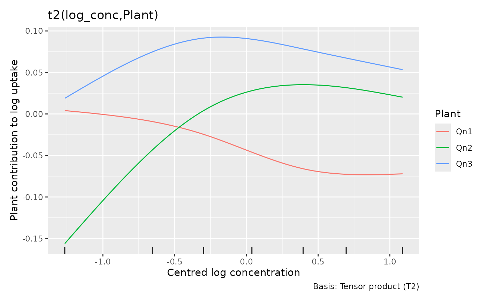
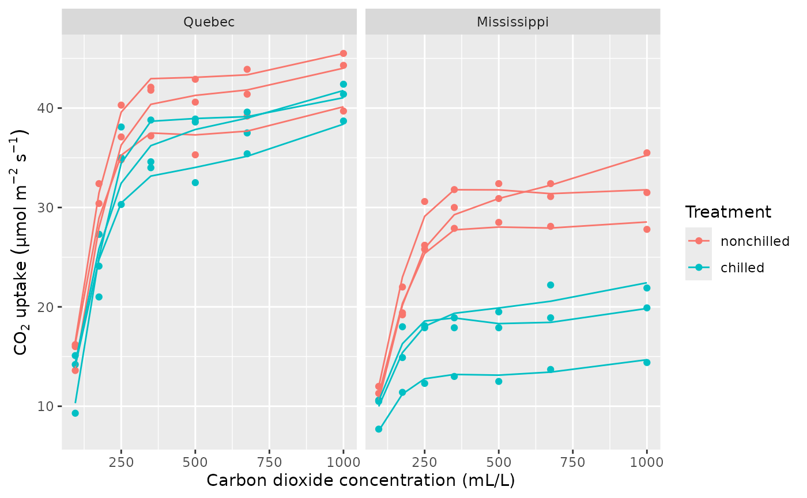
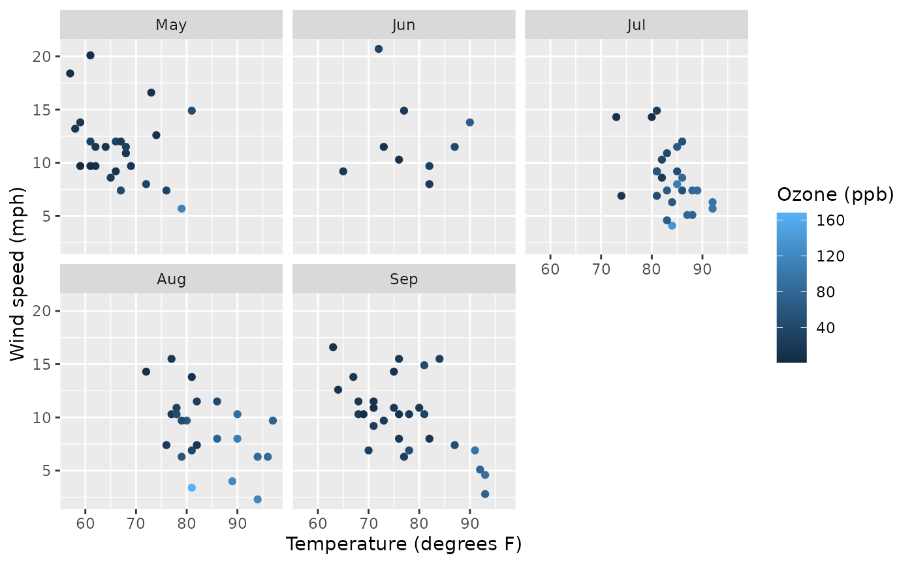
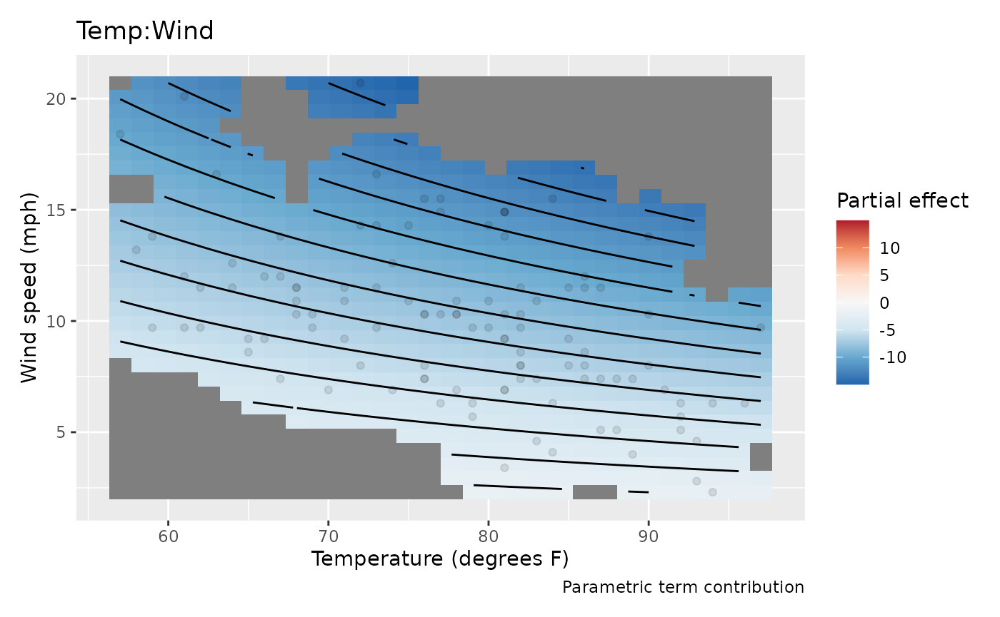
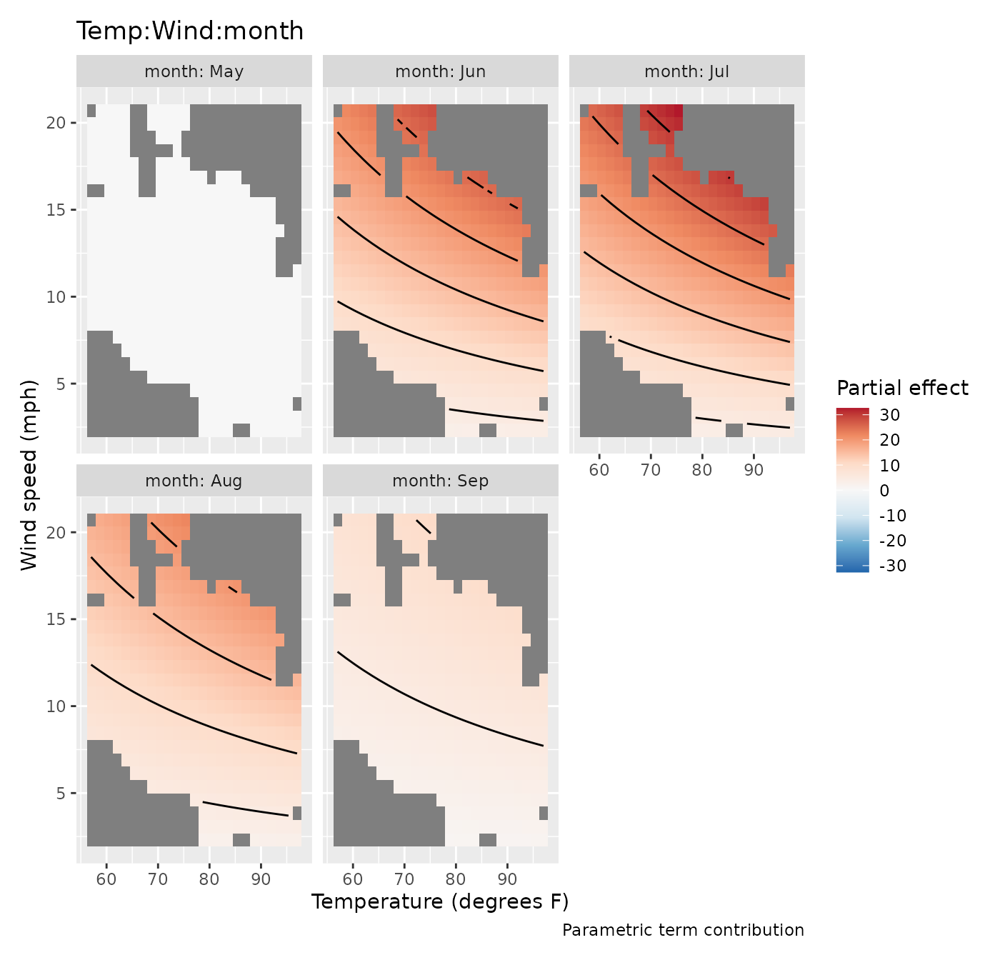
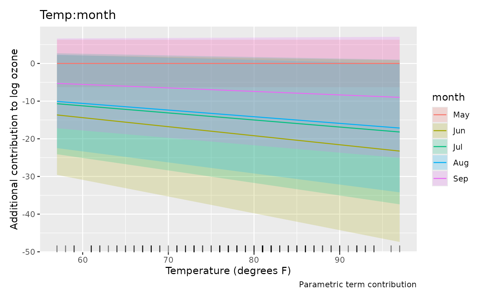
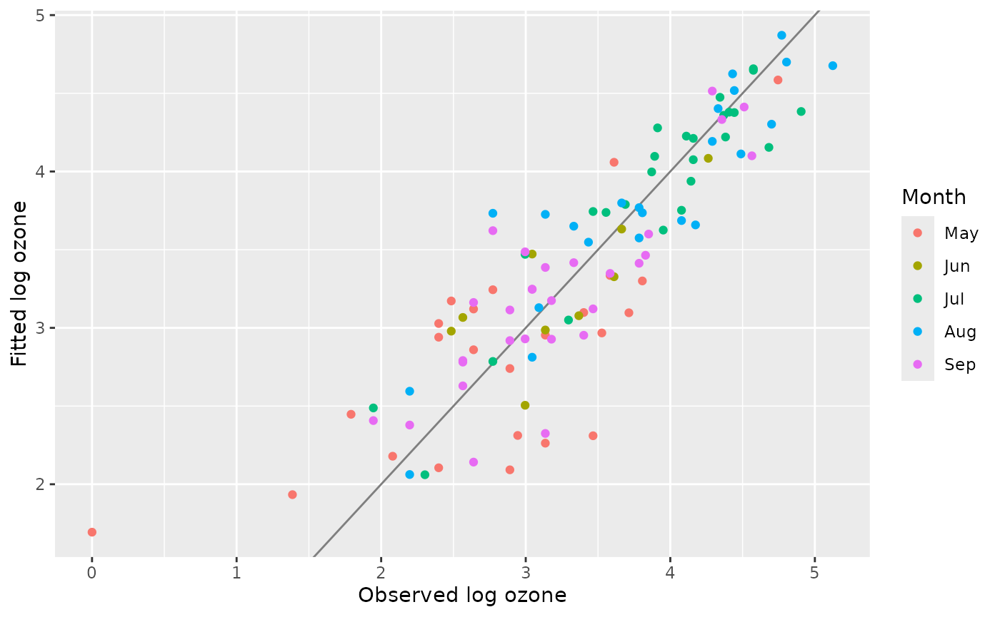
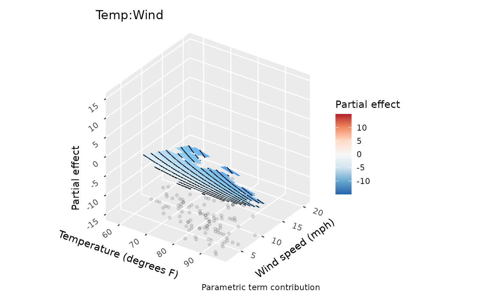

# Read smooth effects, interactions and surfaces

Effect plots show how one smooth or parametric term contributes to the
linear predictor. To obtain the expected response in these examples, add
the model terms and intercept, then apply the inverse link. In the
log-link model below, that means exponentiating the sum to get mean
carbon dioxide uptake. We use the plant experiment from [Smooth trends
and repeated measurements with
glmmTMB](https://gavinsimpson.github.io/gratia/articles/glmmTMB-support.md)
to plot curves for individual plants, then use daily air quality
measurements to plot interactions between continuous and categorical
predictors.

Load {gratia}, {mgcv} and {ggplot2} for the examples.

``` r

library("gratia")
load_mgcv()
library("ggplot2")
```

## Fit and plot plant-specific smooth curves

The carbon dioxide experiment measured uptake at seven concentrations on
each of twelve plants, with three plants per combination of origin and
treatment. The Gamma model with a log link keeps the fitted means
positive and lets the spread increase with the mean. In the model below,
`s(log_conc)` allows the shared uptake curve to level off as
concentration increases. The
[`t2()`](https://rdrr.io/pkg/mgcv/man/t2.html) term combines a spline
for concentration with a plant random effect so that each plant can have
its own smooth departure from the shared curve.

``` r

plant <- as.data.frame(CO2)
plant$Plant <- factor(plant$Plant, ordered = FALSE)
plant$log_conc <- log(plant$conc) - mean(log(plant$conc))
plant_gam <- gam(
  uptake ~ Type * Treatment + s(log_conc, k = 5) +
    t2(log_conc, Plant, bs = c("cr", "re"), k = c(4, 12), full = TRUE),
  data = plant, family = Gamma(link = "log"), method = "REML")
overview(plant_gam)
#> 
#> Generalized Additive Model with 6 terms
#> 
#>   term                             type        k   edf ref.edf statistic p.value
#>   <chr>                            <chr>   <dbl> <dbl>   <dbl>     <dbl> <chr>  
#> 1 Intercept                        parame…    NA  1       1        52.7  < 0.001
#> 2 TypeMississippi                  parame…    NA  1       1        -3.31 0.00181
#> 3 Treatmentchilled                 parame…    NA  1       1        -1.26 0.21419
#> 4 TypeMississippi:Treatmentchilled parame…    NA  1       1        -2.57 0.01349
#> 5 s(log_conc)                      TPRS        4  3.85    3.96     79.2  < 0.001
#> 6 t2(log_conc,Plant)               Tensor…    48 30.3    43         8.76 < 0.001
```

The penalties pull plant-specific departures towards zero. With
`full = TRUE`, the model can penalise different parts of the tensor
product separately. The concentration basis is small because there are
only seven observations per plant. Use `re_levels` to plot the
departures for three named plants from the nonchilled Quebec group.

``` r

smooths(plant_gam)
#> [1] "s(log_conc)"        "t2(log_conc,Plant)"
draw(plant_gam, select = "t2(log_conc,Plant)",
  re_levels = list(Plant = c("Qn1", "Qn2", "Qn3")),
  xlab = "Centred log concentration", ylab = "Plant contribution to log uptake") &
  theme(legend.position = "right") & labs(colour = "Plant")
```



The concentration goes on the horizontal axis even if the plant factor
comes first in the tensor formula. `re_levels` selects which plants to
display and keeps their order from the fitted factor. To see the fitted
mean for each plant, plot the fitted values against the observations.
These values combine the shared curve, the plant’s departure, the
intercept and the terms for origin and treatment before applying the
inverse link. The concentration units are microlitres per litre
(\mu\mathrm{L}\\\mathrm{L}^{-1}), as reported in Table 1 of the
[original
study](https://biology.mcgill.ca/faculty/potvin/articles/PotvinLech_90.pdf).

``` r

plant$mean_uptake <- fitted(plant_gam)
ggplot(plant, aes(conc, uptake, group = Plant, colour = Treatment)) +
  geom_point() +
  geom_line(aes(y = mean_uptake)) +
  facet_wrap(~ Type) +
  labs(x = expression(CO[2] ~ concentration ~ (mu * L ~ L^{-1})),
    y = expression(CO[2] ~ uptake ~ (mu * mol ~ m^{-2} ~ s^{-1})))
```



The fitted curves rise rapidly and then flatten for these plants. They
include each plant’s estimated departure. At the group level, the model
assumes the same concentration response shape for all combinations of
origin and treatment, with group differences entering as multipliers of
mean uptake. Use
[`variance_comp()`](https://gavinsimpson.github.io/gratia/reference/variance_comp.md)
to extract the variance components for the penalties on the shared
smooth and the plant-specific departures.

``` r

variance_comp(plant_gam)
#> # A tibble: 5 × 5
#>   .component           .variance .std_dev .lower_ci .upper_ci
#>   <chr>                    <dbl>    <dbl>     <dbl>     <dbl>
#> 1 s(log_conc)           0.320      0.566    0.248      1.29  
#> 2 t2(log_conc,Plant)rr  0.000106   0.0103   0.00640    0.0165
#> 3 t2(log_conc,Plant)1r  0.000957   0.0309   0.0186     0.0515
#> 4 t2(log_conc,Plant)2r  0.000502   0.0224   0.0141     0.0355
#> 5 scale                 0.00346    0.0588   0.0471     0.0734
```

The spline rows describe how strongly the model penalises different
parts of the fitted curves. The `scale` row estimates the Gamma
dispersion. Multiplying it by the squared fitted mean gives the
estimated variance of uptake around that mean.

## Fit temperature, wind and month interactions

The `airquality` data contain daily New York measurements from May to
September 1973. Ozone is in parts per billion, temperature in degrees
Fahrenheit, wind speed in miles per hour, and solar radiation in
Langleys; see
[`?datasets::airquality`](https://rdrr.io/r/datasets/airquality.html)
for the sources. We retain complete cases, so our analysis uses the days
with all needed measurements.

The question is whether ozone’s association with temperature depends on
wind, and whether that relationship is stable across summer months. We
model log ozone with a Gaussian distribution, allow a smooth association
with solar radiation, and use a temperature-by-wind-by-month
interaction.

``` r

ozone <- na.omit(airquality[c("Ozone", "Solar.R", "Wind", "Temp", "Month")])
ozone$month <- factor(ozone$Month, labels = month.abb[5:9])
contrasts(ozone$month) <- contr.treatment(levels(ozone$month))
ozone_gam <- gam(log(Ozone) ~ s(Solar.R, k = 6) + Temp * Wind * month,
  data = ozone, method = "REML")
table(ozone$month)
#> 
#> May Jun Jul Aug Sep 
#>  24   9  26  23  29
overview(ozone_gam)
#> 
#> Generalized Additive Model with 21 terms
#> 
#>    term          type           k   edf ref.edf statistic p.value
#>    <chr>         <chr>      <dbl> <dbl>   <dbl>     <dbl> <chr>  
#>  1 Intercept     parametric    NA     1       1     -2.56 0.01214
#>  2 Temp          parametric    NA     1       1      3.64 < 0.001
#>  3 Wind          parametric    NA     1       1      2.50 0.01423
#>  4 monthJun      parametric    NA     1       1      1.99 0.04966
#>  5 monthJul      parametric    NA     1       1      2.31 0.02322
#>  6 monthAug      parametric    NA     1       1      2.88 0.00501
#>  7 monthSep      parametric    NA     1       1      1.40 0.16547
#>  8 Temp:Wind     parametric    NA     1       1     -2.64 0.00975
#>  9 Temp:monthJun parametric    NA     1       1     -2.18 0.03153
#> 10 Temp:monthJul parametric    NA     1       1     -2.41 0.01808
#> # ℹ 11 more rows
```

A three-way interaction gives each month its own temperature-by-wind
surface. Estimates can be imprecise where a month has few observations
at similar temperatures and wind speeds. Plot those observations before
interpreting the fitted surfaces.

``` r

ggplot(ozone, aes(Temp, Wind, colour = Ozone)) +
  geom_point() +
  facet_wrap(~ month) +
  labs(x = "Temperature (degrees F)", y = "Wind speed (mph)",
    colour = "Ozone (ppb)")
```



## Plot the separate interaction contributions

Start with the temperature-by-wind interaction for May, the reference
month.
[`parametric_terms()`](https://gavinsimpson.github.io/gratia/reference/parametric_terms.md)
lists the available terms;
[`parametric_effects()`](https://gavinsimpson.github.io/gratia/reference/parametric_effects.md)
evaluates the chosen contribution on a grid for plotting.

``` r

parametric_terms(ozone_gam)
#>              Temp              Wind             month         Temp:Wind 
#>            "Temp"            "Wind"           "month"       "Temp:Wind" 
#>        Temp:month        Wind:month   Temp:Wind:month 
#>      "Temp:month"      "Wind:month" "Temp:Wind:month"
weather_effect <- parametric_effects(ozone_gam, terms = "Temp:Wind", n_2d = 30)
draw(weather_effect, surface = "tile") &
  labs(x = "Temperature (degrees F)", y = "Wind speed (mph)")
```



Each point on the surface shows the fitted coefficient for `Temp:Wind`
multiplied by the temperature and wind speed. The colours show how much
this term adds to or subtracts from fitted **log** ozone. This is the
interaction for May and the starting point for the other months’
interactions.

`surface = "tile"` uses vector rectangles, which can be useful in a
vector figure. The default `"raster"` keeps large plots compact.
`n_2d = 30` evaluates 30 points along each surface axis. Increase `n_2d`
for a finer display of the same fitted surface. Next plot how each
month’s temperature-by-wind interaction differs from May’s.

``` r

draw(parametric_effects(ozone_gam, terms = "Temp:Wind:month", n_2d = 25),
  surface = "tile") &
  labs(x = "Temperature (degrees F)", y = "Wind speed (mph)")
```



The model uses treatment contrasts with May as the reference month, so
the adjustment is zero in May. The panels share a colour scale centred
at zero. `dist` controls how far a grid point can be from the
observations before it is hidden, after scaling the two axes to range
from zero to one. This uses observations from all months. Use the
monthly scatterplots above to see which parts of each surface are
supported by observations from that month.

Plot the temperature-by-month interaction to see how it adjusts the main
temperature slope. Each month has its own straight line because the term
is linear in temperature.

``` r

draw(parametric_effects(ozone_gam, terms = "Temp:month")) &
  labs(x = "Temperature (degrees F)", y = "Additional contribution to log ozone")
```



These slopes must be combined with the reference temperature slope and
the wind interactions to describe the model’s temperature association.
The [conditional comparisons
article](https://gavinsimpson.github.io/gratia/articles/prediction-comparisons.md)
shows how to compare complete fitted values without isolating
contrast-coded terms.

For a direct view of the complete model, predict at observed weather
conditions:

``` r

ozone$fitted_log <- fitted(ozone_gam)
ggplot(ozone, aes(log(Ozone), fitted_log, colour = month)) +
  geom_abline(slope = 1, intercept = 0, colour = "grey50") +
  geom_point() +
  labs(x = "Observed log ozone", y = "Fitted log ozone", colour = "Month")
```



The plot shows how closely the fitted mean **log** ozone follows the
observed log concentrations. Under this model, exponentiating the fitted
values gives the conditional median ozone concentration. To calculate
the conditional arithmetic mean on the original scale, also account for
the residual variance on the log scale. Similar residuals on nearby days
could affect the uncertainty in monthly comparisons, so check residuals
against the observation dates.

## Show an interaction surface in three dimensions

The optional {ggcube} package can show the same numerical surface in
three dimensions:

``` r

if (requireNamespace("ggcube", quietly = TRUE)) {
  draw(weather_effect, surface = "3d",
    surface_3d = list(yaw = 35, persp = FALSE)) &
    labs(x = "Temperature (degrees F)", y = "Wind speed (mph)")
}
```



Height and fill both represent the same partial contribution. Use the
flat plots with their common colour scale to compare surfaces across
months.

Parametric effect plots use the model’s covariate scale by default. For
example, a term involving `log(x)` uses `log(x)` on the horizontal axis.
`back_transform = TRUE` displays original covariate coordinates without
changing effect values or intervals. With saved smooth estimates,
prepare them using `smooth_estimates(model, back_transform = TRUE)`
before asking
[`draw()`](https://gavinsimpson.github.io/gratia/reference/draw.md) to
use that scale. See the [article on transformed
covariates](https://gavinsimpson.github.io/gratia/articles/transformed-covariates.md)
for worked examples, including transformations without an analytic
inverse.

By default, the intervals include uncertainty in the intercept and its
covariance with the plotted term. Set `overall_uncertainty = FALSE` for
intervals that reflect uncertainty in the term alone. An interval for
the difference between two predictions needs to account for their
covariance.
