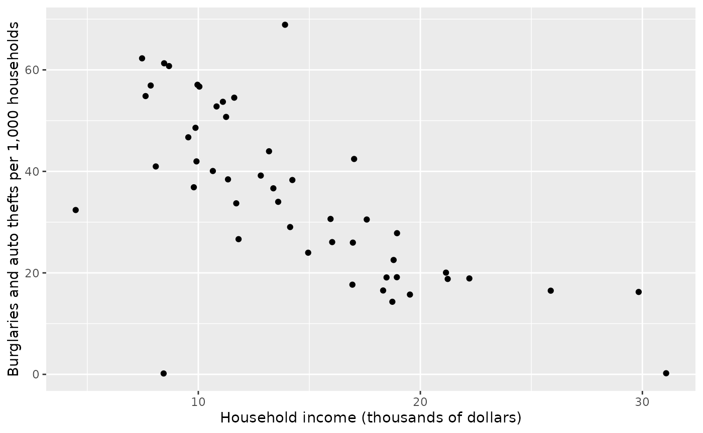
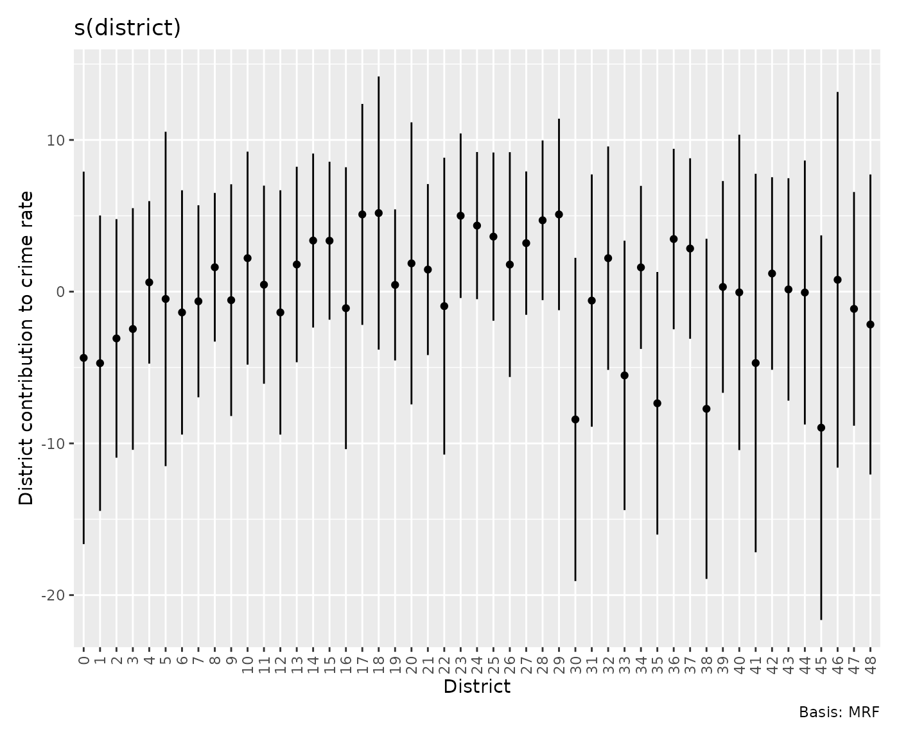
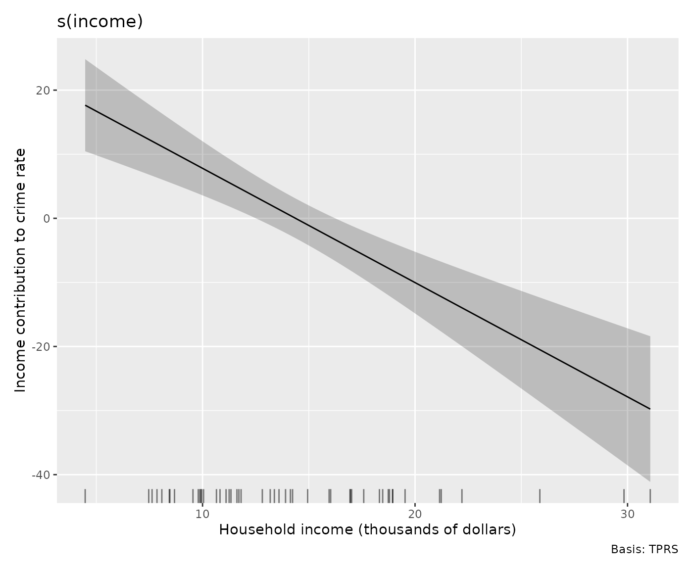
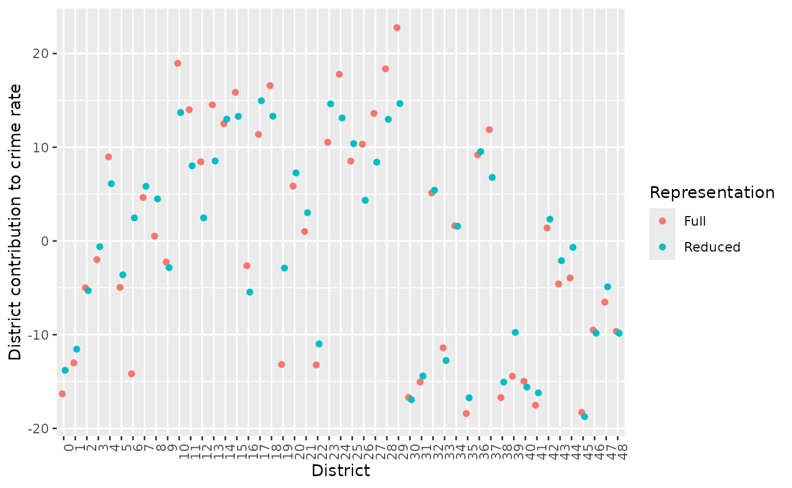
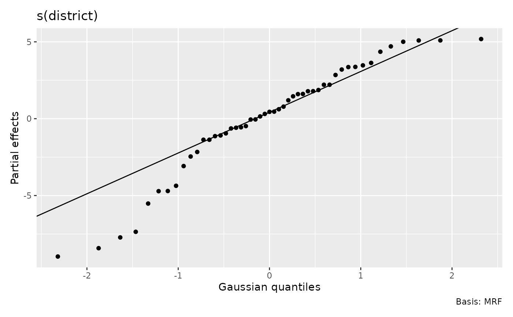
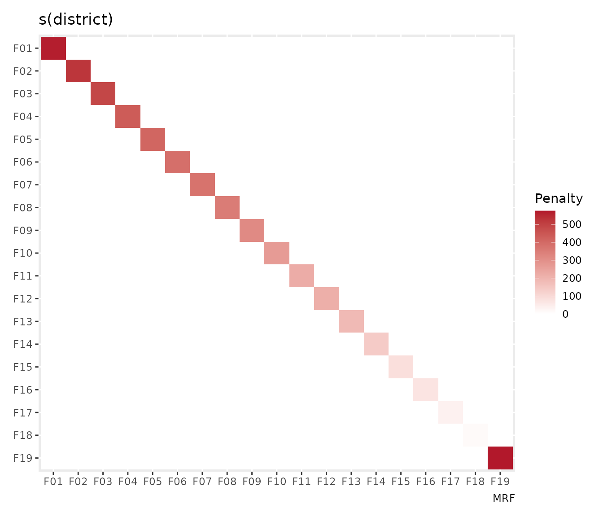
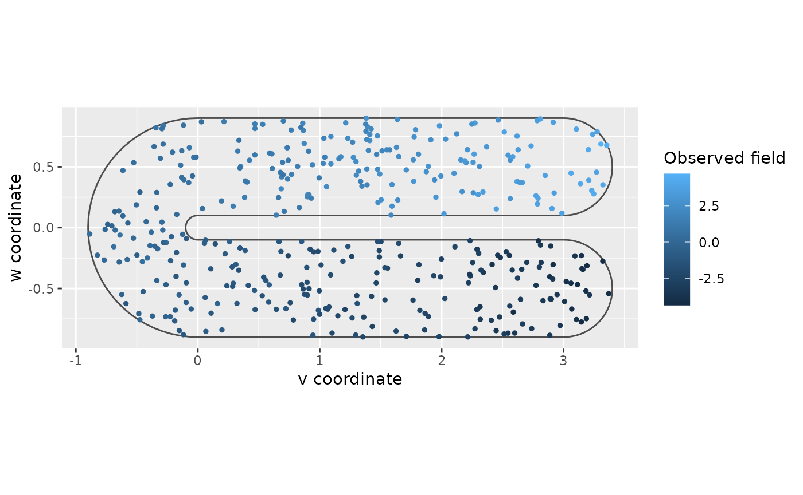
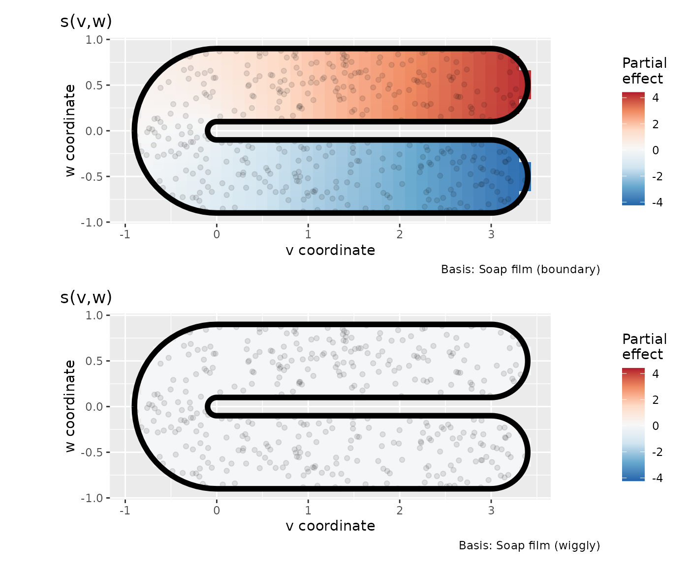
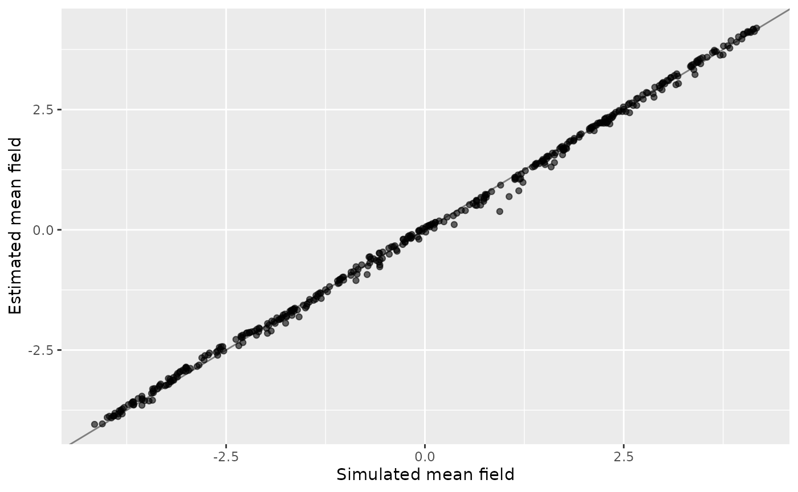
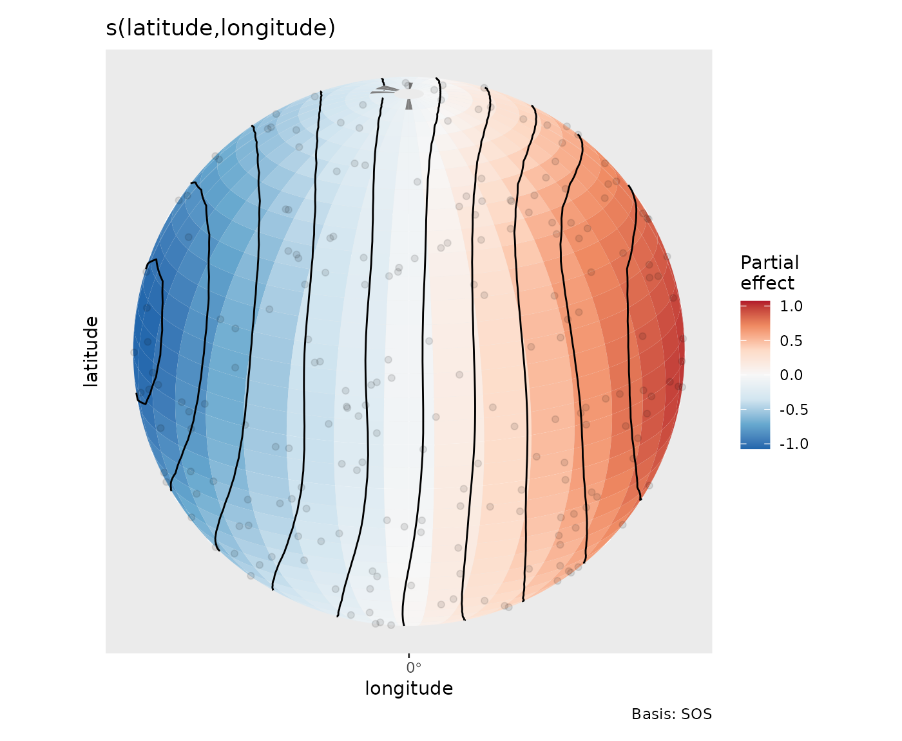

# Choose a smooth for the spatial question

Spatial proximity is not always a straight-line distance. Observations
might represent adjacent districts, locations separated by a peninsula,
or points on the globe. The appropriate smooth depends on that geometry.
This article uses three examples to show how to fit those models and
interpret gratia’s effect displays.

``` r

library("mgcv")
library("gratia")
library("ggplot2")
```

The examples require mgcv 1.9-4 or later. Spherical plotting also needs
the optional sf package. Three-dimensional views need ggcube. The
district and soap-film analyses run without either optional display
package.

## Are high crime rates explained by district income or location?

The Columbus data supplied with mgcv record residential burglary and
auto theft rates per 1,000 households in 49 districts. They also record
household income in thousands of dollars and provide district polygons.
These are **rates**, not counts, so fitting a Poisson distribution to
`crime` would misrepresent the response. A Gaussian model is a starting
approximation for variation in rates; a count model would require counts
and exposure data. See the [data
documentation](https://stat.ethz.ch/R-manual/R-devel/library/mgcv/html/columb.html)
for the original source.

We adapt the worked examples in mgcv’s [Markov random field
documentation](https://stat.ethz.ch/R-manual/R-devel/library/mgcv/html/smooth.construct.mrf.smooth.spec.html).
The smooth gives each district an effect and penalises differences
between neighbours. Neighbourhoods are derived from polygons that share
vertices.

``` r

data("columb", package = "mgcv")
data("columb.polys", package = "mgcv")
ggplot(columb, aes(income, crime)) +
  geom_point() +
  labs(x = "Household income (thousands of dollars)",
    y = "Burglaries and auto thefts per 1,000 households")
```



Start with the spatial pattern alone, and compare a full representation
with a smaller one before adding income:

``` r

district_full <- gam(crime ~ s(district, bs = "mrf",
  xt = list(polys = columb.polys)), data = columb, method = "REML")
district_small <- gam(crime ~ s(district, bs = "mrf", k = 20,
  xt = list(polys = columb.polys)), data = columb, method = "REML")
district_income <- gam(crime ~ s(district, bs = "mrf", k = 20,
  xt = list(polys = columb.polys)) + s(income, k = 6),
  data = columb, method = "REML")
overview(district_income)
#> 
#> Generalized Additive Model with 3 terms
#> 
#>   term        type           k   edf ref.edf statistic p.value
#>   <chr>       <chr>      <dbl> <dbl>   <dbl>     <dbl> <chr>  
#> 1 Intercept   parametric    NA  1       1       22.2   <0.001 
#> 2 s(district) MRF           19  5.43   19        0.512 0.0766 
#> 3 s(income)   TPRS           5  1.00    1.00    28.5   <0.001
```

The full model has a district coefficient for every area, subject to
centring and the estimated penalty. The reduced representation uses
fewer coefficients to represent the same 49 area effects. `k = 20`
restricts the available spatial patterns; it does not mean only twenty
districts are fitted. Adding income asks how much spatial variation
remains after accounting for its association with crime rate.

## Read district effects rather than basis coefficients

``` r

area_effects <- smooth_estimates(district_income, select = "s(district)",
  interval = "credible")
head(area_effects)
#> # A tibble: 6 × 9
#>   .smooth     .type .by   .estimate   .se district .crit .lower_ci .upper_ci
#>   <chr>       <chr> <chr>     <dbl> <dbl> <fct>    <dbl>     <dbl>     <dbl>
#> 1 s(district) MRF   NA       -4.36   6.26 0         1.96    -16.6       7.91
#> 2 s(district) MRF   NA       -4.71   4.97 1         1.96    -14.4       5.02
#> 3 s(district) MRF   NA       -3.08   4.01 2         1.96    -10.9       4.78
#> 4 s(district) MRF   NA       -2.46   4.06 3         1.96    -10.4       5.50
#> 5 s(district) MRF   NA        0.614  2.73 4         1.96     -4.74      5.97
#> 6 s(district) MRF   NA       -0.481  5.62 5         1.96    -11.5      10.5
```

The rows are effects for **areas**, even for a reduced-rank fit. They
are not the coefficients of its smaller basis. The same area labels
identify predictions supplied with `data`; a previously unknown district
is not a valid prediction location merely because it is adjacent to one
in the model.

``` r

draw(area_effects, angle = 90,
  ylab = "District contribution to crime rate", xlab = "District")
```



``` r

draw(district_income, select = "s(income)",
  xlab = "Household income (thousands of dollars)",
  ylab = "Income contribution to crime rate")
```



Positive area effects indicate rates above the fitted intercept and
income contribution. The income association is downward over this
dataset’s range, while individual adjusted district effects have
substantial uncertainty. Use their intervals when comparing districts.
Neighbouring districts borrow information through the penalty on the
mean effects. The Gaussian response errors are still assumed
independent, so inspect residual spatial patterns before relying on
these intervals.

To see how much the smaller spatial representation changes the fitted
pattern, compare its area effects on the same district labels:

``` r

rank_effects <- rbind(
  transform(smooth_estimates(district_full), representation = "Full"),
  transform(smooth_estimates(district_small), representation = "Reduced")
)
ggplot(rank_effects, aes(district, .estimate, colour = representation)) +
  geom_point(position = position_dodge(width = 0.5)) +
  labs(x = "District", y = "District contribution to crime rate",
    colour = "Representation") +
  theme(axis.text.x = element_text(angle = 90, hjust = 1))
```



The comparison shows how reducing the basis changes the spatial-only
fits. Use it to assess whether the smaller representation retains the
district patterns of interest. The neighbourhood graph determines which
area effects borrow information from each other, so check that it
represents the connections relevant to your analysis.

``` r

draw(district_income, select = "s(district)", mrf_plot = "qq")
```



This QQ view describes the distribution of fitted area effects. They are
correlated and can have unequal marginal variances, so this is not a
test of independent normal effects or a response-distribution
diagnostic. For response checks use
[`appraise()`](https://gavinsimpson.github.io/gratia/reference/appraise.md)
and consult [Choosing diagnostic
references](https://gavinsimpson.github.io/gratia/articles/model-checking.md).

One can also inspect the neighbourhood penalty itself:

``` r

draw(penalty(district_income, select = "s(district)"), geom = "tile")
```



This is the penalty expressed in the fitted reduced basis; its rows are
basis coefficients rather than districts. Larger diagonal entries
indicate coefficient directions that are penalised more strongly. Before
its basis transformation, the MRF penalty counts neighbours on the
diagonal and uses negative off-diagonal entries for neighbours. Use the
area plots above to inspect district labels and intervals; the penalty
plot explains how their underlying coefficients are regularised.

## How should a surface behave across a peninsula?

For a bounded region such as a water body, locations on opposite sides
of land can be close in Euclidean distance and distant along the water.
A soap-film smooth respects the supplied boundary. We use a simulation
from mgcv’s [soap-film
example](https://stat.ethz.ch/R-manual/R-devel/library/mgcv/html/smooth.construct.so.smooth.spec.html),
retaining its curved boundary, interior knots and simulated test
surface. The question is whether a boundary-aware smoother can recover a
field without joining opposite sides across the excluded region. We use
REML instead of the example’s default smoothing selection.

``` r

bnd <- list(mgcv::fs.boundary())
names(bnd[[1]]) <- c("v", "w")
interior_knots <- expand.grid(v = seq(-0.5, 3, by = 0.5),
  w = c(-0.6, -0.3, 0.3, 0.6))
set.seed(0)
v <- runif(600, -1, 4)
w <- runif(600, -1, 1)
truth <- mgcv::fs.test(v, w, b = 1)
y <- truth + rnorm(600, sd = 0.3)
inside <- mgcv::inSide(bnd, x = v, y = w)
water <- data.frame(v = v[inside], w = w[inside],
  y = y[inside], truth = truth[inside])
ggplot(water, aes(v, w, colour = y)) +
  geom_path(data = as.data.frame(bnd[[1]]), aes(v, w),
    inherit.aes = FALSE, colour = "grey30") +
  geom_point(size = 1) +
  coord_equal() +
  labs(x = "v coordinate", y = "w coordinate", colour = "Observed field")
```



The errors were generated as independent Gaussian noise with standard
deviation 0.3, matching the Gaussian identity-link model fitted below.

## Separate boundary variation from interior variation

``` r

water_fit <- gam(y ~
    s(v, w, bs = "sf", k = 30, xt = list(bnd = bnd, nmax = 100)) +
    s(v, w, bs = "sw", k = 30, xt = list(bnd = bnd, nmax = 100)),
  data = water, knots = interior_knots, method = "REML")
overview(water_fit)
#> 
#> Generalized Additive Model with 3 terms
#> 
#>   term      type                     k      edf ref.edf   statistic p.value
#>   <chr>     <chr>                <dbl>    <dbl>   <dbl>       <dbl> <chr>  
#> 1 Intercept parametric              NA  1             1  -0.973     0.331  
#> 2 s.v.w.    Soap film (boundary)    28 15.6          28 850.        <0.001 
#> 3 s.v.w..1  Soap film (wiggly)      32  0.00141      32   0.0000397 0.458
smooths(water_fit)
#> [1] "s(v,w)" "s(v,w)"
```

`sf` estimates a cyclic smooth around the closed boundary and extends it
into the interior as a surface satisfying Laplace’s equation. The first
panel shows that surface, rather than just the values along the
boundary. `sw` adds interior variation that is zero on the boundary.
Both components are estimated jointly; their sum plus the intercept
gives the complete fitted mean. The boundary basis size is `k`; the
interior basis size comes from the number of supplied knots.
`nmax = 100` sets the numerical solution grid, rather than the plotting
grid. Both component types now have distinct labels in gratia.

Both terms happen to have the same `s(v,w)` label. Select them by
numerical position when you need one component rather than both:

``` r

draw(water_fit, n_2d = 35, surface = "tile", caption = TRUE, ncol = 1,
  scales = "fixed", contour = FALSE,
  xlab = "v coordinate", ylab = "w coordinate")
```



In this simulation REML shrinks the interior adjustment almost to zero,
so the second panel is nearly flat on the shared colour scale. The
surface induced by the boundary accounts for almost all the fitted
variation. Effect colours display each centred contribution; add them
and the intercept to recover the fitted mean field. Boundary loops
remain visible and predictions outside the supplied domain are
unavailable.

``` r

interior_effect <- smooth_estimates(water_fit, select = 2,
  n_2d = 30, clip = TRUE)
head(interior_effect)
#> # A tibble: 6 × 9
#>   .smooth .type              .by   .estimate     .se .bndry .loop      v       w
#>   <chr>   <chr>              <chr>     <dbl>   <dbl> <lgl>  <int>  <dbl>   <dbl>
#> 1 s(v,w)  Soap film (wiggly) NA      2.02e-7 3.21e-5 FALSE     NA -0.886 -0.155 
#> 2 s(v,w)  Soap film (wiggly) NA      2.20e-7 4.42e-5 FALSE     NA -0.886 -0.0925
#> 3 s(v,w)  Soap film (wiggly) NA      1.62e-7 4.81e-5 FALSE     NA -0.886 -0.0305
#> 4 s(v,w)  Soap film (wiggly) NA      7.99e-8 4.79e-5 FALSE     NA -0.886  0.0315
#> 5 s(v,w)  Soap film (wiggly) NA      5.54e-9 4.37e-5 FALSE     NA -0.886  0.0935
#> 6 s(v,w)  Soap film (wiggly) NA      9.20e-7 9.37e-5 FALSE     NA -0.739 -0.464
```

`clip = TRUE` removes evaluation cells outside the boundary. Without
clipping, those locations retain missing estimates. Boundary rows are
retained as plotting information and are identified by `.bndry`; they
are not additional observations. Saved estimates retain the component
identity so
[`draw()`](https://gavinsimpson.github.io/gratia/reference/draw.md) can
reproduce its boundary-aware display.

The simulated truth makes it possible to assess the complete fitted
surface:

``` r

water$estimated <- fitted(water_fit)
sqrt(mean((water$estimated - water$truth)^2))
#> [1] 0.08519373
ggplot(water, aes(truth, estimated)) +
  geom_abline(slope = 1, intercept = 0, colour = "grey50") +
  geom_point(alpha = 0.6) +
  labs(x = "Simulated mean field", y = "Estimated mean field")
```



The fitted values follow the simulated mean closely at the sampled
locations. When adapting this model to a water body, place interior
knots across the domain and include boundary features that must prevent
smoothing across land. sf/sw components can also form space-by-time
tensor products; the flat-surface display uses numeric conditioning
slices for time. Transformed soap-film boundaries currently cannot be
drawn on a recovered raw covariate scale: retain the model-scale display
rather than silently dropping the boundary.

## How do we avoid a seam at the date line?

A plane is a poor representation for a global surface: points
immediately either side of the date line are neighbours, and all
longitudes meet at a pole. A spline on the sphere uses that geometry. We
adapt mgcv’s [spherical smooth
example](https://stat.ethz.ch/R-manual/R-devel/library/mgcv/html/smooth.construct.sos.smooth.spec.html)
as a synthetic sensor survey. Sampling latitude through
[`asin()`](https://rdrr.io/r/base/Trig.html) gives uniform area density
directly. We remove the example’s latitude shift in the test function so
the simulated field is continuous at both poles, and use REML. The units
are arbitrary; this is a controlled field-recovery exercise.

``` r

set.seed(90)
globe <- data.frame(
  latitude = asin(runif(400, -1, 1)) * 180 / pi,
  longitude = runif(400, -180, 180)
)
globe$truth <- with(globe,
  sin(longitude * pi / 180) * cos(latitude * pi / 180))
globe$observed <- globe$truth + rnorm(400, sd = 0.2)
globe_fit <- gam(observed ~ s(latitude, longitude, bs = "sos", k = 60),
  data = globe, method = "REML")
sqrt(mean((fitted(globe_fit) - globe$truth)^2))
#> [1] 0.04255861
```

The smooth requires latitude first and longitude second, in degrees. A
Gaussian fit matches the generated observation errors. The recovery
error summarises the difference between the fitted and simulated mean at
the sampled locations.

``` r

if (requireNamespace("sf", quietly = TRUE)) {
  draw(globe_fit, n_2d = 35, rug = TRUE,
    crs = "+proj=ortho +lat_0=20 +lon_0=0")
}
```



The orthographic view shows one hemisphere. Surface cells, contours and
observation points are clipped to that visible hemisphere before
projection, so locations on the far side cannot leak into the display.
Cells at poles and the date line retain valid geographic boundaries.
Changing the projection changes which locations are visible while
retaining the fitted spherical surface. Factor-by spherical effects use
separate panels for each level. Supply a regular prediction grid for a
cell map; a scattered prediction dataset is drawn as points.

Choose the geometry from the question: district neighbourhoods for
aggregated area measurements, soap films for a bounded continuous
domain, and spherical splines for global locations. The boundary and
projection controls then let the displayed surface follow the geometry
used in fitting.
