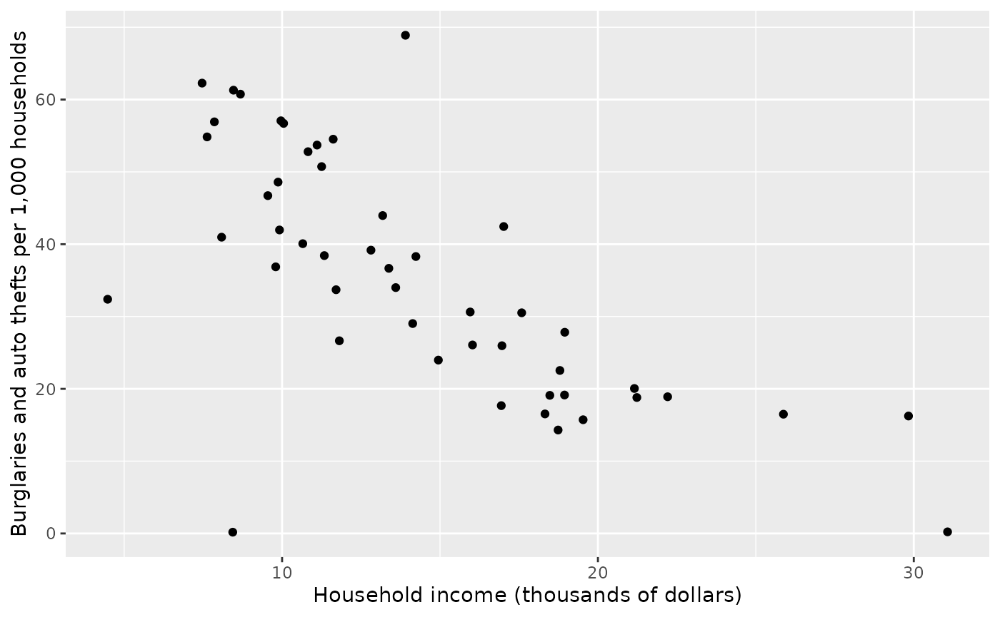
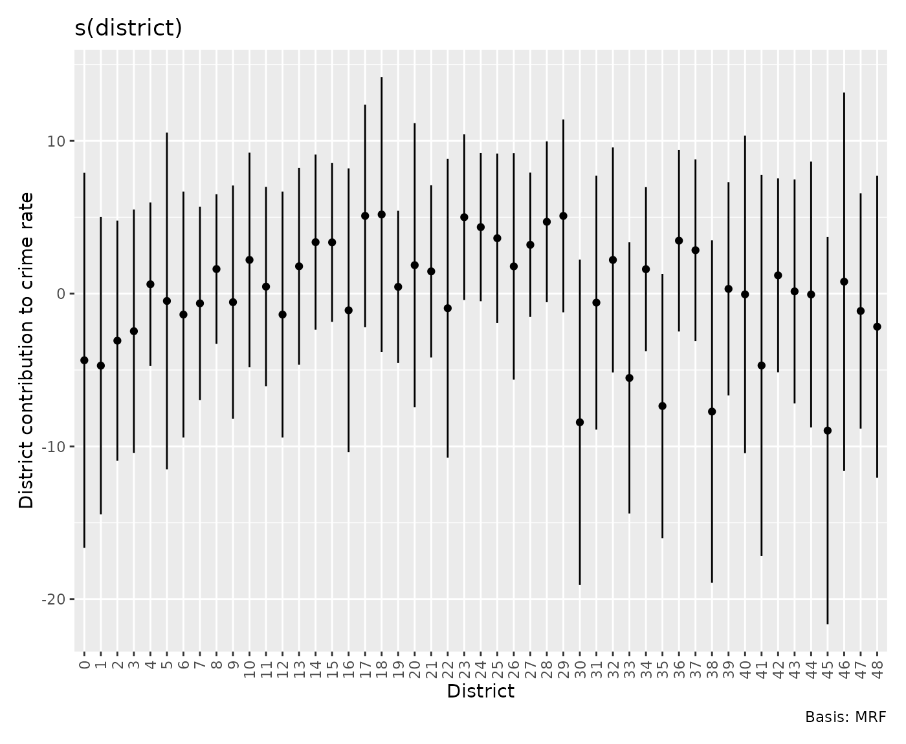
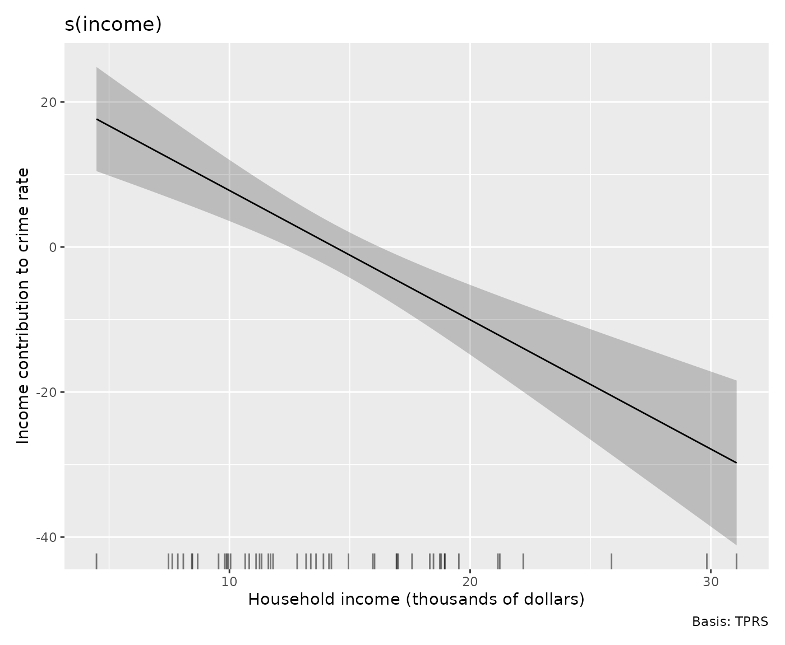
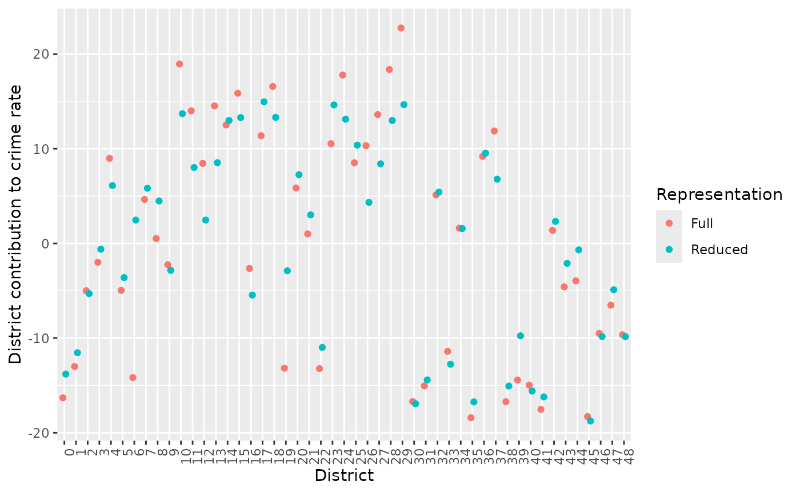
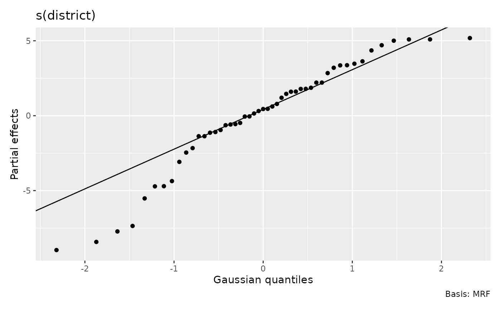
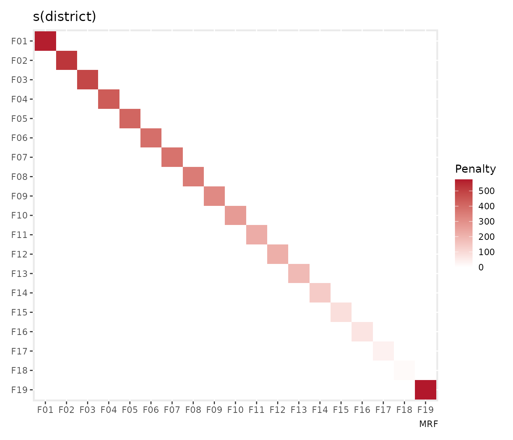
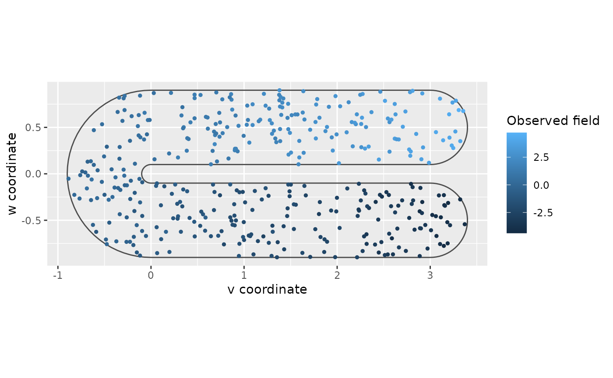
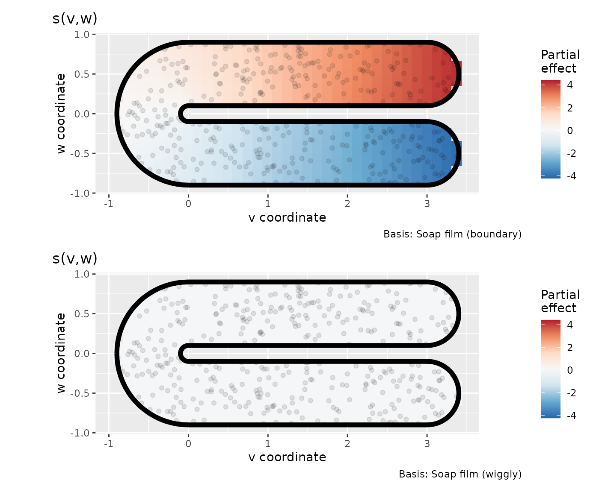
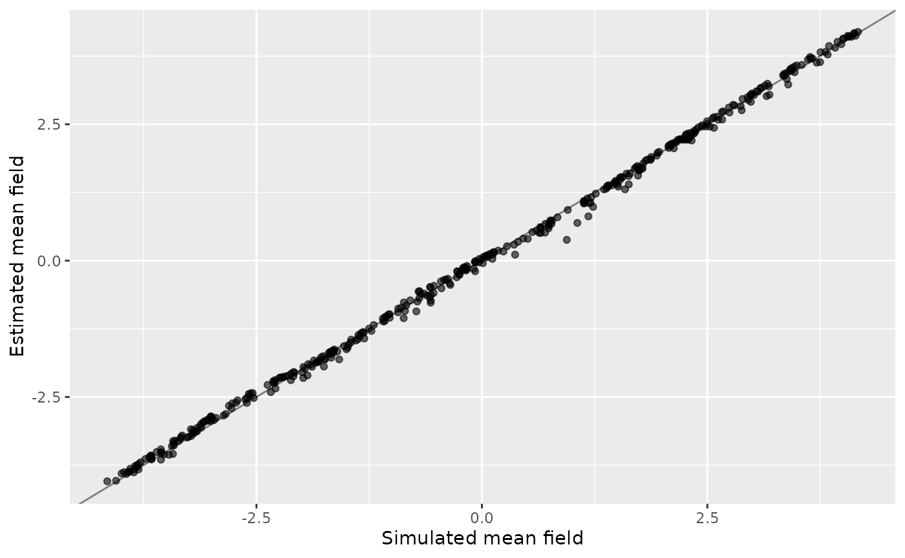
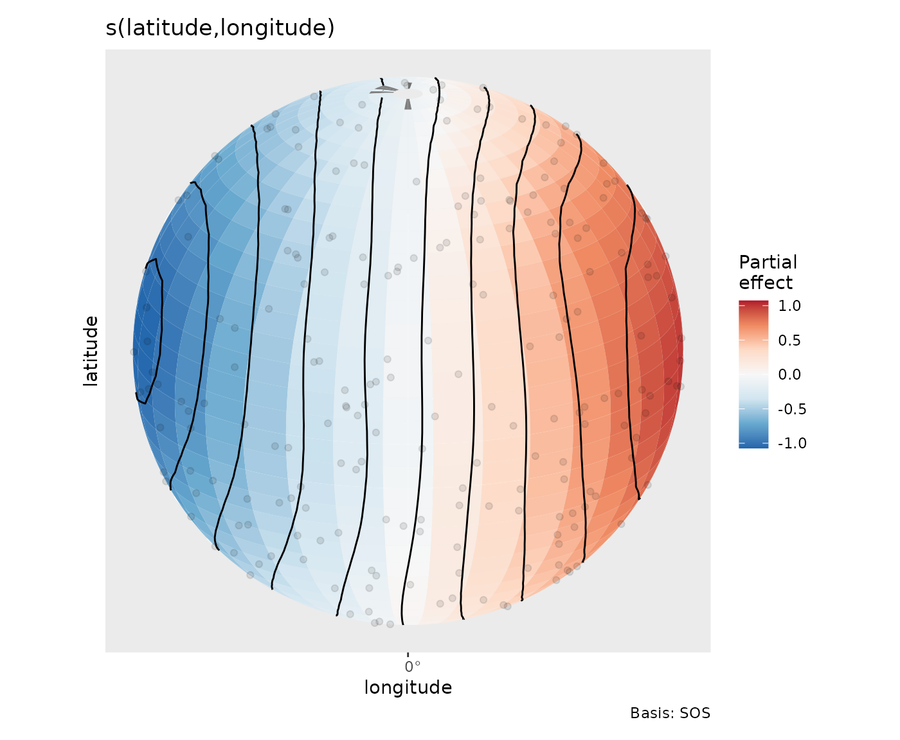

# Specialist spatial smooths

What counts as nearby depends on the setting. Districts can be
neighbours because their boundaries touch. Locations in a lake can be
close on a map but separated by land. On a globe, points with longitudes
near 180° E and 180° W can lie next to each other. This article fits and
plots a smooth for each setting.

Load {gratia}, {mgcv} and {ggplot2} for fitting the models and plotting
their effects.

``` r

library("gratia")
load_mgcv()
library("ggplot2")
```

The examples require mgcv 1.9-4 or later. Drawing the spherical map also
needs the optional {sf} package.

## Markov random fields for district effects

The Columbus data supplied with mgcv record residential burglary and car
theft rates per 1,000 households in 49 districts. They also record
household income in thousands of dollars and provide district polygons.
We use a Gaussian model for the rates. A Poisson model would need the
original crime counts and the number of households in each district. See
the [data
documentation](https://stat.ethz.ch/R-manual/R-devel/library/mgcv/html/columb.html)
for the original source.

We adapt the worked examples in mgcv’s [Markov random field
documentation](https://stat.ethz.ch/R-manual/R-devel/library/mgcv/html/smooth.construct.mrf.smooth.spec.html).
The smooth gives each district an effect and penalises differences
between neighbours. Here, districts are neighbours if their polygons
have at least one vertex in common. Load the measurements and district
polygons, then plot crime rate against income.

``` r

data("columb", package = "mgcv")
data("columb.polys", package = "mgcv")
ggplot(columb, aes(income, crime)) +
  geom_point() +
  labs(x = "Household income (thousands of dollars)",
    y = "Burglaries and auto thefts per 1,000 households")
```



First fit the district effects alone, using either one coefficient per
district or a smaller basis. Then add an income smooth to ask how much
geographical variation remains after accounting for income.

``` r

district_full <- gam(crime ~ s(district, bs = "mrf",
  xt = list(polys = columb.polys)), data = columb, method = "REML")
district_small <- gam(crime ~ s(district, bs = "mrf", k = 20,
  xt = list(polys = columb.polys)), data = columb, method = "REML")
district_income <- gam(crime ~ s(district, bs = "mrf", k = 20,
  xt = list(polys = columb.polys)) + s(income, k = 6),
  data = columb, method = "REML")
overview(district_income)
#> 
#> Generalized Additive Model with 3 terms
#> 
#>   term        type           k   edf ref.edf statistic p.value
#>   <chr>       <chr>      <dbl> <dbl>   <dbl>     <dbl> <chr>  
#> 1 Intercept   parametric    NA  1       1       22.2   <0.001 
#> 2 s(district) MRF           19  5.43   19        0.512 0.0766 
#> 3 s(income)   TPRS           5  1.00    1.00    28.5   <0.001
```

The full basis starts with one coefficient per district, and the smooth
is centred to separate it from the intercept. With `k = 20`, the smooth
still estimates an effect for all 49 districts. It uses fewer
coefficients, which limits the spatial patterns it can represent.
Including income shows how the district effects change after accounting
for its association with crime rate.

## Estimate and plot district effects

Use
[`smooth_estimates()`](https://gavinsimpson.github.io/gratia/reference/smooth_estimates.md)
to obtain each district’s estimated contribution and uncertainty. The
output identifies districts even when the fitted basis has fewer
coefficients than there are districts.

``` r

area_effects <- smooth_estimates(district_income, select = "s(district)",
  interval = "credible")
head(area_effects)
#> # A tibble: 6 × 9
#>   .smooth     .type .by   .estimate   .se district .crit .lower_ci .upper_ci
#>   <chr>       <chr> <chr>     <dbl> <dbl> <fct>    <dbl>     <dbl>     <dbl>
#> 1 s(district) MRF   NA       -4.36   6.26 0         1.96    -16.6       7.91
#> 2 s(district) MRF   NA       -4.71   4.97 1         1.96    -14.4       5.02
#> 3 s(district) MRF   NA       -3.08   4.01 2         1.96    -10.9       4.78
#> 4 s(district) MRF   NA       -2.46   4.06 3         1.96    -10.4       5.50
#> 5 s(district) MRF   NA        0.614  2.73 4         1.96     -4.74      5.97
#> 6 s(district) MRF   NA       -0.481  5.62 5         1.96    -11.5      10.5
```

The same district labels identify prediction locations supplied with
`data`. Predictions require districts included in the fitted model;
adjacency alone does not supply an effect for a new district.

Plot the saved district estimates, then the income smooth. The two plots
show the separate contributions to the fitted crime rate.

``` r

draw(area_effects, angle = 90,
  ylab = "District contribution to crime rate", xlab = "District")
```



``` r

draw(district_income, select = "s(income)",
  xlab = "Household income (thousands of dollars)",
  ylab = "Income contribution to crime rate")
```



A positive district effect raises the fitted rate above the sum of the
intercept and the income contribution. Fitted rates decline with income,
and many individual district effects have wide intervals. An interval
for the difference between two districts needs to account for the
covariance of their estimated effects. The penalty encourages similar
fitted effects for neighbours. The model assumes independent errors
around those fitted rates, so check the residuals for remaining spatial
patterns.

To see how much the smaller spatial representation changes the fitted
pattern, compare its area effects on the same district labels:

``` r

rank_effects <- rbind(
  transform(smooth_estimates(district_full), representation = "Full"),
  transform(smooth_estimates(district_small), representation = "Reduced")
)
ggplot(rank_effects, aes(district, .estimate, colour = representation)) +
  geom_point(position = position_dodge(width = 0.5)) +
  labs(x = "District", y = "District contribution to crime rate",
    colour = "Representation") +
  theme(axis.text.x = element_text(angle = 90, hjust = 1))
```



Use this comparison to assess whether the smaller basis retains the
district patterns of interest. To inspect the distribution of the
estimated district effects, use a normal QQ plot.

``` r

draw(district_income, select = "s(district)", mrf_plot = "qq")
```



The QQ plot compares the distribution of the fitted district effects
with a normal distribution. Read it as a description of these estimates,
which can be correlated and have different variances. To check the
response distribution, use
[`appraise()`](https://gavinsimpson.github.io/gratia/reference/appraise.md)
as shown in the [model diagnostics
article](https://gavinsimpson.github.io/gratia/articles/model-checking.md).

Use
[`penalty()`](https://gavinsimpson.github.io/gratia/reference/penalty.md)
to inspect how the model penalises its fitted coefficients. For the
reduced basis used here, the matrix is expressed in basis coefficients
rather than one row and column per district.

``` r

draw(penalty(district_income, select = "s(district)"), geom = "tile")
```



In district coordinates, the unscaled penalty matrix has the number of
neighbours on the diagonal and a value of −1 for each neighbouring pair.
Those entries penalise squared differences between neighbouring district
effects. The plot shows the penalty after it has been expressed in the
smaller basis.

## Soap-film smooths for bounded regions

Across a peninsula, the straight-line distance between two locations can
be much shorter than the distance by water. A soap-film smooth uses the
water boundary to avoid smoothing directly across the land. We use a
simulation from mgcv’s [soap-film
example](https://stat.ethz.ch/R-manual/R-devel/library/mgcv/html/smooth.construct.so.smooth.spec.html),
retaining its curved boundary, interior knots and simulated test
surface. The boundary represents a water body around a peninsula; `v`
and `w` are its spatial coordinates. We sample locations inside it and
add independent Gaussian noise with standard deviation 0.3 to a known
mean surface. This lets us check how well the fitted smooth recovers the
surface while keeping its predictions within the water body.

``` r

bnd <- list(mgcv::fs.boundary())
names(bnd[[1]]) <- c("v", "w")
interior_knots <- expand.grid(v = seq(-0.5, 3, by = 0.5),
  w = c(-0.6, -0.3, 0.3, 0.6))
set.seed(0)
v <- runif(600, -1, 4)
w <- runif(600, -1, 1)
truth <- mgcv::fs.test(v, w, b = 1)
y <- truth + rnorm(600, sd = 0.3)
inside <- mgcv::inSide(bnd, x = v, y = w)
water <- data.frame(v = v[inside], w = w[inside],
  y = y[inside], truth = truth[inside])
ggplot(water, aes(v, w, colour = y)) +
  geom_path(data = as.data.frame(bnd[[1]]), aes(v, w),
    inherit.aes = FALSE, colour = "grey30") +
  geom_point(size = 1) +
  coord_equal() +
  labs(x = "v coordinate", y = "w coordinate", colour = "Observed field")
```



## Separate boundary and interior effects

Fit a Gaussian model with two soap-film components: `sf` describes
variation around the boundary and its extension into the interior, while
`sw` adds variation inside the boundary. We estimate both components
together using REML.

``` r

water_fit <- gam(y ~
    s(v, w, bs = "sf", k = 30, xt = list(bnd = bnd, nmax = 100)) +
    s(v, w, bs = "sw", k = 30, xt = list(bnd = bnd, nmax = 100)),
  data = water, knots = interior_knots, method = "REML")
overview(water_fit)
#> 
#> Generalized Additive Model with 3 terms
#> 
#>   term      type                     k      edf ref.edf   statistic p.value
#>   <chr>     <chr>                <dbl>    <dbl>   <dbl>       <dbl> <chr>  
#> 1 Intercept parametric              NA  1             1  -0.973     0.331  
#> 2 s.v.w.    Soap film (boundary)    28 15.6          28 850.        <0.001 
#> 3 s.v.w..1  Soap film (wiggly)      32  0.00141      32   0.0000397 0.458
smooths(water_fit)
#> [1] "s(v,w)" "s(v,w)"
```

`sf` fits a cyclic smooth around the closed boundary and extends it into
the interior as a surface satisfying Laplace’s equation. `sw` adds
variation in the interior and is zero on the boundary. Adding the two
contributions and the intercept gives the fitted mean. `k` sets the
boundary basis size, and the number of supplied knots sets the interior
basis size. `nmax = 100` sets the resolution of the grid used to compute
the basis.

Plot the two components on the same colour scale to compare the size of
their contributions. The boundary is drawn on each panel so the
locations are clear.

``` r

draw(water_fit, n_2d = 35, surface = "tile", caption = TRUE, ncol = 1,
  scales = "fixed", contour = FALSE,
  xlab = "v coordinate", ylab = "w coordinate")
```



In this simulation the interior adjustment is close to zero, so the
second panel is nearly flat on the shared colour scale. Almost all the
fitted variation comes from the surface that extends the boundary
smooth. To save the interior component, select it by position with
`select = 2` because both components share the label `s(v,w)`.

``` r

interior_effect <- smooth_estimates(water_fit, select = 2,
  n_2d = 30, clip = TRUE)
head(interior_effect)
#> # A tibble: 6 × 9
#>   .smooth .type              .by   .estimate     .se .bndry .loop      v       w
#>   <chr>   <chr>              <chr>     <dbl>   <dbl> <lgl>  <int>  <dbl>   <dbl>
#> 1 s(v,w)  Soap film (wiggly) NA      2.02e-7 3.21e-5 FALSE     NA -0.886 -0.155 
#> 2 s(v,w)  Soap film (wiggly) NA      2.20e-7 4.42e-5 FALSE     NA -0.886 -0.0925
#> 3 s(v,w)  Soap film (wiggly) NA      1.62e-7 4.81e-5 FALSE     NA -0.886 -0.0305
#> 4 s(v,w)  Soap film (wiggly) NA      7.99e-8 4.79e-5 FALSE     NA -0.886  0.0315
#> 5 s(v,w)  Soap film (wiggly) NA      5.54e-9 4.37e-5 FALSE     NA -0.886  0.0935
#> 6 s(v,w)  Soap film (wiggly) NA      9.20e-7 9.37e-5 FALSE     NA -0.739 -0.464
```

`clip = TRUE` drops evaluation points outside the boundary. With
`clip = FALSE`, those estimates are `NA`. Rows marked `.bndry = TRUE`
record the outline so that
[`draw()`](https://gavinsimpson.github.io/gratia/reference/draw.md) can
show it with the saved estimates.

The simulated truth makes it possible to assess the complete fitted
surface:

``` r

water$estimated <- fitted(water_fit)
sqrt(mean((water$estimated - water$truth)^2))
#> [1] 0.08519373
ggplot(water, aes(truth, estimated)) +
  geom_abline(slope = 1, intercept = 0, colour = "grey50") +
  geom_point(alpha = 0.6) +
  labs(x = "Simulated mean field", y = "Estimated mean field")
```



The fitted values follow the simulated mean closely at the sampled
locations. When adapting this model to a water body, spread the interior
knots across the water and keep boundary features, such as peninsulas,
that should block smoothing across land.

## Spherical smooths for global locations

A spline on the sphere accounts for the way longitude wraps at 180° and
converges at the poles. We adapt mgcv’s [spherical smooth
example](https://stat.ethz.ch/R-manual/R-devel/library/mgcv/html/smooth.construct.sos.smooth.spec.html)
to simulate measurements at 400 locations distributed uniformly over the
globe. The mean surface varies with latitude and longitude and is
continuous at the poles. We add independent Gaussian noise with standard
deviation 0.2. The coordinates are in degrees and the response units are
arbitrary.

``` r

set.seed(90)
globe <- data.frame(
  latitude = asin(runif(400, -1, 1)) * 180 / pi,
  longitude = runif(400, -180, 180)
)
globe$truth <- with(globe,
  sin(longitude * pi / 180) * cos(latitude * pi / 180))
globe$observed <- globe$truth + rnorm(400, sd = 0.2)
```

Fit a Gaussian model with a spherical smooth of latitude and longitude,
using REML to estimate its smoothness. Calculate the root mean squared
error between the fitted values and the known mean surface to assess
recovery at the sampled locations.

``` r

globe_fit <- gam(observed ~ s(latitude, longitude, bs = "sos", k = 60),
  data = globe, method = "REML")
sqrt(mean((fitted(globe_fit) - globe$truth)^2))
#> [1] 0.04255861
```

The smooth requires latitude first and longitude second, both in
degrees. Use `crs` to choose a map projection. This orthographic
projection shows the hemisphere centred on latitude 20° and longitude
0°.

``` r

if (requireNamespace("sf", quietly = TRUE)) {
  draw(globe_fit, n_2d = 35, rug = TRUE,
    crs = "+proj=ortho +lat_0=20 +lon_0=0")
}
```



This projection clips the map to the visible hemisphere. You can choose
a different projection to view the same fitted surface. Factor-by
spherical effects use separate panels for each level. Supply a regular
prediction grid to draw a map with cells. For scattered prediction
locations,
[`draw()`](https://gavinsimpson.github.io/gratia/reference/draw.md) uses
points.
