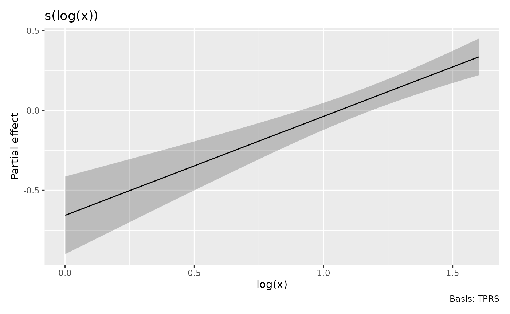
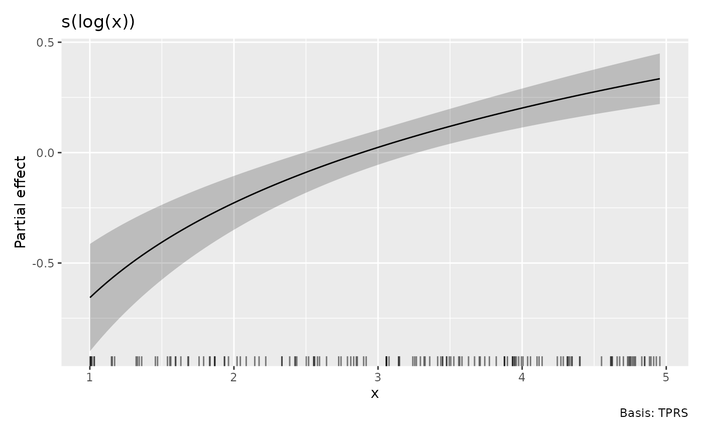
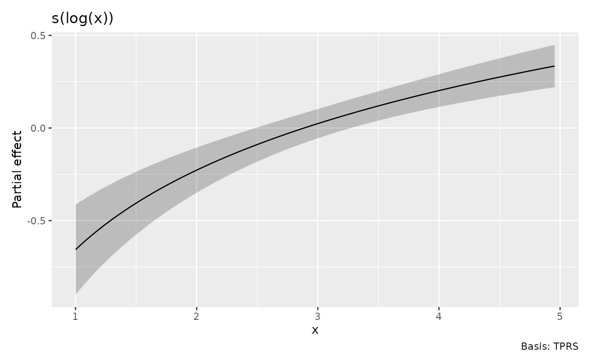
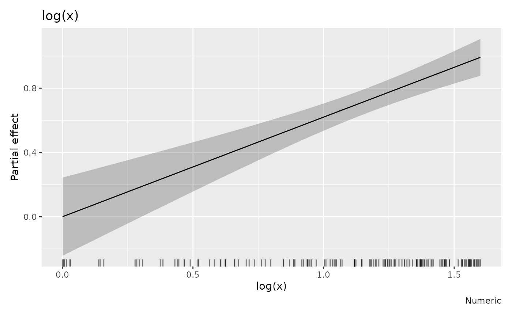
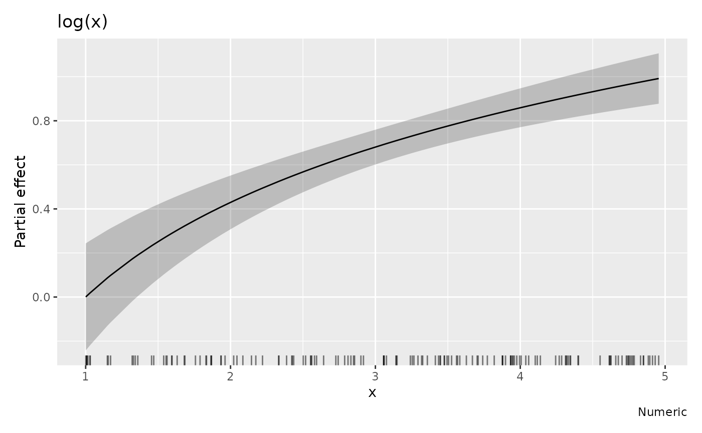
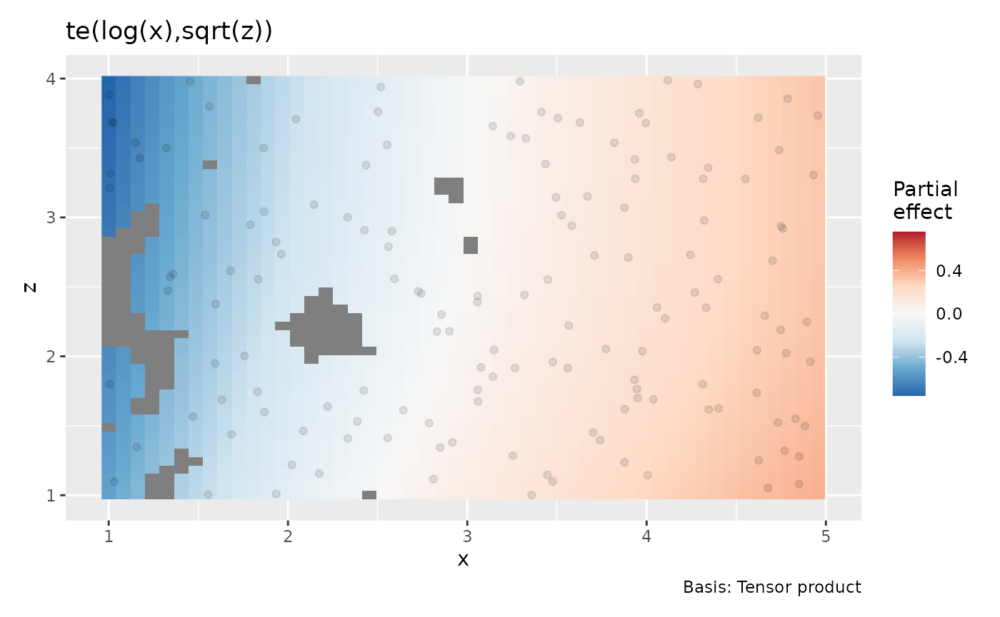
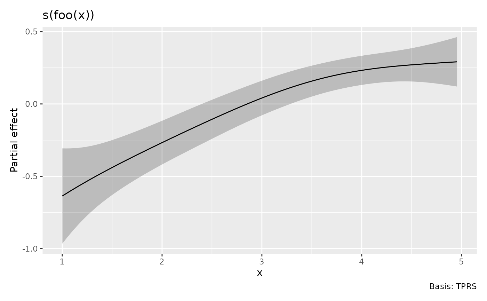

# Predictions, plots and derivatives with transformed covariates

A model fitted with `s(log(x))` uses a transformed covariate, but we may
want to predict at supplied values of `x`, plot the result against `x`,
or estimate change per unit of `x`. This vignette shows how to make
those choices while keeping the model’s transformation intact.

We load {gratia} and {mgcv} for the examples:

``` r

library("gratia")
load_mgcv()
```

## Fit a count model with a transformed covariate and an effort offset

We simulate independent Poisson counts. The rate per unit of effort
varies nonlinearly with `log(x)`, and multiplying that rate by effort
gives each observation’s expected count. Thus, twice the effort gives
twice the expected count at the same value of `x`.

``` r

set.seed(42)
dat <- data.frame(x = runif(150, 1, 5), effort = runif(150, 1, 3))
dat$y <- rpois(nrow(dat), dat$effort * exp(sin(log(dat$x))))
```

With a log link, the multiplicative effort term becomes an additive
`offset(log(effort))`. We fit a smooth of `log(x)` to estimate the
remaining variation in the log expected count:

``` r

m <- gam(y ~ s(log(x), k = 6) + offset(log(effort)),
  family = poisson(), data = dat, method = "REML")
```

## Predict at values of the original covariates

Supply the original `x` and `effort` values when predicting at new
observations; gratia evaluates their transformations. Here we hold
effort at two units and compare the contribution of the smooth with the
complete fitted mean.
[`smooth_estimates()`](https://gavinsimpson.github.io/gratia/reference/smooth_estimates.md)
needs only `x`, whereas
[`fitted_values()`](https://gavinsimpson.github.io/gratia/reference/fitted_values.md)
also needs the effort offset:

``` r

nd <- data.frame(x = seq(1.2, 4.8, length.out = 8), effort = 2)
smooth_estimates(m, data = nd["x"])
#> # A tibble: 8 × 7
#>   .smooth   .type .by   .estimate    .se `log(x)` .gratia_raw_x
#>   <chr>     <chr> <chr>     <dbl>  <dbl>    <dbl>         <dbl>
#> 1 s(log(x)) TPRS  NA      -0.544  0.107     0.182          1.2 
#> 2 s(log(x)) TPRS  NA      -0.323  0.0748    0.539          1.71
#> 3 s(log(x)) TPRS  NA      -0.160  0.0543    0.801          2.23
#> 4 s(log(x)) TPRS  NA      -0.0318 0.0428    1.01           2.74
#> 5 s(log(x)) TPRS  NA       0.0747 0.0396    1.18           3.26
#> 6 s(log(x)) TPRS  NA       0.166  0.0425    1.33           3.77
#> 7 s(log(x)) TPRS  NA       0.245  0.0487    1.46           4.29
#> 8 s(log(x)) TPRS  NA       0.315  0.0561    1.57           4.8
fitted_values(m, data = nd)
#> # A tibble: 8 × 8
#>    .row     x effort .parameter .fitted    .se .lower_ci .upper_ci
#>   <int> <dbl>  <dbl> <chr>        <dbl>  <dbl>     <dbl>     <dbl>
#> 1     1  1.2       2 mean          2.51 0.107       2.03      3.09
#> 2     2  1.71      2 mean          3.13 0.0748      2.70      3.62
#> 3     3  2.23      2 mean          3.68 0.0543      3.31      4.09
#> 4     4  2.74      2 mean          4.18 0.0428      3.85      4.55
#> 5     5  3.26      2 mean          4.65 0.0396      4.31      5.03
#> 6     6  3.77      2 mean          5.10 0.0425      4.69      5.54
#> 7     7  4.29      2 mean          5.52 0.0487      5.01      6.07
#> 8     8  4.8       2 mean          5.92 0.0561      5.30      6.61
```

Without supplied prediction data,
[`smooth_estimates()`](https://gavinsimpson.github.io/gratia/reference/smooth_estimates.md)
creates an evenly spaced grid on the scale used in the smooth: here,
`log(x)`. We can plot the estimated contribution directly on that scale:

``` r

sm <- smooth_estimates(m, n = 30)
draw(sm)
```



If you already have values on the transformed scale, supply a column
named exactly as it appears in the model, here `log(x)`:

``` r

evaluated <- data.frame(`log(x)` = log(nd$x), check.names = FALSE)
smooth_estimates(m, data = evaluated)
#> # A tibble: 8 × 6
#>   .smooth   .type .by   .estimate    .se `log(x)`
#>   <chr>     <chr> <chr>     <dbl>  <dbl>    <dbl>
#> 1 s(log(x)) TPRS  NA      -0.544  0.107     0.182
#> 2 s(log(x)) TPRS  NA      -0.323  0.0748    0.539
#> 3 s(log(x)) TPRS  NA      -0.160  0.0543    0.801
#> 4 s(log(x)) TPRS  NA      -0.0318 0.0428    1.01 
#> 5 s(log(x)) TPRS  NA       0.0747 0.0396    1.18 
#> 6 s(log(x)) TPRS  NA       0.166  0.0425    1.33 
#> 7 s(log(x)) TPRS  NA       0.245  0.0487    1.46 
#> 8 s(log(x)) TPRS  NA       0.315  0.0561    1.57
```

If both `x` and `log(x)` are supplied, gratia computes the
transformation from `x`. To build a grid on the original scale, use
[`data_slice()`](https://gavinsimpson.github.io/gratia/reference/data_slice.md)
with the original fitting data. The following call creates eight evenly
spaced `x` values while holding effort at two:

``` r

data_slice(m, x = evenly(x, n = 8), effort = 2, data = dat)
#> # A tibble: 8 × 2
#>       x effort
#>   <dbl>  <dbl>
#> 1  1.00      2
#> 2  1.57      2
#> 3  2.13      2
#> 4  2.70      2
#> 5  3.26      2
#> 6  3.83      2
#> 7  4.39      2
#> 8  4.96      2
```

## Plot against the original covariates

Drawing methods use the model’s covariate coordinates by default. For
example, `log(x)` is plotted against `log(x)`, with a matching axis
label, whether it is inside a smooth or a parametric term. Set
`back_transform = TRUE` to display `x` instead. The estimated smooth
contribution remains on the model’s linear predictor scale. The
following calls request an axis in the original units, first from the
fitted model and then from saved smooth estimates.

``` r

draw(m, back_transform = TRUE)
```



``` r

sm_raw <- smooth_estimates(m, back_transform = TRUE)
draw(sm_raw, back_transform = TRUE)
```



The same option works for transformed covariates in parametric terms. We
fit a Poisson model with a linear effect of `log(x)` and the same effort
offset. Plot the effect against `log(x)` and `x`, then make the plot in
the original units using the output of
[`parametric_effects()`](https://gavinsimpson.github.io/gratia/reference/parametric_effects.md).

``` r

m_parametric <- gam(y ~ log(x) + offset(log(effort)),
  family = poisson(), data = dat)
draw(m_parametric)
```



``` r

draw(m_parametric, back_transform = TRUE)
```


``` r

pe <- parametric_effects(m_parametric)
draw(pe, back_transform = TRUE)
```



For a surface, `back_transform = TRUE` changes both displayed axes. To
illustrate this, we add an independent covariate `z` and fit a
tensor-product smooth using `log(x)` and `sqrt(z)`. The simulated counts
still depend only on `x` and effort; `z` supplies a second axis for this
display example:

``` r

dat_surface <- transform(dat, z = runif(nrow(dat), 1, 4))
```

Fit a smooth over the transformed coordinates, then request
original-scale axes for both covariates when drawing it.

``` r

m_surface <- gam(y ~ te(log(x), sqrt(z)) + offset(log(effort)), family = poisson(),
  data = dat_surface, method = "REML")
draw(m_surface, back_transform = TRUE, contour = FALSE)
```



`back_transform = TRUE` also changes where a smooth is evaluated when
the grid is generated automatically. For example, consider `s(log(x))`
with `x` ranging from 1 to 100. By default, three equally spaced points
on the log scale correspond to 1, 10 and 100 in the original units. With
`smooth_estimates(..., back_transform = TRUE)`, the same grid size gives
1, 50.5 and 100 in the original units. The smooth is evaluated at the
logs of these values. `draw(m, back_transform = TRUE)` prepares this
grid automatically.

Precomputed estimates retain their chosen evaluation points. An object
created on a transformed-only grid cannot be drawn on the original
scale: its raw coordinates are unavailable. Recompute it with
`back_transform = TRUE`, or supply original covariate values through
`data` when calculating the estimates.

### Use your own transformation functions

The transformation need not be named
[`log()`](https://rdrr.io/r/base/Log.html) or
[`sqrt()`](https://rdrr.io/r/base/MathFun.html). Each smooth axis must
depend on one distinct original model covariate, and the transformation
must be available when calculating predictions. Here `foo()` is another
name for [`sqrt()`](https://rdrr.io/r/base/MathFun.html); we supply its
environment through `envir`:

``` r

foo <- sqrt
m_foo <- gam(y ~ s(foo(x), k = 6), family = poisson(), data = dat)
sm_foo <- smooth_estimates(m_foo, back_transform = TRUE, envir = environment())
draw(sm_foo, back_transform = TRUE)
```



Keep the original fitting data and transformation functions available
when creating automatic original-scale grids. If the fitting data are
unavailable, supply prediction rows in `data`; if a function or constant
is missing, supply its environment in `envir`. Saved estimates can then
be plotted without evaluating the transformation again. Rugs and partial
residuals require the original observations and are omitted when those
observations cannot be recovered.

Soap-film boundary coordinates are stored on the model scale. A
transformed boundary has no retained raw coordinates, so raw-scale
drawing raises an error. Draw these soap films with
`back_transform = FALSE` to retain their boundaries.

The old `parametric_effects(transform = ...)` argument is deprecated.
Replace `transform = TRUE` with `back_transform = FALSE`, and
`transform = FALSE` with `back_transform = TRUE`.

## Preserve functions defined inside a model-fitting function

A fitted model may retain the formula expression without retaining the
local environment in which it was evaluated. In the example below,
`transform_x()` needs the local constant `shift`. We return the fitted
model and that environment together, then use `envir` when predicting at
new observations:

``` r

fit_local <- function(dat) {
  shift <- 0.5
  transform_x <- function(x) log(x + shift)
  f <- y ~ s(transform_x(x), k = 6) + offset(log(effort))
  list(model = gam(f, family = poisson(), data = dat, method = "REML"),
    envir = environment(f))
}
bundle <- fit_local(dat)
smooth_estimates(bundle$model, data = nd, envir = bundle$envir)
#> # A tibble: 8 × 7
#>   .smooth           .type .by   .estimate    .se `transform_x(x)` .gratia_raw_x
#>   <chr>             <chr> <chr>     <dbl>  <dbl>            <dbl>         <dbl>
#> 1 s(transform_x(x)) TPRS  NA      -0.543  0.113             0.531          1.2 
#> 2 s(transform_x(x)) TPRS  NA      -0.329  0.0772            0.795          1.71
#> 3 s(transform_x(x)) TPRS  NA      -0.164  0.0607            1.00           2.23
#> 4 s(transform_x(x)) TPRS  NA      -0.0295 0.0511            1.18           2.74
#> 5 s(transform_x(x)) TPRS  NA       0.0802 0.0451            1.32           3.26
#> 6 s(transform_x(x)) TPRS  NA       0.170  0.0440            1.45           3.77
#> 7 s(transform_x(x)) TPRS  NA       0.244  0.0497            1.57           4.29
#> 8 s(transform_x(x)) TPRS  NA       0.308  0.0619            1.67           4.8
fitted_values(bundle$model, data = nd, envir = bundle$envir)
#> # A tibble: 8 × 8
#>    .row     x effort .parameter .fitted    .se .lower_ci .upper_ci
#>   <int> <dbl>  <dbl> <chr>        <dbl>  <dbl>     <dbl>     <dbl>
#> 1     1  1.2       2 mean          2.51 0.113       2.01      3.13
#> 2     2  1.71      2 mean          3.11 0.0772      2.67      3.62
#> 3     3  2.23      2 mean          3.67 0.0607      3.26      4.13
#> 4     4  2.74      2 mean          4.19 0.0511      3.79      4.64
#> 5     5  3.26      2 mean          4.68 0.0451      4.28      5.11
#> 6     6  3.77      2 mean          5.12 0.0440      4.70      5.58
#> 7     7  4.29      2 mean          5.51 0.0497      5.00      6.08
#> 8     8  4.8       2 mean          5.88 0.0619      5.21      6.64
```

New predictions require the original definition of `transform_x()` and
the same value of `shift`. Retaining `bundle$envir` makes both available
after `fit_local()` has returned.

## Choose whether derivatives describe change in `x` or `log(x)`

For a contribution f(\log x), the default derivative is with respect to
\log x. Set `wrt = "covariate"` to differentiate with respect to x
instead. The latter includes the chain-rule factor 1/x. We compare both
derivatives at the prediction rows created earlier. Both describe change
in the smooth’s contribution to the log expected count; use
[`response_derivatives()`](https://gavinsimpson.github.io/gratia/reference/response_derivatives.md)
for change in the complete response mean.

``` r

derivatives(m, data = nd, type = "central")
#> # A tibble: 8 × 9
#>   .smooth   .by   .fs   .derivative   .se .crit .lower_ci .upper_ci `log(x)`
#>   <chr>     <chr> <chr>       <dbl> <dbl> <dbl>     <dbl>     <dbl>    <dbl>
#> 1 s(log(x)) NA    NA          0.620 0.101  1.96     0.422     0.817    0.182
#> 2 s(log(x)) NA    NA          0.620 0.100  1.96     0.423     0.817    0.539
#> 3 s(log(x)) NA    NA          0.620 0.100  1.96     0.423     0.816    0.801
#> 4 s(log(x)) NA    NA          0.620 0.100  1.96     0.423     0.816    1.01 
#> 5 s(log(x)) NA    NA          0.620 0.100  1.96     0.423     0.816    1.18 
#> 6 s(log(x)) NA    NA          0.620 0.100  1.96     0.423     0.816    1.33 
#> 7 s(log(x)) NA    NA          0.619 0.101  1.96     0.422     0.816    1.46 
#> 8 s(log(x)) NA    NA          0.619 0.101  1.96     0.422     0.817    1.57
derivatives(m, data = nd, type = "central", wrt = "covariate")
#> # A tibble: 8 × 9
#>   .smooth   .by   .fs   .derivative    .se .crit .lower_ci .upper_ci     x
#>   <chr>     <chr> <chr>       <dbl>  <dbl> <dbl>     <dbl>     <dbl> <dbl>
#> 1 s(log(x)) NA    NA          0.516 0.0839  1.96    0.352      0.681  1.2 
#> 2 s(log(x)) NA    NA          0.361 0.0586  1.96    0.247      0.476  1.71
#> 3 s(log(x)) NA    NA          0.278 0.0450  1.96    0.190      0.366  2.23
#> 4 s(log(x)) NA    NA          0.226 0.0366  1.96    0.154      0.298  2.74
#> 5 s(log(x)) NA    NA          0.190 0.0308  1.96    0.130      0.251  3.26
#> 6 s(log(x)) NA    NA          0.164 0.0266  1.96    0.112      0.216  3.77
#> 7 s(log(x)) NA    NA          0.145 0.0235  1.96    0.0986     0.191  4.29
#> 8 s(log(x)) NA    NA          0.129 0.0209  1.96    0.0880     0.170  4.8
```

### Differentiate a surface with respect to one covariate

For a surface,
[`partial_derivatives()`](https://gavinsimpson.github.io/gratia/reference/partial_derivatives.md)
varies the coordinate named in `focal` while holding the other
coordinates fixed. `wrt` chooses the scale of that coordinate. For
example, `te(log(x), sqrt(z))` represents a contribution f(\log x, \sqrt
z), with the following choices:

| Arguments | Derivative |
|:---|:---|
| `wrt = "smooth", focal = "log(x)"` | With respect to \log x, holding \sqrt z fixed |
| `wrt = "covariate", focal = "x"` | With respect to x, holding z fixed |

We simulate a Gaussian response with mean `sin(log(x)) * sqrt(z)`. The
positive covariates are sampled independently, and independent Gaussian
errors have standard deviation 0.1.

``` r

set.seed(43)
tensor_dat <- data.frame(x = runif(150, 1, 5), z = runif(150, 1, 3))
tensor_dat$y <- sin(log(tensor_dat$x)) * sqrt(tensor_dat$z) +
  rnorm(nrow(tensor_dat), sd = 0.1)
```

We fit a tensor-product smooth using the transformed covariates to
estimate that surface:

``` r

tensor_model <- gam(y ~ te(log(x), sqrt(z), k = c(4, 4)),
  data = tensor_dat, method = "REML")
```

Next, we hold `z` at two and vary `x`. We calculate derivatives with
respect to `log(x)` and `x`, then compare the latter with the chain-rule
calculation:

``` r

# Vary x along a slice with z held fixed.
tensor_nd <- data.frame(x = seq(1.2, 4.8, length.out = 8), z = 2)
pd_smooth <- partial_derivatives(tensor_model, data = tensor_nd,
  wrt = "smooth", focal = "log(x)", type = "central")
pd_covariate <- partial_derivatives(tensor_model, data = tensor_nd,
  wrt = "covariate", focal = "x", type = "central")

# Compare the raw-covariate derivative with the chain-rule calculation.
data.frame(x = tensor_nd$x,
  covariate_derivative = pd_covariate$.partial_deriv,
  smooth_derivative_over_x = pd_smooth$.partial_deriv / tensor_nd$x)
#>          x covariate_derivative smooth_derivative_over_x
#> 1 1.200000           1.10743950               1.10743950
#> 2 1.714286           0.70406919               0.70406919
#> 3 2.228571           0.46255744               0.46255744
#> 4 2.742857           0.30372264               0.30372264
#> 5 3.257143           0.19160164               0.19160164
#> 6 3.771429           0.11442885               0.11442885
#> 7 4.285714           0.07550389               0.07550389
#> 8 4.800000           0.05874753               0.05874753
```

The first call estimates the derivative from small changes in `log(x)`.
The second makes small changes in `x` and recalculates `log(x)` before
evaluating the smooth. The chain rule gives the relationship \partial f
/ \partial x = (\partial f / \partial \log x) / x, up to
finite-difference approximation error.

For this surface, use `focal = "x"` or `"z"` with `wrt = "covariate"`,
and supply the original covariate values in `data`. Keep the other
covariate fixed to describe change along a particular slice, as we did
with `z = 2`. The default `wrt = "smooth"` selects the first numeric
smooth coordinate if `focal` is omitted. Naming it explicitly makes the
intended derivative clear. For an untransformed coordinate, such as `x`
in `te(x, z)`, both values of `wrt` give the same interpretation.

### Choosing a finite-difference step

The derivative functions use `eps = NULL` by default to choose a step
from the fitted range of the differentiation coordinate. This is the
range of `log(x)` when differentiating on that smooth coordinate, or of
`x` when using `wrt = "covariate"`. The step therefore follows changes
in the covariate’s units and normally stays the same when prediction
data are split into batches.

Start with this default. If estimates appear unstable, supply a positive
absolute `eps` in the units of the coordinate being differentiated. For
example, `eps = 1e-4` with `wrt = "covariate"` sets the step in units of
`x`. Compare estimates using half and twice the chosen step: very small
steps can amplify rounding errors, while large steps give a poorer local
approximation. Near a transformation’s domain boundary, choose a step
and difference type that keep the evaluation points inside the domain.
The [FiniteDiff step-size
discussion](https://docs.sciml.ai/FiniteDiff/dev/epsilons/) explains
this balance.
