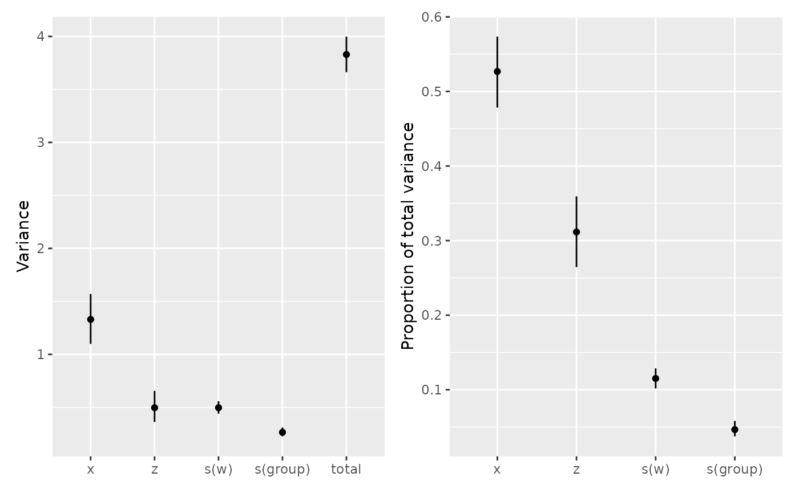
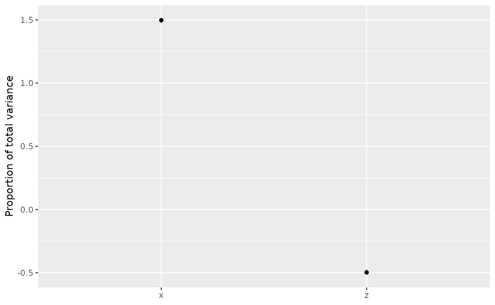

# Estimating and interpreting variance components in GAMs

Use
[`variance_comp()`](https://gavinsimpson.github.io/gratia/reference/variance_comp.md)
to answer two questions. How strongly does the model penalise its smooth
and random-effect coefficients? How much do the fitted contributions of
its terms vary across the observations? The first is about the model’s
coefficients. The second also depends on the observed covariate values.
A linear term, for example, varies more across observations that cover a
wider range of its covariate, even with the same coefficient.

Load {gratia} and {mgcv}, then simulate 360 observations in 12 groups of
30. We generate `z` from `x` plus noise so the two are positively
correlated. We generate `w` independently for the nonlinear effect.

``` r

library("gratia")
load_mgcv()

set.seed(2026)
dat <- data.frame(x = runif(360, -1, 1), w = runif(360),
  group = factor(rep(seq_len(12), each = 30)))
dat$z <- 0.8 * dat$x + rnorm(360, sd = 0.2)
```

The response combines positive linear effects of `x` and `z` with a sine
wave in `w`. Add a Gaussian random intercept with standard deviation
0.6, shared by all observations in the same group, and independent
Gaussian noise with standard deviation 0.4 for each observation. The two
linear effects tend to increase together, so their covariance increases
the variance of their sum.

``` r

group_effect <- rnorm(12, sd = 0.6)
dat$y <- 2 * dat$x + 1.5 * dat$z + sin(2 * pi * dat$w) +
  group_effect[dat$group] + rnorm(360, sd = 0.4)
```

Fit a model with unpenalised linear terms for `x` and `z`, a smooth for
`w` and a random intercept for `group`.

``` r

model <- gam(y ~ x + z + s(w, k = 8) + s(group, bs = "re"),
  data = dat, method = "REML")
```

## Extract penalty variances and variances of fitted terms

First extract the penalty variances, which describe shrinkage of the
penalised coefficients. The `.lower_ci` and `.upper_ci` columns give
interval limits on the standard deviation scale.

``` r

vc_penalty <- variance_comp(model, type = "penalty")
vc_penalty
#> # A tibble: 3 × 5
#>   .component .variance .std_dev .lower_ci .upper_ci
#>   <chr>          <dbl>    <dbl>     <dbl>     <dbl>
#> 1 s(w)         139.      11.8       6.51     21.3  
#> 2 s(group)       0.293    0.542     0.354     0.829
#> 3 scale          0.157    0.397     0.368     0.428
```

A penalty variance is the model scale \phi divided by the smoothing
parameter \lambda_j. By default, the function expresses \lambda_j on the
scale of the original penalty matrix, undoing the rescaling mgcv applies
during fitting. For a given penalty, a larger variance corresponds to
less shrinkage. There is one row per penalty, so a smooth can have
several rows. For this Gaussian model the `scale` row gives the
estimated residual variance. The unpenalised terms `x` and `z` appear in
the fitted term table below.

With `type = "terms"`, we measure how much each term’s fitted
contribution varies across the observations used to fit the model. We
use 1,000 draws of the coefficients to calculate intervals and set a
seed to make the draws reproducible.

``` r

vc_terms <- variance_comp(model, type = "terms", n_draws = 1000, seed = 42)
vc_terms
#> # A tibble: 5 × 8
#>   .component .variance .std_dev .lower_ci .upper_ci .proportion
#>   <chr>          <dbl>    <dbl>     <dbl>     <dbl>       <dbl>
#> 1 x              1.33     1.15      1.05      1.25       0.527 
#> 2 z              0.497    0.705     0.602     0.810      0.312 
#> 3 s(w)           0.497    0.705     0.665     0.747      0.115 
#> 4 s(group)       0.265    0.515     0.477     0.557      0.0466
#> 5 total          3.83     1.96      1.91      2.00       1     
#> # ℹ 2 more variables: .proportion_lower_ci <dbl>, .proportion_upper_ci <dbl>
```

These are sample variances on the linear predictor scale, with each
observation counted equally. The output includes unpenalised terms and
has one row for each smooth, even if it has several penalties.
Intercepts, offsets and residual variation are excluded from the
calculation.

## Account for covariance when comparing terms

The variance of the sum depends on both the term variances and their
covariances. Let f_j be term j’s fitted values, F = \sum_j f_j their
sum, and C their covariance matrix. Then

\operatorname{Var}(F) = \sum_j C\_{jj} + 2\sum\_{j\<k} C\_{jk}.

The result stores the covariance matrix of the fitted contributions
across observations. Summing its diagonal gives the sum of the term
variances. Summing all entries also accounts for covariance, so it gives
the total variance of the combined contributions.

``` r

C <- attr(vc_terms, "covariance")
c(sum_of_term_variances = sum(diag(C)),
  total_including_covariance = sum(C))
#>      sum_of_term_variances total_including_covariance 
#>                   2.588591                   3.829474
```

To divide the total among terms, we split each covariance contribution,
2C\_{jk}, equally between the two terms. Each term receives its own
variance plus its covariance with every other term, expressed as the
proportion p_j = \operatorname{Cov}(f_j, F) / \operatorname{Var}(F).
When the total variance is positive, the proportions sum to one. Check
this by computing only the individual proportions with
`include_total = FALSE` and skipping interval calculation with
`n_draws = 0`.

``` r

vc_no_total <- variance_comp(model, type = "terms", include_total = FALSE,
  n_draws = 0)
sum(vc_no_total$.proportion)
#> [1] 1
```

Intervals for the penalty variances account for uncertainty in the
estimated smoothing parameters and model scale. For intervals on the
fitted term variances, we draw all coefficients together from their
approximate Gaussian posterior distribution. We recompute the fitted
contributions and their variances and proportions for each draw. The
smoothing parameters stay fixed at their estimates by default. Use
`unconditional = TRUE` to include a correction for uncertainty in
smoothing parameter estimates when the fitted model supports it. The
proportions from each draw are in
`attr(vc_terms, "proportion_draws")$total`. The interval limits describe
each term separately, so the limits need not sum to one.

## Plot term variances and their proportions

Use {patchwork} to show the variances, including the total, alongside
the proportions for the individual terms. Both plots show intervals,
with terms on the x-axis.

``` r

patchwork::wrap_plots(
  draw(vc_terms),
  draw(vc_terms, type = "proportion", include_total = FALSE),
  ncol = 2
)
```



Use `draw(vc_penalty)` for penalty variances or
`draw(vc_terms, type = "std_dev")` for term standard deviations.
[`draw()`](https://gavinsimpson.github.io/gratia/reference/draw.md) uses
the stored intervals, squaring standard deviation limits when plotting
variances. Use `n_dodge = 2` to stagger term labels, `angle = 45` to
rotate them, or `flip = TRUE` to put terms on the y-axis.

### Why a term’s proportion can be negative

To show how a proportion can be negative, we reuse the correlated `x`
and `z` but give their effects opposite signs. The new response combines
`2 * x - z` with Gaussian noise of standard deviation 0.1, so the two
effects partly cancel each other.

``` r

set.seed(208)
dat$contrast <- 2 * dat$x - dat$z + rnorm(nrow(dat), sd = 0.1)
```

Fit both linear terms and plot their proportions with intervals,
omitting the total row.

``` r

opposing <- gam(contrast ~ x + z, data = dat, method = "REML")
vc_opposing <- variance_comp(opposing, type = "terms", n_draws = 1000, seed = 43)
draw(vc_opposing, type = "proportion", include_total = FALSE)
```



Their negative covariance reduces the variance of their sum. Accounting
for this covariance gives `x` a share of 1.5 and `z` a share of -0.5. In
this example `z` gets a negative proportion because its covariance with
the contribution of `x` is more negative than its own variance is
positive. The proportions still sum to one, so `x` gets a proportion
greater than one. When the total variance is zero, the proportions are
undefined (`NA`).
