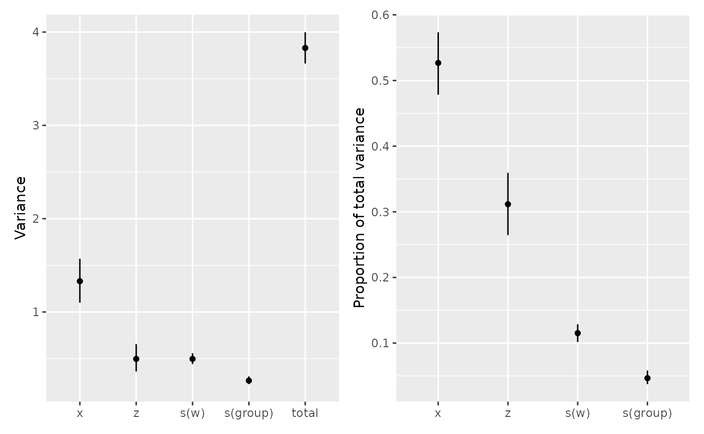
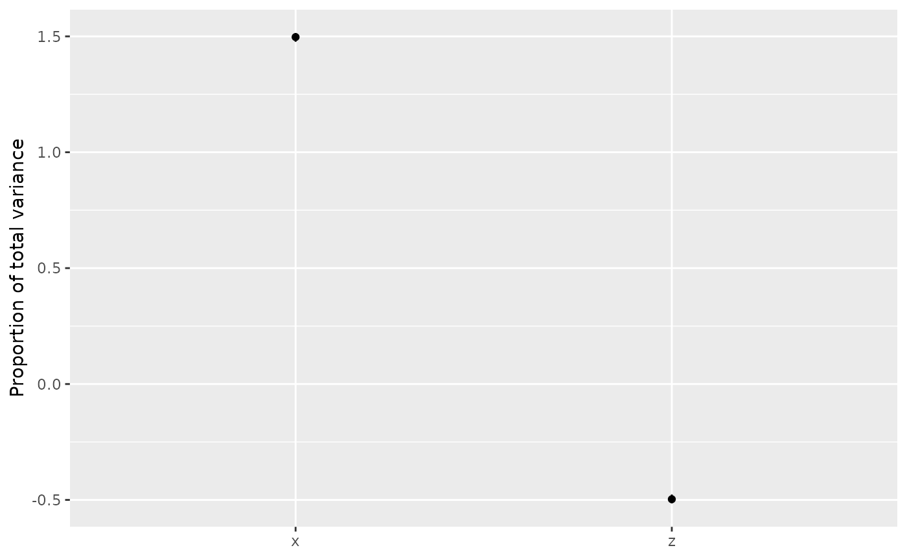

# Variance components in GAMs

This example uses
[`variance_comp()`](https://gavinsimpson.github.io/gratia/reference/variance_comp.md)
to compare penalty variances with variances of fitted terms.

We simulate 360 observations in 12 groups of 30. The covariate `z` is a
noisy version of `x`, so the two are positively correlated. We generate
`w` independently for the nonlinear effect.

``` r

library("gratia")
load_mgcv()

set.seed(2026)
dat <- data.frame(x = runif(360, -1, 1), w = runif(360),
  group = factor(rep(seq_len(12), each = 30)))
dat$z <- 0.8 * dat$x + rnorm(360, sd = 0.2)
```

The response combines positive linear effects of `x` and `z`, a sine
wave in `w`, differences between groups and Gaussian noise. Every
observation in a group shares the same random intercept. Because the two
linear effects tend to increase together, their covariance will
contribute to the total variance.

``` r

group_effect <- rnorm(12, sd = 0.6)
dat$y <- 2 * dat$x + 1.5 * dat$z + sin(2 * pi * dat$w) +
  group_effect[dat$group] + rnorm(360, sd = 0.4)
```

We fit linear terms for `x` and `z`, a smooth for `w` and a random
intercept for `group`. This gives us both unpenalised terms and terms
with penalties to compare:

``` r

model <- gam(y ~ x + z + s(w, k = 8) + s(group, bs = "re"),
  data = dat, method = "REML")
```

## Two kinds of variance

We first extract the penalty variances, which describe shrinkage of the
penalised coefficients. The `.lower_ci` and `.upper_ci` columns give
interval limits for standard deviations:

``` r

vc_penalty <- variance_comp(model, type = "penalty")
vc_penalty
#> # A tibble: 3 × 5
#>   .component .variance .std_dev .lower_ci .upper_ci
#>   <chr>          <dbl>    <dbl>     <dbl>     <dbl>
#> 1 s(w)         139.      11.8       6.51     21.3  
#> 2 s(group)       0.293    0.542     0.354     0.829
#> 3 scale          0.157    0.397     0.368     0.428
```

Penalty variances are \phi / \lambda_j: the model scale divided by the
smoothing parameter. By default, the calculation undoes the rescaling
that `mgcv` applies to penalties during fitting. Larger variances mean
less shrinkage of the coefficients affected by that penalty. A smooth
can have several penalties, each with its own row. Unpenalised terms
such as `x` and `z` are omitted. For this Gaussian model, `scale` is the
estimated residual variance.

With `type = "terms"`, we instead measure how much each term’s fitted
values vary across the observations used to fit the model. We use 1,000
coefficient draws for intervals and set a seed to make them
reproducible:

``` r

vc_terms <- variance_comp(model, type = "terms", n_draws = 1000, seed = 42)
vc_terms
#> # A tibble: 5 × 8
#>   .component .variance .std_dev .lower_ci .upper_ci .proportion
#>   <chr>          <dbl>    <dbl>     <dbl>     <dbl>       <dbl>
#> 1 x              1.33     1.15      1.05      1.25       0.527 
#> 2 z              0.497    0.705     0.602     0.810      0.312 
#> 3 s(w)           0.497    0.705     0.665     0.747      0.115 
#> 4 s(group)       0.265    0.515     0.477     0.557      0.0466
#> 5 total          3.83     1.96      1.91      2.00       1     
#> # ℹ 2 more variables: .proportion_lower_ci <dbl>, .proportion_upper_ci <dbl>
```

These are sample variances on the linear predictor scale, with each
observation counted equally. The output includes parametric terms and
one row for each smooth, regardless of how many penalties it has. It
excludes intercepts, offsets and residual variation.

## Totals and proportions

The variance of the sum depends on both the term variances and their
covariances. Let f_j be term j’s fitted values, F = \sum_j f_j their
sum, and C their covariance matrix. Then

\operatorname{Var}(F) = \sum_j C\_{jj} + 2\sum\_{j\<k} C\_{jk}.

We retrieve the covariance matrix stored in the result to compare the
sum of term variances with the total, which includes covariance:

``` r

C <- attr(vc_terms, "covariance")
c(sum_of_term_variances = sum(diag(C)),
  total_including_covariance = sum(C))
#>      sum_of_term_variances total_including_covariance 
#>                   2.588591                   3.829474
```

To divide the total among terms, we split each covariance contribution,
2C\_{jk}, equally between the two terms. Each term’s proportion is then
p_j = \operatorname{Cov}(f_j, F) / \operatorname{Var}(F). The individual
terms’ proportions sum to one. We check this using
`include_total = FALSE` to omit the total row and `n_draws = 0` to skip
interval calculations:

``` r

vc_no_total <- variance_comp(model, type = "terms", include_total = FALSE,
  n_draws = 0)
sum(vc_no_total$.proportion)
#> [1] 1
```

Penalty intervals use uncertainty in the estimated smoothing parameters
and model scale. For term intervals, we draw all coefficients together
from their approximate Gaussian posterior distribution. We recompute
fitted values, variances and proportions for each draw, preserving
dependence between terms. By default, the smoothing parameters stay
fixed at their estimates. `unconditional = TRUE` adjusts for their
uncertainty when that adjustment is available for the fitted model. The
proportions from each draw are in
`attr(vc_terms, "proportion_draws")$total`. Interval limits summarise
each term separately and need not sum to one.

## Plotting

We plot variances, including the total, alongside proportions for the
individual terms. Both plots show intervals, with terms on the x-axis:

``` r

patchwork::wrap_plots(
  draw(vc_terms),
  draw(vc_terms, type = "proportion", include_total = FALSE),
  ncol = 2
)
```



Use `draw(vc_penalty)` for penalty variances or
`draw(vc_terms, type = "std_dev")` for term standard deviations.
[`draw()`](https://gavinsimpson.github.io/gratia/reference/draw.md) uses
the stored intervals, squaring standard deviation limits when plotting
variances. Use `n_dodge = 2` to stagger term labels, `angle = 45` to
rotate them, or `flip = TRUE` to put terms on the y-axis.

### Negative proportions

To show how a proportion can be negative, we reuse the correlated `x`
and `z` but give their effects opposite signs. The new response combines
`2 * x - z` with Gaussian noise of standard deviation 0.1, so the two
effects partly cancel each other:

``` r

set.seed(208)
dat$contrast <- 2 * dat$x - dat$z + rnorm(nrow(dat), sd = 0.1)
```

We fit both linear terms and plot their proportions with intervals,
omitting the total row:

``` r

opposing <- gam(contrast ~ x + z, data = dat, method = "REML")
vc_opposing <- variance_comp(opposing, type = "terms", n_draws = 1000, seed = 43)
draw(vc_opposing, type = "proportion", include_total = FALSE)
```



Their negative covariance reduces the variance of their sum. Accounting
for this covariance gives `x` a share of 1.5 and `z` a share of -0.5.
Proportions can therefore exceed one or be negative. They are undefined
(`NA`) when the total variance is zero.
