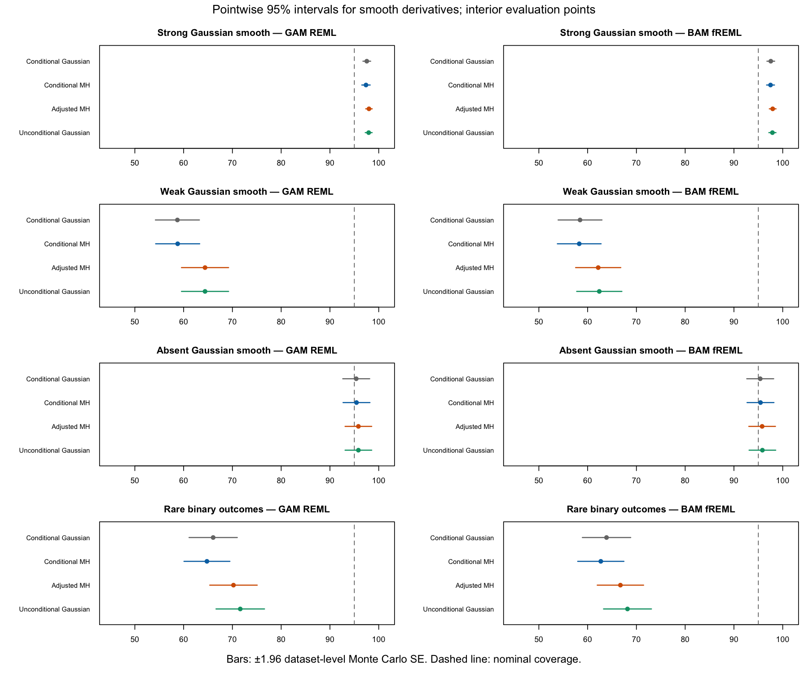
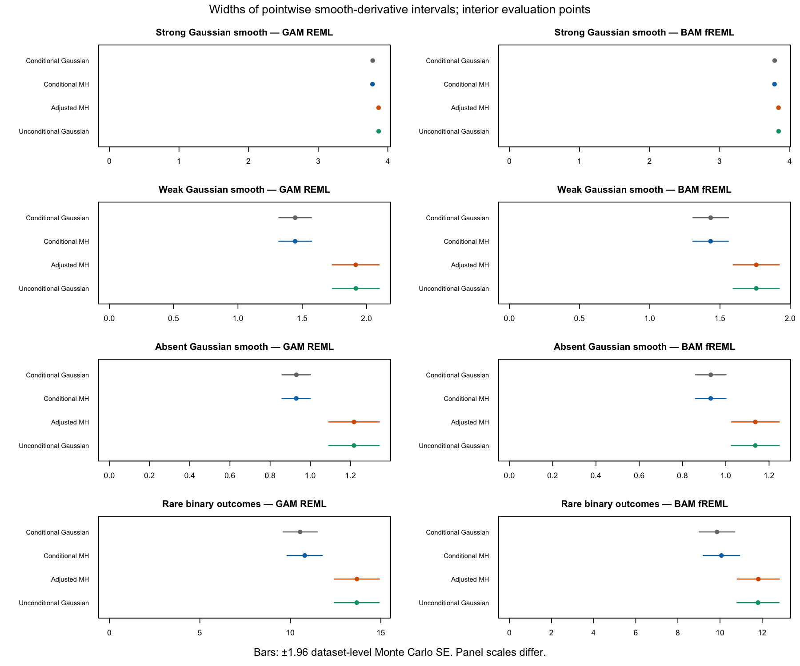

# Adjusting conditional MH draws to mgcv's unconditional covariance

This experiment is internal on gls/posterior-chains. The new
`sampling_mh_covariance_adjust()` function is not exported and is not a public
sampling method. Existing Gaussian and MH calls, seeded outputs and defaults
are unchanged. Earlier smoothing-uncertainty research files are preserved.

## What is adjusted

The source is a complete matrix of retained conditional MH coefficient draws.
For a fitted model with an available `Vc`, compute the pooled empirical MH
mean m and covariance C. Write C = R_c' R_c and Vc = R_u' R_u using upper
Cholesky factors, then transform every row:

```
adjusted_beta = (beta - m) %*% solve(R_c, R_u) + m
```

The implementation uses triangular solves rather than a matrix inverse.
It preserves the pooled mean and matches the empirical coefficient covariance
to Vc. All coefficients, including correlations between smooths and any other
coefficients, are transformed together. Do not transform each chain, smooth,
prediction point or coefficient separately.

No smoothing parameters are drawn. The MH acceptance step still targets the
original fixed-smoothing coefficient posterior. This is a deterministic
adjustment of the retained draws, not a different MH acceptance calculation
and not integration of a joint coefficient-and-smoothing posterior.

Input columns must be the complete fitted coefficient vector, in fitted order.
Unnamed matrices from native samplers are interpreted in that order. There
must be more draws than coefficients. Missing or malformed Vc, incomplete
coefficient sets, nonfinite draws, invalid chain layouts and singular or
numerically ill-conditioned covariance matrices produce errors. The function
does not substitute Vp, regularise singular matrices, clip draws or silently
repeat an adjustment.
It also rejects nonfinite empirical covariances, overflowing transformations,
and adjustments whose achieved covariance differs from Vc by more than 1e-7
relative to its largest entry. These failures can arise when the target
variation is too small to represent around a very large coefficient mean.

The output remains a coefficient matrix. It retains row identities, chain and
iteration mappings, original acceptance information and other source attributes.
Its `sampling$covariance_adjustment` audit stores the source and target
covariances, transformation, pooled mean, achieved covariance error and original
diagnostics. Requested coefficient summaries are recalculated for the adjusted
draws. Source acceptance rates always describe the original conditional run.

## Internal use

With the branch installed and an existing supported fitted model:

```r
library("gratia")

conditional <- mh_draws(model, n_draws = 16000, chains = 4,
  burnin = 4000, mh_backend = "gratia", seed = 281,
  diagnostics = TRUE)

adjusted <- gratia:::sampling_mh_covariance_adjust(model, conditional)

gaussian <- gaussian_draws(model, n_draws = 16000, chains = 4,
  unconditional = TRUE, mvn_method = "mgcv", seed = 282)

fitted <- fitted_samples(model, data = evaluation_data,
  method = "user", draws = adjusted)
response <- posterior_samples(model, data = evaluation_data,
  method = "user", draws = adjusted, seed = 283)
derivative <- derivative_samples(model, data = evaluation_data,
  focal = "x", method = "user", draws = adjusted)
```

This example does not automatically accept a model unsupported by conditional
MH or a model without Vc. Apply coefficient selection only after the joint
adjustment. Existing supplied-draw prediction conventions still apply.
Expected-response and response draws, including supported LSS calculations,
can use the adjusted matrix through the existing user-draw interface; LSS
coverage and support of its coefficient MH target are not validated by this
study of ordinary Gaussian and binomial fits.

## Repeated-data comparison

The [protocol](mh-adjustment-protocol.md) fixes the cases, draws, diagnostics,
failure policy and simulation units. It reuses the earlier coverage study's
200 datasets per case, including the original weights, offsets and truths.
The fits are gam REML and non-discrete bam fREML. Conditional MH, adjusted MH
and unconditional Gaussian sampling retain 16,000 draws over four chains;
MH uses 4,000 burn-in iterations per chain. Analytic conditional Gaussian
intervals provide a fourth control.

The recorded derivative is the derivative of the centred first smooth on the
linear predictor scale, excluding the known offset derivative. The expected
response includes the offset. These are pointwise 95% equal-tail intervals,
not simultaneous bands or intervals for future noisy observations.

<!-- BEGIN STUDY RESULTS -->
The main study attempted 1600 fits on 800 datasets. It returned complete
comparisons for 1599 fits. Every comparison includes all four methods.
The failed-fit table retains the attempted denominator; it does not count a
missing comparison as successful coverage.

### Interior smooth derivatives

Cells show pointwise interval coverage and average width in parentheses.

| Case and fit | Datasets | Conditional MH | Adjusted MH | Unconditional Gaussian |
| --- | ---: | ---: | ---: | ---: |
| Strong Gaussian, GAM REML | 200 | 97.4% (3.781) | 98.0% (3.868) | 97.9% (3.869) |
| Strong Gaussian, BAM fREML | 200 | 97.5% (3.782) | 97.9% (3.839) | 97.9% (3.840) |
| Weak Gaussian, GAM REML | 200 | 58.8% (1.445) | 64.4% (1.916) | 64.4% (1.918) |
| Weak Gaussian, BAM fREML | 200 | 58.3% (1.433) | 62.2% (1.759) | 62.4% (1.758) |
| Absent Gaussian, GAM REML | 200 | 95.4% (0.930) | 95.8% (1.218) | 95.8% (1.217) |
| Absent Gaussian, BAM fREML | 200 | 95.4% (0.930) | 95.8% (1.137) | 95.8% (1.136) |
| Rare binary, GAM REML | 200 | 64.8% (10.794) | 70.2% (13.681) | 71.6% (13.671) |
| Rare binary, BAM fREML | 199 | 62.7% (10.068) | 66.7% (11.819) | 68.2% (11.804) |





The weak-Gaussian results show that covariance adjustment reproduces the
unconditional Gaussian correction without solving weak-smooth undercoverage.
Here the conditional coefficient posterior is already Gaussian. The absent-smooth
control is close to nominal for all three methods.

### Expected response

| Case and fit | Datasets | Conditional MH | Adjusted MH | Unconditional Gaussian |
| --- | ---: | ---: | ---: | ---: |
| Strong Gaussian, GAM REML | 200 | 95.8% (0.311) | 96.2% (0.315) | 96.2% (0.315) |
| Strong Gaussian, BAM fREML | 200 | 95.9% (0.311) | 96.0% (0.314) | 96.2% (0.314) |
| Weak Gaussian, GAM REML | 200 | 88.3% (0.279) | 90.5% (0.314) | 90.6% (0.314) |
| Weak Gaussian, BAM fREML | 200 | 87.9% (0.279) | 89.3% (0.303) | 89.5% (0.303) |
| Absent Gaussian, GAM REML | 200 | 94.1% (0.256) | 95.1% (0.279) | 95.0% (0.279) |
| Absent Gaussian, BAM fREML | 200 | 93.9% (0.256) | 94.7% (0.272) | 94.8% (0.272) |
| Rare binary, GAM REML | 200 | 85.3% (0.089) | 87.0% (0.101) | 89.2% (0.115) |
| Rare binary, BAM fREML | 199 | 85.4% (0.088) | 86.2% (0.095) | 88.3% (0.107) |

The inverse links in these cases are monotone, so pointwise expected-response
coverage equals linear-predictor coverage for each draw-based method.
Interval widths are on different scales. Neither table adds future response noise.

### Paired differences

Adjusted MH minus unconditional Gaussian, for interior smooth derivatives.
The uncertainty column is 1.96 times the paired dataset-level Monte Carlo SE.
It describes simulation precision, not posterior uncertainty.

| Case and fit | Difference in coverage (percentage points) | Monte Carlo uncertainty | Width difference |
| --- | ---: | ---: | ---: |
| Strong Gaussian, GAM REML | +0.06 | ±0.11 | -0.001 |
| Strong Gaussian, BAM fREML | +0.06 | ±0.19 | -0.002 |
| Weak Gaussian, GAM REML | +0.00 | ±0.00 | -0.001 |
| Weak Gaussian, BAM fREML | -0.22 | ±0.27 | +0.000 |
| Absent Gaussian, GAM REML | +0.00 | ±0.00 | +0.000 |
| Absent Gaussian, BAM fREML | -0.06 | ±0.11 | +0.000 |
| Rare binary, GAM REML | -1.39 | ±0.82 | +0.009 |
| Rare binary, BAM fREML | -1.45 | ±0.85 | +0.015 |

### Failures and mixing

| Case | Dataset | Fit | Stage | Reason |
| --- | ---: | --- | --- | --- |
| binomial_rare | 177 | bam fREML | fitting | Native fitting failed the convergence screen. algorithm did not converge |

Across returned methods, the worst coefficient/derived R-hat was 1.00833;
the minimum bulk and tail ESS were 660 and 275 respectively.
The largest relative empirical-covariance mismatch after adjustment was 1.23e-11.
Only rare-binary GAM dataset 73 failed the tail-ESS screen. Both original
and adjusted MH failed it. The CSVs retain the same matched subset for all methods.

### Longer-chain check

The first five datasets per case were also sampled with 64,000 retained
draws and 16,000 burn-in iterations per chain. This does not add independent
coverage replications.
Across methods and quantities, the largest endpoint change divided by
the original interval width was 0.089. Analytic conditional Gaussian
intervals are unchanged. The complete per-fit changes are retained in
[the resolution results](mh-adjustment-resolution.csv).

### Costs

Median seconds for coefficient generation and coefficient diagnostics.
Adjusted MH includes its original MH run and the adjustment. All include
their own coefficient diagnostics but exclude the common derived-quantity
summaries. Runs overlapped other simulations and package validation;
these are exploratory costs rather than an isolated performance benchmark.

| Method | Median seconds |
| --- | ---: |
| Conditional MH | 0.275 |
| Adjusted MH | 0.502 |
| Unconditional Gaussian | 0.183 |

Compact data: [coverage](mh-adjustment-coverage.csv),
[paired differences](mh-adjustment-paired.csv),
[diagnostics](mh-adjustment-diagnostics.csv), and
[availability](mh-adjustment-availability.csv).
CSV coverage errors use whole datasets as the independent units and include
interior, endpoint and all-point summaries for every quantity.

In the diagnostic CSV, columns beginning with source_mh describe the
original conditional run, including on Gaussian rows. Columns beginning
with adjustment describe the pooled covariance transformation for that fit.
R-hat, ESS, MCSE and elapsed time describe the sampler named in each row.
The source-MH mean shift is the largest absolute coefficient mean–mode difference.

### Assessment

For rare binary outcomes, adjusted MH improves coverage over conditional MH
but has lower coverage than unconditional Gaussian draws, for both smooth
derivatives and expected responses. Matching Vc while retaining a transformed
MH shape is therefore not an accuracy improvement over unconditional Gaussian
sampling on these repeated-data coverage measures.

Excluding the same low-tail-ESS GAM dataset from every method gives
interior derivative coverage of 64.6% (conditional MH), 70.1% (adjusted MH)
and 71.5% (unconditional Gaussian), over 199 datasets. Thus the difference
is not driven by that one diagnostic failure.

In the first-five resolution comparison, the average adjusted-MH endpoint
change was 0.66% of the original interval width. The largest was 8.9%, for
the expected response in rare-binary GAM dataset 4. Coverage for that
dataset/quantity did not change. Passing the mixing screen does not establish
uniform 1% precision for interval endpoints.

### Diagnostic follow-up of dataset 73

The rare-binary GAM's original tail ESS was 275 for conditional MH and
279 after adjustment, below the required 400. This post hoc follow-up
retained 64,000 draws with 16,000 burn-in iterations per chain. Both fitters
were rerun for comparison. These results do not replace the primary
intervals, diagnostic exclusions or coverage denominators.

| Fit | Method | Maximum R-hat | Minimum bulk ESS | Minimum tail ESS |
| --- | --- | ---: | ---: | ---: |
| gam | conditional_mh | 1.00116 | 7531 | 3998 |
| gam | adjusted_mh | 1.00126 | 7531 | 3998 |
| gam | unconditional_gaussian | 1.00011 | 60861 | 61603 |
| bam | conditional_mh | 1.00091 | 8315 | 3917 |
| bam | adjusted_mh | 1.00091 | 8315 | 3917 |
| bam | unconditional_gaussian | 1.00010 | 62575 | 61998 |

The longer runs pass the screen. Their original fitted smoothing
parameters agree with the primary fits. The [follow-up data](mh-adjustment-followup.csv)
also retain the endpoint and coverage changes for this single selected dataset.

<!-- END STUDY RESULTS -->

## Interpretation and limitations

- Matching Vc is an algebraic property, not independent evidence of accurate
  posterior probabilities or frequentist coverage. Vc is itself an approximate
  correction and need not improve every quantity.
- The adjustment retains the MH mean. It cannot reproduce a change in the
  posterior mean caused by genuine smoothing integration or remove shrinkage
  bias simply by matching a covariance.
- An invertible linear transformation carries the original joint nonnormal
  distribution into another one. Covariance alone does not identify how a
  marginal posterior's skewness or tails should change with smoothing
  uncertainty.
- The Cholesky transformation depends on the fitted coefficient basis and
  order. Other transformations can give the same covariance and different
  nonnormal distributions. Fitted coefficient order makes this implementation
  reproducible; it does not remove that statistical choice.
- Replacing the MH covariance with Vc can shrink directions where actual
  conditional MH variance exceeds the target. It is not guaranteed to widen
  intervals. The comparison records the range of generalised covariance ratios.
- The empirical transformation depends on the same finite, autocorrelated
  sample it adjusts. Report both original and transformed diagnostics.
  Those diagnostics do not account for uncertainty in the estimated
  transformation or establish a new invariant MH target.
- A pooled map preserves differences between chain means. Transforming each
  chain separately would conceal those differences. Even a pooled map changes
  the coefficient combinations being diagnosed, so individual R-hat and ESS
  values need not be unchanged.
- Population covariance must exist and the retained chains must adequately
  estimate it. Having more rows than coefficients is only a necessary
  numerical condition. The routine does not certify mixing automatically.
- Dispersion and family parameters outside the coefficient vector remain
  fixed. This study does not validate ML, general/LSS families, quasi families,
  discrete bam, or smoothing integration. The earlier NCV exclusion is unchanged.

## Validation and reproduction

[Validation record](mh-adjustment-validation.txt) records tests, package checks,
source hashes and the independent checks of raw intervals and paired summaries.

Run outside the sandbox from the repository root with the branch installed in
a private R library and R_LIBS pointing to it:

```sh
Rscript notes/posterior-chains/mh-adjustment-run.R /path/to/fresh/main 4 200
Rscript notes/posterior-chains/mh-adjustment-summary.R /path/to/fresh/main
Rscript notes/posterior-chains/mh-adjustment-validate.R /path/to/fresh/main
Rscript notes/posterior-chains/mh-adjustment-run.R /path/to/fresh/resolution 4 5 64000 16000
```

Raw checkpoints and protocol hashes allow resumption only when the inputs and
research source match. The old pilot is a separate archive and is excluded
from coverage estimates. Compact results are retained in this directory;
larger raw results remain outside Git in the research archive.


The separately selected diagnostic follow-up can be resumed with:

```sh
Rscript notes/posterior-chains/mh-adjustment-followup.R
```

After regenerating the CSVs, rebuild the plots and result tables with:

```sh
Rscript notes/posterior-chains/mh-adjustment-figures.R
Rscript notes/posterior-chains/mh-adjustment-results.R
```

The [review validation](mh-adjustment-review-validation.txt) records the
numerical guards, unchanged comparison results and complete pkgdown index check.
Archived studies retain their original execution sources. Validation can use
those frozen sources after review changes; resuming sampling still requires
the generation sources to match the saved protocol.
