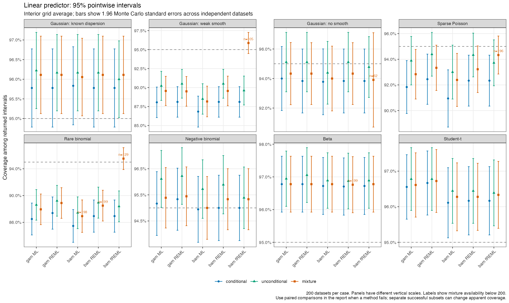
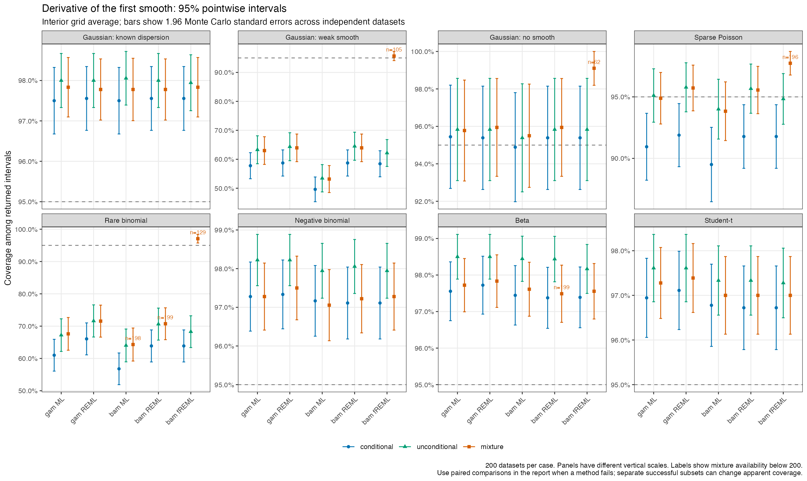

# Repeated-simulation checks for smoothing uncertainty

The mixture improves some intervals but does not reliably restore 95% coverage for weak smooths or rare binary outcomes, particularly for derivatives. It also has substantial numerical failures in several fREML cases. It should remain internal.

The subsequent [partly fixed fREML correction](smoothing-coverage-fixed-report.md) resolves the 200 setup failures described below. Its separate 200-dataset rerun preserves all unaffected results and raises combined mixture availability to 15,688 of 16,000. The following tables and original archives describe the initial study.

Study on `gls/posterior-chains`, using prototype commit `739b44eddf197502c8561240ae9671c63089f5c1`, R 4.6.1, mgcv 1.9.4, mirai 2.7.3 and gratia 0.11.2.50.

## What is compared

The main study has 16 cases with 200 independent simulated responses each. Each dataset is fitted with gam ML and REML and non-discrete bam ML, REML and fREML: 16,000 model fits and 48,000 requested sets of intervals. The cases include known and estimated Gaussian dispersion, small samples, weak and absent smooths, shared and partly fixed smoothing parameters, a tensor product, Poisson and sparse Poisson counts, binomial counts and rare binary outcomes, Gamma, negative-binomial, beta and Student-t responses. This screens representative ordinary and extended families across the supported fitting methods. It does not establish calibration for every supported family or link.

The simulated functions lie in the fitted spline spaces. Consequently, coverage differences include smoothing bias and uncertainty approximations, rather than an inability of the chosen basis to represent the truth. Every case has a known offset; Gaussian cases have unequal observation precisions, and binomial counts have unequal trial counts. See [the protocol](smoothing-coverage-protocol.md) and [case definitions](smoothing-coverage-functions.R) for the exact distributions, curves, sample sizes and seeds.

The three distributions are the coefficient normal approximation conditional on fitted smoothing parameters, mgcv's Gaussian correction from `unconditional = TRUE`, and the prototype mixture over approximate log-smoothing estimates. Gaussian conditional quantiles are calculated analytically. Mixture quantiles average conditional Gaussian CDFs over 256 log-smoothing draws. The underlying standard-normal vectors are paired with their negatives to reduce integration noise. They use the actual prototype conditional evaluator. This avoids adding coefficient-draw Monte Carlo error to every coverage result.

The mixture holds dispersion and scalar family parameters at their estimates. The native unconditional correction is used as supplied by mgcv; it has different curvature handling and can include estimated family-parameter effects in extended-family gam fits. The comparison assesses the complete procedures, rather than isolating smoothing uncertainty alone. The mixture propagates approximate estimation uncertainty; it does not integrate a joint Bayesian posterior.

Intervals are pointwise 95% intervals for the linear predictor, first constrained smooth, its derivative with respect to x, and expected response. For binomial fits the last quantity is the success probability. For these families inverse links are monotone, so expected-response and linear-predictor coverage events coincide, although interval widths and point estimates differ. Interior and boundary results are separate. These are not simultaneous bands or intervals for future observations.

Coverage is averaged over grid points within each simulated dataset before its Monte Carlo standard error is calculated across independent datasets. Grid points and fitting methods are not independent replications. At 95% pointwise coverage, 200 independent datasets give a standard error of about 1.5 percentage points; this study can detect large problems but cannot reliably establish one-percentage-point improvements.

## Coverage and availability

For gam REML, interior linear-predictor coverage is shown below. Values are percentages, with Monte Carlo standard errors in percentage points in parentheses. Every method returned intervals on all 200 datasets in these rows. Full results for every fitting function and method, both grid strata and all quantities are in [the summary CSV](smoothing-coverage-summary.csv).

| Case | Conditional | Unconditional | Mixture |
| --- | ---: | ---: | ---: |
| Gaussian, known dispersion | 95.8 (0.5) | 96.2 (0.5) | 96.1 (0.5) |
| Gaussian, estimated dispersion | 95.9 (0.5) | 96.3 (0.5) | 96.0 (0.5) |
| Gaussian, n = 60 | 94.1 (0.8) | 94.7 (0.7) | 94.6 (0.7) |
| Gaussian, weak smooth | 88.1 (1.0) | 90.5 (1.0) | 89.5 (1.0) |
| Gaussian, no smooth | 93.8 (1.1) | 95.1 (1.0) | 94.3 (1.1) |
| Gaussian, shared parameter | 95.1 (0.8) | 95.2 (0.8) | 95.2 (0.8) |
| Gaussian, partly fixed parameters | 95.4 (0.7) | 95.4 (0.7) | 95.4 (0.7) |
| Gaussian, tensor product | 97.1 (0.6) | 97.7 (0.5) | 97.3 (0.6) |
| Poisson | 96.3 (0.6) | 96.6 (0.5) | 96.3 (0.6) |
| Sparse Poisson | 92.4 (1.0) | 94.4 (0.9) | 93.3 (0.9) |
| Binomial counts | 95.9 (0.6) | 96.4 (0.5) | 96.1 (0.6) |
| Rare binary outcomes | 87.4 (1.2) | 89.2 (1.2) | 88.9 (1.2) |
| Gamma | 94.2 (0.6) | 94.4 (0.6) | 94.6 (0.6) |
| Negative binomial | 95.3 (0.6) | 96.2 (0.6) | 95.4 (0.6) |
| Beta | 96.8 (0.4) | 97.1 (0.4) | 96.8 (0.4) |
| Student-t | 96.7 (0.5) | 96.8 (0.4) | 96.7 (0.5) |

The weak Gaussian and rare-binomial problems are much greater for derivatives. The same gam REML fits give:

| Case, derivative of first smooth | Conditional | Unconditional | Mixture |
| --- | ---: | ---: | ---: |
| Gaussian, known dispersion | 97.6 (0.4) | 98.0 (0.3) | 97.8 (0.4) |
| Gaussian, weak smooth | 58.7 (2.3) | 64.3 (2.5) | 63.9 (2.4) |
| Sparse Poisson | 91.9 (1.3) | 95.8 (1.0) | 95.7 (0.9) |
| Rare binary outcomes | 66.1 (2.5) | 71.6 (2.5) | 71.6 (2.5) |

For sparse Poisson derivatives, both uncertainty corrections improve coverage substantially. For weak Gaussian and rare-binomial derivatives, neither correction addresses the large coverage deficit. The spline reconstruction tests rule out differentiation of the wrong truth or a basis representation error in these examples.

The width, average posterior-median error (`median_bias`) and root mean squared error of the posterior median (`median_rmse`) are also retained in the summary CSV. Errors are averaged over datasets and the selected grid stratum. The [paired CSV](smoothing-coverage-paired.csv) reports differences and their paired Monte Carlo errors using datasets where all three procedures returned intervals.

### Failed fits and failed mixtures

Five native fits did not converge: two bam ML rare-binomial fits, one bam REML rare-binomial fit, one bam REML beta fit and one bam fREML rare-binomial fit. Conditional and unconditional intervals were available for all 15,995 remaining fits; no missing unconditional covariance was replaced by conditional covariance.

The mixture returned 15,488 of 16,000 requested sets of intervals. For bam fREML it returned 2,692 of 3,200. Its additional failures comprise 200 setup reconstruction disagreements in the partly fixed Gaussian case and 307 failed smoothing components. The latter include smoothing values outside numerical range, non-positive conditional precision, failed native conditionals and LAPACK errors. See [availability](smoothing-coverage-availability.csv) and [grouped failure messages](smoothing-coverage-failures.csv).

The bam fREML table distinguishes all returned conditional intervals from comparisons on the smaller set of datasets where every procedure succeeded. The matched count equals the mixture count in these rows. Values are coverage percentages; paired errors and widths are in the paired CSV.

| Case | Conditional / mixture returned | Conditional, all | Conditional, matched | Unconditional, matched | Mixture, matched |
| --- | ---: | ---: | ---: | ---: | ---: |
| Gaussian, weak smooth | 200 / 105 | 88.1 | 92.1 | 94.8 | 95.9 |
| Gaussian, no smooth | 200 / 62 | 93.8 | 91.9 | 95.0 | 93.9 |
| Sparse Poisson | 200 / 196 | 92.3 | 93.4 | 94.7 | 94.3 |
| Rare binary outcomes | 199 / 129 | 86.9 | 93.2 | 95.2 | 95.5 |
| Gaussian, partly fixed parameters | 200 / 0 | 95.4 | -- | -- | -- |

For the weak Gaussian case, bam fREML mixture coverage of 95.9% is based on 105 datasets. Conditional coverage on those same datasets is 92.1%, rather than its 88.1% coverage over all 200 datasets. The paired improvement is 3.81 percentage points (Monte Carlo SE 0.78). For rare binary outcomes, corresponding coverage is 93.2% conditional and 95.5% mixture on 129 datasets, an improvement of 2.33 points (SE 0.53). Thus some improvement persists on matched datasets, but the unmatched figures overstate it. The method still fails to return intervals for many datasets.

The weak-case fREML log-smoothing standard deviations have median 5.38 and maximum 2,865.9. Extreme inputs therefore come from the retained normal approximation being propagated. Failed draws are not clipped or replaced.

The partly fixed fREML rejection is different: it occurs before smoothing draws. An [independent Gaussian check](smoothing-coverage-fixed-check.R) reproduces the BAM coefficients and an independent fixed-smoothing gam reference to about 1e-15, but finds a common covariance-scale discrepancy. For replicate 1, the stored BAM covariance is 1.03188 times the covariance using the reported dispersion. Direct matrix calculations and the independent gam covariance agree to 8e-17 at that reported dispersion. This isolates a dispersion/covariance convention that must be resolved before claiming mixture support for this combination; it does not show an incorrect fitted coefficient mode. [Numerical results](smoothing-coverage-fixed-check.csv) are retained, and the safety check is unchanged. The closed-form Gaussian restricted likelihood gives dispersion 0.220705, matching bam$sig2. The Pearson estimate, weighted residual sum of squares divided by n minus effective degrees of freedom, is 0.227741 and matches the retained covariance and the independent gam estimate. A partly fixed bam fREML control with known dispersion passes reconstruction to 2.4e-15. This distinguishes an estimated-dispersion convention from a penalty-mapping or coefficient-mode error.





## Numerical checks

All eight comparisons against 10,000 actual coefficient draws completed: known-dispersion Gaussian, Poisson, negative-binomial and beta fits, each with gam REML and bam fREML. Conditional and unconditional draws are compared with analytic quantiles; actual prototype mixture draws are compared with 4,096-component integrated quantiles. There are 2,376 related CDF comparisons across the three distributions, 33 projected quantities and three quantiles. Median absolute CDF errors within each fit and distribution range from 0.0014 to 0.0020. The largest CDF error is 0.016, at the median; the largest lower- and upper-tail errors are 0.0063 and 0.0052. The largest binomial-standardised deviation is 4.04 across those comparisons, consistent with finite-draw variation at this scale. The largest endpoint difference is 0.105 marginal standard deviations. These checks support the interval calculation; they are not a coverage guarantee.

The 1,024-component checks completed for the first 20 datasets in each of five prespecified cases and two subsequent difficult-case checks, across all five configurations. Availability was identical to the corresponding 256-component runs in every checked combination. Across the matched subsets, the largest change in interior average coverage was 1.23 percentage points; for gam REML rare-binomial derivatives it was -1.11 points, and weak Gaussian derivatives did not change. The largest group-specific 95th percentile of absolute endpoint changes was 6.05% of the higher-resolution interval width; the largest individual endpoint change was 18.9%. Thus finite integration can matter for individual difficult intervals, while the checked coverage changes do not explain the much larger derivative deficits. Twenty replicates per case do not establish numerical resolution across the full study. See [prespecified results](smoothing-coverage-resolution.csv) and [difficult-case follow-ups](smoothing-coverage-resolution-difficult.csv).

## Validation and scope

The standalone research tests have 99 passing assertions covering known mixture CDFs, exact spline truths and derivatives in both gam and bam bases, family inverse links, correlated Gaussian projections and offsets, reproducibility, unchanged caller random-number state, paired Monte Carlo errors, failure denominators and rejection of duplicate or incomplete checkpoints and incorrect fitting-method labels. Single-worker and multiple-worker pilot runs produced identical datasets, intervals and warnings after excluding elapsed times. Matching completed checkpoints resume without recomputation; changed protocol metadata is rejected. An intentional interrupt of the resolution runner cleaned up its scoped workers; its completed checkpoints resumed with a different worker count and the same protocol.

The generator is recorded explicitly: mirai 2.7.3 daemon maps use `RNGkind("L'Ecuyer-CMRG", "Inversion", "Rejection")`. Direct helper calls must use the same generator. Failed weak-Gaussian replicate 1 and null-Gaussian replicate 3 reproduced their original results exactly in direct serial and parallel reruns, excluding elapsed times. A fresh R session's different default generator explains why matching only the integer seed is insufficient.

The initial study changed no package implementation, exported interface, chain identifiers or seeded sampler results. Its files are under `notes/`, which is excluded from package builds. At the original prototype commit, package source hashes matched the preceding checked archive, so the full suite and R CMD check were not repeated for that notes-only study. The later dispersion correction was tested with the full suite and a fresh package check; see its [validation record](smoothing-coverage-fixed-validation.txt). The [preceding validation record](smoothing-families-checks.md) retains the original check results and their omitted visual, PDF-manual and remote incoming checks.

NCV/QNCV, discrete bam and general families remain excluded. Censored, ordinal, grouped, Tweedie and quasi families were not part of this repeated-simulation screen, although separate conditional reconstruction tests cover supported combinations. Results apply to these fixed curves and sample sizes. Undercoverage in this study does not by itself identify an implementation error; it rules out claiming generally calibrated intervals from this approximation on the strength of the current evidence.

## What needs work next

The [partly fixed fREML follow-up](smoothing-coverage-fixed-report.md) has now resolved the dispersion/covariance disagreement. Next compare the log-smoothing approximation with independent reference calculations in weak-smooth and rare-outcome cases, separating smoothing bias from uncertainty in smoothing, dispersion and family parameters. More repetitions of the difficult cases should follow any statistical change. The current results support keeping the prototype internal; they do not justify claiming that its intervals are generally calibrated.

## Reproduction and saved results

Install the prototype into an isolated R library first; the scripts call internal functions from the installed gratia namespace. The original tables use commit `739b44eddf197502c8561240ae9671c63089f5c1`; running the current branch includes the later dispersion correction, so partly fixed fREML results now follow the separate follow-up. Original checkpoints reject changed source hashes rather than mixing implementations. Run from the repository root, outside the sandbox. Set `R_LIBS` to the isolated library as needed. Use an archive directory outside the package checkout:

```sh
Rscript notes/posterior-chains/smoothing-coverage-tests.R
Rscript notes/posterior-chains/smoothing-coverage-fixed-check.R
Rscript notes/posterior-chains/smoothing-coverage-run.R /path/to/archive/main 200 256 8
Rscript notes/posterior-chains/smoothing-coverage-summary.R /path/to/archive/main /path/to/archive/summaries
Rscript notes/posterior-chains/smoothing-coverage-run.R /path/to/archive/resolution 20 1024 2 normal_known,normal_weak,poisson,nb,beta
Rscript notes/posterior-chains/smoothing-coverage-resolution.R /path/to/archive/main /path/to/archive/resolution /path/to/archive/resolution.csv
Rscript notes/posterior-chains/smoothing-coverage-run.R /path/to/archive/resolution-difficult 20 1024 2 poisson_sparse,binomial_rare
Rscript notes/posterior-chains/smoothing-coverage-resolution.R /path/to/archive/main /path/to/archive/resolution-difficult /path/to/archive/resolution-difficult.csv
Rscript notes/posterior-chains/smoothing-coverage-draws.R /path/to/archive/draws 2
Rscript notes/posterior-chains/smoothing-coverage-figures.R /path/to/archive/summaries /path/to/archive/figures
```

The raw checkpoint directories are under `/Users/gavin/work/git/gratia/research-archives/`, with prefix `smoothing-coverage-2026-10-15-` and suffixes `main`, `resolution`, `resolution-difficult` and `draws`. Protocol files retain source hashes, package versions and the originating commit. Raw checkpoints, pointwise summaries and detailed per-fit failure and warning tables remain outside Git. Compact summaries, paired comparisons, availability and grouped failures accompany this report. The final integrity checks and source hashes are in [the validation record](smoothing-coverage-validation.txt). The checked spline reconstruction errors are in [the geometry results](smoothing-coverage-geometry.csv).
