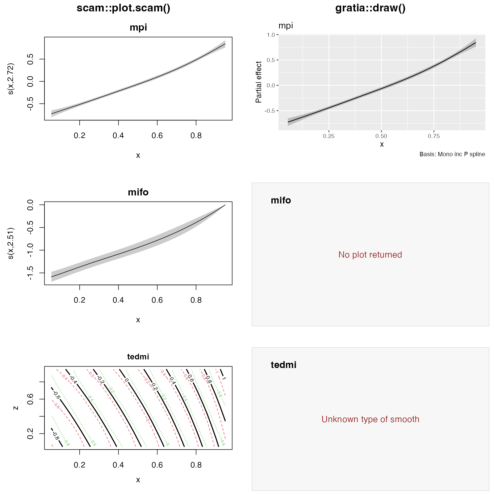

# SCAM support audit

16 October 2026. Audited gratia `main` at
`455da844ac3a0ba6ddfab79f3ea3415495801071`, using R 4.6.1, mgcv 1.9-4 and
scam 1.2-22. The installed scam is the latest CRAN release, published on
12 March 2026, confirmed against the live CRAN source index and
[CRAN package page](https://stat.ethz.ch/CRAN/web/packages/scam/index.html).
The audit branch is `gls/scam-support-audit`.

The computations for the standard supported univariate shape-constrained
smooths are correct for this scam release. On identical evaluation grids,
their fitted contributions and standard errors agree with scam's prediction
and plotting methods to numerical precision. Support is nevertheless much
narrower than the collection of scam methods in gratia suggests: many smooth
classes and GAM operations are unavailable, one recognised smooth disappears
from plots, and response simulation loses scam's AR1 correlation. GCV does
not explain most of these gaps.

The original audit added reproducible R calculations without changing
package behaviour. Subsequent fixes and additions are described in the
[implementation report](implementation.md).

## Which smooths work

The inventory includes every smooth constructor in the installed scam
namespace: 24 univariate constructors and 17 bivariate constructors. Three
ordinary mgcv bases fitted through scam provide additional controls. All 44
fits reported convergence. Eight fits produced warnings during fitting,
including truncated steps and non-finite trial coefficients; the complete
warnings are retained in [the smooth inventory](results/smooth-inventory.csv).
The comparisons evaluate the returned fits, rather than asserting that every
fit represents a satisfactory statistical model.

| Smooths | Current result in gratia |
|---|---|
| `mpi`, `mpd`, `cx`, `cv`, `micx`, `micv`, `mdcx`, `mdcv` | Smooth estimates and plots agree with scam on the same grid. |
| `miso` | Estimates, standard errors and plot agree. Smooth sampling fails because it removes the wrong basis columns. |
| `mifo` | Estimates and standard errors agree, but `draw()` returns no smooth panel. Smooth sampling also fails. |
| `po` | The coefficient mapping for smooth evaluation exists, but the missing `smooth_type()` method prevents a result. |
| `ipo`, `dpo`, `cpop` | Missing type descriptions and coefficient mappings for smooth evaluation. The cyclic constructor creates class `cpopspline.smooth`. |
| `lmpi`, `lipl` | Missing smooth support. `lipl` additionally retains several basis columns whose coefficients were fixed to zero. |
| `mpiBy`, `mpdBy`, `cxBy`, `cvBy`, `micxBy`, `micvBy`, `mdcxBy`, `mdcvBy` | Some evaluation methods already recognise these classes, but missing type descriptions prevent estimates and plots. Basis extraction also fails. |
| All 17 bivariate constructors | No working smooth estimation or drawing path. Full-model predictions are available in more cases than smooth plotting. |
| Ordinary `cr`, `tp`, `ps` smooths in scam fits | Estimates and smooth plots agree with scam. |

A factor `by` smooth specified with `bs = "mpi"` is different from the
explicit `bs = "mpiBy"` constructor. The former works when plotting the smooth
panels alone. A numeric `by` variable with `bs = "mpi"` also passed the
prediction comparisons. Neither result establishes support for all explicit
`By` classes or for matrix-valued functional terms.

The bivariate constructors are:

- Both directions constrained: `tedmi`, `tedmd`, `temicx`, `temicv`,
  `tedecx`, `tedecv`, `tecxcx`, `tecvcv`, `tecxcv`.
- One direction constrained: `tesmi1`, `tesmi2`, `tesmd1`, `tesmd2`,
  `tescx`, `tescv`.
- Interactions with separately specified main effects: `tismi`, `tismd`.

Eight cyclic-margin variants, interactions with main effects, and a
matrix-valued `mpiBy` functional term were also exercised. These remain
unsupported by gratia. Their fitting, native prediction and plotting results
are recorded separately in [the variant results](results/smooth-variants.csv).

## Agreement with native plots

For the eight standard univariate types and the two endpoint-constrained
types, the maximum fitted-value difference from `plot.scam()` was zero on
the matched 100-point grids. Standard-error differences were at most
`1.4e-17`. `mifo` therefore has a rendering failure rather than an incorrect
fitted function. The plot-type list repeats the label for `miso` and omits
the label for `mifo` in `R/smooth-estimates.R`.



The comparison uses the actual plotting methods. The univariate interval
multiplier is matched to 95% normal intervals. With its defaults, scam uses
two standard errors for a univariate curve, whereas gratia uses
`qnorm(0.975)`. That small width difference is expected. Surface grids also
differ by default: scam uses 40 points per axis and gratia uses 50. These
settings must be matched before comparing surfaces and excluded regions.

For supported univariate smooths, retaining scam's fitted centring is correct.
Comparisons on one-row, two-row, changed-range and transformed-covariate data
confirm this. Recentring the basis on each requested grid would change the
fitted function and undo a correct existing implementation. Additional
checks cover factor and numeric `by` variables, additive models, no intercept,
Gaussian, Poisson, binomial and Gamma responses, and `not.exp = TRUE` with
non-default transformation controls.

Bivariate smooths need a separate decision about what is being displayed.
scam's native plot subtracts the mean of the surface over the plotting grid.
Its term predictions retain the fitted contribution. Across the 17 bivariate
fits, subtracting the grid mean from the fitted contribution reproduced the
native plotted surface within `5.5e-10`. Before this subtraction, differences
were constant over the grid, sometimes exceeding two link-scale units.
See [the matrix comparison](results/matrix-comparison.csv).

Consequently, preserving the fitted contribution and reproducing the native
surface's vertical position are different requirements. Keep fitted
contributions stable in `smooth_estimates()`. If matching native surface plots
is required, apply an explicit linear centring operation in plotting and apply
the same operation to the uncertainty calculation. Recentring must not silently
alter estimates returned for other purposes.

Native uncertainty also needs scrutiny. A numerical coefficient-gradient
check reproduces the bivariate plot standard errors for the checked
`tedmi`, `tesmi1`, `temicx` and `tismi` fits. For `mpiBy`, `ipo` and `dpo`,
however, the native plot's standard errors differ from those obtained from
the gradient of the function it displays, by up to `0.0432`, `0.0919` and
`0.00246`, respectively. Native code applies a centring transformation to
their uncertainty without applying the corresponding transformation to their
displayed values. These types should have tests for the stated quantity,
not an unconditional requirement to copy every native interval.

The native `predict(type = "terms", se.fit = TRUE)` path also changes
uncertainty for several bivariate and positive smooths. Its standard errors
can differ substantially from the direct quadratic form for its returned
term estimates. For `tismi` and `tismd`, this call fails with
`non-conformable arguments`, including when separately specified main effects
are present; their fitted-value and native plotting paths work. These are
upstream behaviours that a gratia adapter must account for. The results and
numerical gradient checks are in
[matrix-comparison.csv](results/matrix-comparison.csv) and
[plot-covariance-gradient.csv](results/plot-covariance-gradient.csv).

## Coefficients and covariance

scam stores two parameterisations. Write `beta` for its unrestricted fitting
parameters and `theta` for the parameters after imposing positivity on selected
entries. The model's `p.ident` identifies those entries.

| Quantity | Stored field | Use |
|---|---|---|
| Unrestricted parameters | `coefficients` | Work in scam's original fitting coordinates. |
| Parameters after transformation | `coefficients.t` | Multiply by the fitted prediction matrix. |
| Approximate Bayesian covariance | `Vp`, `Vp.t` | Match the unrestricted or transformed parameterisation, respectively. |
| Frequentist covariance | `Ve`, `Ve.t` | Match the same parameterisation choice. |

gratia's `coef.scam()`, `vcov.scam()` and `get_vcov.scam()` correctly use the
transformed parameters and covariance by default. The checked
`not.exp = TRUE` fit also agrees exactly with its stored transformed
parameters. The old internal `exp_fun()` helper refers to `mgcv::notExp`,
which is different from scam's current softplus transformation. It is unused
by the active evaluation and sampling paths; remove or correct it before
reusing it.

Let `X_s` be the smooth matrix after matching its columns to the transformed
parameters. The fitted contribution is `X_s %*% theta_s`, and its conditional
variance is the row-wise quadratic form `X_s V_s X_s'`. A centred plot instead
uses `H X_s`, where `H` subtracts the chosen grid mean, for both computations.
Adding intercept uncertainty requires its covariance with the smooth as well
as its variance.

Column matching is specific to the basis:

- `po`, `ipo`, `cpop` and the nine doubly constrained bivariate types remove
  the first prediction-basis column.
- `dpo` removes the last column.
- `miso` and `mifo` remove the positions in `n.zero`.
- The six singly constrained bivariate types and the two interaction types
  multiply the raw basis by the fitted `Zc` matrix.
- `lipl` excludes the leading column and its trailing fixed-zero columns.

Use one checked implementation of this mapping throughout estimation, basis
extraction and sampling, including any columns removed for identifiability.
The current sampling rule of removing just the first column whenever there
are too many columns cannot handle these cases.

The default `draw.scam()` uses `overall_uncertainty = FALSE`, matching native
default curve intervals. An explicit `overall_uncertainty = TRUE` has a
different interpretation: gratia adds intercept uncertainty and covariance.
scam's `seWithMean` flag is not applied in its special constrained-smooth
branches, so those two explicit requests should not be treated as equivalent.

## Coverage of GAM operations

scam objects have classes `c("scam", "glm", "lm")`, with no `"gam"` class.
Having a GAM method therefore does not give a function scam support. The
audit exercises 97 operations on each of a single-smooth, additive,
factor-by and bivariate model. The complete status matrix is
[api-summary.csv](results/api-summary.csv); exact errors and calls are in
[api-inventory.csv](results/api-inventory.csv) and
[the R script](scripts/02-api-inventory.R).

Here, “works” means the exercised call returned successfully and any separate
numerical checks below passed. It does not establish every argument or every
response family.

| Area | Result and required work |
|---|---|
| Smooth plots | Work for the nine recognised curve types that reach the renderer. `assemble()` has no scam method. `draw()` temporarily adds `gam` and uses a broader path. |
| Parametric effects | `parametric_effects()` has no scam method. Default `draw()` fails when a numeric or factor parametric term is present: the reused method assumes `pred.formula`, which scam does not store. `parametric = FALSE` allows supported smooth panels to be drawn. |
| Fitted values | Pointwise `fitted_values()` works, including the tested bivariate fit and additional response families. `lp_matrix()` has no scam method despite native `predict(type = "lpmatrix")` being available. |
| Conditional predictions and contrasts | `conditional_values()`, `conditional_differences()` and `difference_smooths()` have no scam methods. `compare_smooths()` works for supported smooth types and fails for unsupported ones. |
| Derivatives | `derivatives()` and `partial_derivatives()` have no scam methods. Full-model `response_derivatives()` and `derivative_samples()` work through simulation on the checked fits. Delta-method response derivatives explicitly reject scam. |
| ALE | No scam method. Its numerical prediction calculations are not inherently prevented by GCV. |
| Sampling | Gaussian coefficient, fitted-value and response draws are implemented. Smooth draws fail for additional types and for endpoint constraints. User-supplied draws are explicitly rejected, with an unrelated scalable-PPC error message. MH has no scam method; INLA is unimplemented. `generate_draws()` has no scam method, although `post_draws()` works. |
| Diagnostics | Ordinary and scalable `appraise()`, QQ and worm plots, residual plots, quantile residuals, DHARMa residuals and residual correlation calculations returned successfully on the independent Gaussian fit. Additional ordinary appraisal calls passed for Poisson, binomial and Gamma fits. AR1 simulations are incorrect, as described below. |
| Predictive checks | Ordinary posterior predictive plots work with `scalable = FALSE`. Scalable PPC is explicitly blocked. `bayesplot::pp_check()` has no scam method and reaches a generic default requiring `fun`. `rootogram()` also has no scam method. |
| Posterior likelihood and model comparison | `log_lik()` explicitly excludes scam; `loo()` and `waic()` have no scam methods. Independent-response likelihood evaluation is possible in principle, using a justified coefficient approximation and fixed nuisance parameters. GCV alone does not remove the response likelihood. |
| Model summaries | `overview()`, smooth-specific `edf()` and `variance_comp()` have no scam methods. `model_edf()` correctly sums stored EDF; requesting unconditional EDF warns and falls back. scam stores `edf1` but not `edf2`. |
| Model structure | `smooths()`, `n_smooths()`, `get_smooth()`, `get_smooths_by_id()` and `smooth_coefs()` work. Several helpers, including `which_smooths()`, `smooth_terms(model)`, `term_names(model)`, `term_variables()` and `parametric_terms()`, have no scam methods. Helpers applied directly to recognised smooth objects are more widely available. |
| Inherited extractors | `fixed_effects()` silently returns smooth coefficients as well as parametric effects, unlike its GAM method. `model_terms()` returns coefficient names. Without an intercept, `model_constant()` returns the first smooth coefficient as if it were an intercept. These need scam-specific semantics. |
| Data preparation | `data_slice()`, `data_combos()`, `factor_combos()`, `typical_values()` and `smooth_data()` work on the checked models. |
| Bases and penalties | `basis()` works for the standard supported types but fails for additional classes and coefficient layouts. `penalty(model)` lacks scam dispatch; smooth-level extraction also depends on missing type descriptions. The penalty is on the unrestricted fitting parameters, which matters when interpreting it. |
| Residual helpers | Direct `partial_residuals()`, `add_partial_residuals()`, `add_fitted()` and `add_residuals()` lack scam methods. `draw(..., residuals = TRUE, parametric = FALSE)` works via its temporary GAM class. |
| Other inference | `confint()` falls through to GLM profiling and fails on the checked fit. Model concurvity has no scam method. Family and link extraction generally works via inherited methods; `n_eta()` has no scam method. |

Model-independent helpers that add intervals, constants, transforms, display
tables or plot already-prepared results do not need a separate scam method.
Their availability depends on successfully producing the corresponding
estimates or draws. Deprecated evaluation and derivative entry points also
lack scam methods; new support should target their current replacements.

## Sampling and response dependence

Default coefficient draws are Gaussian in the already transformed
parameters. Such draws can violate the inequalities used to fit the model.
In a reproducible weakly constrained `mpi` example, 82.5% of 2,000 draws
produced a decreasing segment, and the most negative adjacent-grid increment
was approximately `-0.080`. This is an implementation property of the chosen
approximation, not a consequence of GCV. See
[the sampling script](scripts/04-matrices-and-sampling.R).

Sampling a Gaussian approximation in the unrestricted fitting parameters and
then applying scam's transformation is a candidate for shape-preserving draws.
It changes the approximation and must use scam's own transformation and control
values, not `mgcv::notExp`. A dedicated posterior sampler is another possible
development project. Neither approach should be presented as an exact
constrained posterior merely because it preserves the shape.

The default Cholesky-based sampler also fails for a converged fit whose
covariance is numerically singular. The alternative `mvn_method = "mgcv"`
works for some such fits but fails for other audited covariance matrices.
Both backend outcomes are retained in
[the sampling comparison](results/gaussian-sampling-comparison.csv).
Covariance validation and an explicitly defined treatment of small negative
eigenvalues are needed; changing the backend alone is insufficient.

For draws that could be generated, the fitted-value and derivative projection
checks compared the same coefficient draws with explicit prediction-matrix
calculations. Successful projections agreed to finite-difference precision.
This validates the matrix multiplication in those cases, while the failed
smooth-sampling cases identify the incorrect column mappings.

For a Gaussian scam fit with `AR1.rho = 0.7`, the distribution adapter reports
independent responses. Both its simulated residuals and those from
`simulate()` had lag-one correlation approximately `0.00011` across 1,000
replicates. The fit stores series boundaries in `AR.start`; they are absent
from the model-frame column used by the existing BAM adapter. Supporting
scam therefore requires both dispatch to a correlated response generator and
use of scam's stored boundaries. Posterior response draws use the same
distribution adapter and are affected as well. QQ simulation, DHARMa and PPC
references built from that adapter require the same correction.

## What smoothness selection does prevent

scam selects smoothing parameters using GCV, or UBRE when the scale is known;
it also permits fixed smoothing parameters. It does not supply mgcv's
likelihood-based covariance of smoothing parameters or its corrected `Vc`
matrix. The examined fits contain `Vp`, `Vp.t`, `Ve` and `Ve.t`, but no `Vc`,
`V.sp` or `edf2`.

- Keep `unconditional = TRUE` unavailable until there is a justified method
  for propagating smoothing-parameter selection uncertainty. The existing
  explicit errors are appropriate.
- Do not reuse smoothing-parameter mixture samplers, likelihood-based
  smoothing covariance, or unconditional EDF calculations that require those
  missing quantities.
- Variance-component ratios based on scale and smoothing parameters could
  be exposed with their precise meaning, but the usual likelihood-based
  confidence limits are unavailable. For constrained terms, a Gaussian penalty
  on unrestricted parameters is not a Gaussian random-effect distribution
  for the transformed smooth coefficients.
- Conditional pointwise intervals, simultaneous Gaussian bands, derivatives,
  contrasts, ordinary prediction and independent-response likelihood evaluation
  do not intrinsically require ML or REML smoothness selection. Their current
  exclusions are implementation or inference-design choices.

Shape-enforcing interval utilities can operate on supplied values and grids,
but automatic scam constraint metadata is not implemented. Adding smooth
classes is insufficient to enable the existing scasm-specific integration.
Any interval extension must specify the covered quantity and the coefficient
approximation it uses.

## Recommended implementation order

1. **Establish a shared scam adapter.** Match transformed coefficients,
   covariance, smooth matrices, formula information and exact field names.
   Use explicit methods to expose supported GAM operations. Avoid treating
   class reassignment as a complete compatibility layer.
2. **Complete smooth estimation and drawing.** Correct `mifo`, add missing
   type descriptions, implement every matrix mapping, and test all 41
   constructors. Decide and document the native surface-centring policy.
   Use exact extraction of `sm[["margin"]]`: current `$margin` partially
   matches scam's `margin.bs`, making the shape-metadata code treat a string
   as a marginal smooth object for six bivariate classes.
3. **Repair simulation.** Reuse the same matrix mapping for smooth draws,
   implement AR1 response simulation with `AR.start`, validate covariance
   matrices, and choose an explicit shape-preserving sampling approximation.
   Define the parameterisation expected for user-supplied draws and replace
   its unrelated error message.
4. **Expose the wider API.** Add summaries, extractors, derivatives, contrasts,
   conditional predictions, residual helpers, penalties and parametric plots.
   Check inherited GLM methods for successful but incorrect results. Add
   conditional simultaneous bands and likelihood adapters as separately
   validated capabilities.
5. **Document the supported combinations.** State supported smooths,
   response families, AR1 behaviour, interval quantities and sampling methods.
   Retain explicit errors for unavailable smoothing-parameter uncertainty.

The reference tests should compare against three separate quantities:
native term predictions, native displayed functions, and direct coefficient
gradients. That separation catches both gratia regressions and upstream
differences in centring or interval construction.

## Reproduction and validation

From this checkout, run outside the sandbox:

```sh
Rscript notes/scam-support/run-audit.R
```

The five scripts save their exact calls, errors, warnings, numerical
comparisons, fitted model caches and plot evidence under `results/`.
The runner accepts optional repository and output-directory arguments.
Generated model caches and multipage plotting devices are ignored by Git;
CSV results and the comparison PNG accompany this report. Generated logs,
model caches and plotting-device files are excluded from Git.

The existing scam tests passed. An expanded selection of 11 test files also
passed: basis extraction, fitted values, posterior predictive plots, posterior
samples, the sampling interface, both scam test files, simulation, smooth
bands, smooth coefficients and smooth types. Detailed test logs are generated locally. Their success alongside the
failures above shows that constructor and method coverage needs expansion.
No full-package `R CMD check` was run for this audit-only change.

The numerical checks are reproducible examples and algebraic comparisons;
they do not estimate repeated-sample interval coverage. Such coverage checks
belong with the implementation of any new inference method.

The installed package source and the released
[scam source archive](https://stat.ethz.ch/CRAN/src/contrib/scam_1.2-22.tar.gz)
provide the definitions of native prediction, plotting and transformations.
The [scam ChangeLog](https://stat.ethz.ch/CRAN/web/packages/scam/ChangeLog)
records earlier centring changes, including removal of extra univariate plot
centring in 1.2-17. The present comparison uses the installed 1.2-22 code.
