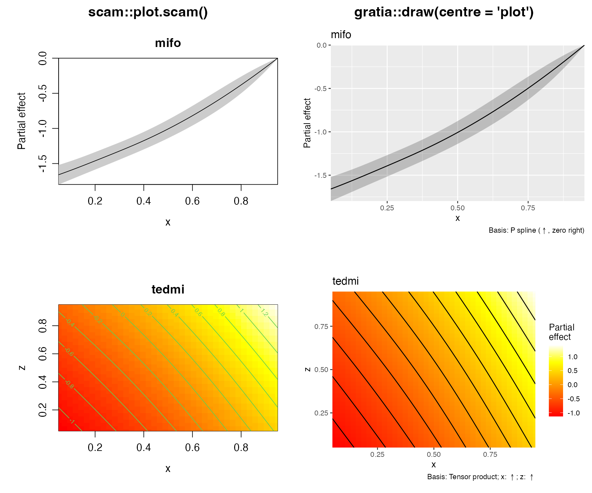
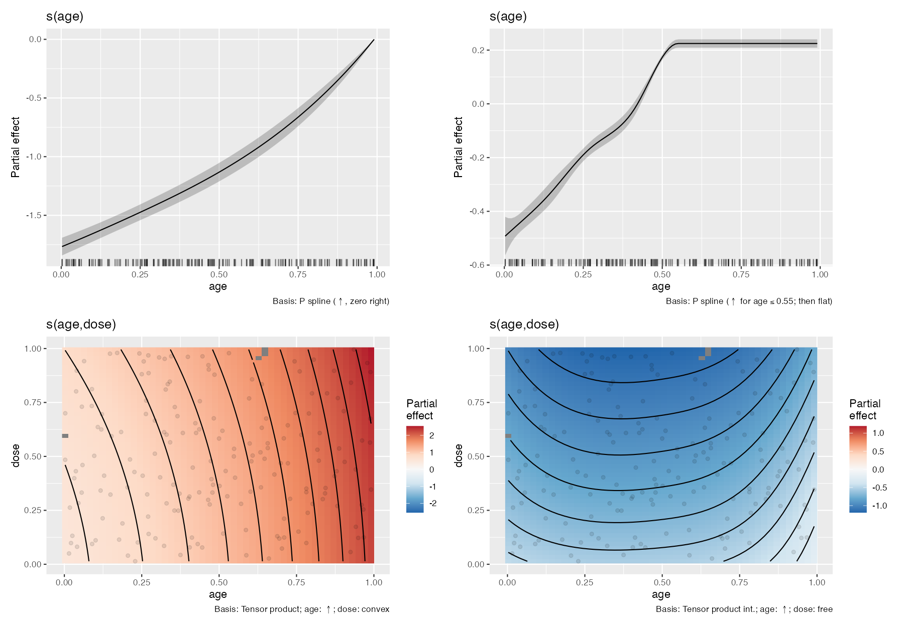

# SCAM support implementation

Implemented on `gls/scam-support`, created explicitly from `main` at
`d433ecdc5554a35accbb73f91f5a54f23b33038f`, using scam 1.2-22 and mgcv 1.9-4.
The [original audit](audit.md) records the earlier baseline and remains the
source of the original failure evidence.

## Fitted functions and plots

A shared adapter aligns every smooth's prediction matrix with the transformed
coefficients returned by `coef()`. It removes fixed-zero basis columns or
applies the fitted `Zc` constraints as required. The original unrestricted
coefficients and covariance remain intact for native summaries and sampling.
All 41 constructors now have smooth descriptions, estimates, basis extraction,
sampled contributions and plots. This includes `mifo`, all 17 bivariate types,
cyclic margins, interactions, explicit `By` constructors and matrix-valued
functional terms.

The same matrices are used for full-model predictions, smooth estimates,
analytic derivatives, contrasts and sampling. Formula expressions retain
fitted prediction parameters, including `scale()`. Missing rows, one-row and
empty evaluations, formula offsets and fitting offsets are handled explicitly.
This also avoids native scam failures for short-grid `lipl` evaluations and
some bivariate term standard errors.

`draw()` and `assemble()` default to `centre = "model"`, retaining the fitted
function when the evaluation grid changes. With `centre = "plot"`, bivariate
functions receive scam's evaluation-grid centring; covariance receives the
same linear transformation. Univariate functions retain fitted centring.
Tests compare all 41 plotted functions with the native plotting method on
matched grids. Separate coefficient-gradient checks assess uncertainty for
the function actually displayed, since native scam sometimes uses different
centring for its standard errors.

The [comparison script](implementation-plot-comparison.R) fits fresh models
and calls both actual plotting methods. The `mifo` functions agree exactly;
the `tedmi` surfaces differ by at most `6.7e-16`. The univariate standard errors
differ by at most `1.4e-17`. This comparison matches grids, interval multipliers,
axis and colour limits, and exclusion distance. Plot captions retain the
established basis labels.

## Sampling and response dependence

Default SCAM coefficient draws now use a Gaussian approximation in
unrestricted fitting coordinates and apply the fitted exponential or `notExp`
transformation. This preserves the fitted coefficient constraints. It differs
from analytic uncertainty calculations, which use the transformed-coordinate
`Vp.t` or `Ve.t` covariance. The nonlinear samples need not reproduce the
mean or covariance of that local Gaussian approximation.

Positive semidefinite covariance matrices are supported by eigen
decomposition. Material negative eigenvalues, non-finite matrices and
transformation overflow produce explicit errors. Very weakly identified fits
can have such large unrestricted variance that exponential draws overflow;
no clipping is applied. User-supplied draws must already be finite transformed
coefficients, in fitted coefficient order, with nonnegative constrained
coefficients. Unrestricted draws are available for inspection. Raw covariance
selection does not depend on the order in which scam and gratia are loaded.

Gaussian identity-link AR1 response simulation now uses fitted correlation,
weights and `AR.start` series boundaries, including after missing observations
are removed. Correlated new-data response simulation is rejected because the
fit does not define a joint correlation structure for arbitrary new data.
Other working-AR1 families do not acquire a joint response distribution merely
by using scam's fitting correction.

## GAM operations and limits

Added explicit methods for summaries, term and coefficient extraction,
parametric effects, model matrices, derivatives, accumulated local effects,
conditional predictions and contrasts, residual helpers, concurvity, penalties,
variance-component ratios and posterior checks. Conditional simultaneous smooth
bands and fitted-value intervals are supported. Independent-response likelihoods,
LOO and WAIC use the supported family adapters and the coefficient approximation
selected for sampling. Scalable posterior predictive plots are supported.

GCV and UBRE fits do not supply smoothing-parameter covariance. Unconditional
uncertainty, unconditional EDF and likelihood-based variance-component limits
remain unavailable. `model_edf()` retains the shared fallback convention:
when requested unconditional EDF are unavailable, it warns and returns standard
EDF. Penalties and scale-to-smoothing-parameter ratios describe unrestricted
fitting parameters. They do not imply Gaussian random effects for transformed
smooth coefficients.

MH and INLA coefficient sampling remain unavailable. Automatic
`interval_method = "shape"` integration remains specific to supported scasm
smooths. The independent `shape_intervals()` utility accepts supplied estimates
and grids when its named function restrictions apply. Analytic interval
endpoints do not automatically inherit the fitted shape.

The [support article](../../vignettes/articles/scam-support.Rmd) provides
executable examples and explains the uncertainty calculations.

## Validation

All tests and package checks ran outside the sandbox. The complete suite was
run, including the paper examples and plotting tests. Its original process
reported three errors because parallel workers loaded the older system
installation of gratia, one obsolete assertion that SCAM simultaneous intervals
were unsupported, and 15 input-validation assertions added after that process
had loaded the earlier sampler code. The assertion was updated. Every affected
failure was checked again against the current package installed during
checking; the complete SCAM selection passed against that build. The initial full-suite
log and separate rerun records are retained under `results/implementation-*`.

The final package was built with vignettes and checked with
`R CMD check --no-manual --no-tests`: **Status: OK**, with no errors, warnings
or notes. `--no-tests` avoided repeating the separately executed suite;
`--no-manual` skipped PDF reference-manual generation. Examples and vignette
building and rebuilding were checked. The new article was executed separately
because `vignettes/articles` is excluded from the package tarball. pkgdown's
article and reference index checks reported no problems. Pandoc emitted
warnings about deprecated math-rendering flags used by rmarkdown/pkgdown;
the article rendered successfully.

The numerical tests compare fitted contributions and both covariance choices
on short and reordered grids, native displayed functions, and independent
coefficient gradients. They also check transformed sampling, covariance
validation, AR1 dependence, missing rows, formula transformations, offsets,
conditional intervals, derivatives and likelihood calculations. These checks
validate the implemented quantities; they do not establish repeated-sample
coverage of the inference approximations.

A repeated run of the whole `mcmc-chains` file subsequently stalled in the
unchanged test for private mirai worker cleanup, after its serial/parallel
comparison had passed. Native stack inspection showed `nanonext` waiting in
`rnng_dispatcher_stop` / `nng_close`, with no R worker processes remaining.
The idle rerun was terminated. This cleanup case and the remaining cases had
passed in the initial full-suite run; the originally failing serial/parallel
comparison was also rerun separately. The interrupted rerun is retained
explicitly as such, rather than recorded as a passing whole-file run.

The isolated serial/parallel comparison completed against the final checked
installation with all 13 assertions passing, no warnings and exit status zero.
Its raw redirected log is
`results/implementation-mcmc-parallel-rerun.log`; the native shutdown stack is
saved in `results/implementation-mirai-shutdown.sample`.

## Short smooth types

Following review, SCAM `smooth_type()` labels now use the approved compact
forms, including `P spline (inc)`, `Tensor (inc, free)` and
`Tensor int. (inc, free)`. The plotting code recognises the renamed types.
The smooth-type tests and computation and plot comparisons for all 41
constructors pass after this change. The default univariate example was
rendered again and its caption inspected. This label update was validated
with those focused tests; the package check above preceded this update.

## Basis and constraint captions

SCAM captions now use the approved basis and constraint descriptions, with
portable plotmath arrows for increasing and decreasing constraints.
`smooth_type()` and `.type` retain their compact ASCII labels. Tensor captions
name the covariates without repeating P spline; interactions use
`Tensor product int.`. Endpoint descriptions use `zero left` and `zero right`.
Local descriptions use the fitted change point and `then flat` where relevant.
A cyclic unconstrained margin is described as `free (cyclic)`.

Caption information is stored separately from inference metadata and is
preserved through direct plots, saved or nested smooth estimates, smooth
selection and grouped factor-by plots. The new caption test file passes 67
assertions, covering all 41 constructors, expressions and literal covariate
names, smooth IDs, change points, caption suppression and rendering. Existing
SCAM computation and plot tests, SCASM caption tests, smooth-type tests and
shared draw and subsetting tests also pass. Representative caption plots were
rendered and inspected, and the native comparison figure was refreshed.

The package was built with vignettes and checked again after this update:
`R CMD check --no-manual --no-tests` reported **Status: OK**, with no errors,
warnings or notes. Tests ran separately; `--no-tests` skipped their duplicate
execution, and `--no-manual` skipped the PDF reference manual. Examples and
vignette building and rebuilding passed. The SCAM article was executed
separately because articles are excluded from the package tarball. The
caption-test and check logs are retained under `results/implementation-caption-*`.

## Combined review before committing

The final review added rendering aliases for all 16 previous univariate SCAM
type strings. Serialized estimates created before the short-label change still
render; newly computed estimates retain the approved short types. The complete
smooth-coverage file passes with those compatibility cases.

Reproducible scripts, numerical CSV summaries and example figures are committed.
Generated test logs, package-check logs, model caches and native stack samples
are local validation artifacts excluded from Git. The final installed-package
test run uses the repository runner with `NOT_CRAN=false`, which installs the
current source and tests together and propagates its temporary library to
workers.
