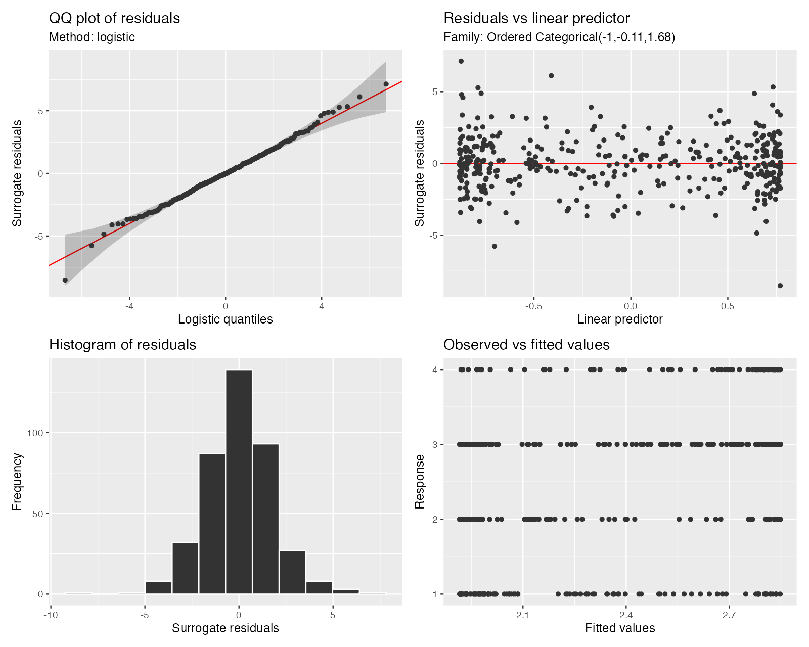

Surrogate residuals for `ocat()` models are implemented through
`surrogate_residuals()` and `type = "surrogate"` in the diagnostic plots,
including their scalable versions. QQ and worm plots use the matching logistic
reference. Each appraisal shares one residual draw across panels, and no
additional package is required.

```r
library("mgcv")
library("gratia")

set.seed(359)
dat <- data.frame(x = runif(400, -2, 2))
latent <- sin(dat$x) + rlogis(nrow(dat))
dat$y <- findInterval(latent, c(-1, 0, 2)) + 1L
fit <- gam(y ~ s(x), data = dat, family = ocat(R = 4), method = "REML")

head(surrogate_residuals(fit, seed = 42))
appraise(fit, type = "surrogate", seed = 42)
```


